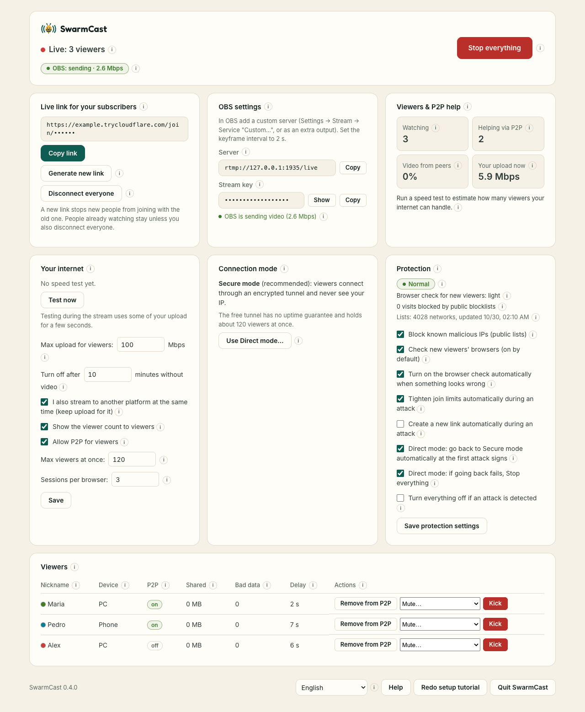

# SwarmCast

Stream a members-only live straight from your own computer, through a secret link. Your members watch in any browser, with no app and no account, and help each other through optional P2P. Free, private (no telemetry) and open source, for Windows, macOS and Linux, in English and Brazilian Portuguese.

**Guide, download and help: <https://lucas-angelo.github.io/swarmcast/>** (em português: <https://lucas-angelo.github.io/swarmcast/pt-br/>)

## Download

Get the installer for your system from the [latest release](https://github.com/Lucas-Angelo/swarmcast/releases/latest), then follow the install guide for [Windows](https://lucas-angelo.github.io/swarmcast/install/windows/), [macOS](https://lucas-angelo.github.io/swarmcast/install/macos/) or [Linux](https://lucas-angelo.github.io/swarmcast/install/linux/). Got a link from a streamer? See [For viewers](https://lucas-angelo.github.io/swarmcast/viewers/).

## For developers

- [docs/DEVELOPMENT.md](docs/DEVELOPMENT.md): build, test, configuration, version policy, releases and the website.
- [docs/](docs/README.md): architecture, threat model, security research, quality, desktop app and the maintainer guide.
- [SECURITY.md](SECURITY.md): reporting a vulnerability.

## License

[MIT](LICENSE). Bundled third-party software (MediaMTX: MIT, cloudflared: Apache-2.0, Node.js and npm dependencies) is listed in `THIRD_PARTY_LICENSES.txt` inside each release package.
