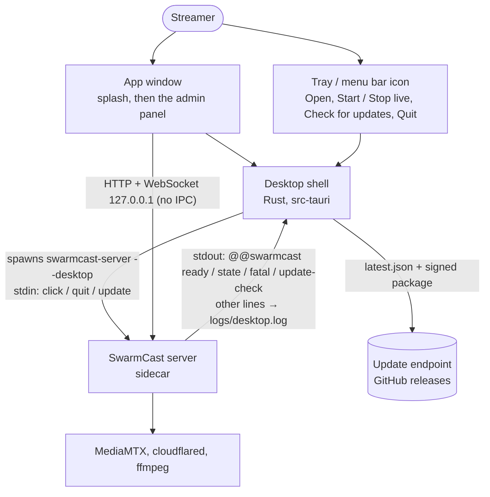

# @swarmcast/desktop

The SwarmCast desktop app ([Tauri 2](https://v2.tauri.app/)): installer, app window, tray / menu bar icon and one-click updates around the same server the start scripts run. Design and the shell ↔ server contract: [docs/DESKTOP.md](../../docs/DESKTOP.md).



- `src-tauri/src/`
  - `main.rs`: plugins (single instance first), setup, macOS app menu, signals, run loop.
  - `shell.rs`: the state machine: server start / bounded restarts / fatal, splash, close dialog, quit.
  - `sidecar.rs`: spawns the server (env of the contract, Windows Job object + no console), reads stdout/stderr, quit with 35 s grace then kill.
  - `protocol.rs`: `@@swarmcast` messages (unit-tested); `window.rs`: window, navigation policy (only the admin origin stays inside), WebView2 `--lang`.
  - `tray.rs`, `updater.rs` (endpoint `UPDATE_ENDPOINT`, checks, dialog, download with retries, relaunch), `i18n.rs` (EN / pt-BR, test: same keys), `logs.rs` (data dir like the server, `desktop.log` rotation).
- `splash/`: local page shown while the server starts, on errors and during updates (the only page with IPC). Colors, radius and font come only from the brand tokens: `src-tauri/build.rs` copies `assets/brand/tokens.css` to `splash/tokens.css` (not committed) at every build. `splash/tokens.stub.css` (same names, Forest & Cream values) is only a fallback for a checkout without `assets/brand/`.
- `src-tauri/windows/hooks.nsh`: NSIS hooks (install folder, stop processes, `--cleanup`, autostart entry, "delete app data"). `Info.plist`: macOS localizations (en, pt-BR) so `navigator.language` follows the system.
- `src-tauri/icons/`: app icons and tray icons, all made by `icons.mjs` (see "Icons").
- `test/mock-server.mjs`: a fake `swarmcast-server --desktop` (modes: ok, crash, fatal, no-ready, ignore quit, self-test of links / language / IPC). `test/dev.mjs`: debug run with the mock.

## Build

Needs Node 24, Rust (stable, `rustup target add <triple>`) and the [Tauri prerequisites](https://v2.tauri.app/start/prerequisites/) of the OS. Each OS builds its own installers:

```sh
npm ci && npm run build
node scripts/build/package.mjs --target <target> --version <v> --no-archive   # release/staging/<target>
node scripts/build/desktop.mjs --target <target> --version <v>                # release/desktop/<target>
```

| Target | Build on | Result |
|---|---|---|
| `windows-x64` | Windows (MSVC Build Tools) | `SwarmCast_<v>_x64-setup.exe` (+ `.sig`) |
| `macos-arm64`, `macos-x64` | a Mac (both from either: `rustup target add aarch64-apple-darwin x86_64-apple-darwin`) | `.dmg`, `SwarmCast_<v>_<arch>.app.tar.gz` (+ `.sig`) |
| `linux-x64`, `linux-arm64` | Linux of that architecture (`libwebkit2gtk-4.1-dev libayatana-appindicator3-dev librsvg2-dev patchelf`) | `.deb`, `.AppImage` (+ `.sig`) |

Toolchain per CI runner (everything is non-interactive; `tauri build` runs with `--ci`):

- **Windows** (`windows-latest`): Node 24, Rust stable (`x86_64-pc-windows-msvc`, preinstalled with the MSVC Build Tools). The Tauri CLI downloads NSIS and the WebView2 bootstrapper itself. Use a short checkout path if a path is too long.
- **macOS** (`macos-latest`, arm64): Node 24, Rust stable + `rustup target add x86_64-apple-darwin` for `macos-x64`, Xcode command line tools (preinstalled; `codesign` signs ad hoc). The DMG step (`bundle_dmg.sh`) lays out the window through Finder/AppleScript; if it times out on a runner, retry the job.
- **Linux** (`ubuntu-22.04` for x64, `ubuntu-22.04-arm` for arm64; the deb is built against the oldest glibc we support): Node 24, Rust stable and
  `sudo apt-get install -y build-essential pkg-config libwebkit2gtk-4.1-dev libayatana-appindicator3-dev librsvg2-dev patchelf libssl-dev file xz-utils`.
  `desktop.mjs` sets `APPIMAGE_EXTRACT_AND_RUN=1` (no FUSE on runners). AppImages are built for the runner's architecture only.
- **Windows installer from Linux** (optional, unsigned exe): `apt-get install nsis lld llvm clang libayatana-appindicator3-dev`, `rustup target add x86_64-pc-windows-msvc`, `cargo install --locked cargo-xwin`, `XWIN_ACCEPT_LICENSE=1`, then `desktop.mjs --target windows-x64 --runner cargo-xwin`.
- All: the signing secrets `TAURI_SIGNING_PRIVATE_KEY` / `TAURI_SIGNING_PRIVATE_KEY_PASSWORD` in the environment (otherwise the build has no `.sig` files and prints a warning).

`desktop.mjs` copies the staged server as the sidecar (`swarmcast-server-<rust triple>`) and MediaMTX, cloudflared, `web/`, licenses as resources (not the Go tray helper), then runs `tauri build` with a config overlay (version, sidecar, resources), so `cargo build` / `cargo test` work without a staged package. Options: `--package` (run `package.mjs` first), `--sidecar mock` (bundle the mock server), `--insecure-updates` (accept `http://` update URLs: local tests only, never publish such a build).

Updater signing: `TAURI_SIGNING_PRIVATE_KEY` and `TAURI_SIGNING_PRIVATE_KEY_PASSWORD` (CI secrets), or locally `~/.tauri/swarmcast-updater.key` + `~/.tauri/swarmcast-updater.password`. Never commit them; only the public key is in `tauri.conf.json`. A new key pair: `npx tauri signer generate -w ~/.tauri/swarmcast-updater.key` (then replace `plugins.updater.pubkey`; apps signed with the old key can no longer update).

Release manifest, after building every target:

```sh
node scripts/build/updater-manifest.mjs --version <v> --notes-file notes.md \
  --base-url https://github.com/Lucas-Angelo/swarmcast/releases/download/v<v> release/desktop/*
```

## Icons

One command regenerates every icon (app window, Dock / taskbar, `icon.icns` for the .app and the DMG, `icon.ico` for the NSIS installer and uninstaller, Linux PNGs) and copies the tray icons:

```sh
node apps/desktop/icons.mjs            # or: npm run desktop:icons
```

- App icon source: `assets/brand/icon/app-icon-1024.png` (the full-bleed square app icon of the brand, [assets/brand/README.md](../../assets/brand/README.md)). Under the hood: `npx tauri icon <source> -o apps/desktop/src-tauri/icons`, minus the mobile / Store sizes. The small sizes of the Windows `.ico` (16–48 px) and `32x32.png` come from the hand-tuned `assets/brand/icon/sizes/`, since a plain downscale blurs. Without the brand files (a fork), `src-tauri/icons/gen.mjs` draws a placeholder.
- Tray icons: `assets/brand/tray/tray-{off,waiting,live}-32.png` (shown at 16 pt in the macOS menu bar), else `apps/tray/icons/*.png`, copied to `src-tauri/icons/tray/`.
- The installers have no other images: NSIS uses `icon.ico`, the DMG the app icon.

Commit the generated files.

## Develop and test

- `npm run desktop:test`: unit tests (protocol, i18n completeness, navigation policy, data dir, log rotation, tooltips).
- `npm run desktop:dev`: debug build with the mock server and a throwaway data folder (`.cache/desktop-dev`). `MOCK_*` variables pick the mock's behaviour (see `test/mock-server.mjs`); `SWARMCAST_LOCALE=pt-BR` forces the language; `SWARMCAST_NO_OPEN=1` logs external links instead of opening them; `SWARMCAST_UPDATE_URL` points the updater elsewhere. Debug builds also accept `SWARMCAST_SIDECAR=<path>` (any executable speaking the protocol).
- Local update test: build two versions with `--insecure-updates`, serve the newer `.app.tar.gz` / `.exe` / `.AppImage`, its `.sig` and a `latest.json` (from `updater-manifest.mjs`) over http, start the older one with `SWARMCAST_UPDATE_URL=http://127.0.0.1:<port>/latest.json` and a temporary `SWARMCAST_DATA_DIR`.
