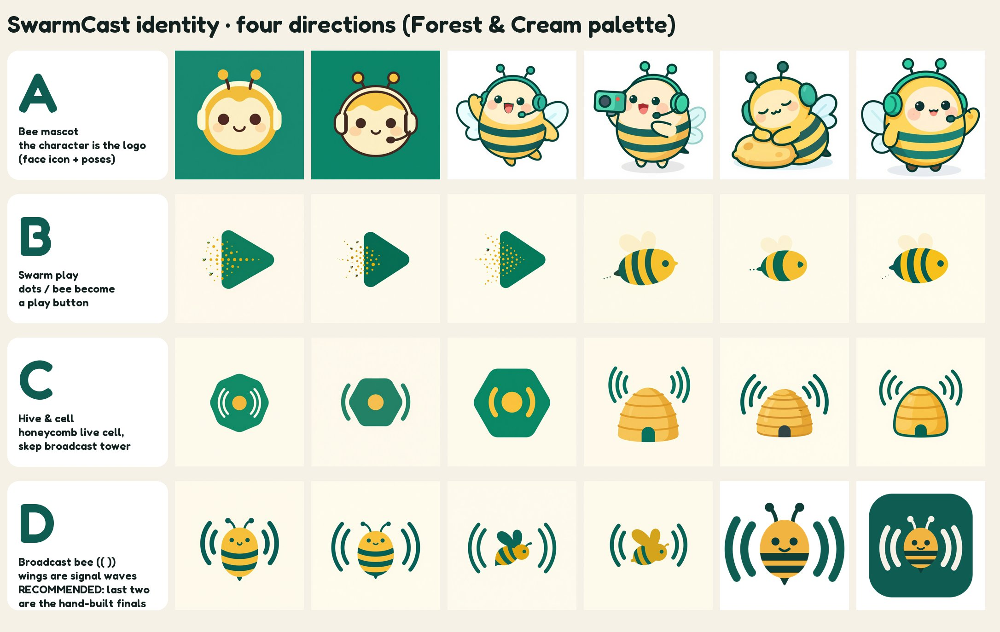

# SwarmCast brand

The visual identity of SwarmCast: symbol, wordmark, app icon, tray icons, favicon, mascot and design
tokens. **Forest & Cream** is the chosen palette: the panel, the viewer pages, the desktop app, the
website and the offline guide all use it (see [How the apps use it](#how-the-apps-use-it)).



## Concept: the broadcasting bee  (( 🐝 ))

The symbol is a small round bee whose wings are drawn as **broadcast waves**. It packs the whole
product into one mark:

- **Swarm**: viewers' browsers work together like bees, sharing the video with each other.
- **Cast**: the waves are the universal "on air / transmitting" sign.
- **Friendly and trustworthy**: a smiling, rounded character on calm forest green and warm cream. It
  is not corporate and not "hacker".

At 16 px it still reads as `(●)`, the familiar broadcast glyph, so it works as a tray and tab icon.
The **mascot** is the same bee drawn as a full character, with a headset and a camera, for onboarding,
the splash screen and the README.

Kept apart from other brands on purpose:

- No purple, no speech bubble and no glitch effect (Twitch).
- No yellow field and no hexagon (Bumble).
- No red play button (YouTube).
- No three-blob circle (OBS), no blurple or controller face (Discord), no coral dot (Patreon).

The `(( ))` waves on their own are a generic icon. The bee in the middle is what makes the mark
ownable. Run a trademark search (INPI/BR, USPTO, EUIPO) before you register it.

### The four directions (explorations/)

| | Direction | Verdict |
|---|---|---|
| **A** | Bee mascot: the character is the logo (face icon plus poses) | Very charming, but too detailed for 16 px. **Kept as the mascot.** |
| **B** | Swarm play: dots or a bee turn into a play triangle | The dot-dispersal play is a stock-logo cliché, and play buttons lean towards YouTube. Dropped. |
| **C** | Hive and cell: honeycomb live cell, or a skep (beehive) broadcast tower | The hexagon reads as "generic tech" or Bumble. The skep is nice but busy when small. Dropped. |
| **D** | **Broadcast bee (( ))**: the wings are signal waves | **Recommended.** It is the simplest, the most ownable, and it works at every size. The final mark is hand-built, inspired by D1. |

Sheets:

- `explorations/overview-ABCD.jpg`: the overall sheet, one row per direction. The last two images in
  row D are the hand-built finals.
- `A-bee-mascot.jpg`, `A-mascot-palettes.jpg`, `B-swarm-play.jpg`, `C-hive-cell.jpg`,
  `D-broadcast-bee.jpg`: every seed of each direction.

Round 1 was generated in the old purple UI colour. The user rejected purple, so those images are not
kept; their prompts are still in `tools/prompts/round1.json`.

## Palette: Forest & Cream (chosen)

| Token | Light | Dark | Use |
|---|---|---|---|
| accent (primary) | `#0F5C53` pine | `#3DB5A2` | Buttons, links, the symbol's waves. White text on it: 7.7:1 |
| accent-strong | `#0A4740` | `#7DD8C8` | Accent-coloured text |
| accent-soft | `#E2EAE4` | `#1B3F39` | Tint behind icons and selected rows |
| secondary (honey) | `#F2B441` | `#F2B441` | Highlights, the bee's body. Ink text on it: 9.0:1 |
| ink | `#12211F` | `#EEF3EE` | Headings |
| text | `#2D3A37` | `#D3D9D4` | Body text (ink 88% into bg), 10.5:1 |
| muted | `#58665F` | `#9CB0A9` | Secondary text (5.9:1 on surface) |
| bg | `#F6F1E6` cream | `#0C1716` | Page |
| surface / surface-2 | `#FFFDF8` / `#EEE7D7` | `#13221F` / `#1A2D29` | Cards / wells |
| border / border-strong | `#E1D9C7` / `#8D9390` | `#26403A` / `#626D6A` | Hairlines / inputs (3:1) |
| success | `#3B7A2A` | `#7BC86A` | OK states (5.2:1) |
| warning | `#A15C00` | `#F2B441` | Warnings (5.1:1) |
| live | `#D63A2F` | `#FF5A4E` | LIVE badge, white text 4.7:1 |
| danger | `#B9302A` | `#FF7A70` | Destructive actions (5.9:1) |
| on-danger | `#FFFFFF` | `#0C1716` | Text and icons on a danger fill (5.9:1 / 7.2:1) |
| focus | `#9A6200` | `#F2B441` | Focus ring (4.5:1 on bg) |

The single source of truth is **`tokens.json`** and **`tokens.css`** (`--sc-*` custom properties,
light and dark, `prefers-color-scheme` plus `data-theme="light|dark"`). Both files are generated by
`tools/palettes.py`, so edit that file, not the outputs. `tokens.json` also records every contrast
ratio.

Two other palettes, **Honey & Ink** and **On Air** (signal vermilion), were proposed. They remain as
non-default options (`<html data-palette="honey|onair">`). Their sheets are in `palettes/`, next to
`palettes/palette-2-forest.png`.

Illustration colours (symbol and mascot): honey `#F2B441`, pine `#0F5C53`, pine-deep `#0F3D38`
(stripes, eyes), cream `#F6F1E6` (waves on pine or dark backgrounds).

## How the apps use it

Everything reads the generated files above; nothing copies a colour by hand. To change the brand,
edit `tools/palettes.py` (or the art), regenerate (see [Regenerate](#regenerate)), then run the
consumers' own steps below and commit the results.

| Consumer | Tokens | Images |
|---|---|---|
| Panel and viewer pages (`apps/admin`, `apps/viewer`) | [`packages/shared/web/brand.css`](../../packages/shared/web/brand.css) imports `tokens.css`; each app's `style.css` imports `brand.css` first and uses only `--sc-*` tokens (plus the few derived values `brand.css` builds from them). Vite bundles it all into `/assets`, so the strict CSP needs nothing but `'self'` | `brand.css` sets the symbol (`symbol/swarmcast-symbol.svg`, `-on-dark.svg` in the dark theme) and the mascot (256 px WebP copies in `packages/shared/web/img/`); the HTML pages link `favicon/favicon.svg`. Details: [packages/shared/README.md](../../packages/shared/README.md) |
| Desktop app (`apps/desktop`) | The splash page: `src-tauri/build.rs` copies `tokens.css` next to it at every build | [`apps/desktop/icons.mjs`](../../apps/desktop/icons.mjs) (`npm run desktop:icons`) makes every app icon from `icon/app-icon-1024.png` (small `.ico` sizes from `icon/sizes/`) and copies `tray/tray-{off,waiting,live}-32.png`. The window shows the panel, so it follows the panel |
| Website (`site/`) | `site/src/styles/tokens.css` imports `tokens.css`; `starlight.css` maps Starlight onto it; `site/src/tokens.mjs` reads literal values at build time (theme colour, contrast test) | [`site/src/brand.mjs`](../../site/src/brand.mjs) names the files used from this folder (symbol light/dark, mascot); `site/public/favicon.svg` is a copy of `favicon/favicon.svg`. Fredoka is subset into `site/src/fonts/` |
| Offline guide (installer zips) | `scripts/build/guide-html.mjs` reads the light and dark values from `tokens.css` | — |

The script-mode tray helper (`apps/tray`) uses copies of `tray/tray-{off,waiting,live}-32.png` and
`tray/tray-<state>.ico` in `apps/tray/icons/` (byte-identical today); re-copy them when the tray icons
change. The desktop app copies the same PNGs with `npm run desktop:icons`.

## Type

- **Fredoka** (Milena Brandão and Hafontia, SIL Open Font License 1.1) is used for display only: the
  wordmark, small headings, big numbers. The files are in `font/`: the variable font
  `Fredoka-VF.ttf` (wght 300–700, wdth 75–125) and a static `Fredoka-SemiBold.ttf` instance made with
  `fonttools varLib.instancer`. The licence is `font/OFL.txt`. Source:
  [google/fonts ofl/fredoka](https://github.com/google/fonts/tree/main/ofl/fredoka).
- **Inter** (SIL OFL 1.1, self-hosted by the site and the panel) is used for body text, large
  headlines and UI. The tokens are `--sc-font-text`, `--sc-font-ui` (system fallback) and
  `--sc-font-mono`.
- In all SVGs the wordmark is **outlined**: the glyphs are converted to paths with HarfBuzz shaping and
  kerning (`tools/textpath.py`), so no font needs to be installed.

## Files

| Path | What |
|---|---|
| `symbol/swarmcast-symbol.svg` | The symbol on light backgrounds (plus a `-1024.png`) |
| `symbol/swarmcast-symbol-on-dark.svg` | On dark backgrounds: light-teal waves, cream antennae |
| `symbol/swarmcast-symbol-small.svg` | Simplified (no antennae or smile, heavier strokes) for 24–48 px |
| `symbol/swarmcast-symbol-mono.svg`, `-mono-white.svg` | One colour, with the stripes and eyes knocked out |
| `wordmark/swarmcast-lockup-{light,dark,mono}.svg/.png` | Horizontal lockup (transparent; `-preview.png` shows it on its background) |
| `wordmark/swarmcast-wordtype.svg` | "SwarmCast" without the symbol |
| `icon/app-icon-1024.png` (+ `.svg`) | **Full-bleed square app icon**: the source for `tauri icon` |
| `icon/app-icon-macos-1024.png` (+ `.svg`) | macOS-style rounded square (824 px body, 100 px margin, r = 185) |
| `icon/sizes/app-icon-{16…1024}.png` | Hand-tuned size set: 16 px uses the one-wave *micro* glyph, 24–48 px the *small* glyph, 64 px and up the full symbol. Use them to override what `tauri icon` derives for the small sizes |
| `icon/preview-sizes.png` | 16/24/32/48/64 px at actual size and zoomed 4× |
| `tray/trayTemplate.png`, `@2x`, `@4x` (+ `.svg`) | macOS menu-bar template (black and alpha only; AppKit tints it) |
| `tray/tray-{off,waiting,live}-{16,32,64}.png`, `.ico`, `.svg` | Windows/Linux tray states: off `#8A948F`, waiting honey `#F2B441`, live `#D63A2F` |
| `tray/preview-16-32px-zoomed.png` | Tray icons on light and dark bars |
| `favicon/favicon.svg` | SVG favicon; the waves switch to light teal under `prefers-color-scheme: dark` |
| `favicon/favicon-{16,32,48,180,192,512}.png`, `favicon.ico`, `apple-touch-icon.png` | PNG/ICO favicons (on a pine tile so they read on any tab bar) |
| `mascot/mascot-hello.png` | Mascot waving hello (onboarding, README hero). 1024², transparent |
| `mascot/mascot-live.png` | Mascot filming, with the red record light (live/broadcasting) |
| `mascot/mascot-sleep.png` | Mascot asleep on a honey pillow (offline / nothing running) |
| `palettes/palette-{1-honey,2-forest,3-onair}.png` | The palette option sheets |
| `tokens.json`, `tokens.css` | Design tokens |
| `tools/` | Everything needed to regenerate (see below) |

## How it was made

### Image model

| | |
|---|---|
| Runner | [mflux](https://github.com/filipstrand/mflux) **0.23.0** (MIT), MLX 0.32.4, Python 3.13, on an Apple M5 Max, 48 GB |
| Main model | **Z-Image-Turbo** (Tongyi-MAI, 6B), the q8 MLX conversion [`mflux-community/z-image-turbo-mflux-q8`](https://huggingface.co/mflux-community/z-image-turbo-mflux-q8) of [`Tongyi-MAI/Z-Image-Turbo`](https://huggingface.co/Tongyi-MAI/Z-Image-Turbo) |
| Licence | **Apache-2.0** (model card metadata of both repos). Not gated: downloads without an account. Apache-2.0 places no restriction on generated images, so commercial use and use as an open-source logo are fine |
| Also evaluated | **Qwen-Image-2512** (20B, Apache-2.0, not gated) via [`mflux-community/qwen-image-2512-mflux-q8`](https://huggingface.co/mflux-community/qwen-image-2512-mflux-q8). It works, but it took ~8.4 s/step (≈3.5 min per 1024² image) on a GPU shared with other jobs, against ~20 s for Z-Image-Turbo. Z-Image-Turbo already gave clean flat vector results, so it was used for every direction. One Qwen test image was generated and not kept |
| Rejected (licence or gating) | **FLUX 3 Image Klein**: gated, FLUX Kommunity License with a revenue cap. **Qwen-Image 2.1**: Qwen *Research* License, non-commercial only. **Krea 2, FIBO, Ideogram 4, FLUX.2-klein-9B**: gated (and non-commercial or custom licences) |

The symbol, wordmark, icons, tray glyphs and favicons are **not** AI output. They are hand-built
geometry in `tools/symbol.py`, inspired by the D1 explorations. That keeps the paths clean and the
authorship clear. Only the mascot illustrations are model output.

### Settings

Z-Image-Turbo q8, 1024×1024, 9 steps, guidance 0 (Turbo has no CFG), `linear` scheduler (model
defaults), no LoRA. Seeds are fixed, so the same mflux version and checkpoint reproduce the images. All
prompts are in `tools/prompts/*.json`, and each raw image had a `.json` sidecar with its exact prompt
and seed.

### Final mascot prompts

All three share the same character description, so the bee stays the same across poses.

- **hello**: seed **303**, job `A8-hello` in `tools/prompts/round4_forest.json`
  > A cute friendly round bee mascot character flying and waving hello with a big welcoming smile. Chubby round body in warm golden honey amber with two deep pine green teal stripes, soft cream face, big shiny friendly eyes, rosy cheeks, two small rounded translucent white wings spread out, short antennae with round tips, wearing a tiny deep teal green headset with a microphone. Flat vector cartoon illustration, bold simple shapes, clean thick dark green outline, sticker style, few colors, full body, centered on a plain white background, no text.
- **live**: seed **303**, job `A6-live`
  > A cute friendly round bee mascot character for a live streaming app, broadcasting live and excited. Chubby round body in warm golden honey amber with two deep pine green teal stripes, soft cream face, big shiny friendly eyes, open happy smile, rosy cheeks, two small rounded translucent white wings, short antennae with round tips, wearing a tiny deep teal green headset with a microphone, holding a tiny retro video camera with a small glowing red recording light. Flat vector cartoon illustration, bold simple shapes, clean thick dark green outline, sticker style, few colors, full body, centered on a plain white background, no text.
- **sleep**: seed **11**, job `A7-sleep`
  > A cute friendly round bee mascot character sleeping peacefully, eyes closed with a calm little smile, curled up and resting on a small soft honeycomb pillow. Chubby round body in warm golden honey amber with two deep pine green teal stripes, soft cream face, rosy cheeks, two small rounded translucent white wings folded, short antennae with round tips drooping, a tiny deep teal green headset resting around its neck. Flat vector cartoon illustration, bold simple shapes, clean thick dark green outline, sticker style, few colors, full body, centered on a plain white background, no text, no letters.

The background is removed with `tools/matte.py`, a plain matte made for flat art on white. It keeps the
near-white region connected to the border, which also drops the soft ground shadow, then feathers the
edge by 1 px, trims, and centres the result on a 1024² canvas with a 6% margin. No ML model is needed.
`tools/cutout.py` (rembg + BiRefNet) is kept as an alternative, but it was not needed.

Exploration seeds were 11, 22, 33, 44, 55, 66 (round 1) and 202, 11, 66, 101, 303, 404 (later
rounds), six per prompt.

### Regenerate

```sh
# tools
brew install resvg
uv tool install --python 3.13 mflux==0.23.0 --with 'pillow<13'   # pillow 13.0.0 breaks mflux's import
uvx --from huggingface_hub hf download mflux-community/z-image-turbo-mflux-q8   # ~11 GB, default HF cache

# images (skips files that already exist; writes explorations/raw/<dir>/)
HF_HUB_OFFLINE=1 ~/.local/share/uv/tools/mflux/bin/python assets/brand/tools/generate.py \
    --model zimage assets/brand/tools/prompts/round4_forest.json
uv run --with pillow --with numpy --with scipy python assets/brand/tools/matte.py \
    assets/brand/explorations/raw/A/zimage_A8-hello_s303.png assets/brand/mascot/mascot-hello.png 1024

# symbol, icons, wordmark, tray, favicon (all from tools/symbol.py)
uv run --with pillow --with fonttools --with uharfbuzz python assets/brand/tools/build_finals.py

# tokens + palette sheets + contact sheets
python3 assets/brand/tools/palettes.py --tokens
uv run --with fonttools --with uharfbuzz python assets/brand/tools/palette_sheet.py forest assets/brand/mascot/mascot-hello.png assets/brand/palettes/palette-2-forest.png
uv run --with pillow python assets/brand/tools/contact_sheet.py picks assets/brand/tools/overview.json assets/brand/explorations/overview-ABCD.jpg
uv run --with pillow python assets/brand/tools/contact_sheet.py dir D "D · Broadcast bee" assets/brand/explorations/D-broadcast-bee.jpg --glob 'zimage_D*f_*'
```

The raw generations (`explorations/raw/`) are not committed: about 58 MB of PNGs that the prompts and
seeds above regenerate. The commit history of the branch before the final squash also had them.

## Usage notes

- Minimum size: the full symbol down to 48 px, the small symbol at 24–48 px, the micro/tray glyph at
  16 px. Clear space around the symbol is ½ of the body width.
- On pine or dark backgrounds, use the `on-dark` symbol, or cream waves as in the app icon. Never put
  the honey body on a honey field.
- Do not recolour the bee body or add a hexagon frame. Do not set the wordmark in another font.
- The mascot is for friendly moments (onboarding, empty and offline states, the splash screen, the
  README). Keep it out of error dialogs that need a serious tone.
