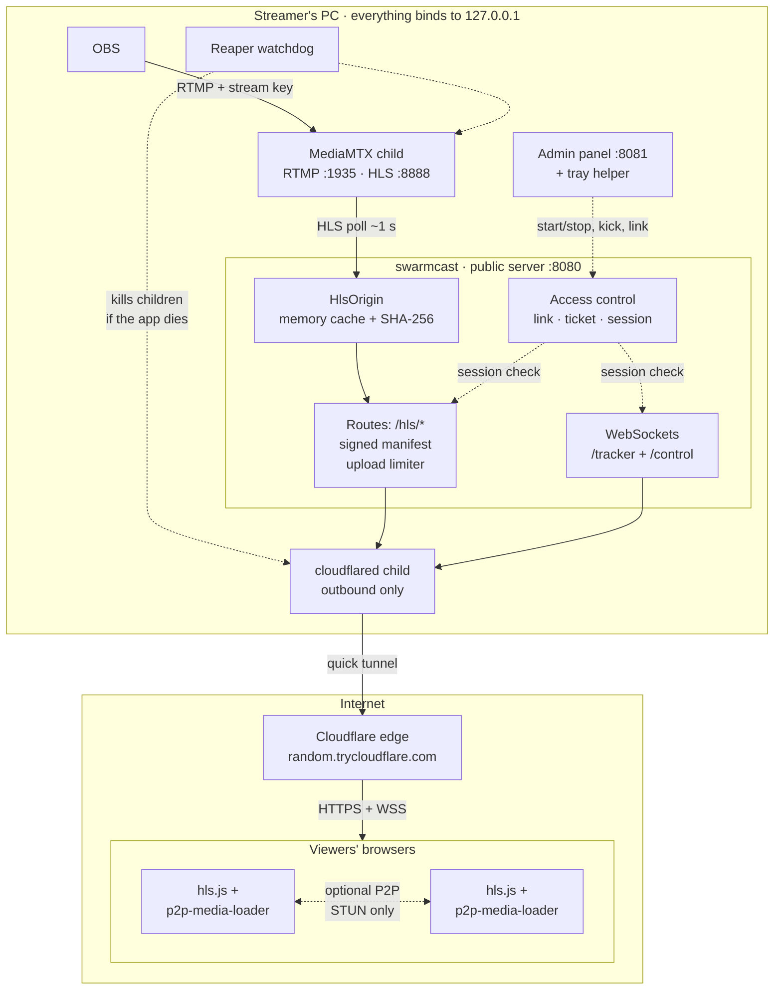
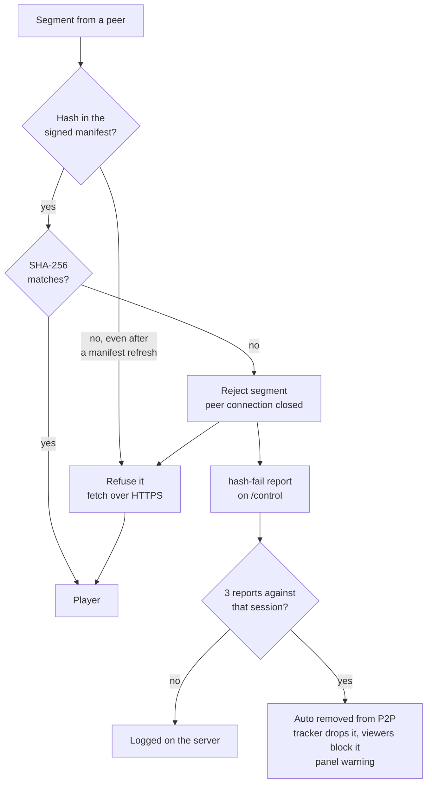
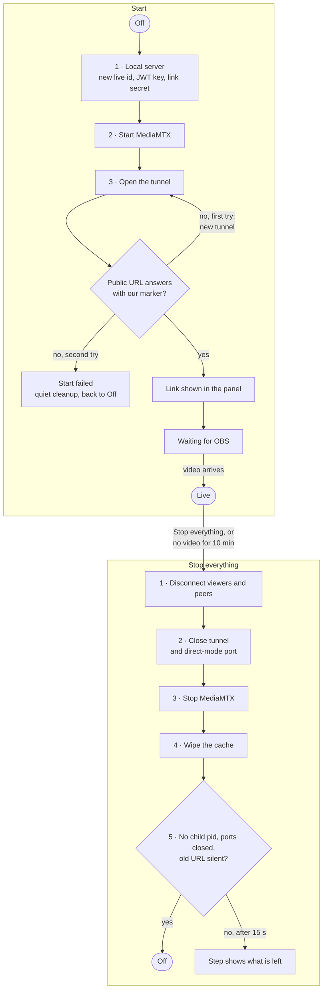
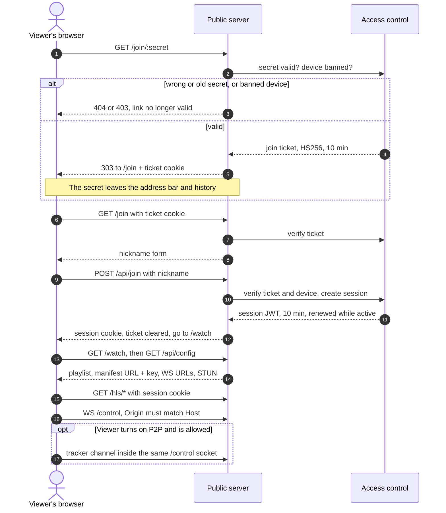
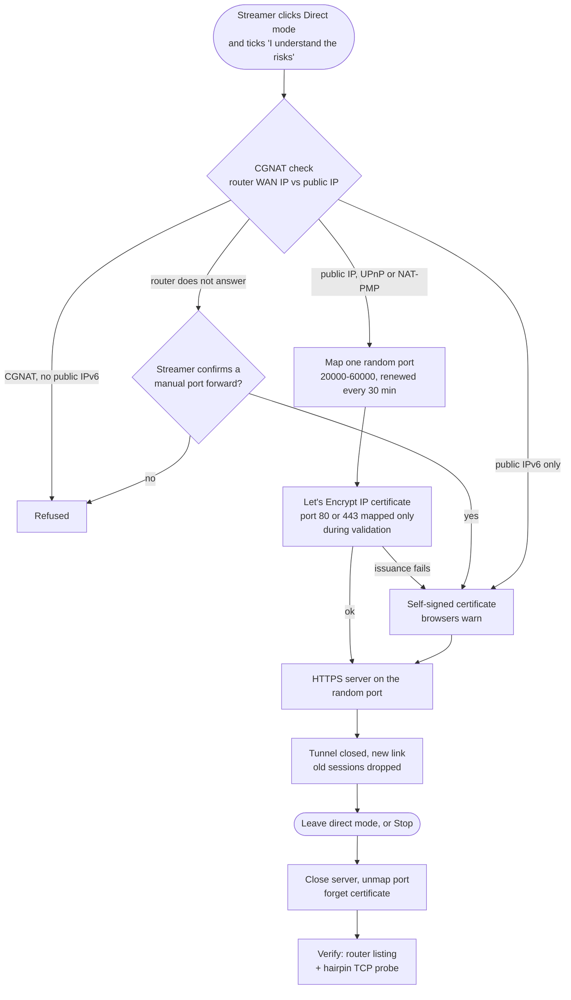

# Architecture

## Components

| Process | Listens on | Role |
|---------|-----------|------|
| `swarmcast` (Node 24, single executable) | 127.0.0.1:8080 (public server), 127.0.0.1:8081 (admin) | Everything below |
| MediaMTX (child) | 127.0.0.1:1935 (RTMP), 127.0.0.1:8888 (HLS) | Receives OBS and produces fMP4 HLS |
| cloudflared (child) | — (outbound only) | Quick tunnel `https://<random>.trycloudflare.com` → 127.0.0.1:8080 |
| `swarmcast --reaper <pid>` (child) | — | Watchdog: kills the other children if the app dies |
| `swarmcast-tray` (child, Go) | — | Tray / menu bar icon over stdin/stdout JSON lines |

Source map (`apps/server/src`):
- `main.ts` reads the flags and `app.ts` wires everything together; `core/live.ts` handles start/stop, steps, link and viewer control.
- `public/server.ts` is the viewer-facing server; `public/security.ts` builds its CSP. `http/` holds what it shares with the panel server: the security headers, the WebSocket Origin check and the resettable rate-limit store.
- `access/access.ts` holds links, tickets, sessions and kicks; `access/own-connection.ts` keeps P2P off for viewers on the streamer's own connection.
- `security/` holds the attack detector, the shield and its reactions, the proof-of-work browser check and the public blocklists; see [SECURITY_RESEARCH.md](SECURITY_RESEARCH.md).
- `hls/` contains the origin cache, playlists, signed manifest and upload limiter.
- `tracker/tracker.ts` and `control/control.ts` are the two WebSocket services.
- `chat/` is the chat: the hub (pipeline, ring, moderation), the batcher, buckets, the flood detector and the event-loop guard; see [CHAT.md](CHAT.md). The panel's chat API is `admin/chat-routes.ts`.
- `branding/` is "Your page": the store, the image validator, the viewer and panel routes and the link-preview page; see [BRANDING.md](BRANDING.md).
- `media/mediamtx.ts`, `tunnel/` and `process/children.ts` manage the child processes; `core/exec.ts` runs the OS's short-lived command-line tools (netsh, reg, tar…).
- `direct/` implements direct mode.
- `admin/server.ts` is the admin panel server.
- `quality/` holds the quality ladder (ffmpeg renditions), encoder probing and the adaptive upload cap; see [QUALITY.md](QUALITY.md). `speedtest/` measures the connection.
- `desktop/` is desktop mode (the stdio protocol, autostart, the first-run system check); see [DESKTOP.md](DESKTOP.md).
- `diagnostics/` keeps the logs for a limited time and writes the anonymised "Export logs" ZIP.
- `tray/tray.ts` drives the tray helper.

## Media path

1. OBS publishes to `rtmp://127.0.0.1:1935/live` with key `sc_…`. The generated MediaMTX config allows exactly one path, `live/<key>`, so publishing to any other path is rejected. Every protocol except RTMP ingest and local HLS is disabled, including `moq`, `rtsp`, `webrtc`, `srt`, `api`, `metrics`, `pprof` and `playback`.
2. MediaMTX remuxes the stream to standard fMP4 HLS (not LL-HLS) with a playlist sized to `PLAYLIST_WINDOW_S` (packages/shared: the furthest a player sits behind live, plus a margin; 20 × 2 s today). It cuts segments at the first keyframe after `hlsSegmentDuration: 1s`, so with OBS keyframes every 2 s each segment is 2 s long.
3. `HlsOrigin` polls MediaMTX about once a second. It passes MediaMTX's cookie check and `hlsSession` cookie, caches the segments in memory (about 60 s are kept) and hashes each one with SHA-256. It then rewrites the playlists so they list only segments that are already cached and hashed.
   - With quality options on (a GPU encoder, or chosen by hand), one ffmpeg process reads the stream from MediaMTX, copies the source and encodes 720p/480p into one multivariant playlist; the origin then pulls from that directory instead. Playlists are stitched, so a restart becomes an `EXT-X-DISCONTINUITY`. See [QUALITY.md](QUALITY.md).
4. `/hls/manifest.json` is a compact JWS (EdDSA/Ed25519, `typ: swarmcast-manifest`). Its payload is `{liveId, version, issuedAt, segments: {"/hls/<file>": sha256}}`.
5. All `/hls/*` routes require a session. Segment bodies pass through one global token-bucket limiter (`uploadLimitMbps`). They are sent with `Cache-Control: private` so the tunnel or CDN never caches them.

## Viewer

- hls.js 1.7 with p2p-media-loader 4.0 (`HlsJsP2PEngine.injectMixin`). The player stays about 14 s behind live (`liveSyncDurationCount: 7`), so segments can travel between peers before they are needed. Segments close to the playhead always come over HTTPS.
- P2P ("Help the stream (P2P)") is **off by default** (opt-in); a viewer who turns it on keeps it on on later visits (remembered in the browser), and the streamer can remove anyone from P2P. When it is on, peers connect only through our tracker (`wss://<host>/tracker`) and use STUN only (`stun:stun.cloudflare.com:3478`); there is no TURN relay.
- `validateP2PSegment` hashes every P2P segment and compares it with the signed manifest. Any mismatch or missing hash is rejected and the segment is fetched over HTTPS instead. A rejection also sends a `hash-fail` report naming the peer on the control channel.
- The manifest signature is verified with WebCrypto Ed25519. If `importKey` fails on an older browser, the viewer trusts the manifest because it came from the same-origin HTTPS response. In that case integrity rests on TLS to the origin, but still never on peers.
- The **peer guard** (`apps/viewer/src/peer-guard.ts`) works around a gap in p2p-media-loader, which has no API to disconnect a peer. The guard links tracker peer ids to `RTCPeerConnection`s by matching the ICE ufrags in signaling, then closes the connections of blocked peers and drops their signaling.

## Live lifecycle

- **Start**:
  1. Start the local server, with a new live id, JWT key and link secret.
  2. Start MediaMTX.
  3. Open the tunnel. cloudflared first asks Cloudflare's quick-tunnel service for a new tunnel; when that service refuses (429: many new tunnels from one network) or fails (5xx, timeout), cloudflared prints the reason as a bare line on stderr and exits with code 1. SwarmCast keeps cloudflared's first and last output lines, and on such a refusal tries again after about 5, 10 and 20 s (plus up to 25 % jitter, or the Retry-After if cloudflared ever reports one), showing the wait on the step; after the fourth refusal, or at once for any other failure (unknown flag, broken binary), the step fails with cloudflared's own words (`tunnel/quick.ts`, `tunnel/start-failure.ts`). Then wait until `https://…/healthz` returns our `X-SwarmCast` marker (60 s), then until this computer's resolver knows the name. When the address does not answer in time, or as soon as cloudflared reports two QUIC failures before its first connection ("failed to dial to edge with quic", "failed to accept QUIC stream", its UDP pre-check failing: a network that blocks or drops UDP to port 7844), SwarmCast replaces the tunnel once with one over TCP (`--protocol http2`, kept by the restarts of that live) and says so on the step (`step.tunnel.tcp`). cloudflared's own fallback (`--protocol auto`) waits for 8 failed QUIC dials with growing pauses and never happens once a QUIC connection has worked, and a quick tunnel has a single connection, so it comes too late or not at all. The whole step has a 4-minute limit (`tunnel/start-budget.ts`, `err.tunnelTimeout`); a Cloudflare retry that could not finish in time is not started, and the system test harnesses wait for the live link exactly that long plus a minute. The new name is resolved through Cloudflare's DNS-over-HTTPS (1.1.1.1, then 1.0.0.1) and the request goes to that address; the computer's own resolver is asked only once Cloudflare has the address (or when neither DoH server answers), because a resolver asked about a name before it exists remembers "no such name" for 60 s and would tell the streamer's browser so (`tunnel/provider.ts`).
- **Stop everything**:
  1. Disconnect viewers and peers.
  2. Close the tunnel and the direct-mode port.
  3. Stop MediaMTX.
  4. Delete the cache. The chat (ring, roster, mutes) is wiped too.
  5. Verify that no child pid is alive, that ports 1935/8888/8080 are closed and that the old public URL no longer answers with our marker. Only then does the panel show "Off".
- **Auto stop**: after `autoStopMinutes` (default 10) without new video.
- **Tunnel drop**: cloudflared is restarted with backoff. The address usually changes, so the panel and a desktop notification ask the streamer to send the new link.
- **Reaper**: the reaper runs the same executable with `--reaper`. It keeps a list of child pids on its stdin. When stdin closes (crash or SIGKILL) or the parent pid disappears, it kills the children (with process groups on POSIX, `taskkill /T /F` on Windows). It was chosen over Windows Job Objects and `PR_SET_PDEATHSIG` because the app is a single executable without native addons.

## Access control

- **Link**: `/join/<secret>`, where the secret is 256-bit, compared in constant time and generated anew on every Start or "Generate new link". The old link stops new joins; people already watching stay.
- **Join**: opening the link sets a 10-min join-ticket cookie and redirects with 303 to `/join`, so the secret leaves the address bar. The viewer then chooses a nickname. Nicknames are **visible to everyone in the live** (they appear in the chat), so since v0.4.0 they follow stricter rules: 2–24 graphemes and at most 64 UTF-8 bytes; letters (from one alphabet) and digits, spaces, `_`, `-`, `.`; no emoji or invisible characters; not a reserved name such as "Streamer"; and not a look-alike of a name already in the live (confusable skeleton). Details: [CHAT.md](CHAT.md#nicknames-rules-v2).
- **Session**: a JWT (HS256) signed with a per-live random key, valid 10 minutes and renewed while the viewer is active. The cookie is HttpOnly, Secure (except in plain-HTTP local testing), SameSite=Lax. All state lives in memory and is wiped on Stop.
- **Browser check**: when the protection asks for it (on by default; stronger under attack), the join page solves an ALTCHA proof-of-work in a worker. A solve sets `sc_verified` (30 days, HttpOnly, SameSite=Lax; HMAC with `browserCheckKey` from `secrets.json`, bound to `sc_device`, records the solved level), and later joins skip the check while it covers the level required. Unlike the per-live session key, this key survives Stop and restarts: the cookie only says that this browser did the work, and says nothing about access.
- **Kick**: drops the session immediately, blocks the device cookie until the stream ends and blocks the viewer's peer ids. IPs are never banned, because mobile CGNAT shares one IP among many people.
- **Remove from P2P**: the session becomes watch-only. The tracker refuses it and closes its sockets, and every viewer is told to drop its peer ids. Three `hash-fail` reports against the same session remove it from P2P automatically and show a warning in the panel.

## Network services

- **Tracker**: an embedded `bittorrent-tracker` 11, WebSocket only. The filter rejects announces from sessions without a valid session or P2P permission, and accepts only the infohashes for this live. Each connection's peer id is pinned at its first announce, which stops spoofed "stopped" events. Each connection is limited to 60 messages per 10 s and 64 KB per message.
- **Control channel** `/control` (WebSocket, because quick tunnels do not support SSE):
  - from the server: hello, kick, P2P on/off, block or unblock peers, ended, `branding` (the streamer's page changed), and the chat messages (`chat.batch`, `chat.ack`, `chat.reject`, `chat.settings`, `chat.you`, `chat.reset`);
  - from viewers: stats and hash-fail reports, and `chat.send`, `chat.color`, `chat.resume`;
  - limits: 30 control messages per 10 s and 4 KB per control message; 200 frames of any kind per 10 s;
  - chat frames (they start with `{"t":"chat.`) have **their own budget**: 20 per 10 s per socket (frame 21 terminates the socket) and 2 KB per frame, checked on the raw bytes before they are decoded. Chat never costs the control budget, and kicks and peer blocks never wait behind a chat batch.
- **One WebSocket per viewer.** A quick tunnel counts every open WebSocket against its 200-requests-in-flight limit (measured, see [Quick tunnel limit](#quick-tunnel-limit-measured-2026-10-26)). So the tracker connection rides on `/control` as a channel (`packages/shared/src/mux.ts`):
  - control messages stay JSON objects; tracker frames start with `~`: `~o<id>` opens a channel, `~d<id> <payload>` carries one tracker message, `~c<id>` closes it;
  - in the viewer, `new WebSocket(trackerUrl)` (p2p-media-loader's own call) returns a `ChannelSocket`, a WebSocket look-alike (`apps/viewer/src/tracker-mux.ts`, installed by `peer-guard.ts`). It opens when the control socket is open, closes when it drops, and p2p-media-loader reconnects with its usual back-off. The peer guard filters each message before the library sees it;
  - on the server, `ControlChannel` hands channels to `TrackerService.openChannel`, which gives bittorrent-tracker an object with the `ws` socket API (`tracker/channel.ts`), so the tracker logic is the same as for a plain socket. A session without P2P gets its channel closed at once (the old `/tracker` answered 403). At most 2 channels per socket and 12 opens per minute;
  - the plain `/tracker` upgrade still exists (same cookie and origin checks) for tools; the viewer page no longer uses it.
- **Public server hardening**:
  - CSP `script-src 'self'` plus the SHA-256 of the one inline script, the startup guard of `join.html` and `watch.html` (`packages/shared/web/startup-guard.mjs`: it reloads a page whose own script failed to load, at most three times in a row; the viewer build writes that text into the pages and the server hashes the same constant, never `'unsafe-inline'`); `connect-src 'self' wss://<host>` plus the GIF provider's API only while GIFs are on; STUN is not listed, because WebRTC's ICE is outside CSP and browsers reject `stun:` sources; HSTS, `Referrer-Policy: no-referrer`, Permissions-Policy, nosniff, `frame-ancestors 'none'`.
  - WebSocket `Origin` must match `Host`.
  - Rate limits: `/join/*` 20/min/IP, `/api/join` 10/min/IP, 900/min per session overall (300 in direct mode).
  - The client IP is taken from `CF-Connecting-IP` only when the request comes from the local tunnel connector. `X-Forwarded-For` is never read.
- **Admin panel**:
  - binds to 127.0.0.1:8081 and is never routed through the tunnel;
  - accepts only `Host` 127.0.0.1/localhost:8081, and the `Origin` must match on every non-GET request (blocks DNS rebinding and CSRF);
  - authenticates with a per-run token cookie that the app or tray sets by opening `/auth/<token>`;
  - pushes live state over a WebSocket.

## Chat

The chat (v0.4.0) rides on `/control`: **it adds no WebSocket and no held request**, so the tunnel arithmetic below is unchanged (one socket per viewer). The `ChatHub` (`apps/server/src/chat/`) runs in the same process and event loop as the public server, with bounded work per message:

- every message goes through the shared Unicode pipeline (`packages/shared/src/chat/text.ts`) before anyone sees it, and clients render with `textContent` only;
- per-device, per-IP and global token buckets run before `JSON.parse`; the global rate comes from a chat upload budget (5 % of the upload cap, 128–960 kbps);
- items are batched every 250 ms (500 ms above 40 viewers, 1 s under pressure): one `JSON.stringify` per batch, the same string to every socket with less than 64 KB buffered; slower sockets are skipped and told how many messages they missed;
- the video limiter leaves the chat only what it really sends (at most its budget), and an event-loop guard slows or pauses chat before video suffers;
- a chat flood alone raises the attack shield to "suspicious" at most (the light browser check for new joins), never to the reactions that drop viewers or rotate the link;
- history is a memory ring of 200 messages (256 KB), wiped by Stop. Nothing is written to disk and logs never contain message text.

The panel gets chat items over its `/ws` as a separate message type and acts through `/api/chat/*`. GIFs (off by default) are loaded by each viewer's browser directly from KLIPY with the streamer's own key, after that viewer agrees; the viewer CSP lists the provider's hosts only while GIFs are on. Full description: [CHAT.md](CHAT.md).

## Your page (branding)

The streamer's name, picture, banner, bio, links, support button and theme colour (v0.4.0, `apps/server/src/branding/`, [BRANDING.md](BRANDING.md)):

- **Members only.** `GET /api/brand`, `/brand/theme.css` and `/brand/<sha256>.<ext>` need a join ticket or a session. `/`, the invalid-link page, 404s and `/healthz` stay stock, so a hostname scanner cannot learn whose stream it is; `/healthz` returns the live marker only to the app's own probe header.
- **Caching.** Every branded answer is `Cache-Control: private` (images `private, max-age=31536000, immutable`, content-addressed names): Cloudflare caches images and CSS by extension and ignores cookies in its cache key, so `public` would bypass the gate. `/api/brand` has an `ETag` per revision and live.
- **Images** are re-encoded by the panel's canvas and validated and stripped of metadata by the server; they are held in memory and sent through the upload limiter like video. The banner loads after the first segment and is skipped (`lite`) under attack or a saturated uplink.
- **Theme** is a generated same-origin stylesheet with validated hex values only; the viewer CSP is byte-identical with and without branding.
- **Updates**: a save sends `{t: 'branding', rev}` on `/control` (coalesced, 2 s); `hello` carries `brandRev`.
- **Link previews**: on `/join/<secret>`, known preview fetchers get a small Open Graph page (no cookie); browsers still get the 303.

## Direct mode (opt-in)

Direct mode is never automatic. The panel only suggests it after repeated tunnel drops or many 429 responses, and turning it on requires ticking "I understand the risks".

1. **CGNAT check**: compare the router's WAN IP (UPnP-IGD or NAT-PMP) with the public IP from Cloudflare's trace endpoint.
   - If the WAN IP is private or in 100.64/10, the connection is behind CGNAT and direct mode is refused.
   - If the router does not answer, CGNAT cannot be ruled out. Direct mode is offered only with an explicit manual port forward.
   - A public IPv6 address on a local interface is offered as an alternative.
2. **One port**: a random external port between 20000 and 60000 (never 1935 or 8081) is mapped through our own minimal UPnP-IGD (SSDP + SOAP) or NAT-PMP client and renewed every 30 min. PCP is not implemented.
3. **Certificate**: a Let's Encrypt IP certificate (`shortlived` profile, about 160 h). IP certificates validate only over port 80 (http-01) or 443 (tls-alpn-01), so that port is mapped just for the seconds of validation and then removed. An IP certificate is valid on any port. If issuance fails, or the port was forwarded manually, the app falls back to a self-signed certificate and browsers show a warning.
4. **Switching modes** creates a new link and drops all sessions.
5. **Leaving direct mode, or Stop**:
   1. Close the server.
   2. Remove the mapping and confirm the router no longer lists it.
   3. Forget the certificate.
   4. Run a hairpin TCP probe on the public IP and port. No true external probe is done.
6. **After a crash**: a mapping left open is shown as a warning with a **Close it now** button, which uses the identifier saved in `state.json`. The app also remembers the last exposed IP and says whether the IP has changed since.

## Packaging

`@yao-pkg/pkg` embeds the Node 24 runtime. It was chosen over Node SEA because official SEA is still in active development and untested upstream on macOS x64. Each release package contains `swarmcast[.exe]`, `bin/{mediamtx,cloudflared,swarmcast-tray}`, `web/{viewer,admin}`, `LICENSE`, `THIRD_PARTY_LICENSES.txt` and `VERSION`. MediaMTX and cloudflared are downloaded by `scripts/build/fetch-binaries.mjs` and pinned by SHA-256 in `scripts/build/versions.json`.

## Verified facts (2026-10-25)

- **MediaMTX v1.21.3** (released 2026-10-25).
  - Keys used: `rtmp`/`rtmpAddress`, `hls`/`hlsAddress`, `hlsVariant: fmp4`, `hlsSegmentCount`, `hlsSegmentDuration`, `hlsAlwaysRemux`, `hlsAllowOrigins` (a list; the singular form is deprecated), `authMethod: internal` + `authInternalUsers`.
  - `hlsSegmentDuration` is a minimum: segments are cut at the next keyframe, so we set 1 s and OBS's 2 s keyframes give 2 s segments.
  - `moq` (Media over QUIC) is on by default in new versions, so we disable it explicitly along with `rtsp`, `webrtc`, `srt`, `api`, `metrics`, `pprof` and `playback`.
  - Unknown keys are fatal.
  - HLS reading requires a cookie-check redirect and an `hlsSession` cookie.
  - Sources: [mediamtx.yml v1.21.3](https://raw.githubusercontent.com/bluenviron/mediamtx/v1.21.3/mediamtx.yml), [authentication](https://mediamtx.org/docs/features/authentication), [read/hls](https://mediamtx.org/docs/read/hls).
- **cloudflared 2026.10.4**.
  - Quick tunnels need no account or domain. They are meant "for testing and development", have no uptime guarantee, accept up to 200 in-flight requests (429 beyond that), do not support SSE, and get a new hostname every time. **Open WebSockets count as in-flight requests** for as long as they are open: see [Quick tunnel limit](#quick-tunnel-limit-measured-2026-10-26).
  - WebSockets work: Cloudflare's Sandbox SDK tunnel docs say so, and our own test over a real quick tunnel confirmed it.
  - A `~/.cloudflared/config.yml` can override `--url`, so we pass an empty `--config` file owned by the app.
  - The URL is printed on stderr inside an ASCII box.
  - Releases have no checksum file, so we use the GitHub asset digests. For darwin, the checksums in the release notes refer to the binary inside the archive.
  - Sources: [quick tunnels](https://developers.cloudflare.com/tunnel/get-started/quick-tunnels/), [Sandbox SDK tunnels](https://developers.cloudflare.com/sandbox/sdk/api/tunnels/), [release 2026.10.4](https://github.com/cloudflare/cloudflared/releases/tag/2026.10.4).
- **Cloudflare terms**.
  - The Service-Specific Terms (Application Services, updated 2026-09-28), CDN section, say that unless you are on Enterprise, serving video and other large files through the CDN requires paid services (Stream etc.), and Cloudflare may limit or disable it.
  - The terms do not say whether this applies to Tunnel traffic. Quick tunnels fall under the [Website & Online Services Terms](https://www.cloudflare.com/website-terms/), and cloudflared's banner says Cloudflare may investigate use.
  - Our position: treat quick tunnels as best-effort for small and medium audiences. P2P reduces tunnel traffic, and the tunnel provider can be swapped (`tunnel.provider`).
  - Source: [Service-Specific Terms](https://www.cloudflare.com/service-specific-terms-application-services/).
- **altcha-lib 2.8** (MIT): join proof-of-work. The server uses `createChallenge`/`verifySolution` (SHA-256, deterministic counter with an HMAC key signature); the join page runs `solveChallenge` with `algorithms/web/sha` in a Vite-built same-origin worker. The `altcha` widget is not used (see `docs/SECURITY_RESEARCH.md`). Attack detection, reactions and public blocklists live in `apps/server/src/security/`.
- **bittorrent-tracker 11.2.3** (ESM).
  - Import `bittorrent-tracker/server`; this avoids the client's native webrtc dependency.
  - `filter(infoHash, params, cb)` runs for every announce, and `params` includes `socket` and `peer_id` (hex).
  - We hand our own `noServer` `ws` sockets to `server.onWebSocketConnection`.
  - Peer ids must be pinned per socket to stop spoofed "stopped" events.
- **p2p-media-loader 4.0.0** (core + hlsjs).
  - Options used: `HlsJsP2PEngine.injectMixin(Hls)`, `announceTrackers` (Safari uses only the first), `rtcConfig`, `isP2PDisabled` (changed at runtime via `applyDynamicConfig`), `swarmId` + `streamSwarmIdBuilder`.
  - `validateP2PSegment(url, byteRange, data)` returns `Promise<boolean>` and gets no peerId. On failure the core closes the peer and fires `onPeerError` with type `validation-failed` and the peerId.
  - The server helper `computeInfoHash` is exported from `p2p-media-loader-core/server`. The tracker reports the infohash as the hex of its 20 ASCII characters.
  - Defaults: `highDemandTimeWindow` is 15 s (we use 6). `cachedSegmentsCount` no longer exists; its replacement is `segmentMemoryStorageLimit`.
- **hls.js 1.7.3**: `preferManagedMediaSource` defaults to false, but ManagedMediaSource is still used automatically on iPhone, which has no MSE. hls.js sets `disableRemotePlayback` itself, and we set it too.
- **WebCrypto Ed25519** is supported in Chrome/Edge/Android 137+, Firefox 129+ and Safari (macOS/iOS) 17+, which covers all our targets. The fallback is described above. Sources: MDN browser-compat-data, [Chrome 137 release notes](https://developer.chrome.com/release-notes/137).
- **Let's Encrypt IP certificates**.
  - Generally available since 2026-01-15 for any account, with the `shortlived` profile (about 160 h).
  - Only the http-01 and tls-alpn-01 challenges work. Production directory: `https://acme-v02.api.letsencrypt.org/directory`.
  - Rate limits: 50 certificates per IP per 7 days, and 5 per identical set per 7 days.
  - We use our own minimal RFC 8555 client (`apps/server/src/direct/acme.ts`): IP identifiers (RFC 8738), http-01 and tls-alpn-01 (RFC 8737), and the `profile` field of new orders when the CA's directory advertises it. It is tested against Pebble (`apps/server/test/integration/acme-pebble.test.ts`).
  - No other free ACME CA is confirmed to issue IP certificates.
  - Sources: [GA announcement](https://letsencrypt.org/2026/01/15/6day-and-ip-general-availability), [profiles](https://letsencrypt.org/docs/profiles/), [challenge types](https://letsencrypt.org/docs/challenge-types/), [rate limits](https://letsencrypt.org/docs/rate-limits/).
- **speed.cloudflare.com**.
  - `__down?bytes=N` and `__up` (POST) are used by the official MIT-licensed `@cloudflare/speedtest` library. They are not a documented public API and come with no explicit usage grant; Cloudflare's website terms cover them.
  - We keep each test small (about 30 MB). Tests run automatically only at app launch and every 15 min while the stream is off; during a live they run only when started by hand.
  - Sources: [cloudflare/speedtest](https://github.com/cloudflare/speedtest), [website terms](https://www.cloudflare.com/website-terms/).
- **OBS Studio 33.0.0** (2026-10-23).
  - Still has no native multi-destination streaming; Multitrack Video / Enhanced Broadcasting targets one service only.
  - Recommended setup when also streaming to another platform (Twitch, YouTube, Kick…): keep that platform in Settings → Stream and add SwarmCast with the [Multiple RTMP outputs](https://obsproject.com/forum/resources/multiple-rtmp-outputs-plugin.964/) or [Aitum Multistream](https://obsproject.com/forum/resources/aitum-multistream.1991/) plugin. OBS 33 changed plugin locations, so check that the plugin is compatible.
  - Keyframe interval: Settings → Output → Advanced → Streaming → 2 s.
- **Node.js**: Node 24 (LTS, in maintenance since 2026-10-20, EOL 2028-04) is the runtime embedded via @yao-pkg/pkg. Node 26 becomes Active LTS on 2026-10-28. Official SEA is at stability "1.1 active development" and is not tested on macOS x64 upstream.
- **Tray**: there is no maintained pure-Node cross-platform tray library (systray2's macOS helper is x86_64 only). We use our own Go helper with fyne.io/systray v1.12.2: cgo on macOS, pure Go on Windows and Linux. On Linux it uses the DBus StatusNotifierItem protocol and needs a tray host; GNOME needs the AppIndicator extension, otherwise the app runs with the panel only.
- **Port mapping**: we wrote our own minimal UPnP-IGD and NAT-PMP clients so they can be tested against a mock IGD. PCP is not implemented.

## Quick tunnel limit (measured 2026-10-26)

Cloudflare documents "200 in-flight requests" for quick tunnels, without saying whether an open WebSocket is one. We measured it once with `scripts/test/tunnel-limit/` (a local origin, one quick tunnel, one machine, 281 s): **cloudflared 2026.10.3** (macOS arm64, QUIC, one tunnel connection, edge `gig09`), Node 24.19.

**Idle WebSockets** (25 more every 10 s, a small message every 2 s on each):

| Open WebSockets | New upgrades | HTTP probe while open | Existing sockets dropped |
|---|---|---|---|
| 25 … 175 | all 101 | 200 | 0 |
| 200 | all 101 | **429** | 0 |
| 225 (attempted) | **all 429** (stayed at 200) | **429** | 0 |

**Concurrent HTTP requests** (each held 2.5 s at the origin, two waves per step), alone and next to K open WebSockets:

| Open WebSockets K | Requests fired | Answered 200 | 429 | Most at the origin at once |
|---|---|---|---|---|
| 0 | 100 / 150 / 180 / 195 | all | 0 | = fired |
| 0 | 205 / 220 / 250 / 300 | 200 | 5 / 20 / 50 / 100 | 200 |
| 0, slow body (headers sent, body 2.5 s) | 175 / 225 | 175 / 200 | 0 / 25 | 175 / 200 |
| 50 | 125 / 165 / 175 | 125 / 150 / 150 | 0 / 15 / 25 | 125 / 150 / 150 |
| 100 | 75 / 115 / 175 | 75 / 100 / 100 | 0 / 15 / 75 | 75 / 100 / 100 |
| 150 | 25 / 65 | 25 / 50 | 0 / 15 | 25 / 50 |

300 KB GETs in a closed loop showed the same ceiling: 170 workers next to 50 sockets got 150 answers and 320 × 429; 120 workers next to 100 sockets got 100 and 245 × 429.

What this means:

- **The limit is exactly 200 per tunnel, and every open WebSocket takes one slot for its whole life.** HTTP headroom is 200 − open WebSockets. A request is in flight until its response body ends (slow downloads count). Idle keep-alive connections do not count (hundreds stayed open between waves).
- The 429 comes from Cloudflare's edge (`server: cloudflare`, empty body, no `Retry-After`); the request never reaches cloudflared or the origin, so only viewers can report it (`http429` in their stats). Sockets already open are not dropped when the limit is hit.
- With the old two WebSockets per viewer (`/control` + `/tracker`), 100 viewers filled the tunnel before any video request. Now each viewer holds one (the tracker rides on `/control`), so the tunnel holds 200 − V − (video requests in flight). Video requests in flight per viewer are an estimate, not yet measured with real viewers: about 0.5 at peaks with P2P (a playlist every ~2 s, segment downloads not served by peers) and 1.5–3 without. **Practical maximum: about 120 viewers** (`QUICK_TUNNEL_MAX_VIEWERS`, the default `maxViewers`; about 80 if most viewers turn P2P off). The panel shows `warn.tunnelLimit` at 80 % of 200, from the measured open WebSockets + HTTP peak (`tunnelInFlight`) or that estimate, whichever is higher.
- The chat and "Your page" (v0.4.0) add no WebSocket and no held request: chat rides on `/control`, and branding is a few short GETs at join (JSON, theme, avatar, favicon, then the banner after the first segment). The arithmetic above is unchanged.
- Side observation: under our heaviest load (about 40 Mbit/s up), the tunnel's single QUIC connection timed out once ("no recent network activity") and reconnected in about 1 s to another edge (`gig08`) with the same hostname. Every open WebSocket (150) dropped at once and the requests in flight failed (502 / connection reset). Viewers reconnect `/control` with back-off; this is one more reason not to run the tunnel near its limit.
- For a bigger audience: a named tunnel on your own domain (no documented in-flight cap), Direct mode, or another provider (`tunnel.provider`).
