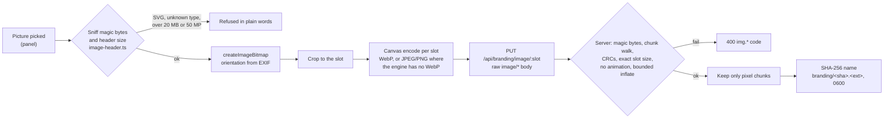

# Streamer branding ("Your page")

New in v0.4.0. The streamer gives her viewer pages a name, a picture, a banner, a short bio, links, a
support button (a link or Pix) and a theme colour, from the panel's **Your page** card ("Sua
página"). This document describes the data, the limits, the image pipeline, the routes and the
security choices. Threats are listed in [THREAT_MODEL.md](THREAT_MODEL.md) (asset 10); the shared code
is in [`packages/shared/src/branding/`](../packages/shared/src/branding/), the server side in
[`apps/server/src/branding/`](../apps/server/src/branding/).

Principles:

- **Members only.** Branding is shown only to someone with a valid join ticket or session. `/`, the
  "link not valid" page, `/healthz` and every 404 stay stock SwarmCast, so probing tunnel hostnames
  never reveals whose stream it is.
- **Text is shown as typed**, never translated, and goes through the chat's Unicode pipeline.
  Rendering uses `textContent` only.
- **Viewers only receive pixels freshly encoded by a browser**, validated and stripped of every
  metadata chunk by the server.
- **No custom CSS, no custom JavaScript, no embeds.** A theme colour and a corner style are the only
  visual controls, and every colour is adjusted until it is readable.
- **The viewer CSP does not change.** A branded page sends exactly the same CSP as an unbranded one.

## What the streamer can set

| Item | Where viewers see it | Default |
|---|---|---|
| Channel name | Join page ("Join {name}'s stream" / "Entrar na live de {name}"), watch header, tab title, link preview | empty: the stock SwarmCast header |
| Picture or logo | Join page, watch header, favicon (32 px, 180 px for iOS home screens) | the SwarmCast symbol |
| Banner | Above the player (1280 × 320, 640 × 160 on phones), loaded after the first video segment | none |
| One-line description (tagline) | Under the name; link preview description | empty |
| About | An "About" card under the player (plain text, line breaks kept) | empty: no card |
| Tags | Chips in the About card (not clickable) | none |
| Links | List in the About card, with a platform icon derived from the host | none |
| Support button | Header and the ended screen; opens a link or a Pix sheet | off; label "Support" / "Apoiar" |
| Theme colour and corners | Buttons, links and accents, in light and dark mode | Forest, round |
| Ended message | The "stream has ended" screen | the stock text |
| Link preview card | When the link is pasted into WhatsApp, Telegram, Discord… | **off** |
| "on SwarmCast" credit | A small footer line | shown (can be hidden) |

Not offered, by decision: custom CSS, custom JavaScript, iframes or embeds (see "Decisions" below),
and a custom domain (dropped from the roadmap).

## Data model

`config.json` → `branding`, schema `brandingSchema` in
[`schemas.ts`](../packages/shared/src/branding/schemas.ts). Every field has a default, so older
config files need no migration.

| Field | Content |
|---|---|
| `enabled` | Branding on (default on; with no fields set, pages look stock) |
| `name`, `tagline`, `about`, `endedMessage`, `bannerAlt` | Canonicalised text (absent when empty) |
| `tags` | Up to 8 strings |
| `links` | Up to 6 `{label, url}`; `url` is the normalised href |
| `support` | `{enabled, label: support \| tip \| donate \| pix, mode: link \| pix, url?, pix?: {type, key, name, city}}` |
| `theme` | `{preset: forest \| honey \| onair \| ocean \| clay \| graphite \| custom, accent?: #rrggbb, corners: round \| soft \| square}` |
| `preview` | `{enabled}` (the link preview card) |
| `showCredit` | The "on SwarmCast" line |
| `images` | Per slot: `{sha, type: png \| jpeg \| webp, w, h, bytes}` |
| `rev` | Increases on every save; viewers use it to refetch |

`PUT /api/branding` takes the same object without `images` and `rev` (`brandingTextSchema`). Text and
links are canonicalised while parsing, and a bad value comes back as a plain-words error code
(`brandingIssue()`), never as a raw validation message.

The **diagnostics export** (Export logs) replaces the whole `branding` object with a summary (which
fields are set, how many links and tags, the preset); no branding string appears in it.

## Limits

From [`limits.ts`](../packages/shared/src/branding/limits.ts). Text lengths are graphemes, counted the
same way in the panel and on the server.

| Field | Limit |
|---|---|
| Name | 40 graphemes, 160 UTF-8 bytes, 1 line |
| Tagline | 100 graphemes, 400 bytes, 1 line |
| About | 1,000 graphemes, 4,000 bytes, 12 lines (runs of blank lines collapse to one) |
| Tag | 8 tags, each 24 graphemes, 96 bytes: letters, numbers, spaces, `-`, `_` and emoji; unique by skeleton |
| Link | 6 links; label 32 graphemes; URL 512 characters |
| Ended message | 140 graphemes, 1 line |
| Banner alt text | 120 graphemes, 1 line |
| Raw input per field | 6,000 UTF-16 units, checked before any work |
| Pix | merchant name 25, city 15 (ASCII after transliteration), description 40 |

| Image slot | Exact size | Byte cap |
|---|---|---|
| `avatar` | 256 × 256 | 64 KB |
| `avatar128` | 128 × 128 | 24 KB |
| `fav32` | 32 × 32 | 6 KB |
| `fav180` | 180 × 180 | 32 KB |
| `banner` | 1280 × 320 | 150 KB |
| `banner640` | 640 × 160 | 50 KB |
| `card` | 1200 × 630 | 200 KB |

Any upload over 512 KB is refused before it is parsed. On disk: at most 9 files and 1.5 MB. The
panel refuses a source picture over 20 MB, 12,000 px on a side or 50 megapixels before decoding it.

## Text

Every text field goes through `canonicalizeBrandText()`
([`text.ts`](../packages/shared/src/branding/text.ts)): the chat's Unicode pipeline
([CHAT.md](CHAT.md#unicode-pipeline)) line by line with a field profile (graphemes, bytes, lines).
Bidi controls, invisible characters, control characters and mark floods are removed; only About keeps
line breaks. Unlike nicknames, a channel name may mix scripts and contain emoji ("Ana 🎮 ゲーム"), and
it is not checked against the reserved names (a channel may be called "SwarmCast Fans").

Viewers and the panel preview render with `textContent` only, inside `<bdi dir="auto">`, in clipped
boxes; names inside translated sentences are separate nodes, never concatenated into HTML. The panel
shows the stored (canonical) result back, so the streamer sees exactly what viewers will see.

## Images

Two stages: the panel re-encodes, the server validates and strips.

**Panel** (`apps/admin/src/branding/`): SVG is refused by type and by sniffing. The shared header
parser ([`image-header.ts`](../packages/shared/src/branding/image-header.ts)) checks the declared size
before anything is decoded, so a decompression bomb never reaches the decoder. The picture is decoded
with `createImageBitmap(file, {imageOrientation: 'from-image'})`, cropped and drawn on a canvas, then
encoded per slot, stepping the quality down until it fits the cap. A canvas encode writes only
pixels: the source's EXIF, GPS, XMP, IPTC and comments never survive (see the BR0 appendix for the
per-engine matrix). The output type is read from the blob, because WebKit answers PNG when asked for
WebP.

**Server** ([`image.ts`](../apps/server/src/branding/image.ts)): a structural check, not a decoder.

| Check | PNG | JPEG | WebP |
|---|---|---|---|
| Structure | Chunk walk, every CRC-32 verified, IHDR first, IEND last | Marker walk, baseline/extended/progressive only | RIFF walk, size consistent, VP8/VP8L header parsed |
| Size | Must equal the slot exactly | same | same |
| Refused | Animation (`acTL`), interlacing, a mismatching inflate size | other SOF types | animation (`ANIM`/`ANMF`) |
| Bomb check | All IDAT inflated with a bounded output that must equal the size the header implies | size bound only | size bound only |
| Kept | IHDR, PLTE, tRNS, IDAT, IEND | the image markers and entropy data | VP8X (flags reset), ALPH, the bitstream |
| Dropped | eXIf, tEXt, zTXt, iTXt, iCCP, tIME, every other ancillary chunk, bytes after IEND | APP1 (EXIF, XMP), APP2 (ICC), APP13 (IPTC), every other APPn, COM | EXIF, XMP, ICCP, unknown chunks |

Errors: `img.type`, `img.corrupt`, `img.dims`, `img.bytes`, `img.animated`, `img.tooLarge`, and
`img.disk` when the budget is full. Stripping is applied to the bytes as stored and is idempotent.

**Storage** ([`store.ts`](../apps/server/src/branding/store.ts)): files are content-addressed
(`<data>/branding/<sha256>.<png|jpg|webp>`, folder 0700, files 0600, atomic writes). At load every
file is read with a bounded read, re-validated and re-hashed; a tampered or missing file is dropped
from the config with an activity-log line. Unreferenced or misnamed files are deleted after every
change. Everything is held in memory (at most 1.5 MB), so serving never touches the disk. Removing the
avatar or banner also removes its variants.

## Theme and contrast

The streamer picks a preset (Forest, Honey, On Air, Ocean, Clay, Graphite; none purple or indigo) or
one custom colour. Only the accent tokens change, per theme, and contrast is enforced against the
page's own backgrounds ([`theme.ts`](../packages/shared/src/branding/theme.ts)):

| Token | Used for | Constraint in each theme |
|---|---|---|
| `--sc-accent` | Buttons, toggles | ≥ 3:1 against the background, the label ≥ 4.5:1 on it |
| `--sc-accent-strong` | Links, accent text, button hover | ≥ 4.5:1 against background and surface, the label ≥ 4.5:1 on it |
| `--sc-accent-soft` | Selected rows, callouts | a tint on which the ink text keeps ≥ 7:1 |

The search moves only OKLCH lightness (the hue stays), aims at 4.6 so that 8-bit rounding still
verifies at 4.5, and the panel says "adjusted" when the colour had to change. Status colours, the
focus ring, text and backgrounds are never overridable. Viewers keep their own light or dark choice.
Corners set the radii to 6/10/16 px (round), 4/6/10 (soft) or 2/2/4 (square).

`/brand/theme.css` is generated on the server from validated hex values and fixed selectors only; a
test checks every output against a strict grammar. Both viewer pages link it statically, so the
colours are there on first paint without inline styles.

## Links

[`url.ts`](../packages/shared/src/branding/url.ts), used by the panel, the server on save and on load,
and the viewer before rendering:

- **`https:` and `mailto:` only.** `javascript:`, `data:`, `http:`, `file:`, app schemes and
  everything else are refused. The WHATWG URL parser (the one browsers use for `href`) decides what
  the link is, so `java\tscript:` is refused as `javascript:`.
- No user name or password (`https://youtube.com@evil.example/`), no port.
- The host must be a public DNS name: IP literals, `localhost`, `.local`, `.lan`, `.internal`,
  `.home` and similar, single-label names and the stream's own host are refused, so a link cannot
  point viewers at their router or at our own origin.
- A bare address gets a suggested scheme in the panel (`ko-fi.com/ana` → `https://ko-fi.com/ana`),
  shown before saving, never applied silently.
- Viewers see the label and, under it, the host in its ASCII (punycode) form, so a look-alike
  Cyrillic domain shows as `xn--…`. The platform icon (YouTube, Twitch, Instagram, Ko-fi, LivePix,
  Apoia.se…) is derived from the host at render time, never stored.
- Rendered with `rel="noopener noreferrer nofollow"`, `target="_blank"` and no referrer. Text in
  About never becomes a link.

## Support button and Pix

- **Link mode:** any link that passes the rules above (Ko-fi, LivePix, Apoia.se, PayPal…). The label
  comes from a fixed list so it is always translated: Support/Apoiar, Tip/Gorjeta, Donate/Doar, Pix.
- **Pix mode:** the streamer enters a key (random key, e-mail, phone, CPF or CNPJ; validated per type
  by [`pix.ts`](../packages/shared/src/branding/pix.ts)), her name and city. Viewers get a sheet with
  the key and a **Copy** button, the **Pix copia e cola** string (a static BR Code with CRC16, see the
  appendix) and a **QR code** of it ([`qr.ts`](../packages/shared/src/branding/qr.ts), our own
  encoder, tested by decoding with an independent decoder).
- **The warning is mandatory:** "Anyone who sends you a Pix sees your full legal name and part of
  your CPF. If you want to stay anonymous, use a tip service instead." The panel recommends a random
  key, and a CPF or phone key needs a second confirmation ("Everyone watching will see this number").

## Link previews

[`og.ts`](../apps/server/src/branding/og.ts). Before v0.4.0, a messaging app that fetched
`/join/<secret>` followed the 303 without the cookie and showed "Link not valid". Now, after the
secret is validated exactly as before, a request whose User-Agent is a known preview fetcher
(facebookexternalhit, WhatsApp, TelegramBot, Discordbot, Slackbot, Twitterbot, LinkedInBot,
Applebot, Mastodon, Bluesky, …) gets a tiny static page with Open Graph tags: status 200, **no
cookie, no ticket**, no script, no style, every value escaped. Browsers still get the 303.

- **Card off (default):** a neutral invitation ("You're invited to a live stream") that names
  nobody. This also fixes the old "Link not valid" preview.
- **Card on:** "{name} is live", the tagline and the 1200 × 630 card image. The image URL is
  `/p/<token>/card.<ext>`, where the token is an HMAC of the current link secret: it reveals nothing
  and stops working with "New link". Rate limited per IP, `private, max-age=600`.
- With the card on, the name, tagline and image go to the platform that builds the preview and are
  shown to everyone in that conversation, which is why it is off by default and the panel says so.
- A browser that sends a bot User-Agent gets the preview page with an "Open the stream" link; a
  fetcher that is not on the list gets the old behaviour.

`/healthz` now answers a constant marker to strangers; only the app's own reachability probe (a
header derived from the live's key) learns which live is on, so polling an address does not tell when
the streamer is live.

## Routes

**Viewer server** (through the tunnel):

| Route | Who | Answer |
|---|---|---|
| `GET /api/brand` | join ticket or session; anyone else gets the stock "not found" | `PublicBranding` JSON (only what the page shows), `ETag "b<rev>-<live>"`, `private, no-cache`; `If-None-Match` → 304 |
| `GET /brand/theme.css` | ticket or session; anyone else gets an empty stylesheet (the page never breaks) | generated CSS, `ETag`, `private, no-cache` |
| `GET /brand/<sha>.<png\|jpg\|webp>` | ticket or session | the bytes, type from the sniffed file (the extension must match), `private, max-age=31536000, immutable`, through the upload limiter |
| `GET /join/<secret>` with a preview User-Agent | the secret | the preview page above |
| `GET /p/<token>/card.<ext>` | the current preview token, card on | the card image |

**Panel** (`127.0.0.1:8081`, behind the login and the Host/Origin checks,
[`admin-routes.ts`](../apps/server/src/branding/admin-routes.ts)):

| Route | Effect |
|---|---|
| `GET /api/branding` | Config, derived theme for both modes, image URLs, the public payload, disk use |
| `PUT /api/branding` | Text, links, support, theme, preview (JSON) |
| `PUT /api/branding/image/:slot` | Raw `image/png`, `image/jpeg` or `image/webp` body of exactly the slot's size |
| `DELETE /api/branding/image/:slot` | Remove it (and its variants) |
| `GET /api/branding/file/:sha.:ext` | The stored bytes, for the preview |
| `POST /api/branding/reset` | Back to the SwarmCast defaults |

The panel normally refuses any non-GET body that is not `application/json` (a CSRF defence). The
image route is the one exception, for those three image types only and still with the mandatory
`Origin` check: none of them is a CORS-safelisted content type, so a cross-site page cannot send them
without a preflight the panel never answers.

## Caching and bandwidth

- **`private` on everything**, immutable images included. Cloudflare's edge caches `.png`, `.jpg`,
  `.webp` and `.css` by extension when the origin allows it, and its cache key ignores cookies, so a
  `public` answer would be served to anyone with the URL and bypass the members-only gate.
- Images go through the same upload limiter as video, so the upload cap stays a hard ceiling. On a
  quick tunnel the hostname changes every live, so browsers download the set again each time: about
  185 KB on a desktop, 85 KB on a phone.
- The banner loads lazily, at low priority, only after the player has its first segment, so it
  never delays the first frame.
- **Lite mode:** while the attack shield is not calm, or the limiter has been saturated within the
  last 10 s, `/api/brand` says `lite: true` and the page skips the banner. Names, colours and links
  still show.
- Branding adds no WebSocket; its few short GETs at join do not change the tunnel arithmetic in
  [ARCHITECTURE.md](ARCHITECTURE.md#quick-tunnel-limit-measured-2026-10-26).

## Live updates

A save bumps `rev` and sends `{t: 'branding', rev}` on `/control` to every viewer, coalesced to at
most one per 2 s. The page refetches `/api/brand` with `If-None-Match` and reloads `theme.css`, without
a page reload. `hello` carries `brandRev`, so a reconnecting viewer catches up. Older pages ignore the
unknown message type.

## Decisions

| Decision | Why |
|---|---|
| No custom JavaScript, ever | A script on the viewer origin could chat as every viewer, read nicknames, re-stream the video, and reveal every viewer's IP through WebRTC (ICE is not governed by `connect-src`) |
| No custom CSS | Even under our CSP it allows UI redressing (hiding the P2P privacy note, faking a streamer badge), performance attacks on cheap phones, and would break on every release. More validated variables can come later instead |
| No custom domain | Dropped from the roadmap; every live keeps its quick-tunnel address and a new secret |
| Preview card off by default | It sends the name and picture to messaging platforms and to everyone in the conversation |
| Links: https and mailto only | No `http:` downgrade, no app schemes |
| "on SwarmCast" credit shown, can be hidden | The streamer decides |
| Panel canvas re-encode + server validator, no server-side decoder | No native addon fits the single executable; WASM codecs would add about 2 MB to audit. A structural check cannot prove that entropy-coded data is benign, which is why the panel re-encodes |
| Pix with key, copia e cola and QR | With the legal-name warning above |

## Tests

| What | Where |
|---|---|
| Text profiles over the chat corpus, tags, links (≥ 80 cases plus properties), theme for every 24-bit colour, `theme.css` grammar, header sniffing, schemas, slot caps vs the size budget | [`packages/shared/test/branding/branding.test.ts`](../packages/shared/test/branding/branding.test.ts) |
| Pix payload byte for byte, CRC16 vector, key validation | [`pix.test.ts`](../packages/shared/test/branding/pix.test.ts) |
| QR codes decoded back with an independent decoder | [`qr.test.ts`](../packages/shared/test/branding/qr.test.ts) |
| Image validator and stripper over metadata-laden fixtures, plus mutation fuzzing | [`apps/server/test/unit/branding-image.test.ts`](../apps/server/test/unit/branding-image.test.ts), fixtures made by [`make.py`](../apps/server/test/fixtures/branding/make.py) |
| Preview page escaping over the corpus, bot list | [`branding-og.test.ts`](../apps/server/test/unit/branding-og.test.ts) |
| Store, GC, tamper on load, public payload, diagnostics export, panel routes | [`branding-store.test.ts`](../apps/server/test/unit/branding-store.test.ts) |
| Real server: members-only, image headers, identical CSP, live update, link previews, `/healthz` | [`apps/server/test/integration/branding.test.ts`](../apps/server/test/integration/branding.test.ts) |

## Appendix: BR0 findings (2026-10-29)

Spike results recorded before the implementation.
### 1. Link previews today

Read from the code (`apps/server/src/public/server.ts`): `GET /join/<secret>` sets the ticket
cookie and answers `303 → /join`. `/join` without a valid ticket answers 404 with the "Link not
valid" page. A preview fetcher that does not carry the cookie across the redirect therefore
renders **"Link not valid · SwarmCast"**. BR3 answers known preview user agents directly on
`/join/<secret>` (200, Open Graph tags, no cookie) and keeps the 303 for browsers.

User agents matched (from the providers' documentation and widely published lists; real-app
captures stay a manual pre-release check): `facebookexternalhit`, `Facebot`, `meta-externalagent`,
`Twitterbot`, `WhatsApp/`, `TelegramBot`, `Discordbot`, `Slackbot-LinkExpanding`, `Slackbot`,
`LinkedInBot`, `SkypeUriPreview`, `Embedly`, `redditbot`, `Applebot`, `Iframely`, `Pinterestbot`,
`vkShare`, `Mastodon/`, `Bluesky`, `SignalLinkPreview` (Signal's proxy sends a generic UA; it falls
back to today's behaviour, which is harmless).

### 2. Canvas re-encode matrix

`createImageBitmap(file, {imageOrientation: 'from-image'})` + `OffscreenCanvas.convertToBlob`,
fixtures made with Pillow carrying EXIF (camera make/model, orientation 6, GPS), a JPEG comment
and a PNG `tEXt` chunk. Playwright 1.64, macOS:

| Engine | Orientation applied | `image/webp` gives | Source metadata in output | Engine-added metadata |
|---|---|---|---|---|
| Chromium | yes (1600×400 → 400×1600) | WebP | none | JPEG output has an `ICC_PROFILE` (sRGB) APP2 |
| WebKit (Safari, WKWebView) | yes | **PNG** (no WebP encoder) | none | PNG output has an **`eXIf` chunk**, JPEG output an `Exif` APP1 (no GPS, no camera data) |
| Firefox | not run (the local Playwright Firefox did not start; CI runs it in BR8) | | | |

Consequences: the source's GPS, camera, comments and text never survive a canvas re-encode,
but the output is **not** metadata-free (ICC profile, WebKit's own EXIF). The server stage
therefore strips every non-pixel chunk, as planned; the panel must take the type from the blob,
since WebKit answers PNG to a WebP request.

### 3. Vite and `/brand/theme.css`

A static `<link rel="stylesheet" href="/brand/theme.css">` in `join.html` survives `vite build`
unchanged (Vite logs "doesn't exist at build time, it will remain unchanged to be resolved at
runtime").

### 4. Pix BR Code

Derived from the BCB "Manual de Padrões para Iniciação do Pix" (EMV QRCPS merchant-presented
mode), static payload:

| ID | Field | Value |
|---|---|---|
| 00 | Payload Format Indicator | `01` |
| 26 | Merchant Account Information – Pix | `00` GUI `br.gov.bcb.pix`, `01` the key, `02` optional description |
| 52 | Merchant Category Code | `0000` |
| 53 | Transaction Currency | `986` (BRL) |
| 54 | Transaction Amount | omitted (the payer types the amount) |
| 58 | Country Code | `BR` |
| 59 | Merchant Name | 1–25 characters, ASCII (transliterated) |
| 60 | Merchant City | 1–15 characters, ASCII |
| 62 | Additional Data, `05` Reference Label | `***` (static code without a transaction id) |
| 63 | CRC16 | CRC-16/CCITT-FALSE (poly 0x1021, init 0xFFFF) over the whole payload including `6304`, 4 uppercase hex digits |

Each field is `ID` + 2-digit length + value; field 26's value nests the same layout. The bank-app
check was skipped (user decision); `packages/shared/src/branding/pix.ts` reproduces the payload
byte for byte and its tests decode the QR code with an independent decoder.
