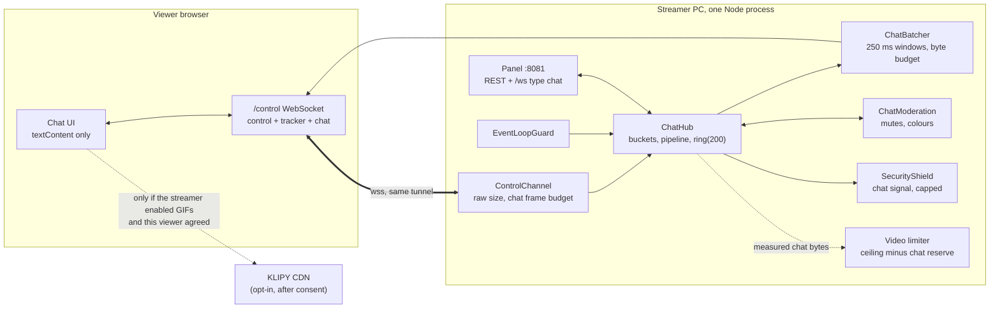

# Chat

A members-only text chat on the viewer page and in the streamer's panel, new in v0.4.0. This document
describes what the code does: settings, the wire protocol, the server pipeline, the Unicode rules,
moderation, flood protection, GIFs, emotes and privacy. The limits come from one file,
[`packages/shared/src/chat/limits.ts`](../packages/shared/src/chat/limits.ts), which the server, the
viewer and the panel all import, so they cannot drift apart. Threats and mitigations are in
[THREAT_MODEL.md](THREAT_MODEL.md); the design discussion (alternatives, measurements, sources) is in
the v0.4.0 chat plan.

In short:

- **On by default.** Nicknames are visible to everyone in the live (the join page says so).
- **One socket.** Chat rides on the existing `/control` WebSocket. It adds no connection, no held
  request and nothing to the quick tunnel's 200-in-flight budget.
- **Memory only.** A ring of the last 200 messages, wiped by Stop. Nothing is written to disk, and
  logs never contain message text.
- **The server is authoritative.** Every message goes through one shared Unicode pipeline before
  anyone sees it; clients render with `textContent` only.
- **Video comes first.** Chat has its own upload budget, a separate frame budget, batched fan-out and
  an event-loop guard that sheds chat before video suffers.
- **No third party by default.** GIFs are off until the streamer adds her own KLIPY key, and each
  viewer agrees before their browser contacts KLIPY.



## Settings and defaults

Saved in `config.json` → `chat` (config version 4, `reactions` since version 6; older files get the defaults). Schema:
`chatSettingsSchema` in [`packages/shared/src/chat/schemas.ts`](../packages/shared/src/chat/schemas.ts).
The panel changes them with `PUT /api/chat/settings`; viewers get the effective values in
`chat.settings`.

| Setting | Default | Range / values | Notes |
|---|---|---|---|
| `enabled` | **on** | on/off | Off: no snapshot in `hello`, every send gets `chat.err.off` |
| `content.text` / `.emotes` / `.gifs` | on / on / **off** | at least one on | Presets in the panel: Everything, Text + emotes, Text only, Emotes only, GIFs only. **Text only refuses emoji too** (`chat.err.mode`) |
| `slowModeS` | 2 s | 0–300 | Seconds between two messages from one viewer (per device). 0 leaves only the burst bucket |
| `maxGraphemes` | 200 | 20–500 | Visible length, counted in graphemes ("🇧🇷" is 1) |
| `maxEmoji` | 30 | 1–100 | Emoji graphemes per message |
| `newViewerWaitS` | 0 | 0–600 | A new session waits this long before it may write |
| `duplicateWindowS` | 30 s | 0–300 | The same text (by comparison key) from one device is refused within the window |
| `historyOnJoin` | 50 | 0–100 | Messages a new viewer gets in `hello` |
| `links` | `text` | `text`, `block` | Links are never clickable either way; `block` refuses messages that contain one |
| `blockedWords` | none | ≤ 200 entries, 1–40 graphemes each | Matched on the comparison key, so look-alike letters, accents, case, fullwidth forms and spacing do not get around them. The sender is not told which word |
| `viewerColors` | on | on/off | Viewers pick their name colour; off = the default colour per author |
| `streamerName` | "" | nickname rules, ≤ 24 graphemes | Shown next to the "Streamer" badge; "" = the translated "Streamer". Reserved for joins; asked in the setup tutorial ("The streamer's chat name") |
| `announceMutes` | off | on/off | A system line "X was muted" in the chat |
| `scripts` | `any` | `any`, `latin` | `latin`: every grapheme must be Latin, Common or Inherited, else `text.script` |
| `autoProtect` | on | on/off | Automatic flood protection (below) |
| `budgetShare` | 0.05 | 0.01–0.1 | Share of the upload cap chat may use. `config.json` only, no panel control |
| `gif.provider` | `klipy` | `klipy`, `giphy` | GIPHY is a fallback |
| `gif.key` | "" | `[A-Za-z0-9_-]{8,128}` | The streamer's own key. GIFs stay off without one |
| `gif.rating` | `pg` | `g`, `pg`, `pg-13` | Mapped to KLIPY's `content_filter` (`high`, `medium`, `low`) or GIPHY's `rating` |
| `gif.consent` | `ask` | `ask` | Each viewer agrees before their browser contacts the provider; there is no way to skip it |
| `emotes.builtin` | on | on/off | The built-in SwarmCast emote pack |
| `reactions` | on | on/off | Reactions over the video ("Reactions"); they pause by themselves in lockdown and while the event-loop guard is busy |

What applies at a given moment is computed by `effectiveChat()` in
[`apps/server/src/chat/settings.ts`](../apps/server/src/chat/settings.ts): the manual settings, raised
by automatic slow mode and by protection, and with GIFs paused when protection or the event-loop
guard asks for it. Setting changes reach viewers coalesced, at most one `chat.settings` per second.

## Wire protocol

Chat is a set of JSON message types on `/control`
([`packages/shared/src/chat/protocol.ts`](../packages/shared/src/chat/protocol.ts),
[`schemas.ts`](../packages/shared/src/chat/schemas.ts)). Keys are short on purpose: every item is sent
once per viewer, so the compact form is what keeps chat inside its budget.

### Viewer → server

Every chat frame starts with the bytes `{"t":"chat.` (the viewer always serialises `t` first), so the
server recognises it before decoding it.

| Frame | Fields | Meaning |
|---|---|---|
| `chat.send` | `n` (nonce, 1…2³¹−1), exactly one of `text` (≤ 1,500 UTF-16 units) or `gif`; optional `re` (the seq it replies to) and `mn` (≤ 3 author keys it mentions, `[0-9a-z]{1,10}`) | Send a message ("Replies and mentions") |
| `chat.color` | `color` `#rrggbb` | Choose my name colour (rate limited, ignored while locked) |
| `chat.resume` | `after` (a seq) | I missed items after `after` (gap or reconnect) |
| `chat.vote` | `n`, `id` (the poll, `p[0-9a-z]{1,10}`), `o` (option, 0–4) | My vote in a poll or prediction ("Polls and predictions") |
| `chat.react` | `c`: taps per reaction kind (`c[i]` of `CHAT_REACTIONS[i]`, 1–8 entries, 1–10 taps in all) | Reactions over the video ("Reactions"); never answered |

Reaction frames have a frame budget of their own, so a viewer who taps reactions while chatting can
never reach the chat budget that terminates the socket (and its P2P channel); see "Item classes and
frame budgets" below.

A GIF is never a URL: `gif = {p: provider, id: [A-Za-z0-9_-]{1,64}, w, h}` with `w`, `h` between 16
and 498. Clients build the image URL from a fixed template for that provider.

### Server → viewer

| Message | Content |
|---|---|
| `hello.chat` | The snapshot (below), inside the existing `hello`. Absent while the chat is off |
| `chat.batch` | `items`: the items of one batch window |
| `chat.ack` | `n` (the nonce), `s` (the seq the message got) |
| `chat.reject` | `n` (when known), `code`, optional `params` and `retryMs` |
| `chat.settings` | The effective public settings |
| `chat.you` | My state: author key, colour, lock, `mutedUntil`, `waitUntil` |
| `chat.reset` | A full snapshot that replaces the client's list |
| `chat.voted` | `n`, `id`, `o`, `c` (the counts now): this device's vote was counted; sent to every socket of every session of that device |

Items inside a batch or snapshot:

| `k` | Item | Fields |
|---|---|---|
| `m` | Message | `s` seq, `at` server time (ms), `a` author key, `x` text **or** `g` GIF; `h: 1` while the streamer has it highlighted; `re` the message it replies to (`s`, `a`, and the server's quote `q` with `cut: 1` when shortened, or `gif: 1`, or `gone: 1` once deleted); `mn` the author keys it mentions |
| `u` | Roster upsert | `au: {a, n nickname, c colour, r role, tag}`; sent once per author, again after a colour change |
| `d` | Delete | `s: [seq…]` |
| `clr` | Clear | `s`: everything up to and including this seq |
| `sys` | System line | `s`, `at`, `code` (a message key), `params`; translated by the client |
| `skip` | Not delivered | `n` messages this viewer did not get (budget or a slow connection) |
| `hl` | Highlight changed | `s` the message (not a seq of its own), `on` true or false |
| `pin` | Pin changed | `p`: the pinned message (`s`, `a`, `x` or `g`, `at` when pinned, `endsIn` ms left for a timed pin) or `null` |
| `poll` | Poll changed | `p`: the poll or prediction (`id`, `kind`, `q`, `o`, `st`, `c`, `endsIn` while open, `win` once answered, `newOnly`, `mine` in a snapshot) or `null` |
| `pt` | Vote counts | `id`, `c`: the counts of that poll now (ephemeral, latest-wins) |
| `rx` | Reactions | `c`: everyone's taps of one window per kind, each at most 20 (ephemeral, merged; "Reactions") |

The **author key** `a` is an opaque base36 counter per live, never the session id. The **tag** is 4
base32 characters from an HMAC of the session id with a per-live salt; it tells apart two people
whose names look alike. `r` is `viewer` or `streamer`, and only messages posted from the panel ever
carry `streamer`.

**Snapshot** (`ChatSnapshot`): `{v, settings, you, roster, items, lastSeq, pin?, poll?}`. `v` is
`CHAT_PROTOCOL_VERSION` (1). `items` are the last `historyOnJoin` ring items (20 at most under
"slow" protection, none under "lockdown"); `roster` holds only the authors of those items, the
pinned message's author and the viewer. `pin` is the pinned message, in full snapshots and
reconnect deltas alike (absent: nothing is pinned), and `poll` the poll or prediction on screen, with
this device's vote as `mine` (absent: none). The snapshot's bytes are counted against the
chat budget.

**Ordering and gaps.** `seq` increases by one per ring item within a live and starts at 1 after every
Start. A client that sees a gap, or reconnects, sends `chat.resume`; the server answers with the
missing items, or with `chat.reset` when they have already left the ring.

**Compatibility.** Clients ignore unknown `t` and unknown `k`; new fields are optional. A breaking
change bumps `CHAT_PROTOCOL_VERSION`, and an old page then asks the viewer to reload.

### Item classes and frame budgets

The rules every new chat feature builds on (protocol v1, all additive). A page that was already
open when a newer server answers (a stale tab, a page restored from the back/forward cache, a panel
tab left open across an update) keeps working: `chat-compat.test.ts` feeds the frames this server
sends to the chat session v0.4.2 shipped and to the current one, and both show the same messages
without a resume.

- **Only `m` and `sys` take a `seq`** (`CHAT_SEQ_KINDS`, `isChatSeqItem()` in
  [`protocol.ts`](../packages/shared/src/chat/protocol.ts)). A client reads a jump in `seq` as
  missed items and asks to resume, so a new kind that took a `seq` would stall every older page for
  3 s each time. Every other kind is seq-less, and clients treat an unknown kind as seq-less even if
  it carries an `s`.
- **Durable seq-less items** (`u`, `d`, `clr`): never dropped; a socket too slow to get one
  receives a fresh snapshot when it catches up.
- **State items** (`ChatBatcher.pushState(key, item, refs?)`: `pin` under the key `pin`, `hl`
  under `hl:<seq>`, `poll` under `poll`): durable too, never dropped, but each one only says what a piece of state is
  now. A socket too slow to get some is sent the current state of each key it missed when it
  catches up (`stateOf` in [`hub.ts`](../apps/server/src/chat/hub.ts)), after the roster entries
  they name and before the next batch, instead of a snapshot; owing more than
  `CHAT_STATE_MISSED_MAX` (64) keys, or a durable item as well, still means a snapshot.
- **Ephemeral items** (`ChatBatcher.pushLatest(key, item, merge?)`: the vote counts `pt` under `pt`,
  and the reaction counts `rx` under `rx`, merged: the counts add up, each still capped):
  latest-wins state, at most one pending per key (a newer one replaces the pending one, or `merge`
  folds the two), at most `CHAT_EPHEMERAL_PENDING_MAX` (32) keys, sent after the batch's other
  items. Under upload pressure they are the first to go, silently (no `skip`, which counts
  messages). A slow socket that misses one gets neither a snapshot nor a `skip`: the next count
  replaces it. Never in the ring, snapshots or resume answers.
- **Referred authors.** An item can name authors other than its own (a reply's parent, a mention,
  a pin): `push(item, prio, refs)` and the ring keep those keys, every socket gets the roster entry
  of each one before the batch that names it, and snapshots, resume answers and the panel's state
  include them (`ringAuthors()` in [`hub.ts`](../apps/server/src/chat/hub.ts)).
- **New `sys` codes.** A client that does not know a code shows a neutral line ("Something changed
  in the chat that this page cannot show. Reload the page to see it."); one entry that fails to
  render never stops the others. Pages older than 0.5.0 lack this guard, so a feature whose line
  must reach them should prefer a new seq-less kind (which they ignore) over a new `sys` code.

| Frame budget per socket, per 10 s | Limit | Past it |
|---|---|---|
| Any frame (control, tracker, chat) | 200 | terminated |
| Chat frames (`{"t":"chat.`, reactions excepted) | 20 (`CHAT_MAX_FRAMES_PER_10S`) | terminated |
| Reaction frames (`{"t":"chat.react"`) | 10 handed on (`CHAT_REACT_FRAMES_PER_10S`) | ignored up to 20 (`CHAT_REACT_FRAMES_MAX_PER_10S`), then terminated |

Reaction frames are told apart by their first bytes (closing quote included, so `chat.reactX` is an
ordinary chat frame) and never count as chat frames; one over 2 KB is dropped before decoding,
without a reply. A new page sends them only to a server that announces reactions in its settings,
so an older server never sees them.

**Per-network limits** (poll votes) group addresses with `networkKey()`
([`network.ts`](../apps/server/src/access/network.ts)): an IPv4 address is its own network, an
IPv6 address counts by its /64 (`CHAT_IPV6_NETWORK_PREFIX`; one home or phone usually holds a whole
/64), and an IPv4-mapped IPv6 address is the IPv4 address. The existing per-IP message bucket still
keys on the full address.

### Reject codes

Every code is a message key with EN and pt-BR text (`CHAT_REJECT_CODES`; a test checks they are all
translated).

| Code | When |
|---|---|
| `chat.err.off` | The chat is off (or stopped itself after repeated internal errors) |
| `chat.err.muted` / `chat.err.mutedLive` | Muted for N minutes / until the end of this live |
| `chat.err.slow` | Slow mode, the burst bucket or the GIF interval; `retryMs` says when |
| `chat.err.busy` | The per-IP or global limit, or the event-loop guard paused the chat |
| `chat.err.newViewer` | The new-viewer wait is still running |
| `chat.err.protect` | Lockdown: only people who were watching before the alert may write |
| `chat.err.mode` | The content kind is off (text in emotes-only, emoji in text-only, …) |
| `chat.err.dup` | The same message again within the duplicate window |
| `chat.err.blocked` | A blocked word |
| `chat.err.links` | Links are blocked |
| `chat.err.gifOff` / `chat.err.gifInvalid` | GIFs are off / the wrong provider |
| `text.tooLong` | Over the grapheme cap, over 1,024 UTF-8 bytes, or a raw frame over 2 KB |
| `text.empty` | Nothing visible left |
| `text.invalid` | Lone surrogates, bad JSON or a frame that fails the schema |
| `text.combining` | More than 20 combining marks had to be dropped |
| `text.tooManyEmoji` | Over the emoji cap |
| `text.script` | Not Latin while the streamer allows Latin only |
| `chat.err.pollClosed` | The vote names a poll that is not open (ended, gone, another one) or an option it does not have |
| `chat.err.voted` | This device already voted in this poll (`params.o`: its option) |
| `chat.err.pollLate` | "Only people already watching": the session joined after the poll opened |
| `chat.err.pollNet` | Its network (IPv4 address, IPv6 /64) already gave CHAT_POLL_VOTES_PER_NET (10) votes |

Rejects to one socket are coalesced to 2 per second (slow-mode answers excepted), so a flooding
script gets silence instead of one reply per frame.

## Server pipeline (one message)

[`apps/server/src/control/control.ts`](../apps/server/src/control/control.ts) and
[`apps/server/src/chat/hub.ts`](../apps/server/src/chat/hub.ts), cheapest checks first:

1. **Frame ceiling.** More than 200 frames of any kind per 10 s, or a binary frame: the socket is
   terminated (unchanged from v0.3).
2. **Chat prefix.** A frame that starts with `{"t":"chat.` goes to the chat path. It has **its own
   budget**: 20 chat frames per 10 s per socket (4 times what the UI can send). Frame 21 terminates
   the socket. Chat frames never cost the control budget (30 per 10 s), so chatting cannot get a
   viewer kicked from control.
3. **Raw size.** Over 2,048 bytes: `text.tooLong`, without decoding the bytes. The socket stays open.
4. **Session.** An ended session closes the socket (4001).
5. **Prechecks, O(1):** chat on, mute, lockdown, new-viewer wait, guard pause, slow mode.
6. **Buckets, before `JSON.parse`:** the burst bucket per device (5 messages, refilled at 0.5/s;
   tabs of one browser share it), the per-IP bucket (2 msg/s × the sessions behind that IP, at most
   10, so CGNAT is not punished), then the global bucket G. A message that fails a later step gets
   its tokens back.
7. **Parse and schema** (`chatSendSchema`, zod). Failure: `text.invalid`.
8. **GIF checks** (GIFs on, the right provider, one GIF per 30 s per device) or the **text pipeline**
   (next section), then the content mode, links, blocked words and duplicates.
9. **Accept:** assign the next `seq`, append to the ring (at most 200 items and 256 KB; the oldest go
   first), queue the item for the next batch, and send `chat.ack` to the sender at once.

Every entry point runs inside `safe()`: an exception never leaves the chat. More than 5 internal
errors in a minute stop the chat for the rest of the live (a system line says so, the panel shows
it); the stream is not affected.

## Unicode pipeline

`canonicalizeChatText()` in [`packages/shared/src/chat/text.ts`](../packages/shared/src/chat/text.ts)
is pure, synchronous and linear in its input, whose size is checked first. The server stores and
sends its output.

**Data.** [`scripts/build/gen-unicode-tables.mjs`](../scripts/build/gen-unicode-tables.mjs) downloads
pinned UCD 17.0 files and the UTS #39 security data, checks their SHA-256s against
[`scripts/build/unicode-data.json`](../scripts/build/unicode-data.json) and writes compact range tables
(`ucd.generated.ts`, `grapheme.generated.ts`, `confusables.generated.ts`). A test asserts that the
pinned version equals the runtime's `process.versions.unicode`, so a Node upgrade that changes
Unicode fails loudly. Grapheme clusters come from a pure TypeScript UAX #29 implementation
([`grapheme.ts`](../packages/shared/src/chat/grapheme.ts)) that passes every case of
GraphemeBreakTest.txt, so the server does not depend on the ICU data shipped in the binary.

**Steps:**

1. **Size guard.** More than 1,500 UTF-16 units: `text.tooLong`, before any other work.
2. **Well-formed.** A lone surrogate: `text.invalid`, never repaired.
3. **Lines and spaces.** CR, LF, VT, FF, TAB, NEL, U+2028 and U+2029 become a space; every space
   separator (NBSP, U+3000, …) becomes U+0020; runs collapse; the result is trimmed. A message is one
   line.
4. **Removed:** C0/C1 controls and DEL, private use, unassigned, noncharacters, the bidi embeddings,
   overrides and isolates (U+202A–202E, U+2066–2069), default-ignorable code points (U+200B, U+FEFF,
   the Hangul fillers U+3164 and friends, …) except the joiners and selectors handled below,
   visually blank characters (U+FFF9–FFFC, U+2800, U+1D159), and LRM/RLM/ALM beyond the fourth.
5. **NFC.**
6. **Per grapheme:**
   - at most 4 consecutive nonspacing or enclosing marks, never the same mark twice in a row (UTS #39
     §5.4); the rest are dropped and counted;
   - ZWJ and ZWNJ outside emoji only in their RFC 5892 contexts (after a virama, or ZWNJ between
     joining letters); this drops the joiner of the 2018 Telugu crash string;
   - an emoji grapheme with ZWJ, tags, a keycap or several code points must be a full RGI emoji,
     otherwise it is split into its pictographs; at most 10 code points and 3 ZWJs; tag characters
     survive only inside the RGI subdivision flags;
   - variation selectors only after a base that takes them, one per grapheme (closes "smuggling"
     through selectors);
   - at most 16 code points per grapheme.
7. **Decision.** Nothing visible: `text.empty`. Over `maxGraphemes` or 1,024 UTF-8 bytes:
   `text.tooLong` (never silently truncated). More than 20 marks dropped: `text.combining`. Over
   `maxEmoji`: `text.tooManyEmoji`.
8. **Scripts.** With `scripts: latin`, anything outside Latin, Common and Inherited: `text.script`.

**Comparison key** (not displayed): `comparisonKey()` in
[`skeleton.ts`](../packages/shared/src/chat/skeleton.ts) is NFKC, case folding and the UTS #39
confusable skeleton, with spaces and punctuation removed. Blocked words, duplicates and nickname
uniqueness all compare keys. Blocked words are matched with Aho–Corasick
([`ahocorasick.ts`](../packages/shared/src/chat/ahocorasick.ts)), linear in the text.

**Client re-check.** Before rendering, the viewer and the panel run `checkChatInvariants()` from the
same module: well-formed, nothing from the removal set, mark runs, code points per grapheme, the
caps, no bidi controls. It does not re-run the pipeline and compare, because browsers ship other
Unicode versions. A message that fails is shown as "message hidden", so a server bug cannot reach the
DOM unchecked.

No regex in `chat/` backtracks: a test scans every regex literal in the folder for nested quantifiers.
Regexes with the `v` flag (`\p{RGI_Emoji}`) are built with `new RegExp` inside try/catch at first
use, because a `v` literal is a parse error on Safari before 17 and Firefox before 116.

## Nicknames (rules v2)

Nicknames are now visible to everyone in the live, so they must never hide, break a layout or
impersonate. [`packages/shared/src/chat/nickname.ts`](../packages/shared/src/chat/nickname.ts) is an
allowlist, applied on `/api/join` and by the join page for instant feedback:

- NFC; any whitespace becomes one space; trimmed;
- each code point is a letter or decimal digit with UTS #39 Identifier_Status=Allowed, a combining
  mark directly after a letter, or one of space, `_`, `.` and `-`. **No emoji**, symbols, other
  punctuation, controls, format characters, private use or unassigned code points; this closes the
  invisible Hangul-filler name;
- marks: at most 2 in a row and 3 per grapheme (accents, Indic vowel signs and Thai tone marks fit;
  stacking does not);
- at least one letter or digit; **2 to 24 graphemes** and at most **64 UTF-8 bytes**;
- one script (UTS #39 Moderately Restrictive: one script, or Latin plus one other except Cyrillic and
  Greek; Han with Kana, Hangul or Bopomofo counts as one). "Аnа" with Cyrillic letters is refused;
- not a reserved name, compared by key: streamer, transmissor(a), transmissão, swarmcast, admin,
  administrador, moderator, moderador, mod, system, sistema, and the streamer's own chat name.

The server also refuses a name whose key equals that of an active session (connected, or seen in the
last 30 s) with `nickname.taken` and a suggestion. "Ana" and "ana", or "lucas" and "Iucas", cannot be
live at the same time. The same device may rejoin with its own name.

**The streamer's identity never comes from a name.** Her messages carry `r: streamer`, and the
viewer draws a translated "Streamer" badge from that role. A viewer can never get the role.

### The streamer's chat name

`chat.streamerName` in `config.json` is the one source of truth: it is the name on her messages
(`ChatHub.streamerMember`) and the extra reserved name of every join (`reservedNames` in
`core/live.ts` → `/api/join`). The "Your page" channel name is a different field (it may have emoji
and 40 graphemes) and reserves nothing.

- **Rules:** `validateStreamerName()` in `nickname.ts`: the viewers' rules above (so not
  "Streamer", "admin"… either), or empty, which shows the translated "Streamer". The server's save
  (`PUT /api/chat/settings`, `admin.chat.err.streamerName`), the setup tutorial and the chat
  settings form use it, so the panel's instant feedback never disagrees with the server.
- **Asked once:** the setup tutorial's second step, "Your name in the chat", right after the
  welcome. It starts from the saved name, else from the "Your page" name when that one passes the
  rules. Next (or Enter) saves a valid change with the chat settings; an invalid name keeps the step
  open with its reason; closing the tutorial saves a valid change and drops an invalid one. Later
  it is changed in the Chat card, Chat settings → Looks, with the same instant check.
- **Changed while viewers watch:** the new name is reserved from the next `/api/join` on. A viewer
  who already holds a name that now looks like it keeps it for the rest of that session (it ends
  with Stop, "Disconnect everyone", a kick, or about 10 minutes away from the page, when the
  session cookie runs out); nobody is renamed or dropped, since a rename the viewer
  did not ask for would be more confusing than the badge, which still tells the two apart. Any new
  join with that name, from any device, including the same one, gets `nickname.reserved`. The
  streamer's name wins over a viewer's only on joins, so a viewer who joined first cannot block the
  streamer from taking her own name. Integration test: `chat.test.ts`, "the streamer takes a name
  a viewer has".

## Rendering rules (viewer and panel)

- DOM built with `createElement`, `textContent` and constant attribute names only. No `innerHTML`,
  `insertAdjacentHTML`, `outerHTML` or `DOMParser` (an ESLint rule covers the chat folders). No
  markup language.
- Name and text each inside `<bdi>` (`dir="auto"`), so right-to-left text cannot reorder the line.
- Each message is a clipped box (`contain: content`, `overflow: clip`, a line clamp), so marks cannot
  spill over other messages.
- Name colours are set with CSSOM (`style.setProperty`), which the viewer CSP (`style-src 'self'`)
  allows. The client adjusts every colour to at least 4.5:1 against the chat background in both
  themes (`adjustNameColor()` in [`color.ts`](../packages/shared/src/chat/color.ts), OKLCH lightness
  only, hue kept). The default palette has no violet or indigo.
- Links are plain text: never clickable, never previewed. No `` from a user-supplied URL.
- One entry never breaks the others: a `sys` code the client does not know shows a neutral line
  (`translateWire()`), and a row that fails to build shows "Message hidden" while the rest of the
  batch is drawn. The viewer's session and the panel's store skip a malformed item on its own.
- The chat is a separate, lazily loaded chunk, so the player never depends on it.

## Highlight and pin

The streamer can **highlight** messages (they stand out for everyone) and **pin** one message at the
top of everyone's chat. Both are streamer actions only: the panel's REST routes (below) are the only
way in, and no viewer frame can create, change or remove either. Nothing new reaches pages older
than 0.5.0 that they could stumble on: they ignore the `hl` and `pin` items, the `h` field and the
snapshot's `pin`, so they keep working and simply show neither (`chat-compat.test.ts`). No `sys`
line is posted for either.

**Highlight** (`ChatHub.highlight(s, on)`): a flag on the ring item (`h: 1`), so snapshots and
resume answers carry it, plus an `hl` state item for the pages already showing the message. At most
`CHAT_HIGHLIGHTS_MAX` (20) at once: one more takes it off the oldest, with its own `hl` item. A
highlight changes a message the viewer may already have, so a reconnect delta from before it is not
served (as after a delete). On the viewer page a highlighted row has an accent bar and the soft
accent fill (`--sc-accent-soft`; names on it are checked for 4.5:1 against that fill) and starts
with a visually hidden "Highlighted by the streamer"; in the panel, a bar and a "Highlighted" mark.

**Pin** (`ChatHub.pin(s, minutes)`): one at a time; pinning another message replaces it. The hub
keeps a copy of the message's text (or GIF) and author key, so the pin outlives the message's place
in the ring, and the author's roster entry is kept with it (snapshots, resume answers, the roster
prune). A timed pin (`minutes` 1–`CHAT_PIN_MAX_MIN` (120); the panel offers until unpinned, 5, 15
and 60 minutes) carries `endsIn`, the milliseconds left when it was sent, and comes down by
itself (checked on the hub's one-second tick and whenever the pin is read). The pin comes down,
with a `{k: 'pin', p: null}` item, on **Unpin**, when its message is **deleted**, on **Clear chat**,
when its time is up, and on **Stop** (wiped with everything else). Muting or kicking the author does
not unpin (the streamer decides), and neither do slow mode, the content modes, blocked words or
protection: they apply to what viewers send, and the pin is the streamer's. With the chat off,
viewers get no snapshot and see no chat at all; the pin is kept and shows again when the chat is
turned back on (a resume answer carries the current `pin` item). The pin is in every snapshot, also
under lockdown (no history): it is the streamer's own choice and costs at most ~1.2 KB per hello.

The viewer page shows the pin in a bar between the chat's header and the list
(`<section aria-label="Pinned message">`), never over the list or the input: the label "Pinned by
the streamer" (UI chrome, never message text), the author with the badge from the role, and the
text built by the same code as a row (text nodes, `<bdi>`, invariants, emotes, GIF consent). It is
folded to one line under 1100 px (where the chat is 40 % of the screen) and two lines in the side
column; **Show more** opens it up to the usual clamp. **✕** hides that pin on this page (in memory;
the next pin shows again). A new pin is announced in the polite status region, and "Show chat"
says "Pinned" while the chat is hidden. The panel shows the same pin above its feed with **Unpin**
and, for a timed pin, the time it comes down.

| Moderation or setting | Highlight | Pin |
|---|---|---|
| Delete | The message is gone | Deleting the pinned message unpins |
| Clear chat | Gone with the ring | Unpinned |
| Mute, kick | Stays | Stays |
| Slow mode, content modes, blocked words, links, protection | Not affected (streamer action) | Not affected; in every snapshot, also under lockdown |
| Chat off | Hidden with the chat | Hidden with the chat; kept for when it comes back |
| Reconnect | A delta from before a highlight is not served | In every snapshot and delta |
| Slow socket | Current state when it catches up (state item) | Current state when it catches up (state item) |
| Stop | Wiped | Wiped |

## Replies and mentions

A viewer or the streamer can **reply** to a message and **mention** people with `@`. Both are fields
of an ordinary message (`re`, `mn`), so a reply is a message like any other: it takes a seq, goes
through the whole pipeline (slow mode, content modes, blocked words, links, duplicates, mute,
protection) and is moderated like one. Pages older than 0.5.0 ignore both fields and show a reply as
the plain message it is (`chat-compat.test.ts`); no `sys` line and no new kind are involved.

**Reply** (`re`: the seq of the message answered). The server looks it up in the ring: only a
message (`m`) that is there now. Gone (deleted, cleared, evicted, a system line, a seq that never
was), the message is accepted **without** the reply: its text is fine, there is nothing to answer, and
a deleted message must not come back through a quote. Otherwise the item gets `re = {s, a, q}` where
`q` is the server's own quote of that message, never text from the client: its canonical text cut by
`cutQuote()` ([`quote.ts`](../packages/shared/src/chat/quote.ts)) on a grapheme boundary (never inside
an emoji ZWJ sequence, a flag, a mark run or a surrogate pair), at most
`CHAT_REPLY_QUOTE_MAX_GRAPHEMES` (40) graphemes and `CHAT_REPLY_QUOTE_MAX_BYTES` (160) UTF-8 bytes,
without the space the cut left, with `cut: 1` when it is shorter than the message (clients add the
ellipsis). A GIF is quoted as `gif: 1`. A quote that holds a blocked word (the list may have changed
since, and the streamer's own messages skip it) is left out: the reply still says whom it answers.
The quote is a copy, so it outlives its message's place in the ring and reaches viewers who joined
later; deleting the message wipes it from every reply in the ring (`gone: 1`, bytes counted again),
in the panel and on every page (`d` item), and the replies stay. The answered author is a referred
author (`refs`): kept in the roster and sent before the reply.

**Mention** (`mn`: author keys). The client works the keys out of the text when it sends
(`mentionKeys()` in [`mentions.ts`](../packages/shared/src/chat/mentions.ts)), so a name picked and
then deleted is not sent; the server checks each one again and keeps it only when that person already
wrote in this live (their roster entry went out, so the key of someone who only watches is never
confirmed), is still watching (or is the streamer), is not the sender, and is named in the text as
`@` + their nickname exactly, not inside a word or a grapheme (`findMentionSpans()`): "ana@Ana.com",
"@Anabela" and a look-alike "@Аna" (Cyrillic А) mention nobody, because nicknames are unique by
confusable skeleton among the people watching. A streamer without a name is mentioned as "@Streamer"
or "@Transmissão". Limits per viewer (never for the streamer): `CHAT_MENTIONS_PER_MIN` (6) a minute
from one device, the same person at most once per `CHAT_MENTION_SAME_TARGET_S` (30 s) from it, and
`CHAT_MENTIONS_TO_TARGET_PER_MIN` (10) a minute to one person from everyone. A mention that fails any
of this stays plain text and the message still goes: there is no reject to retry against. Mentioned
people are referred authors too. Nothing makes a sound, sends a notification or reaches anyone but
the people on the page; there is no `@everyone`.

| Moderation or setting | Replies | Mentions |
|---|---|---|
| Delete | The quote of every reply to it becomes "Original message deleted"; a reply being written to it is cancelled | — |
| Clear chat | Nothing left to reply to (a later `re` to a cleared message is a plain message) | — |
| Mute | A muted viewer cannot send, so cannot reply; replies to their messages keep the quote (the streamer can delete them) | A muted viewer can still be mentioned |
| Kick | Messages and quotes stay | A person who left is no longer mentioned |
| Slow mode, protection | A reply is a message: the same wait | The same |
| Content modes | The reply's own text follows the mode | `@name` is text: refused in emotes only, taken in text only |
| Blocked words | The reply's own text is checked; a quote holding one is left out | — |
| Chat off | Nothing is sent | — |
| Reconnect, snapshot, resume | Ring items carry `re` (with the quote as it is now) and `mn`; their authors are in the roster | |
| Slow socket | Replies are messages: dropped with a `skip` under pressure like any other | |
| Stop | Wiped with the ring and the mention limits | |

**Viewer page.** Every message has a **Reply** button in its top right corner: shown when the pointer
is over the message, after a tap on it (touch screens), or reached from the list with the arrow keys
(↑/↓ from message to message, Home/End, Escape back to the list), so the Tab order never runs through
150 buttons. "Replying to Ana" with the quote and ✕ sits above the box (Escape cancels too); the
reply starts with one clipped line, `↩ Ana: the start of her message…`, name and quote in their own
`<bdi>` boxes and checked with the shared invariants, and a click on it scrolls to the message it
answers while that is still in the list and marks it for a moment. Typing `@` lists up to
`CHAT_MENTION_SUGGESTIONS` (8) people who wrote in the chat on this page, newest first, with their tag
(↑/↓, Enter or Tab picks, Escape closes); nobody who only watches is ever listed, so the list sends
no one's name anywhere. A message that mentions this viewer gets a honey bar, its `@Name` a honey
tint and a visually hidden "Mentions you", only for them, and only while **Highlight messages that
mention me** (chat settings, on by default) is on; "Show chat" counts mentions while the chat is
hidden. **Panel.** **Reply** in the ⋯ menu, the same bar over the "Send as …" box, `@` over the people
who wrote in the feed with their tags, the quote above replies, and "Mentions you" on messages that
mention the streamer.

## Polls and predictions

The streamer can ask everyone a question: a **poll** (people vote and see the results) or a
**prediction** (people guess; the streamer picks the right answer once the guesses end). There are no
points or currency: a poll is advisory, so its stakes are zero. Only the panel can start, end, answer
or remove one (REST, below); no viewer frame can, and the server never reads chat text as a command.
The state machine is [`apps/server/src/chat/polls.ts`](../apps/server/src/chat/polls.ts) (pure, on an
injected clock); the hub wires it ([`hub.ts`](../apps/server/src/chat/hub.ts)).

- **One at a time.** 2 to 5 options (`CHAT_POLL_OPTIONS_MIN`/`MAX`), open for 15 s to 10 min
  (`CHAT_POLL_SECONDS_MIN`/`MAX`; the form offers 30 s, 1, 2, 5 and 10 minutes, 2 minutes by default).
  A new one is refused (`admin.chat.err.pollOpen`) while one is open or waiting for its answer, and
  replaces the results of a finished one.
- **Text.** Question and options go through the Unicode pipeline (`canonicalizeChatText`, 80 and 30
  graphemes, `CHAT_POLL_QUESTION_MAX_GRAPHEMES`, `CHAT_POLL_OPTION_MAX_GRAPHEMES`); two options with the
  same comparison key ("Sim" and "sim ", or a look-alike) are refused. Blocked words do not apply: it is
  the streamer's own text, as for the streamer's messages. Clients check every string with the shared
  invariants and draw it from text nodes in `<bdi>` boxes.
- **Lifecycle.** `open` → (its time is up, or **End now**) → `closed` for a poll, whose results stay
  on screen for `CHAT_POLL_RESULTS_S` (60 s), or `locked` for a prediction, which waits for the right
  answer up to `CHAT_PREDICTION_LOCK_MAX_MIN` (30 minutes, then it is removed) → `resolved` (the
  answer, on screen for 60 s) → gone (`p: null`). **Cancel** / **Remove** takes it away in any state.
  One timer at the next deadline (unref) plus the hub's one-second tick; a vote is checked against
  `now < endsAt` to the millisecond whatever the timers did.
- **Results live.** Viewers see the percentages while voting. The counts go out as an ephemeral `pt`
  item, at most one per `CHAT_POLL_TALLY_MS` (1 s; `CHAT_POLL_TALLY_MS_LARGE`, 2 s, above 40 viewers,
  under protection, under event-loop pressure or with the upload budget in debt), only when they
  changed: about 35 bytes, dropped first under budget pressure, never a reason for a snapshot. The
  voter gets `chat.voted` with the counts at once.
- **One vote per device**, final and anonymous. Votes are keyed by the device cookie (`sc_device`,
  random, set by the server), which every tab and every one of the up to 3 sessions of one browser
  share; `chat.voted` goes to all of their sockets. A second vote from that device gets
  `chat.err.voted` with the option it chose. A private window or another browser is another device: it
  costs a full join (rate limits, a unique nickname, the browser check when the shield asks).
- **At most 10 votes per network** (`CHAT_POLL_VOTES_PER_NET`, `networkKey()`: an IPv4 address, an
  IPv6 /64): the rest get `chat.err.pollNet` and are counted once per device for the streamer ("3 votes
  not counted: too many from one network", `rn`, panel only).
- **"Only people already watching"** (`newOnly`): only sessions that joined before it opened may vote
  (`chat.err.pollLate`). On by default for predictions, off for polls (the streamer can change it), and
  forced on while protection is `slow` or `lockdown`.
- **Votes cost no message limit.** One chat frame each (the 20-per-10-s socket budget) and O(1) checks,
  never the slow mode, burst, per-IP or global buckets: one vote per device is its own limit. Refusals
  are coalesced like every other (2 per second per socket).
- **Memory only, no per-voter record shown.** The vote of each device is kept in memory for "your
  vote" after a reload and wiped with the poll; logs and the activity log hold counts only (never the
  question, an option or who voted what); the streamer sees counts.
- **Compatibility.** Nothing new reaches a page older than 0.5.0 that it could stumble on: it ignores
  the `poll` and `pt` kinds, the snapshot's `poll` and the `chat.voted` type, and never sends a vote.
  No `sys` line is posted for a poll (`chat-compat.test.ts`).

| Moderation or setting | Polls and predictions |
|---|---|
| Mute | A muted viewer cannot vote (`chat.err.muted`, `chat.err.mutedLive`): a mute is "no taking part"; the card shows "Muted people cannot vote." |
| Kick | Their vote no longer counts (the count goes down); a kick bans the device for the live, so it cannot vote again |
| New-viewer wait, lockdown | Refused like a message (`chat.err.newViewer`, `chat.err.protect`); `slow` and `lockdown` also force "only people already watching" |
| Slow mode, content modes, blocked words, links | Not affected (votes are not messages; the text is the streamer's) |
| Event-loop guard paused | Votes refused (`chat.err.busy`), like messages; counts slowed to one per 2 s under pressure |
| Clear chat | The poll stays (it is not a message) |
| Chat off | Viewers have no chat, so no card; votes are refused (`chat.err.off`); the poll keeps running and shows again when the chat comes back (a resume answer carries the current `poll`) |
| Reconnect, snapshot, resume | The poll is in every snapshot and delta (with this device's vote), also under lockdown, and in resume answers |
| Slow socket | Misses counts silently (the next one replaces them); a missed change of state comes as the current poll when it catches up (state item) |
| Stop everything, a server restart | Wiped: the next live has no poll, and a restart is a new live |

**Viewer page** ([`poll.ts`](../apps/viewer/src/chat/poll.ts)). A card under the pinned bar and above
the list (never over the list or the input), with a honey top border: "Poll" or "Prediction", the time
left, the question, the options as full-width buttons with a bar and a percentage each (the bar is a
`transform: scaleX()` of `--p`, set through the CSSOM), and a line under them: "Tap an option. Your vote
is final and anonymous.", "You voted: Pizza · 12 votes", "Poll ended", "Guesses are closed. Waiting for
the answer…", "The answer: Bia · 3 people got it right · You got it!". After the vote, the end or the
answer the buttons stay focusable (`aria-disabled`, `aria-pressed` on your vote) so the keyboard and
screen readers keep their place; the card is a labelled region, and a polite live region announces
only changes of state (opened with its question, ended, the answer, your vote, a refusal), at most one
per 2 s, never the counts. ▾ folds the card to its header. On a phone (under 720 px) a new poll starts
folded to one line with its question, so the few lines of chat under the player keep their room until
the viewer taps it. "Show chat" says "Poll" while one is open and the chat is hidden.

**Panel.** **Poll** under the "Send as …" box opens the form: Poll or Prediction, the question, 2 to 5
options (+ and −), the time to vote, and "Only people already watching" (with a tip). The card above
the feed shows the live counts and percentages, the time left, "12 votes from 30 watching", the votes
refused for their network, and **End now** (**End guesses** for a prediction), **Cancel**, **Right
answer** on each option of a prediction whose guesses ended, and **Remove** for the results. The
activity log says when one opened, ended (with its count), was answered (how many got it right) or was
removed.

## Reactions

Viewers tap one of eight bee emotes and it floats up over the video for a moment for everyone, like
the live reactions of the big streaming sites. A reaction carries no text: it is an index into
`CHAT_REACTIONS` (`love`, `hype`, `lol`, `wow`, `gg`, `fire`, `sad`, `hi`; append only, the index is
the wire format), drawn from the built-in emote images on our own origin, the same on every OS. The
server side is `onReact` in [`hub.ts`](../apps/server/src/chat/hub.ts) and
[`reactions.ts`](../apps/server/src/chat/reactions.ts) (pure, on an injected clock); the page side is
[`apps/viewer/src/chat/reactions.ts`](../apps/viewer/src/chat/reactions.ts).

- **On by default** (`reactions`, the Chat card's "Reactions on the video"). They apply only while the
  chat is on, not in lockdown and while the event-loop guard is calm (like GIFs, the first extra to
  pause); viewers learn it from `reactions: true` in the public settings, and a page sends `chat.react`
  only while it is there.
- **The page's frames.** The first tap goes at once, the taps after it together: at most one frame per
  `CHAT_REACT_FRAME_MS` (2 s), at most `CHAT_REACT_PER_FRAME_MAX` (10) taps per frame, and the same tap
  bucket as the server (`CHAT_REACT_BURST` 10, refilled at `CHAT_REACT_REFILL_PER_S` 2 per second), so a
  tap the page draws is a tap the server takes. At most 5 frames per 10 s: half the socket's own
  reaction budget, so timer jitter never gets near it.
- **Frame budget** ("Item classes and frame budgets"): reaction frames never count as chat frames; past
  10 per 10 s they are ignored, past 20 the socket is terminated. The flood detector does not count them
  as offered frames either: an audience tapping together (0.5 frames/s each) would read as a flood and
  slow everyone's chat down. A script past the ceiling is counted, as a termination.
- **Checks**, O(1) and silent (there is no answer: a refusal would cost more upload than the tap): the
  reactions are on and the viewer may take part (`mayTakePart`: not muted, past the new-viewer wait, no
  lockdown, the guard has not paused the chat), then the device's tap bucket and the address's (2 taps/s
  × the sessions behind it, at most 10, as the message bucket), before `JSON.parse`; then
  `chatReactSchema` (strict: 1 to 8 whole counts, 1 to 10 taps in all). A frame with more taps than the
  buckets allow keeps as many as they do.
- **Added up.** An accepted tap only bumps a counter of its kind (`ReactionTally`). Once per window
  (`CHAT_REACT_WINDOW_MS`, 1 s; `CHAT_REACT_WINDOW_MS_LARGE`, 2 s, above 40 viewers, under protection,
  under event-loop pressure or with the upload budget in debt) everyone gets one ephemeral `rx` item with
  the counts, each capped at `CHAT_REACT_BROADCAST_MAX_PER_KIND` (20); two windows still waiting for the
  same batch merge, still capped. Never in the ring, a snapshot or a resume answer, never a seq, dropped
  first under budget pressure, and a slow socket that misses one gets the next (no snapshot, no `skip`).
  About 35 bytes per viewer per window: some 17 kbps at 120 viewers.
- **Memory only.** The counters, the buckets and the panel's tally are wiped by Stop; nothing about who
  reacted is kept, logged or shown.

| Moderation or setting | Reactions |
|---|---|
| Mute | A muted viewer cannot react (dropped; the page has no React button); they still see everyone's |
| Kick | The session and its socket end; the device is banned for the live |
| New-viewer wait | No reactions until it is over (no React button) |
| Slow mode, content modes, blocked words, links | Not affected (reactions carry no text) |
| Protection `slow` | On, sent every 2 s |
| Lockdown | Off for everyone |
| Event-loop guard degrade or pause | Off |
| Clear chat | Not affected (nothing is kept) |
| Chat off | Off: no button, nothing drawn |
| Reconnect, snapshot, resume | Nothing to send (they are ephemeral) |
| Slow socket | Misses a window silently; the next one comes |
| Stop | The counters, the buckets and any taps waiting are wiped |

**Viewer page.** A React button (a bee) next to the emoji picker opens the eight reactions as buttons
with translated names (aria-label and tooltip; ←/→/↑/↓, Home, End; Escape closes and gives the focus
back), and the popover stays open for more taps. The page's own tap floats at once, and the page takes
its own taps of the last `OWN_ECHO_MS` (6 s) off the counts that come back, so nobody sees their own
reaction twice. Floaters live in a layer inside the player (`.player > .rx-layer`, so they show in full
screen too), over the picture and under the controls, with `pointer-events: none` and `aria-hidden`
(the chat list stays the accessible chat). Each is an `` of a built-in emote whose place, timing
and rise are CSS custom properties set through the CSSOM (no `style` attribute; the CSP is unchanged),
and only transform and opacity animate. At most `CHAT_FLOATERS_SPAWN_PER_WINDOW` (8) start per window
(every kind that came at least once, the rest shared by the counts) and `CHAT_FLOATERS_MAX` (24) are on
screen at once; nothing is drawn while the tab is hidden, so nothing piles up. With **reduce motion**
nothing floats: a small counter per kind in the corner counts up in place and goes after 4 quiet
seconds. **Show reactions on the video** (chat settings, on by default, remembered in this browser)
hides them for this viewer only; sending still works. Hiding the chat hides them too.

**Panel.** The live chat shows a small tally under its counters, "Reactions in the last minute: Fire
12 · Love 3" (`counters.reactions`: taps taken per kind in the last minute; the panel's `/ws` also gets
each window's `rx` with the counts before the cap), "No reactions in the last minute." or, while they
are paused, why.

**Compatibility.** A page older than 0.5.1 ignores the `rx` kind and the `reactions` field, and has no
button, so it never sends `chat.react` (`chat-compat.test.ts`); a current page sends reactions only to
a server that announces them.

## Chat over the video

While the player fills the screen, the viewer can show the chat as lines over the picture, like the
big streaming sites do in full screen. It is the viewer's own choice, **off by default** and
remembered in that browser (`swarmcast.chatOverlay`): the **Chat on the video** button in the
player's bar (only while it fills the screen) or **Chat on the video in full screen** in the watch
page's Settings. Nothing changes on the server or the wire: the page draws what its chat already
has. The switches and the state are in [`overlay-mode.ts`](../apps/viewer/src/overlay-mode.ts) (the
main bundle; the player never depends on the chat), the lines in
[`chat/overlay.ts`](../apps/viewer/src/chat/overlay.ts) (the chat chunk).

- **When it shows.** The viewer turned it on, there is a chat (on, and not hidden by the viewer:
  "Hide chat" means no chat over the video either), and the player fills the screen: the player
  container in full screen (computers, Android, iPad, iPhones on iOS 26), or **fill the screen** on an
  iPhone whose Safari has no element full screen. There, while this is on, the full-screen button
  fixes the player over the whole page (`pc-fill`; the button again or Escape leaves; Safari's own
  bars may stay) instead of opening iOS's own player, which shows nothing of the page over the
  picture. With it off, that button opens iOS's player as before. Picture-in-picture shows the video
  only.
- **What shows.** The last `CHAT_OVERLAY_LINES` (6) messages and system lines at the bottom left,
  each for `CHAT_OVERLAY_FADE_S` (12 s) from when it came (a snapshot's messages only for what is left
  of that time), fading over its last 1.2 s; two lines at most each; GIFs are left out. Deleting a
  message, Clear chat and a new snapshot take lines away as in the list. Lines are built by the
  list's own code (`ChatList.overlayLine`: text nodes, `<bdi>` boxes, the shared invariants, emotes,
  mentions) without the Reply button or the quote, so there is no second renderer.
- **Readable on any picture.** Each line sits on a strong scrim, 72 % of `--video-bg`, with
  `--on-video` text; names are made readable (4.5:1) against the lightest that scrim gets, over a white
  picture, so they also hold over a dark one. Both themes look the same (the video tokens do not
  change with the theme).
- **Never in the way.** The overlay sits under the player's bar in the stacking order and just above
  it on screen (the bar's height is measured, also with a phone's safe area); the lines take no click
  (`pointer-events: none`) and are hidden from screen readers (the chat list stays the accessible
  chat); at most 38 % of the player's width (72 % on a phone). Reactions float on the right, the lines
  on the left.
- **Writing.** A small button opens the chat's own message box over the video (the same form, moved
  into the overlay and back, so slow mode, mutes, replies, mentions and React work there), and **C**
  does too while the overlay shows. The emoji and GIF pickers stay in the chat column. Closing the box,
  or leaving full screen, puts it back in the chat. Keys typed there never trigger the page's
  shortcuts. Escape in full screen is the browser's (it leaves full screen).
- **Reduce motion**: lines come and go without fading.

## Slash commands

A shortcut for the streamer in the panel's message box; the buttons stay (a command is never the only
way). One pure parser, [`commands.ts`](../packages/shared/src/chat/commands.ts), shared by the panel
and the viewer page: no DOM, no network, never throws, linear (no regex that can backtrack). A command
becomes the same REST call its button makes ([`logic.ts`](../apps/admin/src/chat/logic.ts)
`runCommand`); **the server never reads chat text as a command**. Names in English and Portuguese both
work whatever the panel's language, without case or accents (`/Enquête` = `/enquete` = `/poll`); text
that does not start with a known name is sent as a message (`/o/`, `/s`), and `//text` sends "/text".

| English | Portuguese | Does |
|---|---|---|
| `/help`, `/?` | `/ajuda` | The list of commands (also the **?** next to Send) |
| `/poll [time] Question \| A \| B` | `/enquete [tempo] Pergunta \| A \| B` | Starts a poll; alone, opens the form. A time first is optional: `30s`, `2m`, `1m30s` (a bare number is part of the question); 2 to 5 options split on `\|` (or `;`) |
| `/prediction …` | `/palpite …` | The same for a prediction |
| `/end` | `/encerrar` | Ends the voting now |
| `/answer N` | `/resposta N` | The right answer of a prediction whose guesses ended (N from 1) |
| `/cancel` | `/cancelar` | Removes the poll or prediction |
| `/pin [text]` | `/fixar [texto]` | Sends the text and pins it; alone, pins the message being replied to |
| `/unpin` | `/desafixar` | Unpins |
| `/clear` | `/limpar` | Asks the Clear question first, as the button does: never clears by itself |
| `/slow N` · `/slow off` | `/lento N` · `/lento desligar` | Slow mode, 0 to 300 s |
| `/mute Name [minutes \| live]` | `/silenciar Nome [minutos \| live]` | 10 minutes when left out. The name is matched without case or accents among the people watching; two look-alikes are told apart with the tag (`Ana#K3QF`) |
| `/unmute Name` | `/dessilenciar Nome` | |
| `/protect off \| slow \| lockdown` | `/proteger desligado \| lento \| bloqueio` | Flood protection by hand |

While the text starts with "/" a list of the matching commands shows above the box with how to write
them (↑/↓, Tab or Enter completes a name; Enter on a whole name runs it); the result, or why it did
not run, shows under the box ("Poll started.", "Write the number of the right option, from 1 to 5.").
The panel's onboarding tour mentions it in its chat step.

**Viewers** have `/help` (`/ajuda`, `/?`) only, answered on the page with a short box of what they can
do (reply, mention, vote, settings) and never sent. A streamer command typed by a viewer is not sent
either (it would show "/poll …" to everyone): the box keeps it and says only the streamer can use it.

## Moderation (panel)

While live with the chat on (`AdminState.chatEnabled`, pushed on `/ws` when the setting changes), the
panel shows the **Live chat** at the top: the feed with a ⋯ menu per message, "Send as …", flood
protection and Clear (`ChatLive` in `apps/admin/src/chat/ChatCard.tsx`). It is a column on the right
of a wide window (sticky, as tall as the window, so the send box is always on screen) and sits under
the status on a narrow one (`apps/admin/src/style.css`, "Layout"). Before and after the live, or with
the chat off, it is not shown. The on/off switch and the settings are in the **Chat** card further
down (`ChatCard`); both share one load of `GET /api/chat` (`useChatPanel` in `chat/panel.ts`).

| Action | Effect |
|---|---|
| Delete | Up to 100 messages at once; a `d` item goes to everyone, the ring forgets them |
| Highlight / Remove highlight | Marks the message for everyone (at most 20 at once), or takes the mark off |
| Pin to top / Unpin | One pinned message at the top of everyone's chat, until unpinned or for 5, 15 or 60 minutes ("Highlight and pin") |
| Reply | Answers the message from the "Send as …" box, with its quote ("Replies and mentions") |
| Poll / prediction | Ask everyone a question; End now, the right answer, Cancel, Remove ("Polls and predictions") |
| Commands | `/poll`, `/pin`, `/mute`… in the "Send as …" box, and **?** for the list ("Slash commands") |
| Clear | A `clr` item; the ring is emptied |
| Mute | 1, 10 or 60 minutes (any value up to 1,440), or **until the end of this live**. Keyed by the device cookie and the session, never by IP, so it survives leaving and rejoining. The viewer sees "muted until…". There are no accounts, so a mute cannot follow a person to the next live |
| Unmute | Applies at once |
| Colour | Set anyone's colour, optionally locked (the viewer can no longer change it), or back to the default |
| Protection | Off, slow or lockdown, by hand (overrides the automatic state) |
| Post | The streamer writes with the same pipeline, the badge, and a small anti-mistake limit (5 messages, then 1 per second) |

Kick, "Remove from P2P" and "New link" work as before; mute is a separate state.

The feed follows the newest message unless the streamer scrolled up, and holds still while a ⋯
menu is open (it shows "New messages below" instead), so a click never lands on a button that
moved under the pointer (`ChatFeed.tsx`).

## Flood protection and the video budget

**Upload budget.** `B_chat = clamp(budgetShare × upload cap, 128 kbps, 960 kbps)` (5 % by default: lively chat at 120 viewers on a 10 Mbps cap needs about 408 kbps). The global rate
`G = clamp(B_chat / (viewers × 70 B), 1, 20)` messages per second, so slow mode effectively rises as
the audience grows. The guard halves G while it degrades.

**Batching** ([`batcher.ts`](../apps/server/src/chat/batcher.ts)). Items wait for a window of 250 ms
(500 ms above 40 viewers, 1 s under budget or CPU pressure). Then one `JSON.stringify`, and the same
string goes to every socket whose send buffer is under 64 KB. A slower socket is skipped and later
gets one `skip` item (or a fresh snapshot if it missed a delete, clear or roster change). When a batch
does not fit the byte budget, it waits up to 1 s and then drops ephemeral items first, then the
oldest viewer messages with a `skip`; streamer messages and moderation items are never dropped. The
queue holds at most 500 items (see "Item classes and frame budgets").

**Automatic slow mode** ([`detector.ts`](../apps/server/src/chat/detector.ts)). When the chat is
busy at G, the effective slow mode rises at once and halves again after 60 calm seconds; the viewer
page shows it as "slowed down automatically".

**Automatic protection** (on by default). A flood detector on the pattern of the attack detector
(rolling 10 s windows, an EWMA baseline learned only while calm, absolute and per-viewer floors,
3 s to escalate, 2 calm minutes to step down) looks at offered frames, rejects, terminations,
duplicate storms and new senders. The state is the higher of the chat detector and the attack
shield, unless the streamer set one by hand:

| State | What changes |
|---|---|
| off | Nothing |
| slow | Slow mode at least 10 s, new-viewer wait at least 60 s, history at most 20, GIFs paused |
| lockdown | Slow mode at least 30 s, no history, GIFs paused; only sessions that joined before the alert began, and at least 2 minutes before, may write |

**Tie-in with the attack shield.** The chat reports its level to the shield once a second. A chat
flood alone is **capped at "suspicious"**: it turns on the light browser check for new joins (raids
arrive through joins) and shows the panel warning with the reason "chat", but it never tightens
admission, rotates the link, leaves Direct mode or stops the stream. Those stay tied to the request,
join and connection signals, so a few trolls cannot make the streamer lose her audience.

**Event-loop guard** ([`guard.ts`](../apps/server/src/chat/guard.ts)). It samples the event-loop
delay p99 and utilisation every second against a baseline learned while calm. *Degrade* (5 s over
the threshold): batches every second, G halved, GIFs paused. *Pause* (2 s of heavy load): only the
streamer's and moderation items go out; viewers get `chat.err.busy`. It recovers after 10 calm
seconds. It reacts to load from any cause (the quality ladder, a request flood, chat itself).

**Video reserve.** The video limiter leaves `min(B_chat, 1.2 × measured chat upload)` to the chat
(`chatReserveMbps()` in
[`upload-controller.ts`](../apps/server/src/quality/upload-controller.ts)), never below half the cap
for video, so video + chat stay within the ceiling and video only gives up what chat really uses.
Control messages (kick, peer blocks) are sent directly and never wait behind a chat batch.

## GIFs

Off by default (user decision). When the streamer turns them on with **her own free KLIPY key**:

- **Viewer consent.** With `consent: ask` (the default), a GIF message first shows a placeholder
  that says the browser will contact KLIPY and that KLIPY sees the viewer's IP address. Nothing
  leaves the page until the viewer agrees (remembered in that browser). The picker and search run
  only after the viewer opens the picker and has agreed.
- **Direct from the browser, never through the streamer.** KLIPY's terms forbid proxying and require
  browser-originated requests; a proxy would also reveal the streamer's IP to the provider and
  multiply her upload. The key is not a secret: both providers put it in the client by design.
- **CSP widened only while GIFs are on**, and only to that provider's documented hosts
  (`GIF_PROVIDERS` in [`gif.ts`](../packages/shared/src/chat/gif.ts)): KLIPY adds
  `connect-src https://api.klipy.com` and `img-src https://static.klipy.com https://static1.klipy.com
  https://static2.klipy.com`. With GIFs off, the CSP is byte-identical to v0.3.
- **No analytics pings** (GIPHY's `onload`/`onclick` URLs, KLIPY's share trigger) are fired.
  Requests use `referrerpolicy="no-referrer"` and `credentials: 'omit'`.
- **Server limits.** A GIF reference is an id and a size, never a URL; one GIF per 30 s per device;
  GIFs pause under protection and when the guard degrades.
- **Attribution** ("Search KLIPY" / "Powered by GIPHY") is shown in the picker. GIPHY is a fallback
  only: its free beta key allows 100 calls per hour. Tenor's API shut down for third parties on
  2026-06-30.
- If the streamer searches GIFs in her own panel, her computer contacts KLIPY too; the panel says
  so next to the switch.

How to get a key: the site guide "Get a GIF key".

## Emotes

- **Unicode emoji** from the RGI set, rendered with the OS emoji font (no emoji images are fetched).
- **The built-in SwarmCast emote pack** (`:hello:`, `:gg:`, `:love:`, …; the codes are in
  [`tokens.ts`](../packages/shared/src/chat/tokens.ts)), bundled with the viewer and served from our
  own origin. On by default (`emotes.builtin`).
- Emote and emoji graphemes count as "emotes" for the content modes and toward `maxEmoji`.
- **Custom streamer emotes are deferred to 0.4.1.** The protocol already has an empty `emotes` list
  in the public settings for them.

## Privacy

- **Memory only.** The ring, roster, mutes, colours and counters live in memory and are wiped by
  Stop; the next live starts at seq 1. Nothing is written to disk.
- **Logs** record chat events as counts and codes only, never the text. Moderation actions appear in
  the panel's activity log (in memory), with the nickname, as kicks do.
- **No IPs in moderation.** Mutes use the device cookie and the session. The per-IP rate-limit bucket
  is in memory only and never shown or logged.
- **Nicknames and colours are visible to everyone in the live.** The join page and the "watching
  as" tooltip say so.
- **Chat never creates a new path to the streamer's IP.** Everything travels through the existing
  tunnel; there is no WebRTC for chat. In Direct mode the exposure is unchanged (chat adds nothing).
- The only third party is the GIF provider, and only after the streamer opts in and the viewer
  agrees.

## Admin API

Panel only (`127.0.0.1:8081`), behind the panel login and the Host/Origin checks, bodies validated
with zod ([`apps/server/src/admin/chat-routes.ts`](../apps/server/src/admin/chat-routes.ts)):

| Route | Body | Effect |
|---|---|---|
| `GET /api/chat` | — | Settings, effective settings, ring, roster, sessions (mutes, colours, tags), counters |
| `PUT /api/chat/settings` | chat settings | Validated, saved to `config.json`, pushed to viewers |
| `POST /api/chat/send` | `{text}` or `{gif}` | A message as the streamer |
| `POST /api/chat/delete` | `{seqs: [1…100 numbers]}` | Delete messages |
| `POST /api/chat/clear` | — | Clear the chat |
| `POST /api/chat/mute` | `{sessionId, minutes: 1…1440 \| null}` | `null` = until the end of this live |
| `POST /api/chat/unmute` | `{sessionId}` | |
| `PUT /api/chat/color` | `{sessionId, color \| null, lock}` | Set (and lock) a colour, or back to the default |
| `POST /api/chat/protect` | `{mode: off \| slow \| lockdown}` | Manual protection |
| `POST /api/chat/highlight` | `{s, on}` | Highlight a ring message for everyone, or take the highlight off (`admin.chat.err.gone` when it is not in the ring) |
| `POST /api/chat/pin` | `{s, minutes?: 1…120 \| null}` | Pin a ring message (replaces any other pin); `null` or absent = until unpinned |
| `POST /api/chat/unpin` | — | Unpin |
| `POST /api/chat/poll` | `{kind: poll \| prediction, question ≤ 500 units, options: 2–5 strings ≤ 200 units, seconds: 15…600, newOnly?}` | Start a poll or prediction (`admin.chat.err.pollOpen`, `.pollQuestion`, `.pollOption`, `.pollDuplicate`, `.disabled`) |
| `POST /api/chat/poll/end` | — | End the voting now (`admin.chat.err.noPoll`, `.pollState`) |
| `POST /api/chat/poll/resolve` | `{option: 0…4}` | The right answer of a prediction whose guesses ended (`.pollState`, `.pollAnswer`) |
| `POST /api/chat/poll/cancel` | — | Remove it in any state |

The panel's `/ws` gets chat items in their own message type (`{type: 'chat', reset, items,
sessions, counters}`), so the big panel snapshot never carries chat. Counters: accepted and rejected
per minute, skipped, G, chat upload and budget, guard state, protection and its reason, and whether
the chat stopped itself, and the reaction taps of the last minute per kind.

## Deferred to 0.4.1

- The OBS chat overlay (a browser source that shows the chat on stream).
- Custom streamer emotes (PNG, WebP or GIF only, never SVG, checked by header, served from our
  origin through the upload limiter).

## Tests

| What | Where |
|---|---|
| Corpus of hostile strings (zalgo, bidi, invisibles, ZWJ, tags, crash strings, controls, normalisation) with exact expectations | [`packages/shared/test/chat/corpus.ts`](../packages/shared/test/chat/corpus.ts), [`text.test.ts`](../packages/shared/test/chat/text.test.ts) |
| Properties P1–P13 and P15 (well-formed, idempotent, caps, NFC-stable, passes the client check, linear work, realistic chat unchanged, skeleton, tokenizer round trip, colour contrast for every 24-bit colour, a reply's quote is a grapheme prefix that passes the client check, mention spans on grapheme boundaries); 2,000 seeded runs per PR, `CHAT_FUZZ_RUNS` raises it | [`properties.test.ts`](../packages/shared/test/chat/properties.test.ts), [`arbitraries.ts`](../packages/shared/test/chat/arbitraries.ts) |
| Grapheme clusters vs GraphemeBreakTest.txt and `Intl.Segmenter` | [`grapheme.test.ts`](../packages/shared/test/chat/grapheme.test.ts) |
| No ReDoS in `chat/` | [`redos.test.ts`](../packages/shared/test/chat/redos.test.ts) |
| Quotes (graphemes, bytes, bidi, zero-width, the corpus) and mentions (longest name, word and grapheme boundaries, look-alikes, RTL names, the @ list's query, suggestions and insertion) | [`quote.test.ts`](../packages/shared/test/chat/quote.test.ts), [`mentions.test.ts`](../packages/shared/test/chat/mentions.test.ts) |
| Hub: replies (present, long, GIF, gone, deleted, cleared, blocked quote, streamer) and mentions (who counts, look-alikes, the streamer's names, every limit, reset) | [`chat-replies.test.ts`](../apps/server/test/unit/chat-replies.test.ts) |
| Protocol shapes, reject codes translated, settings defaults, the highlight and pin bodies, `hl` and `pin` seq-less, `re` and `mn` bounds | [`protocol.test.ts`](../packages/shared/test/chat/protocol.test.ts) |
| Backward compatibility: the frames this server sends, fed to the v0.4.2 chat session (frozen in [`test/fixtures/chat-0.4.2`](../apps/server/test/fixtures/chat-0.4.2/session.ts)) and to the current one: same messages, no resume; highlights and pins (also missed by a slow socket and in a reconnect hello), replies and mentions show only on the current page; reactions (also missed by a slow socket and across a reconnect) are drawn only by the current page | [`chat-compat.test.ts`](../apps/server/test/unit/chat-compat.test.ts) |
| Network keys (IPv4, IPv6 /64, IPv4-mapped) against Node's `BlockList` on random addresses in every spelling | [`network.test.ts`](../apps/server/test/unit/network.test.ts) |
| Unknown or malformed items and `sys` codes never throw (viewer session and list, panel store, fuzzed); highlighted rows and the pinned bar (text nodes, hide, Show more, chat off), and the panel store's highlights and pin; replies (quote, gone, GIF, unsafe quote, jump, the Reply button, the arrow keys, taps) and mentions (spans, the mark and its setting), the reply bar and the @ list | [`chat-session.test.ts`](../apps/viewer/test/unit/chat-session.test.ts), [`chat-render.test.ts`](../apps/viewer/test/unit/chat-render.test.ts), [`chat-input.test.ts`](../apps/viewer/test/unit/chat-input.test.ts), [`chat-store.test.ts`](../apps/admin/test/unit/chat-store.test.ts), [`i18n.test.ts`](../apps/server/test/unit/i18n.test.ts) |
| Hub: pipeline, slow mode, burst, duplicates, modes, blocked words, mutes, colours, roles, snapshot, resume, ring, reset, G, lockdown, failure isolation; highlight (cap, delta) and pin (replace, delete, clear, timer, Stop, mute and kick keep it, snapshots under lockdown, roster prune, slow sockets, resume) | [`apps/server/test/unit/chat-hub.test.ts`](../apps/server/test/unit/chat-hub.test.ts) |
| `/control`: frame budgets (chat and reactions), raw size, fuzzed hostile frames (also replies and mentions) and frame kinds; nickname uniqueness and reserved names | [`chat-control.test.ts`](../apps/server/test/unit/chat-control.test.ts) |
| Buckets, detector, adaptive slow mode, guard, batcher (ephemeral items, state items, referred authors) | [`chat-limits.test.ts`](../apps/server/test/unit/chat-limits.test.ts) |
| Admin routes, shield cap, upload reserve | [`chat-admin.test.ts`](../apps/server/test/unit/chat-admin.test.ts) |
| GIF CSP and settings | [`chat-gif.test.ts`](../apps/server/test/unit/chat-gif.test.ts) |
| The chat over the video: the viewer's choice (default, remembered, blocked storage), when it shows (full screen, the page-filling mode, a chat), the bar button and the Settings switch, C; the lines (at most 6, the fade and the end on a manual clock, a snapshot's, deletes, clears) and the message box moved over the video and back; the page-filling mode on an iPhone (and iOS's own player while it is off); F through the player's toggle | [`apps/viewer/test/unit/chat-overlay.test.ts`](../apps/viewer/test/unit/chat-overlay.test.ts), [`player-controls.test.ts`](../apps/viewer/test/unit/player-controls.test.ts), [`player-extras.test.ts`](../apps/viewer/test/unit/player-extras.test.ts), [`shortcuts.test.ts`](../apps/viewer/test/unit/shortcuts.test.ts) |
| Reactions: the tally, the merge and the tap allowance; the effective switch (lockdown, guard, chat off); the hub (one `rx` per window for everyone, capped, never a seq, a snapshot or an answer; the device and address buckets, CGNAT; mute, new-viewer wait, lockdown, off; hostile frames; not a flood for the detector; slow sockets, merged windows, budget pressure; the panel's counts; the window's timer; Stop); the frame schema; the page's sender (first tap at once, the rest together, the bucket, its own taps taken off), the floaters (sampled, capped, hidden tab, reduce motion), the picker (names, keys) and the session's `rx` guard; the panel's tally line | [`chat-reactions.test.ts`](../apps/server/test/unit/chat-reactions.test.ts), [`protocol.test.ts`](../packages/shared/test/chat/protocol.test.ts), [`apps/viewer/test/unit/chat-reactions.test.ts`](../apps/viewer/test/unit/chat-reactions.test.ts), [`chat-logic.test.ts`](../apps/admin/test/unit/chat-logic.test.ts) |
| Polls: the state machine on a manual clock (lifecycle, timers to the millisecond, one vote per device, per network with IPv4 and IPv6 /64, "only people already watching", kick, counts), the hub (frames, three sessions and tabs of one device, moderation refusals, hostile and replayed frames, counts at most one per window, slow sockets, snapshots and resume, Clear, chat off, Stop, the panel's `rn`, 120 votes at once); slash commands (both languages, accents, every command and error, text stays text, a fuzzed property: total, round trip, linear) | [`chat-polls.test.ts`](../apps/server/test/unit/chat-polls.test.ts), [`commands.test.ts`](../packages/shared/test/chat/commands.test.ts), [`chat-logic.test.ts`](../apps/admin/test/unit/chat-logic.test.ts) |
| Real server and sockets: delivery, slow mode, flood termination, mutes across rejoin, nicknames, settings push, resume, kick during a flood, Stop, highlight and pin (a new joiner's hello, clear, Stop); polls (one vote across tabs and sessions of a browser, a late joiner, a kick, a prediction, Stop; a burst of 120 vote frames from one network); reactions (a burst of frames from one address: sockets kept, a script past the ceiling ended, the taps added up and capped, one `rx` per batch at most; a muted viewer and reactions off reach nobody; Stop) | [`apps/server/test/integration/chat.test.ts`](../apps/server/test/integration/chat.test.ts) |
| Join page nickname feedback | [`apps/server/test/e2e/nickname.spec.ts`](../apps/server/test/e2e/nickname.spec.ts) |
| The viewer chat against the real server in Chrome, Firefox and WebKit: both ways, slow mode and translated rejects, hide chat, colours under the real CSP, streamer badge, one socket, a reply with a mention between real pages, a reaction from one page floating on the other under the real CSP, the chat over the video in full screen (a message from another page over the picture, one written from there) | [`apps/server/test/e2e/chat.spec.ts`](../apps/server/test/e2e/chat.spec.ts) |
| Moderation from the panel's chat API reaching viewer pages: delete, clear, mute for a time and until the end of the live, colour lock, presets (text only refuses emoji), blocked words; highlight and pin (later joiners, mute and modes keep them, delete and clear unpin); replies and mentions under the content modes, blocked words, mute and clear | [`apps/server/test/e2e/chat-moderation-api.spec.ts`](../apps/server/test/e2e/chat-moderation-api.spec.ts) |
| The panel's live chat (on screen without scrolling, desktop window and narrow, also with a pin) and Chat card: feed, moderation menu (reply, highlight, pin, unpin), the @ list, "Mentions you", settings, protection, the reactions tally and switch | [`apps/server/test/e2e/chat-moderation.spec.ts`](../apps/server/test/e2e/chat-moderation.spec.ts) |
| The video-first gate: a flood from scripted viewers while a real viewer plays; no extra stalls, HLS answers within 20 %, a kick within 1 s | [`apps/server/test/e2e/chat-flood.spec.ts`](../apps/server/test/e2e/chat-flood.spec.ts) (`@media`) |
| The viewer chat UI against a mock hub, and the whole corpus rendered in every engine and on phones (boxes clip, nothing hidden, no errors, still responsive); highlight and pin in both themes, keyboard only, in Portuguese, with the chat hidden or off, and on phones; replies and mentions (hover, keyboard only, delete, the @ list, the mark in both themes, the setting, Portuguese, phones); the poll card (place, mouse and keyboard votes, live percentages, ended / waiting / answered, reload, mute, Portuguese, folded on phones) and `/help`; reactions (the React button and its named reactions by mouse and keyboard, floaters inside the player under its controls and never taking a click, at most 8 per window and 24 at once, no double own tap, reduce motion, "Show reactions" remembered, turned off by the streamer, an older server, mutes, chat off, Portuguese, both themes, a storm, phones); the chat over the video in full screen (off by default, the bar button only in full screen and the Settings switch, remembered; the lines above the controls taking no click; readable in both themes; the message box over the video with React; C; hide chat and chat off; deletes and Clear; Portuguese; reduce motion; an iPhone without element full screen fills the page; phones) | [`apps/viewer/test/chat/`](../apps/viewer/test/chat/) (`chat-ui.spec.ts`, `chat-poll.spec.ts`, `chat-reactions.spec.ts`, `chat-overlay.spec.ts`, `chat-render.spec.ts`; run in the e2e `ui` group) |
| Polls and commands end to end: the panel's form and card with real viewer pages (live results, a late viewer, a reload, End now, Remove), a prediction answered from the panel, commands in Portuguese and English (suggestions, the ? list, `/limpar` asks first), moderation (mute, chat off, Clear), a narrow panel | [`apps/server/test/e2e/chat-polls.spec.ts`](../apps/server/test/e2e/chat-polls.spec.ts) |

## Load and soak

The chat bench ([`scripts/test/chat/bench.ts`](../scripts/test/chat/bench.ts)) runs the real public
server and chat hub in one process (fake MediaMTX, a fake quick tunnel on 127.0.0.1, port 0, no data
folder) and its bots in another ([`bots.ts`](../scripts/test/chat/bots.ts)). Each bot joins like a
browser behind its own address and holds `/control`. The bench samples the server every second (CPU,
event-loop utilisation and p99 delay, RSS, chat upload against the budget, accepted messages, G,
protection, tunnel in-flight) and checks each scenario after a 5 s calm baseline:

| Scenario | Bots | Behaviour | Must hold |
|---|---|---|---|
| quiet / lively | 120 | 0.5 / 3 msg/s overall | delivery p95 ≤ 1 s; no refusal, no protection, nothing skipped |
| flood | 120 | every bot at the highest rate its socket allows | accepted ≤ G; the flood is limited |
| raid | 120 + 60 joining in 30 s | the newcomers chat at once at their maximum | protection reaches slow or lockdown; chat never rotates the link |
| zalgo | 50 | the corpus at the highest rate | server CPU p95 ≤ 50 % of a core |
| slow-readers | 120, 20 of them stop reading | normal chat | RSS grows ≤ 30 MB; the others get their messages within 1.5 s |
| dup-storm | 60 | the same text | repeats refused or detected |
| gif-spam | 30 | GIFs as fast as allowed | at most one GIF per 30 s per viewer |
| reconnect-storm | 120 | everyone drops and reconnects at once (`?chatAfter`) | everyone gets their hello back within 10 s |
| vote-storm | 120 | lively chat; a poll opens and every bot votes within 1 s | every vote answered and counted; at most one vote count per 2 s per viewer; delivery p95 ≤ 1 s |
| react-storm | 120 | lively chat; every bot taps reactions as fast as the page sends, 10 scripts far above it (up to the ceiling) | at most one `rx` per 2 s per viewer and never two in one batch, counts capped, taps within the device buckets; no protection; delivery p95 ≤ 1 s |

In every scenario: no bot that keeps to the limits loses its socket, the event-loop p99 stays within
30 ms of calm, chat adds no connection, and chat upload stays within its budget (twice the budget while
many viewers join or reconnect, since their hellos are sent at once and charged afterwards).

```sh
node --import tsx scripts/test/chat/bench.ts --scenario lively,flood   # or all; --seconds 30
```

Results: `test-results/chat-bench/<scenario>.json` (every sample) and `summary.md`.

**On demand in CI** (never on every push):

- [`chat-load.yml`](../.github/workflows/chat-load.yml): the `chat-load` label on a pull request, by
  hand, monthly. The bench on Ubuntu and Windows; the property tests at 1,000,000 runs and the
  exhaustive 24-bit colour sweeps of chat names and the page theme (`CHAT_EXHAUSTIVE=1`).
- [`rendering.yml`](../.github/workflows/rendering.yml): the `rendering` label, by hand, monthly. The
  corpus and the chat UI in Chrome, Edge, Firefox and WebKit on Windows, macOS and Ubuntu, plus iPhone
  and Pixel emulation, with a screenshot per engine.
- Soak ([`.github/soak-plan.json`](../.github/soak-plan.json)): the chat, nickname and branding E2E
  specs 20 times on Ubuntu and macOS, and the bench (`chat-load` suite) 3 times on Ubuntu and Windows.

## Rendering checks

Before a release, by hand: a real iPhone and iPad (current iOS), an older iPhone if there is one, a mid
and a low-end Android phone (Chrome and Samsung Internet), Windows 10 and 11 (Edge, Chrome, Firefox),
macOS Safari, Ubuntu Firefox, and the desktop app's panel on each OS. Each one opens a live with the
corpus posted in the chat and 50 bots chatting, and must stay responsive (scrolling and typing within
100 ms), never crash or reload, keep every glyph inside its message box, and show the bidi cases
isolated.
