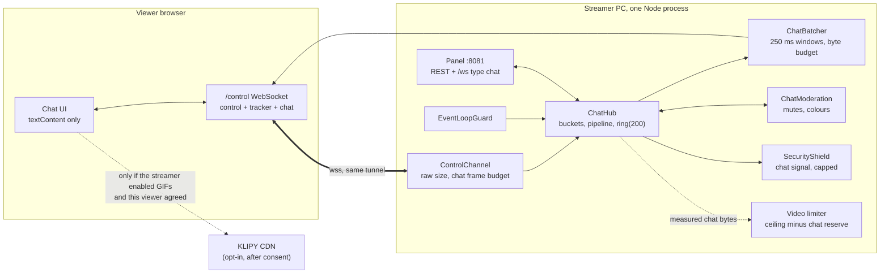

# Chat

A members-only text chat on the viewer page and in the streamer's panel, new in v0.4.0. This document
describes what the code does: settings, the wire protocol, the server pipeline, the Unicode rules,
moderation, flood protection, GIFs, emotes and privacy. The limits come from one file,
[`packages/shared/src/chat/limits.ts`](../packages/shared/src/chat/limits.ts), which the server, the
viewer and the panel all import, so they cannot drift apart. Threats and mitigations are in
[THREAT_MODEL.md](THREAT_MODEL.md); the design discussion (alternatives, measurements, sources) is in
the v0.4.0 chat plan.

In short:

- **On by default.** Nicknames are visible to everyone in the live (the join page says so).
- **One socket.** Chat rides on the existing `/control` WebSocket. It adds no connection, no held
  request and nothing to the quick tunnel's 200-in-flight budget.
- **Memory only.** A ring of the last 200 messages, wiped by Stop. Nothing is written to disk, and
  logs never contain message text.
- **The server is authoritative.** Every message goes through one shared Unicode pipeline before
  anyone sees it; clients render with `textContent` only.
- **Video comes first.** Chat has its own upload budget, a separate frame budget, batched fan-out and
  an event-loop guard that sheds chat before video suffers.
- **No third party by default.** GIFs are off until the streamer adds her own KLIPY key, and each
  viewer agrees before their browser contacts KLIPY.



## Settings and defaults

Saved in `config.json` → `chat` (config version 4; older files get the defaults). Schema:
`chatSettingsSchema` in [`packages/shared/src/chat/schemas.ts`](../packages/shared/src/chat/schemas.ts).
The panel changes them with `PUT /api/chat/settings`; viewers get the effective values in
`chat.settings`.

| Setting | Default | Range / values | Notes |
|---|---|---|---|
| `enabled` | **on** | on/off | Off: no snapshot in `hello`, every send gets `chat.err.off` |
| `content.text` / `.emotes` / `.gifs` | on / on / **off** | at least one on | Presets in the panel: Everything, Text + emotes, Text only, Emotes only, GIFs only. **Text only refuses emoji too** (`chat.err.mode`) |
| `slowModeS` | 2 s | 0–300 | Seconds between two messages from one viewer (per device). 0 leaves only the burst bucket |
| `maxGraphemes` | 200 | 20–500 | Visible length, counted in graphemes ("🇧🇷" is 1) |
| `maxEmoji` | 30 | 1–100 | Emoji graphemes per message |
| `newViewerWaitS` | 0 | 0–600 | A new session waits this long before it may write |
| `duplicateWindowS` | 30 s | 0–300 | The same text (by comparison key) from one device is refused within the window |
| `historyOnJoin` | 50 | 0–100 | Messages a new viewer gets in `hello` |
| `links` | `text` | `text`, `block` | Links are never clickable either way; `block` refuses messages that contain one |
| `blockedWords` | none | ≤ 200 entries, 1–40 graphemes each | Matched on the comparison key, so look-alike letters, accents, case, fullwidth forms and spacing do not get around them. The sender is not told which word |
| `viewerColors` | on | on/off | Viewers pick their name colour; off = the default colour per author |
| `streamerName` | "" | nickname rules, ≤ 24 graphemes | Shown next to the "Streamer" badge; "" = the translated "Streamer" |
| `announceMutes` | off | on/off | A system line "X was muted" in the chat |
| `scripts` | `any` | `any`, `latin` | `latin`: every grapheme must be Latin, Common or Inherited, else `text.script` |
| `autoProtect` | on | on/off | Automatic flood protection (below) |
| `budgetShare` | 0.05 | 0.01–0.1 | Share of the upload cap chat may use. `config.json` only, no panel control |
| `gif.provider` | `klipy` | `klipy`, `giphy` | GIPHY is a fallback |
| `gif.key` | "" | `[A-Za-z0-9_-]{8,128}` | The streamer's own key. GIFs stay off without one |
| `gif.rating` | `pg` | `g`, `pg`, `pg-13` | Mapped to KLIPY's `content_filter` (`high`, `medium`, `low`) or GIPHY's `rating` |
| `gif.consent` | `ask` | `ask` | Each viewer agrees before their browser contacts the provider; there is no way to skip it |
| `emotes.builtin` | on | on/off | The built-in SwarmCast emote pack |

What applies at a given moment is computed by `effectiveChat()` in
[`apps/server/src/chat/settings.ts`](../apps/server/src/chat/settings.ts): the manual settings, raised
by automatic slow mode and by protection, and with GIFs paused when protection or the event-loop
guard asks for it. Setting changes reach viewers coalesced, at most one `chat.settings` per second.

## Wire protocol

Chat is a set of JSON message types on `/control`
([`packages/shared/src/chat/protocol.ts`](../packages/shared/src/chat/protocol.ts),
[`schemas.ts`](../packages/shared/src/chat/schemas.ts)). Keys are short on purpose: every item is sent
once per viewer, so the compact form is what keeps chat inside its budget.

### Viewer → server

Every chat frame starts with the bytes `{"t":"chat.` (the viewer always serialises `t` first), so the
server recognises it before decoding it.

| Frame | Fields | Meaning |
|---|---|---|
| `chat.send` | `n` (nonce, 1…2³¹−1), exactly one of `text` (≤ 1,500 UTF-16 units) or `gif` | Send a message |
| `chat.color` | `color` `#rrggbb` | Choose my name colour (rate limited, ignored while locked) |
| `chat.resume` | `after` (a seq) | I missed items after `after` (gap or reconnect) |

Reaction frames (`{"t":"chat.react"…`, reserved for 0.5.0, no handler yet) have a frame budget of
their own, so a viewer who taps reactions while chatting can never reach the chat budget that
terminates the socket (and its P2P channel); see "Item classes and frame budgets" below.

A GIF is never a URL: `gif = {p: provider, id: [A-Za-z0-9_-]{1,64}, w, h}` with `w`, `h` between 16
and 498. Clients build the image URL from a fixed template for that provider.

### Server → viewer

| Message | Content |
|---|---|
| `hello.chat` | The snapshot (below), inside the existing `hello`. Absent while the chat is off |
| `chat.batch` | `items`: the items of one batch window |
| `chat.ack` | `n` (the nonce), `s` (the seq the message got) |
| `chat.reject` | `n` (when known), `code`, optional `params` and `retryMs` |
| `chat.settings` | The effective public settings |
| `chat.you` | My state: author key, colour, lock, `mutedUntil`, `waitUntil` |
| `chat.reset` | A full snapshot that replaces the client's list |

Items inside a batch or snapshot:

| `k` | Item | Fields |
|---|---|---|
| `m` | Message | `s` seq, `at` server time (ms), `a` author key, `x` text **or** `g` GIF; `h: 1` while the streamer has it highlighted |
| `u` | Roster upsert | `au: {a, n nickname, c colour, r role, tag}`; sent once per author, again after a colour change |
| `d` | Delete | `s: [seq…]` |
| `clr` | Clear | `s`: everything up to and including this seq |
| `sys` | System line | `s`, `at`, `code` (a message key), `params`; translated by the client |
| `skip` | Not delivered | `n` messages this viewer did not get (budget or a slow connection) |
| `hl` | Highlight changed | `s` the message (not a seq of its own), `on` true or false |
| `pin` | Pin changed | `p`: the pinned message (`s`, `a`, `x` or `g`, `at` when pinned, `endsIn` ms left for a timed pin) or `null` |

The **author key** `a` is an opaque base36 counter per live, never the session id. The **tag** is 4
base32 characters from an HMAC of the session id with a per-live salt; it tells apart two people
whose names look alike. `r` is `viewer` or `streamer`, and only messages posted from the panel ever
carry `streamer`.

**Snapshot** (`ChatSnapshot`): `{v, settings, you, roster, items, lastSeq, pin?}`. `v` is
`CHAT_PROTOCOL_VERSION` (1). `items` are the last `historyOnJoin` ring items (20 at most under
"slow" protection, none under "lockdown"); `roster` holds only the authors of those items, the
pinned message's author and the viewer. `pin` is the pinned message, in full snapshots and
reconnect deltas alike (absent: nothing is pinned). The snapshot's bytes are counted against the
chat budget.

**Ordering and gaps.** `seq` increases by one per ring item within a live and starts at 1 after every
Start. A client that sees a gap, or reconnects, sends `chat.resume`; the server answers with the
missing items, or with `chat.reset` when they have already left the ring.

**Compatibility.** Clients ignore unknown `t` and unknown `k`; new fields are optional. A breaking
change bumps `CHAT_PROTOCOL_VERSION`, and an old page then asks the viewer to reload.

### Item classes and frame budgets

The rules every new chat feature builds on (protocol v1, all additive). A page that was already
open when a newer server answers (a stale tab, a page restored from the back/forward cache, a panel
tab left open across an update) keeps working: `chat-compat.test.ts` feeds the frames this server
sends to the chat session v0.4.2 shipped and to the current one, and both show the same messages
without a resume.

- **Only `m` and `sys` take a `seq`** (`CHAT_SEQ_KINDS`, `isChatSeqItem()` in
  [`protocol.ts`](../packages/shared/src/chat/protocol.ts)). A client reads a jump in `seq` as
  missed items and asks to resume, so a new kind that took a `seq` would stall every older page for
  3 s each time. Every other kind is seq-less, and clients treat an unknown kind as seq-less even if
  it carries an `s`.
- **Durable seq-less items** (`u`, `d`, `clr`, and later polls): never dropped; a socket too slow
  to get one receives a fresh snapshot when it catches up.
- **State items** (`ChatBatcher.pushState(key, item, refs?)`: `pin` under the key `pin`, `hl`
  under `hl:<seq>`): durable too, never dropped, but each one only says what a piece of state is
  now. A socket too slow to get some is sent the current state of each key it missed when it
  catches up (`stateOf` in [`hub.ts`](../apps/server/src/chat/hub.ts)), after the roster entries
  they name and before the next batch, instead of a snapshot; owing more than
  `CHAT_STATE_MISSED_MAX` (64) keys, or a durable item as well, still means a snapshot.
- **Ephemeral items** (`ChatBatcher.pushLatest(key, item, merge?)`, for vote and reaction counts):
  latest-wins state, at most one pending per key (a newer one replaces the pending one, or `merge`
  folds the two), at most `CHAT_EPHEMERAL_PENDING_MAX` (32) keys, sent after the batch's other
  items. Under upload pressure they are the first to go, silently (no `skip`, which counts
  messages). A slow socket that misses one gets neither a snapshot nor a `skip`: the next count
  replaces it. Never in the ring, snapshots or resume answers.
- **Referred authors.** An item can name authors other than its own (a reply's parent, a mention,
  a pin): `push(item, prio, refs)` and the ring keep those keys, every socket gets the roster entry
  of each one before the batch that names it, and snapshots, resume answers and the panel's state
  include them (`ringAuthors()` in [`hub.ts`](../apps/server/src/chat/hub.ts)).
- **New `sys` codes.** A client that does not know a code shows a neutral line ("Something changed
  in the chat that this page cannot show. Reload the page to see it."); one entry that fails to
  render never stops the others. Pages older than 0.5.0 lack this guard, so a feature whose line
  must reach them should prefer a new seq-less kind (which they ignore) over a new `sys` code.

| Frame budget per socket, per 10 s | Limit | Past it |
|---|---|---|
| Any frame (control, tracker, chat) | 200 | terminated |
| Chat frames (`{"t":"chat.`, reactions excepted) | 20 (`CHAT_MAX_FRAMES_PER_10S`) | terminated |
| Reaction frames (`{"t":"chat.react"`) | 10 handed on (`CHAT_REACT_FRAMES_PER_10S`) | ignored up to 20 (`CHAT_REACT_FRAMES_MAX_PER_10S`), then terminated |

Reaction frames are told apart by their first bytes (closing quote included, so `chat.reactX` is an
ordinary chat frame) and never count as chat frames; one over 2 KB is dropped before decoding,
without a reply. A new page sends them only to a server that announces reactions in its settings,
so an older server never sees them.

**Per-network limits** (votes in 0.5.0) group addresses with `networkKey()`
([`network.ts`](../apps/server/src/access/network.ts)): an IPv4 address is its own network, an
IPv6 address counts by its /64 (`CHAT_IPV6_NETWORK_PREFIX`; one home or phone usually holds a whole
/64), and an IPv4-mapped IPv6 address is the IPv4 address. The existing per-IP message bucket still
keys on the full address.

### Reject codes

Every code is a message key with EN and pt-BR text (`CHAT_REJECT_CODES`; a test checks they are all
translated).

| Code | When |
|---|---|
| `chat.err.off` | The chat is off (or stopped itself after repeated internal errors) |
| `chat.err.muted` / `chat.err.mutedLive` | Muted for N minutes / until the end of this live |
| `chat.err.slow` | Slow mode, the burst bucket or the GIF interval; `retryMs` says when |
| `chat.err.busy` | The per-IP or global limit, or the event-loop guard paused the chat |
| `chat.err.newViewer` | The new-viewer wait is still running |
| `chat.err.protect` | Lockdown: only people who were watching before the alert may write |
| `chat.err.mode` | The content kind is off (text in emotes-only, emoji in text-only, …) |
| `chat.err.dup` | The same message again within the duplicate window |
| `chat.err.blocked` | A blocked word |
| `chat.err.links` | Links are blocked |
| `chat.err.gifOff` / `chat.err.gifInvalid` | GIFs are off / the wrong provider |
| `text.tooLong` | Over the grapheme cap, over 1,024 UTF-8 bytes, or a raw frame over 2 KB |
| `text.empty` | Nothing visible left |
| `text.invalid` | Lone surrogates, bad JSON or a frame that fails the schema |
| `text.combining` | More than 20 combining marks had to be dropped |
| `text.tooManyEmoji` | Over the emoji cap |
| `text.script` | Not Latin while the streamer allows Latin only |

Rejects to one socket are coalesced to 2 per second (slow-mode answers excepted), so a flooding
script gets silence instead of one reply per frame.

## Server pipeline (one message)

[`apps/server/src/control/control.ts`](../apps/server/src/control/control.ts) and
[`apps/server/src/chat/hub.ts`](../apps/server/src/chat/hub.ts), cheapest checks first:

1. **Frame ceiling.** More than 200 frames of any kind per 10 s, or a binary frame: the socket is
   terminated (unchanged from v0.3).
2. **Chat prefix.** A frame that starts with `{"t":"chat.` goes to the chat path. It has **its own
   budget**: 20 chat frames per 10 s per socket (4 times what the UI can send). Frame 21 terminates
   the socket. Chat frames never cost the control budget (30 per 10 s), so chatting cannot get a
   viewer kicked from control.
3. **Raw size.** Over 2,048 bytes: `text.tooLong`, without decoding the bytes. The socket stays open.
4. **Session.** An ended session closes the socket (4001).
5. **Prechecks, O(1):** chat on, mute, lockdown, new-viewer wait, guard pause, slow mode.
6. **Buckets, before `JSON.parse`:** the burst bucket per device (5 messages, refilled at 0.5/s;
   tabs of one browser share it), the per-IP bucket (2 msg/s × the sessions behind that IP, at most
   10, so CGNAT is not punished), then the global bucket G. A message that fails a later step gets
   its tokens back.
7. **Parse and schema** (`chatSendSchema`, zod). Failure: `text.invalid`.
8. **GIF checks** (GIFs on, the right provider, one GIF per 30 s per device) or the **text pipeline**
   (next section), then the content mode, links, blocked words and duplicates.
9. **Accept:** assign the next `seq`, append to the ring (at most 200 items and 256 KB; the oldest go
   first), queue the item for the next batch, and send `chat.ack` to the sender at once.

Every entry point runs inside `safe()`: an exception never leaves the chat. More than 5 internal
errors in a minute stop the chat for the rest of the live (a system line says so, the panel shows
it); the stream is not affected.

## Unicode pipeline

`canonicalizeChatText()` in [`packages/shared/src/chat/text.ts`](../packages/shared/src/chat/text.ts)
is pure, synchronous and linear in its input, whose size is checked first. The server stores and
sends its output.

**Data.** [`scripts/build/gen-unicode-tables.mjs`](../scripts/build/gen-unicode-tables.mjs) downloads
pinned UCD 17.0 files and the UTS #39 security data, checks their SHA-256s against
[`scripts/build/unicode-data.json`](../scripts/build/unicode-data.json) and writes compact range tables
(`ucd.generated.ts`, `grapheme.generated.ts`, `confusables.generated.ts`). A test asserts that the
pinned version equals the runtime's `process.versions.unicode`, so a Node upgrade that changes
Unicode fails loudly. Grapheme clusters come from a pure TypeScript UAX #29 implementation
([`grapheme.ts`](../packages/shared/src/chat/grapheme.ts)) that passes every case of
GraphemeBreakTest.txt, so the server does not depend on the ICU data shipped in the binary.

**Steps:**

1. **Size guard.** More than 1,500 UTF-16 units: `text.tooLong`, before any other work.
2. **Well-formed.** A lone surrogate: `text.invalid`, never repaired.
3. **Lines and spaces.** CR, LF, VT, FF, TAB, NEL, U+2028 and U+2029 become a space; every space
   separator (NBSP, U+3000, …) becomes U+0020; runs collapse; the result is trimmed. A message is one
   line.
4. **Removed:** C0/C1 controls and DEL, private use, unassigned, noncharacters, the bidi embeddings,
   overrides and isolates (U+202A–202E, U+2066–2069), default-ignorable code points (U+200B, U+FEFF,
   the Hangul fillers U+3164 and friends, …) except the joiners and selectors handled below,
   visually blank characters (U+FFF9–FFFC, U+2800, U+1D159), and LRM/RLM/ALM beyond the fourth.
5. **NFC.**
6. **Per grapheme:**
   - at most 4 consecutive nonspacing or enclosing marks, never the same mark twice in a row (UTS #39
     §5.4); the rest are dropped and counted;
   - ZWJ and ZWNJ outside emoji only in their RFC 5892 contexts (after a virama, or ZWNJ between
     joining letters); this drops the joiner of the 2018 Telugu crash string;
   - an emoji grapheme with ZWJ, tags, a keycap or several code points must be a full RGI emoji,
     otherwise it is split into its pictographs; at most 10 code points and 3 ZWJs; tag characters
     survive only inside the RGI subdivision flags;
   - variation selectors only after a base that takes them, one per grapheme (closes "smuggling"
     through selectors);
   - at most 16 code points per grapheme.
7. **Decision.** Nothing visible: `text.empty`. Over `maxGraphemes` or 1,024 UTF-8 bytes:
   `text.tooLong` (never silently truncated). More than 20 marks dropped: `text.combining`. Over
   `maxEmoji`: `text.tooManyEmoji`.
8. **Scripts.** With `scripts: latin`, anything outside Latin, Common and Inherited: `text.script`.

**Comparison key** (not displayed): `comparisonKey()` in
[`skeleton.ts`](../packages/shared/src/chat/skeleton.ts) is NFKC, case folding and the UTS #39
confusable skeleton, with spaces and punctuation removed. Blocked words, duplicates and nickname
uniqueness all compare keys. Blocked words are matched with Aho–Corasick
([`ahocorasick.ts`](../packages/shared/src/chat/ahocorasick.ts)), linear in the text.

**Client re-check.** Before rendering, the viewer and the panel run `checkChatInvariants()` from the
same module: well-formed, nothing from the removal set, mark runs, code points per grapheme, the
caps, no bidi controls. It does not re-run the pipeline and compare, because browsers ship other
Unicode versions. A message that fails is shown as "message hidden", so a server bug cannot reach the
DOM unchecked.

No regex in `chat/` backtracks: a test scans every regex literal in the folder for nested quantifiers.
Regexes with the `v` flag (`\p{RGI_Emoji}`) are built with `new RegExp` inside try/catch at first
use, because a `v` literal is a parse error on Safari before 17 and Firefox before 116.

## Nicknames (rules v2)

Nicknames are now visible to everyone in the live, so they must never hide, break a layout or
impersonate. [`packages/shared/src/chat/nickname.ts`](../packages/shared/src/chat/nickname.ts) is an
allowlist, applied on `/api/join` and by the join page for instant feedback:

- NFC; any whitespace becomes one space; trimmed;
- each code point is a letter or decimal digit with UTS #39 Identifier_Status=Allowed, a combining
  mark directly after a letter, or one of space, `_`, `.` and `-`. **No emoji**, symbols, other
  punctuation, controls, format characters, private use or unassigned code points; this closes the
  invisible Hangul-filler name;
- marks: at most 2 in a row and 3 per grapheme (accents, Indic vowel signs and Thai tone marks fit;
  stacking does not);
- at least one letter or digit; **2 to 24 graphemes** and at most **64 UTF-8 bytes**;
- one script (UTS #39 Moderately Restrictive: one script, or Latin plus one other except Cyrillic and
  Greek; Han with Kana, Hangul or Bopomofo counts as one). "Аnа" with Cyrillic letters is refused;
- not a reserved name, compared by key: streamer, transmissor(a), transmissão, swarmcast, admin,
  administrador, moderator, moderador, mod, system, sistema, and the streamer's own chat name.

The server also refuses a name whose key equals that of an active session (connected, or seen in the
last 30 s) with `nickname.taken` and a suggestion. "Ana" and "ana", or "lucas" and "Iucas", cannot be
live at the same time. The same device may rejoin with its own name.

**The streamer's identity never comes from a name.** Her messages carry `r: streamer`, and the
viewer draws a translated "Streamer" badge from that role. A viewer can never get the role.

## Rendering rules (viewer and panel)

- DOM built with `createElement`, `textContent` and constant attribute names only. No `innerHTML`,
  `insertAdjacentHTML`, `outerHTML` or `DOMParser` (an ESLint rule covers the chat folders). No
  markup language.
- Name and text each inside `<bdi>` (`dir="auto"`), so right-to-left text cannot reorder the line.
- Each message is a clipped box (`contain: content`, `overflow: clip`, a line clamp), so marks cannot
  spill over other messages.
- Name colours are set with CSSOM (`style.setProperty`), which the viewer CSP (`style-src 'self'`)
  allows. The client adjusts every colour to at least 4.5:1 against the chat background in both
  themes (`adjustNameColor()` in [`color.ts`](../packages/shared/src/chat/color.ts), OKLCH lightness
  only, hue kept). The default palette has no violet or indigo.
- Links are plain text: never clickable, never previewed. No `` from a user-supplied URL.
- One entry never breaks the others: a `sys` code the client does not know shows a neutral line
  (`translateWire()`), and a row that fails to build shows "Message hidden" while the rest of the
  batch is drawn. The viewer's session and the panel's store skip a malformed item on its own.
- The chat is a separate, lazily loaded chunk, so the player never depends on it.

## Highlight and pin

The streamer can **highlight** messages (they stand out for everyone) and **pin** one message at the
top of everyone's chat. Both are streamer actions only: the panel's REST routes (below) are the only
way in, and no viewer frame can create, change or remove either. Nothing new reaches pages older
than 0.5.0 that they could stumble on: they ignore the `hl` and `pin` items, the `h` field and the
snapshot's `pin`, so they keep working and simply show neither (`chat-compat.test.ts`). No `sys`
line is posted for either.

**Highlight** (`ChatHub.highlight(s, on)`): a flag on the ring item (`h: 1`), so snapshots and
resume answers carry it, plus an `hl` state item for the pages already showing the message. At most
`CHAT_HIGHLIGHTS_MAX` (20) at once: one more takes it off the oldest, with its own `hl` item. A
highlight changes a message the viewer may already have, so a reconnect delta from before it is not
served (as after a delete). On the viewer page a highlighted row has an accent bar and the soft
accent fill (`--sc-accent-soft`; names on it are checked for 4.5:1 against that fill) and starts
with a visually hidden "Highlighted by the streamer"; in the panel, a bar and a "Highlighted" mark.

**Pin** (`ChatHub.pin(s, minutes)`): one at a time; pinning another message replaces it. The hub
keeps a copy of the message's text (or GIF) and author key, so the pin outlives the message's place
in the ring, and the author's roster entry is kept with it (snapshots, resume answers, the roster
prune). A timed pin (`minutes` 1–`CHAT_PIN_MAX_MIN` (120); the panel offers until unpinned, 5, 15
and 60 minutes) carries `endsIn`, the milliseconds left when it was sent, and comes down by
itself (checked on the hub's one-second tick and whenever the pin is read). The pin comes down,
with a `{k: 'pin', p: null}` item, on **Unpin**, when its message is **deleted**, on **Clear chat**,
when its time is up, and on **Stop** (wiped with everything else). Muting or kicking the author does
not unpin (the streamer decides), and neither do slow mode, the content modes, blocked words or
protection: they apply to what viewers send, and the pin is the streamer's. With the chat off,
viewers get no snapshot and see no chat at all; the pin is kept and shows again when the chat is
turned back on (a resume answer carries the current `pin` item). The pin is in every snapshot, also
under lockdown (no history): it is the streamer's own choice and costs at most ~1.2 KB per hello.

The viewer page shows the pin in a bar between the chat's header and the list
(`<section aria-label="Pinned message">`), never over the list or the input: the label "Pinned by
the streamer" (UI chrome, never message text), the author with the badge from the role, and the
text built by the same code as a row (text nodes, `<bdi>`, invariants, emotes, GIF consent). It is
folded to one line under 1100 px (where the chat is 40 % of the screen) and two lines in the side
column; **Show more** opens it up to the usual clamp. **✕** hides that pin on this page (in memory;
the next pin shows again). A new pin is announced in the polite status region, and "Show chat"
says "Pinned" while the chat is hidden. The panel shows the same pin above its feed with **Unpin**
and, for a timed pin, the time it comes down.

| Moderation or setting | Highlight | Pin |
|---|---|---|
| Delete | The message is gone | Deleting the pinned message unpins |
| Clear chat | Gone with the ring | Unpinned |
| Mute, kick | Stays | Stays |
| Slow mode, content modes, blocked words, links, protection | Not affected (streamer action) | Not affected; in every snapshot, also under lockdown |
| Chat off | Hidden with the chat | Hidden with the chat; kept for when it comes back |
| Reconnect | A delta from before a highlight is not served | In every snapshot and delta |
| Slow socket | Current state when it catches up (state item) | Current state when it catches up (state item) |
| Stop | Wiped | Wiped |

## Moderation (panel)

While live with the chat on (`AdminState.chatEnabled`, pushed on `/ws` when the setting changes), the
panel shows the **Live chat** at the top: the feed with a ⋯ menu per message, "Send as …", flood
protection and Clear (`ChatLive` in `apps/admin/src/chat/ChatCard.tsx`). It is a column on the right
of a wide window (sticky, as tall as the window, so the send box is always on screen) and sits under
the status on a narrow one (`apps/admin/src/style.css`, "Layout"). Before and after the live, or with
the chat off, it is not shown. The on/off switch and the settings are in the **Chat** card further
down (`ChatCard`); both share one load of `GET /api/chat` (`useChatPanel` in `chat/panel.ts`).

| Action | Effect |
|---|---|
| Delete | Up to 100 messages at once; a `d` item goes to everyone, the ring forgets them |
| Highlight / Remove highlight | Marks the message for everyone (at most 20 at once), or takes the mark off |
| Pin to top / Unpin | One pinned message at the top of everyone's chat, until unpinned or for 5, 15 or 60 minutes ("Highlight and pin") |
| Clear | A `clr` item; the ring is emptied |
| Mute | 1, 10 or 60 minutes (any value up to 1,440), or **until the end of this live**. Keyed by the device cookie and the session, never by IP, so it survives leaving and rejoining. The viewer sees "muted until…". There are no accounts, so a mute cannot follow a person to the next live |
| Unmute | Applies at once |
| Colour | Set anyone's colour, optionally locked (the viewer can no longer change it), or back to the default |
| Protection | Off, slow or lockdown, by hand (overrides the automatic state) |
| Post | The streamer writes with the same pipeline, the badge, and a small anti-mistake limit (5 messages, then 1 per second) |

Kick, "Remove from P2P" and "New link" work as before; mute is a separate state.

## Flood protection and the video budget

**Upload budget.** `B_chat = clamp(budgetShare × upload cap, 128 kbps, 960 kbps)` (5 % by default: lively chat at 120 viewers on a 10 Mbps cap needs about 408 kbps). The global rate
`G = clamp(B_chat / (viewers × 70 B), 1, 20)` messages per second, so slow mode effectively rises as
the audience grows. The guard halves G while it degrades.

**Batching** ([`batcher.ts`](../apps/server/src/chat/batcher.ts)). Items wait for a window of 250 ms
(500 ms above 40 viewers, 1 s under budget or CPU pressure). Then one `JSON.stringify`, and the same
string goes to every socket whose send buffer is under 64 KB. A slower socket is skipped and later
gets one `skip` item (or a fresh snapshot if it missed a delete, clear or roster change). When a batch
does not fit the byte budget, it waits up to 1 s and then drops ephemeral items first, then the
oldest viewer messages with a `skip`; streamer messages and moderation items are never dropped. The
queue holds at most 500 items (see "Item classes and frame budgets").

**Automatic slow mode** ([`detector.ts`](../apps/server/src/chat/detector.ts)). When the chat is
busy at G, the effective slow mode rises at once and halves again after 60 calm seconds; the viewer
page shows it as "slowed down automatically".

**Automatic protection** (on by default). A flood detector on the pattern of the attack detector
(rolling 10 s windows, an EWMA baseline learned only while calm, absolute and per-viewer floors,
3 s to escalate, 2 calm minutes to step down) looks at offered frames, rejects, terminations,
duplicate storms and new senders. The state is the higher of the chat detector and the attack
shield, unless the streamer set one by hand:

| State | What changes |
|---|---|
| off | Nothing |
| slow | Slow mode at least 10 s, new-viewer wait at least 60 s, history at most 20, GIFs paused |
| lockdown | Slow mode at least 30 s, no history, GIFs paused; only sessions that joined before the alert began, and at least 2 minutes before, may write |

**Tie-in with the attack shield.** The chat reports its level to the shield once a second. A chat
flood alone is **capped at "suspicious"**: it turns on the light browser check for new joins (raids
arrive through joins) and shows the panel warning with the reason "chat", but it never tightens
admission, rotates the link, leaves Direct mode or stops the stream. Those stay tied to the request,
join and connection signals, so a few trolls cannot make the streamer lose her audience.

**Event-loop guard** ([`guard.ts`](../apps/server/src/chat/guard.ts)). It samples the event-loop
delay p99 and utilisation every second against a baseline learned while calm. *Degrade* (5 s over
the threshold): batches every second, G halved, GIFs paused. *Pause* (2 s of heavy load): only the
streamer's and moderation items go out; viewers get `chat.err.busy`. It recovers after 10 calm
seconds. It reacts to load from any cause (the quality ladder, a request flood, chat itself).

**Video reserve.** The video limiter leaves `min(B_chat, 1.2 × measured chat upload)` to the chat
(`chatReserveMbps()` in
[`upload-controller.ts`](../apps/server/src/quality/upload-controller.ts)), never below half the cap
for video, so video + chat stay within the ceiling and video only gives up what chat really uses.
Control messages (kick, peer blocks) are sent directly and never wait behind a chat batch.

## GIFs

Off by default (user decision). When the streamer turns them on with **her own free KLIPY key**:

- **Viewer consent.** With `consent: ask` (the default), a GIF message first shows a placeholder
  that says the browser will contact KLIPY and that KLIPY sees the viewer's IP address. Nothing
  leaves the page until the viewer agrees (remembered in that browser). The picker and search run
  only after the viewer opens the picker and has agreed.
- **Direct from the browser, never through the streamer.** KLIPY's terms forbid proxying and require
  browser-originated requests; a proxy would also reveal the streamer's IP to the provider and
  multiply her upload. The key is not a secret: both providers put it in the client by design.
- **CSP widened only while GIFs are on**, and only to that provider's documented hosts
  (`GIF_PROVIDERS` in [`gif.ts`](../packages/shared/src/chat/gif.ts)): KLIPY adds
  `connect-src https://api.klipy.com` and `img-src https://static.klipy.com https://static1.klipy.com
  https://static2.klipy.com`. With GIFs off, the CSP is byte-identical to v0.3.
- **No analytics pings** (GIPHY's `onload`/`onclick` URLs, KLIPY's share trigger) are fired.
  Requests use `referrerpolicy="no-referrer"` and `credentials: 'omit'`.
- **Server limits.** A GIF reference is an id and a size, never a URL; one GIF per 30 s per device;
  GIFs pause under protection and when the guard degrades.
- **Attribution** ("Search KLIPY" / "Powered by GIPHY") is shown in the picker. GIPHY is a fallback
  only: its free beta key allows 100 calls per hour. Tenor's API shut down for third parties on
  2026-06-30.
- If the streamer searches GIFs in her own panel, her computer contacts KLIPY too; the panel says
  so next to the switch.

How to get a key: the site guide "Get a GIF key".

## Emotes

- **Unicode emoji** from the RGI set, rendered with the OS emoji font (no emoji images are fetched).
- **The built-in SwarmCast emote pack** (`:hello:`, `:gg:`, `:love:`, …; the codes are in
  [`tokens.ts`](../packages/shared/src/chat/tokens.ts)), bundled with the viewer and served from our
  own origin. On by default (`emotes.builtin`).
- Emote and emoji graphemes count as "emotes" for the content modes and toward `maxEmoji`.
- **Custom streamer emotes are deferred to 0.4.1.** The protocol already has an empty `emotes` list
  in the public settings for them.

## Privacy

- **Memory only.** The ring, roster, mutes, colours and counters live in memory and are wiped by
  Stop; the next live starts at seq 1. Nothing is written to disk.
- **Logs** record chat events as counts and codes only, never the text. Moderation actions appear in
  the panel's activity log (in memory), with the nickname, as kicks do.
- **No IPs in moderation.** Mutes use the device cookie and the session. The per-IP rate-limit bucket
  is in memory only and never shown or logged.
- **Nicknames and colours are visible to everyone in the live.** The join page and the "watching
  as" tooltip say so.
- **Chat never creates a new path to the streamer's IP.** Everything travels through the existing
  tunnel; there is no WebRTC for chat. In Direct mode the exposure is unchanged (chat adds nothing).
- The only third party is the GIF provider, and only after the streamer opts in and the viewer
  agrees.

## Admin API

Panel only (`127.0.0.1:8081`), behind the panel login and the Host/Origin checks, bodies validated
with zod ([`apps/server/src/admin/chat-routes.ts`](../apps/server/src/admin/chat-routes.ts)):

| Route | Body | Effect |
|---|---|---|
| `GET /api/chat` | — | Settings, effective settings, ring, roster, sessions (mutes, colours, tags), counters |
| `PUT /api/chat/settings` | chat settings | Validated, saved to `config.json`, pushed to viewers |
| `POST /api/chat/send` | `{text}` or `{gif}` | A message as the streamer |
| `POST /api/chat/delete` | `{seqs: [1…100 numbers]}` | Delete messages |
| `POST /api/chat/clear` | — | Clear the chat |
| `POST /api/chat/mute` | `{sessionId, minutes: 1…1440 \| null}` | `null` = until the end of this live |
| `POST /api/chat/unmute` | `{sessionId}` | |
| `PUT /api/chat/color` | `{sessionId, color \| null, lock}` | Set (and lock) a colour, or back to the default |
| `POST /api/chat/protect` | `{mode: off \| slow \| lockdown}` | Manual protection |
| `POST /api/chat/highlight` | `{s, on}` | Highlight a ring message for everyone, or take the highlight off (`admin.chat.err.gone` when it is not in the ring) |
| `POST /api/chat/pin` | `{s, minutes?: 1…120 \| null}` | Pin a ring message (replaces any other pin); `null` or absent = until unpinned |
| `POST /api/chat/unpin` | — | Unpin |

The panel's `/ws` gets chat items in their own message type (`{type: 'chat', reset, items,
sessions, counters}`), so the big panel snapshot never carries chat. Counters: accepted and rejected
per minute, skipped, G, chat upload and budget, guard state, protection and its reason, and whether
the chat stopped itself.

## Deferred to 0.4.1

- The OBS chat overlay (a browser source that shows the chat on stream).
- Custom streamer emotes (PNG, WebP or GIF only, never SVG, checked by header, served from our
  origin through the upload limiter).

## Tests

| What | Where |
|---|---|
| Corpus of hostile strings (zalgo, bidi, invisibles, ZWJ, tags, crash strings, controls, normalisation) with exact expectations | [`packages/shared/test/chat/corpus.ts`](../packages/shared/test/chat/corpus.ts), [`text.test.ts`](../packages/shared/test/chat/text.test.ts) |
| Properties P1–P12 (well-formed, idempotent, caps, NFC-stable, passes the client check, linear work, realistic chat unchanged, skeleton, tokenizer round trip, colour contrast for every 24-bit colour); 2,000 seeded runs per PR, `CHAT_FUZZ_RUNS` raises it | [`properties.test.ts`](../packages/shared/test/chat/properties.test.ts), [`arbitraries.ts`](../packages/shared/test/chat/arbitraries.ts) |
| Grapheme clusters vs GraphemeBreakTest.txt and `Intl.Segmenter` | [`grapheme.test.ts`](../packages/shared/test/chat/grapheme.test.ts) |
| No ReDoS in `chat/` | [`redos.test.ts`](../packages/shared/test/chat/redos.test.ts) |
| Protocol shapes, reject codes translated, settings defaults, the highlight and pin bodies, `hl` and `pin` seq-less | [`protocol.test.ts`](../packages/shared/test/chat/protocol.test.ts) |
| Backward compatibility: the frames this server sends, fed to the v0.4.2 chat session (frozen in [`test/fixtures/chat-0.4.2`](../apps/server/test/fixtures/chat-0.4.2/session.ts)) and to the current one: same messages, no resume; highlights and pins (also missed by a slow socket and in a reconnect hello) show only on the current page | [`chat-compat.test.ts`](../apps/server/test/unit/chat-compat.test.ts) |
| Network keys (IPv4, IPv6 /64, IPv4-mapped) against Node's `BlockList` on random addresses in every spelling | [`network.test.ts`](../apps/server/test/unit/network.test.ts) |
| Unknown or malformed items and `sys` codes never throw (viewer session and list, panel store, fuzzed); highlighted rows and the pinned bar (text nodes, hide, Show more, chat off), and the panel store's highlights and pin | [`chat-session.test.ts`](../apps/viewer/test/unit/chat-session.test.ts), [`chat-render.test.ts`](../apps/viewer/test/unit/chat-render.test.ts), [`chat-store.test.ts`](../apps/admin/test/unit/chat-store.test.ts), [`i18n.test.ts`](../apps/server/test/unit/i18n.test.ts) |
| Hub: pipeline, slow mode, burst, duplicates, modes, blocked words, mutes, colours, roles, snapshot, resume, ring, reset, G, lockdown, failure isolation; highlight (cap, delta) and pin (replace, delete, clear, timer, Stop, mute and kick keep it, snapshots under lockdown, roster prune, slow sockets, resume) | [`apps/server/test/unit/chat-hub.test.ts`](../apps/server/test/unit/chat-hub.test.ts) |
| `/control`: frame budgets (chat and reactions), raw size, fuzzed hostile frames and frame kinds; nickname uniqueness and reserved names | [`chat-control.test.ts`](../apps/server/test/unit/chat-control.test.ts) |
| Buckets, detector, adaptive slow mode, guard, batcher (ephemeral items, state items, referred authors) | [`chat-limits.test.ts`](../apps/server/test/unit/chat-limits.test.ts) |
| Admin routes, shield cap, upload reserve | [`chat-admin.test.ts`](../apps/server/test/unit/chat-admin.test.ts) |
| GIF CSP and settings | [`chat-gif.test.ts`](../apps/server/test/unit/chat-gif.test.ts) |
| Real server and sockets: delivery, slow mode, flood termination, mutes across rejoin, nicknames, settings push, resume, kick during a flood, Stop, highlight and pin (a new joiner's hello, clear, Stop) | [`apps/server/test/integration/chat.test.ts`](../apps/server/test/integration/chat.test.ts) |
| Join page nickname feedback | [`apps/server/test/e2e/nickname.spec.ts`](../apps/server/test/e2e/nickname.spec.ts) |
| The viewer chat against the real server in Chrome, Firefox and WebKit: both ways, slow mode and translated rejects, hide chat, colours under the real CSP, streamer badge, one socket | [`apps/server/test/e2e/chat.spec.ts`](../apps/server/test/e2e/chat.spec.ts) |
| Moderation from the panel's chat API reaching viewer pages: delete, clear, mute for a time and until the end of the live, colour lock, presets (text only refuses emoji), blocked words; highlight and pin (later joiners, mute and modes keep them, delete and clear unpin) | [`apps/server/test/e2e/chat-moderation-api.spec.ts`](../apps/server/test/e2e/chat-moderation-api.spec.ts) |
| The panel's live chat (on screen without scrolling, desktop window and narrow, also with a pin) and Chat card: feed, moderation menu (highlight, pin, unpin), settings, protection | [`apps/server/test/e2e/chat-moderation.spec.ts`](../apps/server/test/e2e/chat-moderation.spec.ts) |
| The video-first gate: a flood from scripted viewers while a real viewer plays; no extra stalls, HLS answers within 20 %, a kick within 1 s | [`apps/server/test/e2e/chat-flood.spec.ts`](../apps/server/test/e2e/chat-flood.spec.ts) (`@media`) |
| The viewer chat UI against a mock hub, and the whole corpus rendered in every engine and on phones (boxes clip, nothing hidden, no errors, still responsive); highlight and pin in both themes, keyboard only, in Portuguese, with the chat hidden or off, and on phones | [`apps/viewer/test/chat/`](../apps/viewer/test/chat/) (`chat-ui.spec.ts`, `chat-render.spec.ts`; run in the e2e `ui` group) |

## Load and soak

The chat bench ([`scripts/test/chat/bench.ts`](../scripts/test/chat/bench.ts)) runs the real public
server and chat hub in one process (fake MediaMTX, a fake quick tunnel on 127.0.0.1, port 0, no data
folder) and its bots in another ([`bots.ts`](../scripts/test/chat/bots.ts)). Each bot joins like a
browser behind its own address and holds `/control`. The bench samples the server every second (CPU,
event-loop utilisation and p99 delay, RSS, chat upload against the budget, accepted messages, G,
protection, tunnel in-flight) and checks each scenario after a 5 s calm baseline:

| Scenario | Bots | Behaviour | Must hold |
|---|---|---|---|
| quiet / lively | 120 | 0.5 / 3 msg/s overall | delivery p95 ≤ 1 s; no refusal, no protection, nothing skipped |
| flood | 120 | every bot at the highest rate its socket allows | accepted ≤ G; the flood is limited |
| raid | 120 + 60 joining in 30 s | the newcomers chat at once at their maximum | protection reaches slow or lockdown; chat never rotates the link |
| zalgo | 50 | the corpus at the highest rate | server CPU p95 ≤ 50 % of a core |
| slow-readers | 120, 20 of them stop reading | normal chat | RSS grows ≤ 30 MB; the others get their messages within 1.5 s |
| dup-storm | 60 | the same text | repeats refused or detected |
| gif-spam | 30 | GIFs as fast as allowed | at most one GIF per 30 s per viewer |
| reconnect-storm | 120 | everyone drops and reconnects at once (`?chatAfter`) | everyone gets their hello back within 10 s |

In every scenario: no bot that keeps to the limits loses its socket, the event-loop p99 stays within
30 ms of calm, chat adds no connection, and chat upload stays within its budget (twice the budget while
many viewers join or reconnect, since their hellos are sent at once and charged afterwards).

```sh
node --import tsx scripts/test/chat/bench.ts --scenario lively,flood   # or all; --seconds 30
```

Results: `test-results/chat-bench/<scenario>.json` (every sample) and `summary.md`.

**On demand in CI** (never on every push):

- [`chat-load.yml`](../.github/workflows/chat-load.yml): the `chat-load` label on a pull request, by
  hand, monthly. The bench on Ubuntu and Windows; the property tests at 1,000,000 runs and the
  exhaustive 24-bit colour sweeps of chat names and the page theme (`CHAT_EXHAUSTIVE=1`).
- [`rendering.yml`](../.github/workflows/rendering.yml): the `rendering` label, by hand, monthly. The
  corpus and the chat UI in Chrome, Edge, Firefox and WebKit on Windows, macOS and Ubuntu, plus iPhone
  and Pixel emulation, with a screenshot per engine.
- Soak ([`.github/soak-plan.json`](../.github/soak-plan.json)): the chat, nickname and branding E2E
  specs 20 times on Ubuntu and macOS, and the bench (`chat-load` suite) 3 times on Ubuntu and Windows.

## Rendering checks

Before a release, by hand: a real iPhone and iPad (current iOS), an older iPhone if there is one, a mid
and a low-end Android phone (Chrome and Samsung Internet), Windows 10 and 11 (Edge, Chrome, Firefox),
macOS Safari, Ubuntu Firefox, and the desktop app's panel on each OS. Each one opens a live with the
corpus posted in the chat and 50 bots chatting, and must stay responsive (scrolling and typing within
100 ms), never crash or reload, keep every glyph inside its message box, and show the bidi cases
isolated.
