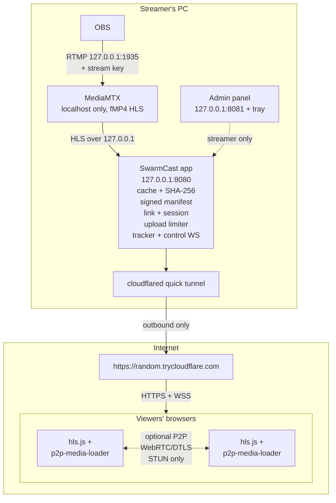

# Development

For developers and maintainers. Streamers and viewers: everything is on the website,
<https://lucas-angelo.github.io/swarmcast/> (English and Brazilian Portuguese), built from [`site/`](../site/).

## How it fits together



Details: [ARCHITECTURE.md](ARCHITECTURE.md).

## Security in short

- Each stream gets a new 256-bit link. The admin panel is only reachable from the streamer's PC.
- Viewers never see the streamer's IP in the default mode, because the tunnel sits in front of the PC.
- Every segment a viewer gets from another viewer is checked against the signed SHA-256 hash before it reaches the player.
- "Stop everything" disconnects viewers, closes the tunnel, stops MediaMTX, wipes the cache and then checks that nothing is still running or reachable.
- Remaining risks:
  - Viewers who turn on P2P see each other's IP addresses.
  - Cloudflare terminates TLS at its edge.
  - The free tunnel has no uptime guarantee.
  - Direct mode (opt-in) shows the streamer's IP to everyone who has the link.
  - Nothing can stop a viewer from recording the screen.

  Full list: [THREAT_MODEL.md](THREAT_MODEL.md).

## Install scripts (script mode)

The desktop app ([DESKTOP.md](DESKTOP.md)) is the normal way to install SwarmCast. The start scripts in
[`scripts/`](../scripts/README.md) remain for advanced users and servers; the streamer-facing steps are on the
website ("Advanced: install with a script"), and the offline guide inside the installer zips is generated from
the same website pages by `scripts/build/guide-html.mjs`.

The same script does everything:
- checks the computer and runs a short speed test;
- installs or updates SwarmCast (from the installer zip next to it, or online) for the current user, with no admin rights (`%LOCALAPPDATA%\SwarmCast`, `~/Library/Application Support/SwarmCast` or `~/.local/share/swarmcast`);
- verifies the SHA-256 checksums;
- downloads the free video converter (ffmpeg) for the extra viewer qualities straight from its publisher, checks its SHA-256 and keeps it in `<data>/tools/ffmpeg` (re-downloaded only when the pinned build changes; skipped with a note when offline, and SwarmCast still works with the original quality);
- updates atomically, retries failed steps a few times (2 s, 5 s, 10 s), and rolls back to the previous version if the update fails or the new version does not start;
- saves the computer check to `<data>/system-check.json` for the panel;
- starts the app. It never asks questions in the terminal (a below-minimum computer gets a warning, not a prompt); on errors the window stays open with what to do.

Script flags: `--no-tunnel`, `--install-only`, `--smoke-test`, `--skip-speedtest`, `--no-ffmpeg`, `--ask` (ask before continuing on a below-minimum computer), `--yes` (answers `--ask` questions; kept for compatibility) — on Windows also `-NoTunnel`, `-NoFfmpeg`, `-Ask`, `-Yes`, and so on.

**Requirements:** at least 4 GB RAM, 2 CPU cores and 10 Mbps upload. Recommended: 8 GB, 4 cores, 50 Mbps+ upload.

## Configuration

`config.json` lives in the data folder above. It is created on first run, and the panel edits the common settings.

| Key | Default | Meaning |
|-----|---------|---------|
| `ports.rtmp` / `public` / `admin` / `mediamtxHls` | 1935 / 8080 / 8081 / 8888 | Local ports (all bound to 127.0.0.1). If `public` or `admin` is busy, the next free port is used for that run; `rtmp` must be free because OBS points at it |
| `uploadLimitMbps` | 100 | Hard global cap on what the PC uploads to viewers |
| `maxViewers` | 500 | Cap on simultaneous viewer sessions; further joins see "stream is full" (panel; lowering it never drops anyone watching) |
| `maxSessionsPerDevice` | 3 | Sessions one browser may hold (the oldest is replaced) (panel) |
| `security.blockKnownBadIps` | true | Refuse IPs on free public blocklists (Spamhaus DROP + DROPv6, FireHOL level1), downloaded at start and every 24 h, cached in `blocklists/` (panel) |
| `security.requireBrowserCheck` | true | Ask new viewers' browsers for a short proof-of-work (ALTCHA protocol, self-hosted), once per browser: a signed `sc_verified` cookie remembers it for 30 days (panel) |
| `configVersion` | 2 | Format version. Files without it are from v0.1.0: their `requireBrowserCheck: false` (the old default) is switched on once |
| `security.autoBrowserCheck` | true | Turn the browser check on automatically on unusual activity / attacks (panel) |
| `security.autoTighten` | true | Under attack: stricter per-IP join limits, 1 session per browser, viewer cap held near the current audience (panel) |
| `security.autoNewLink` | false | Under attack (Secure mode): generate a new link automatically; you must resend it (panel) |
| `security.autoSecureFromDirect` | true | Direct mode: go back to Secure mode at the first attack signs (panel) |
| `security.autoStopIfDirectFails` | true | Direct mode: Stop everything if going back fails (panel) |
| `security.stopOnAttack` | false | Stop everything when an attack is detected (panel) |
| `security.blocklists` | `["spamhaus-drop","spamhaus-drop-v6","firehol-level1"]` | Built-in lists; `"feodo"` (abuse.ch Feodo Tracker, already inside FireHOL level1) is optional |
| `security.extraBlocklistUrls` | `[]` | Extra `https://` lists (one IP/CIDR per line), e.g. blocklist.de or Tor exit lists. Not recommended: aggressive lists block innocent viewers |
| `autoStopMinutes` | 10 | Stop everything after this long without video from OBS |
| `alsoStreamingElsewhere` | true | Reserve upload for another platform you stream to at the same time (e.g. Twitch, YouTube, Kick) in the capacity estimate |
| `tunnel.provider` | `cloudflare-quick` | `cloudflare-quick`, `none` (local only) or `external` |
| `tunnel.externalUrl` | — | Public base URL of your own reverse proxy/tunnel (`external` only) |
| `stunServers` | `["stun:stun.cloudflare.com:3478"]` | STUN servers given to viewers |
| `trustTunnelProxy` | true | Read `CF-Connecting-IP` from the local tunnel connector |
| `speedTest.enabled` / `intervalMinutes` | true / 15 | Automatic speed test at launch and while off |
| `quality.ladder.mode` | `auto` | `auto`: offer extra qualities when this PC can make them safely (graphics-chip encoder: 720p/480p/360p; CPU only: one small rendition if the CPU test passes). `manual`: the streamer's own choice below, kept on every start (panel: "Stream in multiple qualities") |
| `quality.ladder.enabled` / `heights` | true / `[720, 480, 360]` | Manual mode: the switch and the renditions to add below the original (panel) |
| `quality.ladder.encoder` | `auto` | Force one encoder (`h264_nvenc`, `h264_qsv`, `h264_amf`, `h264_videotoolbox`, `h264_vaapi`, `libx264`, `libopenh264`) (panel, Advanced) |
| `quality.upload.mode` / `otherStreamKbps` / `headroomPercent` | `auto` / null / 15 | Adaptive upload cap, bitrate you send to other platforms (null = detect), share of the upload kept free (panel) |
| `quality.obsWebsocket.enabled` / `url` / `password` | false / `ws://127.0.0.1:4455` / — | Read the main stream's health from OBS (loopback only) (panel) |
| `ffmpegPath` | — | ffmpeg for the extra qualities. Unset: `bin/ffmpeg` if a packager bundled it, else `<data>/tools/ffmpeg/ffmpeg[.exe]` (installed by the start scripts or the panel). `SWARMCAST_FFMPEG` overrides it; `"ffmpeg"` uses the one on PATH (source checkouts only) |

**ffmpeg licensing.** SwarmCast does not ship or redistribute ffmpeg. The user's own computer downloads the build pinned in `scripts/build/versions.json` (published with each release as `binaries.json`) straight from its publisher (BtbN LGPL builds on Windows/Linux, Martin Riedl builds on macOS) and checks its SHA-256. See [QUALITY.md](QUALITY.md).

`secrets.json` holds the stream key and the Ed25519 signing key. It is generated on first run with mode 0600 and is never logged. The other data files are `state.json` (last direct-mode IP, open router mapping), `blocklists/` (cached public IP lists with their download date) and `logs/`.

App flags (`swarmcast --help`): `--no-tunnel`, `--no-open`, `--no-tray`, `--no-autostart`, `--smoke-test`, `--data-dir DIR`, `--version`. Environment variables: `SWARMCAST_DATA_DIR`, `SWARMCAST_BIN_DIR`, `SWARMCAST_LOG_LEVEL`.

## Development

Requires Node 24 (`.nvmrc`). The integration and E2E tests also need `ffmpeg`, and the E2E Chromium project uses Google Chrome. To build the tray helper you need Go 1.23+ ([apps/tray/README.md](../apps/tray/README.md)).

```sh
npm ci
npm run fetch-bins        # MediaMTX + cloudflared for this OS into vendor/<os-arch>/ (SHA-256 pinned)
npm run build             # shared → viewer → admin → server
npm test                  # unit tests (vitest)
npm run test:integration  # real MediaMTX + ffmpeg test stream
npm run test:e2e          # Playwright: Chrome, Firefox, WebKit (npx playwright install first; SWARMCAST_E2E_PORT_OFFSET=N moves its ports)
npm run dev               # run the app from source (tsx)
npm run lint && npm run typecheck
```

Layout: [apps/](../apps/README.md) (server, viewer, admin, tray), [packages/](../packages/README.md) (shared types), [scripts/](../scripts/README.md) (install and build scripts).

## Website

`site/` is a standalone Astro Starlight project with its own `package-lock.json` (not a root workspace, so the
app's CI and release jobs never install Astro). English pages are in `site/src/content/docs/`, Brazilian
Portuguese in `site/src/content/docs/pt-br/` (same file names).

```sh
cd site && npm ci
npm run dev        # http://localhost:4321/swarmcast/
npm run build      # fails on broken internal links (starlight-links-validator)
npm run check      # types
npm run test:e2e   # Playwright against the built site (SITE_E2E_PORT moves its port)
```

- Branding (logo, favicon, mascot, accent colour): `site/src/brand.mjs`.
- Offline guide pages and order: `site/offline-guide.json`; `node scripts/build/guide-html.mjs out.html --lang en|pt-BR`.
- Usage numbers without telemetry: `scripts/stats/` and `.github/workflows/stats.yml` (data on the `stats` branch),
  explained to visitors on the site's "Privacy and usage numbers" page.
- Deploy: `.github/workflows/site.yml` (GitHub Pages, source "GitHub Actions").

## Version policy

Everything is pinned so a surprise major release cannot break a build, while bug fixes still flow in:

- **npm:** `^` ranges in `package.json` (minor + patch, never a new major) and an exact `package-lock.json`; `npm ci` installs exactly the lockfile. Dependabot groups minor/patch updates weekly and ignores majors, which are upgraded deliberately.
- **MediaMTX / cloudflared:** exact versions with SHA-256 in [`scripts/build/versions.json`](../scripts/build/versions.json). `node scripts/build/update-binaries.mjs --check` (also a scheduled CI job) reports newer releases within the same major; running it without `--check` rewrites the pins and hashes.
- **Toolchains:** Node `24.x` (embedded runtime: Node 24 LTS via `@yao-pkg/pkg`), Go `1.27.x` for the tray helper, Playwright browsers from the lockfile, GitHub Actions pinned by commit SHA (Dependabot updates them).

## Releases

Pushing a tag `vX.Y.Z` runs the release workflow. It builds and tests every platform, then publishes `SwarmCast-vX.Y.Z-{windows-x64.zip, macos-arm64.tar.gz, macos-x64.tar.gz, linux-x64.tar.gz, linux-arm64.tar.gz}`, one `SwarmCast-vX.Y.Z-<target>-installer.zip` per target (start script + package + its checksum + guide), `SHA256SUMS.txt` and the start scripts to GitHub Releases, and optionally to a public mirror repository. Maintainer guide (Portuguese): [PUBLICACAO_PT-BR.md](PUBLICACAO_PT-BR.md).

**Binaries are unsigned by default.** Windows SmartScreen shows "Windows protected your PC" (click **More info → Run anyway**). macOS Gatekeeper may block the app (open **System Settings → Privacy & Security → Open Anyway**). The start scripts handle the usual cases. Code signing and notarization switch on automatically when the signing secrets are set in the repository (see the maintainer guide).
