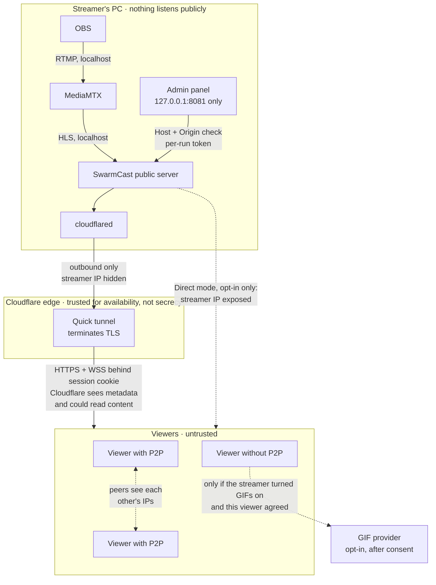

# Threat model

## Assets

1. The streamer's PC and home network, including the public IP and the router.
2. The stream itself, meant for members only.
3. The stream key and the Ed25519 signing key (`secrets.json`).
4. The live link and viewer sessions.
5. Viewer privacy: IPs, and nicknames. Since v0.4.0 nicknames are **visible to every member of the live** (they appear in the chat); IPs stay private.
6. The admin panel, which controls all of the above.
7. Other viewers' devices: their browser tabs, CPU, battery and, on old phones, the whole device (OS text-rendering crashes). Chat and the streamer's page put untrusted text in front of every viewer.
8. The chat's integrity: who said what. No impersonation of the streamer or of another viewer, no forged or hidden messages.
9. Viewer nicknames and name colours, now visible to all viewers.
10. The streamer's identity and branding ("Your page": name, pictures, links, support and Pix details): shown to members only, never to someone without a valid link.

## Actors

| Actor | Can | Goal |
|-------|-----|------|
| Member (viewer) | Open the link, watch, join P2P | Watch; a few may misbehave |
| Leaker | Has a copy of the link | Let non-members watch |
| Malicious peer | Join P2P with a valid session | Inject bad video, spoof peers, harvest IPs, flood |
| Internet attacker | Scan, send requests, run websites the streamer visits | Reach the panel or ports, DoS |
| Local malware / other users on the PC | Read files, connect to localhost | Steal secrets, hijack the stream |
| Infrastructure (Cloudflare, ISP) | See traffic metadata | — (trusted for availability, not for secrecy) |
| Troll (a valid member) | Chat within the limits | Crash or freeze other viewers, impersonate the streamer, flood, post offensive content |
| Raider (many members from one leaked link) | Many sessions, each paying the join proof-of-work | Message storm, join storm |
| Script with a valid session | Send raw frames on `/control`, ignore the page's limits, read nothing back | Oversized or malformed frames, slow-consumer memory growth |
| GIF provider (KLIPY, GIPHY; only when the streamer turns GIFs on) | See the requests of viewers who agreed to load GIFs | Tracking (IP, user agent, searches); content past the rating filter |
| Messaging platforms (link previews) | Fetch `/join/<secret>` when the link is pasted | Show the preview to everyone in a conversation |

## Trust boundaries

## Mitigations

- **Nothing listens publicly in the default mode.** MediaMTX, the public server and the admin panel bind only to 127.0.0.1. The tunnel connects outbound. MediaMTX accepts publishing only on `live/<stream key>` from localhost, and every other protocol is disabled.
- **Admin panel**:
  - lives on a separate port (8081) that the tunnel never routes to;
  - checks `Host` and `Origin` against 127.0.0.1/localhost (DNS rebinding, CSRF);
  - requires `Origin` on every non-GET request;
  - authenticates with a per-run random token cookie (SameSite=Strict, HttpOnly);
  - runs under a strict CSP.
- **Link and sessions**:
  - The secret is 256-bit and compared in constant time; a new one is generated for every stream and on demand.
  - The secret leaves the URL right away (ticket cookie + 303 redirect).
  - Session JWTs use a per-live random key and last 10 minutes, renewed while active.
  - Cookies are HttpOnly, Secure and SameSite=Lax.
  - Everything is in memory and wiped by Stop.
- **Kick**: ends the session and blocks the device cookie for the rest of the stream. **Generate new link** stops anyone who still has the old link from joining. Individual IPs are deliberately not banned, because mobile CGNAT puts many members behind one IP (only networks on conservative public blocklists are refused, see below).
- **P2P integrity**:
  - Each segment's SHA-256 goes into a manifest signed with Ed25519, and the viewer verifies the signature with WebCrypto.
  - Every P2P segment is checked before it reaches the player; a bad or unknown segment is refetched over HTTPS.
  - A peer that fails validation is disconnected and reported. Three reports against one session remove it from P2P automatically, and the panel shows a warning.
- **Tracker**: WebSocket only, behind the session cookie and an `Origin` = `Host` check.
  - It accepts only this live's infohashes.
  - It pins each socket's peer id, so a peer cannot stop or impersonate other peers.
  - It refuses watch-only sessions.
  - Limits: 60 messages per 10 s and 64 KB per message.
  - Viewers' peer guard also closes existing connections to peers that were blocked.
- **Abuse limits**:
  - Rate limits on `/join`, `/api/join`, the API overall, the tracker and the control channel (30 messages per 10 s, 4 KB; chat frames have their own budget of 20 per 10 s and 2 KB).
  - A global upload cap.
  - Small request bodies and short timeouts, even shorter in direct mode, plus a connection cap.
- **Attack detection and automatic reactions** (`apps/server/src/security/`):
  - A rolling-window detector watches requests/s, join attempts/s, refused joins/s, our own 429s, WebSocket upgrade attempts, open connections, TLS handshake errors (Direct mode), distinct client IPs and upload-limiter saturation. Thresholds adapt to the audience (EWMA baselines learned only while calm, plus per-viewer and absolute floors), with normal → suspicious → attack states and time-based hysteresis.
  - Secure mode: suspicious → light proof-of-work on join; attack → stricter per-IP join limits, one session per browser, viewer cap held near the current audience, stronger proof-of-work, and optionally a new link (off by default).
  - Direct mode: at the first attack signs → back to Secure mode (tunnel), and Stop everything if that fails (both on by default). An optional switch stops everything on any detected attack. Direct mode is never turned on automatically.
  - Everything is explained in the panel (warning with a code, EN/pt-BR), the activity log and a desktop notification; "End alert" resets it.
- **Proof-of-work on join** (ALTCHA protocol via `altcha-lib`, MIT, self-hosted): HMAC-signed SHA-256 challenges with a 10-minute expiry, solved in a same-origin Web Worker, verified with a per-live secret and single use. On by default (since 2026-10-26; a v0.1.0 `config.json` that saved the old default is switched on once) and stronger under attack. A browser that solves it gets a signed `sc_verified` cookie (HMAC-SHA256, key `browserCheckKey` in `secrets.json`, bound to the device cookie, records the solved level, 30 days; HttpOnly, SameSite=Lax, Secure like the other cookies), so it is not asked again unless the detector needs a higher level. The cookie only skips the proof-of-work: the link/ticket and the device ban are always checked first, and "New link" / "Disconnect everyone" keep it on purpose. A verified device still holds at most `maxSessionsPerDevice` sessions (1 while tightened), so concurrent fake viewers need one solve per device. Cookies are per address, so with a quick tunnel (new hostname every live) viewers solve it once per live. It raises the cost of scripted mass joins; it does not stop a botnet or a traffic flood.
- **Public IP blocklists** (Spamhaus DROP/DROPv6, FireHOL level1; free, no account, only a plain GET): checked on `/join/<secret>`, `/api/join`, the challenge endpoint and WebSocket upgrades with a sorted-range binary search. Loopback, private, CGNAT and link-local addresses are never blocked (FireHOL includes them as bogons). Refusals are counted in the panel and logged only as a /24 or /48 prefix. Aggressive lists (blocklist.de, Tor exits) are config-only.
- **Browser hardening**:
  - CSP `script-src 'self'` plus the SHA-256 of one fixed inline script (the pages' startup guard, which reloads a page whose own script failed to load), never `'unsafe-inline'`; connections go only to the page's own origin and STUN.
  - HSTS, `Referrer-Policy: no-referrer`, Permissions-Policy, nosniff, `frame-ancestors 'none'`, COOP/CORP.
  - No analytics and no third-party requests on viewer pages except STUN. The one opt-in exception is chat GIFs: only while the streamer has them on, and only after each viewer agrees.
- **IP handling**: `CF-Connecting-IP` is trusted only from the local tunnel connector, and `X-Forwarded-For` is never read. Viewer IPs are kept only in memory.
- **Secrets on disk**: `secrets.json` and `config.json` are mode 0600 inside a 0700 folder. Logs redact stream keys, links, tokens and cookies.
- **Shutdown**: Stop verifies that no process, port or public URL is left. The reaper kills child processes if the app crashes. Direct mode removes its router mapping and confirms it is gone, and a mapping left by a crash can be closed from the panel.

### Chat (v0.4.0)

Details in [CHAT.md](CHAT.md).

| # | Threat | Mitigation |
|---|---|---|
| T1 | XSS through a message or nickname | Never `innerHTML`: `textContent` only, enforced by an ESLint rule in the chat folders. No markup language. CSP stays `script-src 'self'` (plus the hash of the fixed startup guard, never `'unsafe-inline'`) |
| T2 | Zalgo / combining-mark floods that freeze text shaping or spill over the layout | At most 4 consecutive marks, never the same mark twice (UTS #39 §5.4); more than 20 dropped marks reject the message; at most 16 code points per grapheme; every message is a clipped box |
| T3 | Bidi overrides that reverse a name or spoof text | All explicit embeddings, overrides and isolates removed; at most 4 implicit marks; names and text rendered inside `<bdi>` |
| T4 | Invisible text: empty-looking messages, invisible names, data smuggled in tags or variation selectors | Default-ignorable code points removed (joiners and selectors only in valid contexts); tags only inside RGI flags; at most one selector per grapheme; messages with nothing visible rejected |
| T5 | Huge emoji ZWJ sequences | An emoji grapheme with joiners must be RGI, at most 10 code points and 3 ZWJs; an emoji cap per message |
| T6 | Homoglyph impersonation ("Streamer" in Cyrillic, "lucas" vs "Iucas") | Nickname allowlist with one script per name; confusable-skeleton uniqueness among live names and reserved names; the streamer badge comes from the role, never from a name |
| T7 | Control characters and line separators (layout breaks, log injection) | Removed; a message is one line |
| T8 | Normalisation tricks (decomposed forms past blocked words, NFKC expansion) | NFC for display; NFKC + case folding + skeleton only for comparisons; the input is capped before normalising |
| T9 | Known OS/font crash strings (Effective Power, Telugu, Black Dot, Sindhi) | Structural rules (RFC 5892 joiner contexts, bidi-mark and mark caps) and a regression corpus |
| T10 | Lone surrogates or invalid UTF-8 | Rejected (`isWellFormed`); `ws` validates UTF-8 |
| T11 | ReDoS in validation | Linear scanners and single code-point tests; a test rejects quantified groups in every regex of `chat/` |
| T12 | Message storm, join storm, slow consumers | Raw size (2 KB) and a separate chat frame budget (20 per 10 s) before parsing; per-device, per-IP and global buckets; a chat upload budget (5 % of the upload cap, 128–960 kbps); batched fan-out that skips slow sockets; a bounded ring and queue; automatic slow mode and protection; an event-loop guard |
| T13 | Image attacks (decoding bombs, SVG scripts, tracking pixels) | No URL in a message ever becomes an image. GIFs are a provider id + size, rendered from a fixed URL template on an allowlisted host. No SVG anywhere |
| T14 | IP harvesting through chat ("click my link", tracking images) | Links are never clickable and never previewed; no `` from user-supplied URLs; the streamer can block links |
| T15 | Moderation evasion: rejoin after a mute | Mutes are keyed by device cookie and session and survive rejoin within the live; rejoining costs the proof-of-work; an optional new-viewer wait; a new link for the rest |
| T16 | A forged pin or highlight ("📌 PINNED by the streamer: …" typed by a viewer, or a crafted frame), or a pin outliving moderation (v0.5.0) | Only the panel can highlight or pin (local REST behind the panel login and the Host/Origin checks, zod bodies); no viewer frame exists for it. The pinned bar is a separate element above the list, filled only from server state, its label UI chrome; a viewer's own text stays in their own row under their own name. Pinned and highlighted text is the server's canonical copy, rendered with the same text-node rules and invariants. Deleting the message, Clear chat and Stop unpin; at most 20 highlights (docs/CHAT.md, "Highlight and pin") |

Also: a chat flood alone raises the shield to "suspicious" at most (light browser check for new joins) and never drops viewers, rotates the link, leaves Direct mode or stops the stream. Chat never opens a connection to the streamer (no WebRTC for chat). Message text is never written to disk or logs; moderation never uses IPs. GIFs are off by default; when the streamer turns them on, the viewer CSP lists the provider's hosts and each viewer's browser contacts the provider only after that viewer agrees.

### Your page (v0.4.0)

Details in [BRANDING.md](BRANDING.md). The streamer is trusted (she already controls what viewers receive); these rules defend against realistic accidents: a photo with GPS, a crafted image from the web, a phishing link, an unreadable colour, a hostname scanner.

| # | Threat | Mitigation |
|---|---|---|
| B1 | SVG with script, external references or an XML bomb | Refused by type and sniffing in the panel and by magic bytes on the server; only PNG, JPEG and WebP are stored |
| B2 | GPS, camera or name metadata in an uploaded photo | Canvas re-encode in the panel; the server keeps only pixel chunks (EXIF, XMP, ICC, IPTC, text, comments dropped); tests scan the stored bytes |
| B3 | Decompression or dimension bombs | Declared size checked before decoding in the panel (at most 50 MP); exact slot sizes and a bounded PNG inflate on the server; viewers decode at most 1280 × 320 |
| B4 | A crafted file aimed at browser image decoders, reaching all viewers | Viewers only get canvas-encoded bytes, never the original |
| B5 | Content-type confusion | Type from the sniffed bytes, `nosniff`, hash-derived names whose extension must match, the CSP on every answer |
| B6 | XSS through name, bio, tags or link labels | `textContent` only; the only server-rendered HTML (the preview page) escapes every value, tested with the chat corpus |
| B7 | Unicode abuse in the streamer's texts | The chat pipeline per field, plus line caps; `<bdi>` and clipped boxes |
| B8 | Malicious or mistyped links (`javascript:`, credentials in the URL, look-alike hosts, LAN targets, the stream's own host) | https and mailto only, parsed with the WHATWG parser; public hosts only; the host shown in punycode; `noopener noreferrer nofollow` |
| B9 | Unreadable or deceptive colours | Accent derivation with enforced contrast in both themes; status colours and the focus ring cannot be changed; no custom CSS or JavaScript |
| B10 | Learning whose stream it is by probing hostnames | Branding only behind a valid ticket or session; stock answers everywhere else; `/healthz` reveals the live marker only to the app's own probe |
| B11 | The edge cache bypassing the members-only gate | `Cache-Control: private` on every branded answer |
| B12 | Preview cards leaking to messaging platforms | Off by default; only name, tagline and card image; the card URL is derived from the current link and dies with "Generate new link" |
| B13 | Upload DoS of the panel or the disk | 512 KB body limit, per-slot caps, at most 9 files and 1.5 MB on disk, GC after every change |
| B14 | Bandwidth drain through repeated image fetches | Images go through the upload limiter; rate limits; `lite` mode under attack |
| B15 | Pix exposing the streamer's legal identity | A mandatory warning; a random key recommended; CPF and phone keys need a second confirmation |
| B16 | Branding in diagnostics exports | Replaced by a summary |

## Residual risks (accepted)

1. **P2P exposes IPs between viewers.** Viewers who turn P2P on (it is off by default) can see each other's public IP addresses (WebRTC), which reveals an approximate location (city) and internet provider. The viewer page explains this in the tooltip next to the P2P switch; viewers can turn P2P off at any time (the choice is remembered) and still watch over HTTPS, and the streamer can remove anyone from P2P. A viewer on the streamer's own internet connection (the streamer on a phone, someone at home) would show every other P2P viewer the IP the server runs behind, so in Secure mode the server learns its own public addresses (Cloudflare's trace endpoint, again on network changes and every 10 minutes) and keeps P2P off for any session whose `CF-Connecting-IP` is its IPv4 or shares its IPv6 /64; the tracker refuses those sessions too. While the address is unknown (lookup failed), P2P waits for everyone. Limits: it needs the client address from the quick tunnel (an external proxy gives none), and a home device that reaches the tunnel over IPv6 while the server has no IPv6 is not recognised.
2. **Cloudflare is in the path.** The quick tunnel terminates TLS at Cloudflare's edge, so Cloudflare can see traffic metadata and, technically, the content. The free tunnel is best-effort: it has no uptime guarantee and allows 200 requests in flight, every open WebSocket included (one per viewer; measured), so it holds about 120 viewers. It may fail with larger audiences, and Cloudflare's terms on video may apply.
3. **Direct mode exposes the streamer's IP** to everyone who has the link, which risks DDoS and reveals the approximate location. It is opt-in only, needs an explicit risk checkbox and opens a single random port. The IP may stay the same afterwards; unplugging the modem for a few minutes sometimes helps, but that is not guaranteed. The closed-port check is local only (router listing + hairpin probe), not a real external scan. A self-signed certificate (the fallback) trains viewers to click through a warning.
4. **A kicked person can rejoin from another device** if they still have the link, because device blocking relies on a cookie. Generating a new link closes this gap.
5. **Anyone with the link can watch.** A member can forward the link before the streamer notices. The defenses are a new link per stream, "Generate new link" and Kick.
6. **Recording and screen capture are not prevented**, since there is no DRM.
7. **False hash-failure reports.** Three viewers colluding can get someone removed from P2P. The victim keeps watching over HTTPS, and the streamer can allow them again.
8. **Local compromise.** Malware running as the streamer's user can read `secrets.json` and drive the panel. That is out of scope.
9. **Attack detection is heuristic.** A very slow or very distributed attack may stay under the thresholds, and an unusual but legitimate surge may trigger "suspicious" (the reactions are mild by default: a stronger 1–2 s browser check and temporary join limits; nobody already watching is dropped). Proof-of-work only makes scripted joins costlier; native solvers and botnets pay it easily.
10. **Public blocklists can be wrong or stale.** They stop known bad networks, not floods from infected home computers; a listed network reassigned to a legitimate user would be refused until the lists update (daily). The streamer can switch blocking off in the panel.
11. **Unsigned binaries** unless the maintainer configures code signing. Downloads are verified with SHA-256 by the start scripts, which protects against corruption and tampering with a single asset, but not against a compromised GitHub release.
12. **Unknown OS text-rendering bugs.** The chat and page rules remove every known crash pattern and bound the shaping work, but a new bug in an OS font stack (as iOS had in 2015, 2018 and 2020) cannot be ruled out. The regression corpus grows when one is published.
13. **Nicknames are public inside the live.** Everyone with the link sees every chatting viewer's nickname and colour. The join page says so; viewers choose what to type.
14. **Chat content is moderated after the fact.** Offensive text can appear until the streamer deletes it or mutes the author; blocked words catch only what she lists. A mute lasts at most until the end of the live: there are no accounts, so the next live cannot recognise the person.
15. **The GIF provider sees viewers who agree.** With GIFs on (off by default), KLIPY (or GIPHY) sees the IP address, user agent and searches of each viewer who agreed to load GIFs, and the streamer's IP if she searches GIFs in her panel. Its rating filter can miss content.
16. **Pix reveals the streamer's legal name.** Anyone who sends a Pix sees her full legal name, part of her CPF and her bank, whatever the key type. The panel warns about it.
17. **Link preview cards, when turned on,** send the channel name, tagline and card image to the messaging platform and show them to everyone in that conversation, including people who never open the link.
18. **Validating an image is not sanitising it.** The server's structural check cannot prove that JPEG or WebP entropy-coded data is benign; viewers are protected by the panel's canvas re-encode, but the streamer's own panel decodes the original file she picked.
19. **Members may forward what they see.** Names, pictures, links and support details on "Your page" are visible to every member, who can screenshot or copy them.
