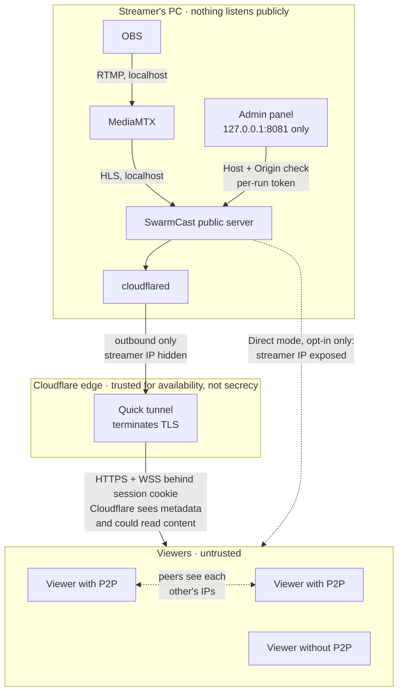

# Threat model

## Assets

1. The streamer's PC and home network, including the public IP and the router.
2. The stream itself, meant for members only.
3. The stream key and the Ed25519 signing key (`secrets.json`).
4. The live link and viewer sessions.
5. Viewer privacy: IPs and nicknames.
6. The admin panel, which controls all of the above.

## Actors

| Actor | Can | Goal |
|-------|-----|------|
| Member (viewer) | Open the link, watch, join P2P | Watch; a few may misbehave |
| Leaker | Has a copy of the link | Let non-members watch |
| Malicious peer | Join P2P with a valid session | Inject bad video, spoof peers, harvest IPs, flood |
| Internet attacker | Scan, send requests, run websites the streamer visits | Reach the panel or ports, DoS |
| Local malware / other users on the PC | Read files, connect to localhost | Steal secrets, hijack the stream |
| Infrastructure (Cloudflare, ISP) | See traffic metadata | — (trusted for availability, not for secrecy) |

## Trust boundaries

## Mitigations

- **Nothing listens publicly in the default mode.** MediaMTX, the public server and the admin panel bind only to 127.0.0.1. The tunnel connects outbound. MediaMTX accepts publishing only on `live/<stream key>` from localhost, and every other protocol is disabled.
- **Admin panel**:
  - lives on a separate port (8081) that the tunnel never routes to;
  - checks `Host` and `Origin` against 127.0.0.1/localhost (DNS rebinding, CSRF);
  - requires `Origin` on every non-GET request;
  - authenticates with a per-run random token cookie (SameSite=Strict, HttpOnly);
  - runs under a strict CSP.
- **Link and sessions**:
  - The secret is 256-bit and compared in constant time; a new one is generated for every stream and on demand.
  - The secret leaves the URL right away (ticket cookie + 303 redirect).
  - Session JWTs use a per-live random key and last 10 minutes, renewed while active.
  - Cookies are HttpOnly, Secure and SameSite=Lax.
  - Everything is in memory and wiped by Stop.
- **Kick**: ends the session and blocks the device cookie for the rest of the stream. **Generate new link** stops anyone who still has the old link from joining. Individual IPs are deliberately not banned, because mobile CGNAT puts many members behind one IP (only networks on conservative public blocklists are refused, see below).
- **P2P integrity**:
  - Each segment's SHA-256 goes into a manifest signed with Ed25519, and the viewer verifies the signature with WebCrypto.
  - Every P2P segment is checked before it reaches the player; a bad or unknown segment is refetched over HTTPS.
  - A peer that fails validation is disconnected and reported. Three reports against one session remove it from P2P automatically, and the panel shows a warning.
- **Tracker**: WebSocket only, behind the session cookie and an `Origin` = `Host` check.
  - It accepts only this live's infohashes.
  - It pins each socket's peer id, so a peer cannot stop or impersonate other peers.
  - It refuses watch-only sessions.
  - Limits: 60 messages per 10 s and 64 KB per message.
  - Viewers' peer guard also closes existing connections to peers that were blocked.
- **Abuse limits**:
  - Rate limits on `/join`, `/api/join`, the API overall, the tracker and the control channel (30 messages per 10 s, 4 KB).
  - A global upload cap.
  - Small request bodies and short timeouts, even shorter in direct mode, plus a connection cap.
- **Attack detection and automatic reactions** (`apps/server/src/security/`):
  - A rolling-window detector watches requests/s, join attempts/s, refused joins/s, our own 429s, WebSocket upgrade attempts, open connections, TLS handshake errors (Direct mode), distinct client IPs and upload-limiter saturation. Thresholds adapt to the audience (EWMA baselines learned only while calm, plus per-viewer and absolute floors), with normal → suspicious → attack states and time-based hysteresis.
  - Secure mode: suspicious → light proof-of-work on join; attack → stricter per-IP join limits, one session per browser, viewer cap held near the current audience, stronger proof-of-work, and optionally a new link (off by default).
  - Direct mode: at the first attack signs → back to Secure mode (tunnel), and Stop everything if that fails (both on by default). An optional switch stops everything on any detected attack. Direct mode is never turned on automatically.
  - Everything is explained in the panel (warning with a code, EN/pt-BR), the activity log and a desktop notification; "End alert" resets it.
- **Proof-of-work on join** (ALTCHA protocol via `altcha-lib`, MIT, self-hosted): HMAC-signed SHA-256 challenges with a 10-minute expiry, solved in a same-origin Web Worker, verified with a per-live secret and single use. On by default (since 2026-10-26; a v0.1.0 `config.json` that saved the old default is switched on once) and stronger under attack. A browser that solves it gets a signed `sc_verified` cookie (HMAC-SHA256, key `browserCheckKey` in `secrets.json`, bound to the device cookie, records the solved level, 30 days; HttpOnly, SameSite=Lax, Secure like the other cookies), so it is not asked again unless the detector needs a higher level. The cookie only skips the proof-of-work: the link/ticket and the device ban are always checked first, and "New link" / "Disconnect everyone" keep it on purpose. A verified device still holds at most `maxSessionsPerDevice` sessions (1 while tightened), so concurrent fake viewers need one solve per device. Cookies are per address, so with a quick tunnel (new hostname every live) viewers solve it once per live. It raises the cost of scripted mass joins; it does not stop a botnet or a traffic flood.
- **Public IP blocklists** (Spamhaus DROP/DROPv6, FireHOL level1; free, no account, only a plain GET): checked on `/join/<secret>`, `/api/join`, the challenge endpoint and WebSocket upgrades with a sorted-range binary search. Loopback, private, CGNAT and link-local addresses are never blocked (FireHOL includes them as bogons). Refusals are counted in the panel and logged only as a /24 or /48 prefix. Aggressive lists (blocklist.de, Tor exits) are config-only.
- **Browser hardening**:
  - CSP without inline scripts; connections go only to the page's own origin and STUN.
  - HSTS, `Referrer-Policy: no-referrer`, Permissions-Policy, nosniff, `frame-ancestors 'none'`, COOP/CORP.
  - No analytics and no third-party requests on viewer pages except STUN.
- **IP handling**: `CF-Connecting-IP` is trusted only from the local tunnel connector, and `X-Forwarded-For` is never read. Viewer IPs are kept only in memory.
- **Secrets on disk**: `secrets.json` and `config.json` are mode 0600 inside a 0700 folder. Logs redact stream keys, links, tokens and cookies.
- **Shutdown**: Stop verifies that no process, port or public URL is left. The reaper kills child processes if the app crashes. Direct mode removes its router mapping and confirms it is gone, and a mapping left by a crash can be closed from the panel.

## Residual risks (accepted)

1. **P2P exposes IPs between viewers.** Viewers with P2P on (the default) can see each other's public IP addresses (WebRTC), which reveals an approximate location (city) and internet provider. The viewer page explains this in the tooltip next to the P2P switch; viewers can turn P2P off at any time (the choice is remembered) and still watch over HTTPS, and the streamer can remove anyone from P2P.
2. **Cloudflare is in the path.** The quick tunnel terminates TLS at Cloudflare's edge, so Cloudflare can see traffic metadata and, technically, the content. The free tunnel is best-effort: it has no uptime guarantee and allows about 200 in-flight requests. It may fail with large audiences, and Cloudflare's terms on video may apply.
3. **Direct mode exposes the streamer's IP** to everyone who has the link, which risks DDoS and reveals the approximate location. It is opt-in only, needs an explicit risk checkbox and opens a single random port. The IP may stay the same afterwards; unplugging the modem for a few minutes sometimes helps, but that is not guaranteed. The closed-port check is local only (router listing + hairpin probe), not a real external scan. A self-signed certificate (the fallback) trains viewers to click through a warning.
4. **A kicked person can rejoin from another device** if they still have the link, because device blocking relies on a cookie. Generating a new link closes this gap.
5. **Anyone with the link can watch.** A member can forward the link before the streamer notices. The defenses are a new link per stream, "Generate new link" and Kick.
6. **Recording and screen capture are not prevented**, since there is no DRM.
7. **False hash-failure reports.** Three viewers colluding can get someone removed from P2P. The victim keeps watching over HTTPS, and the streamer can allow them again.
8. **Local compromise.** Malware running as the streamer's user can read `secrets.json` and drive the panel. That is out of scope.
9. **Attack detection is heuristic.** A very slow or very distributed attack may stay under the thresholds, and an unusual but legitimate surge may trigger "suspicious" (the reactions are mild by default: a stronger 1–2 s browser check and temporary join limits; nobody already watching is dropped). Proof-of-work only makes scripted joins costlier; native solvers and botnets pay it easily.
10. **Public blocklists can be wrong or stale.** They stop known bad networks, not floods from infected home computers; a listed network reassigned to a legitimate user would be refused until the lists update (daily). The streamer can switch blocking off in the panel.
11. **Unsigned binaries** unless the maintainer configures code signing. Downloads are verified with SHA-256 by the start scripts, which protects against corruption and tampering with a single asset, but not against a compromised GitHub release.
