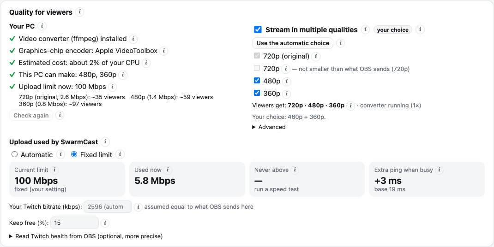
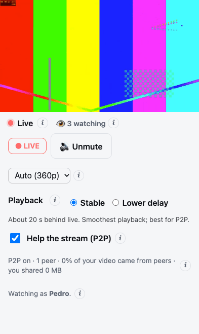

# SwarmCast: how to go live

SwarmCast lets your subscribers watch your stream through a secret link, straight from your computer. Viewers only need a browser.

Before you start: the free tunnel has no uptime guarantee and may fail with big audiences.

## 1. Install and open SwarmCast

There are two ways. Use the one the developer gave you.

**A. Installer zip (sent by the developer)**

1. Download the zip for your computer:
   - Windows: `SwarmCast-vX.Y.Z-windows-x64-installer.zip`
   - Mac with Apple chip (M1, M2, M3, M4): `SwarmCast-vX.Y.Z-macos-arm64-installer.zip`
   - Mac with Intel chip: `SwarmCast-vX.Y.Z-macos-x64-installer.zip`
   - Linux: `SwarmCast-vX.Y.Z-linux-x64-installer.zip`
2. Extract it. Do not run anything from inside the zip.
   - Windows: right-click the zip → **Extract All…** → **Extract**.
   - macOS: double-click the zip.
   - Linux: right-click → **Extract Here**.
3. Open the extracted folder and start the script:
   - **Windows:** double-click `start-windows.cmd`. The first time, Windows may show "Windows protected your PC": click **More info → Run anyway**. If it asks "Do you want to run this file?", click **Run**.
   - **macOS:** double-click `start-macos.command`. The first time, macOS blocks it. Right-click (or Control-click) the file → **Open** → **Open**. On macOS 15 or newer: click **Done** on the warning, open **System Settings → Privacy & Security**, scroll down and click **Open Anyway**, then confirm.
   - **Linux:** open a terminal in the folder and run `./start-linux.sh`.

**B. One-line command (only when the developer says it is available)**

- Windows (PowerShell): `irm https://github.com/Lucas-Angelo/swarmcast/releases/latest/download/start-windows.ps1 | iex`
- macOS (Terminal): `curl -fsSL https://github.com/Lucas-Angelo/swarmcast/releases/latest/download/start-macos.sh | bash`
- Linux (terminal): `curl -fsSL https://github.com/Lucas-Angelo/swarmcast/releases/latest/download/start-linux.sh | bash`

**What the window does**

1. It checks your computer: memory, processor, disk, internet speed and OBS. ✓ means fine, ⚠ means it works but is not ideal, ✗ means too low.
2. If something is below the minimum, it shows a ⚠ warning and continues anyway. It never asks you questions.
3. On Linux, if some basic tools are missing, it explains why and asks for your password (`sudo`) to install them. Nothing else needs administrator rights.
4. It installs or updates SwarmCast, checking that the files are intact (SHA-256). It also downloads the free video converter (ffmpeg) that lets viewers pick smaller qualities.
   If something goes wrong it tries again by itself; if it still fails, it tells you what to do and waits for Enter before closing.
5. The SwarmCast panel opens in your browser.

Keep this window open while you stream. Closing it turns SwarmCast off.

The first time, the panel opens a step-by-step tutorial (with OBS pictures) covering steps 2 to 6 below; to see it again, click **Redo setup tutorial** at the bottom of the panel.

## 2. Set up OBS (only once)

You may also stream to another platform at the same time (Twitch, YouTube, Kick, TikTok Live, Facebook…), or only to SwarmCast. Whatever you already use stays as it is.

- **Another platform and SwarmCast at the same time (Twitch, YouTube, Kick…):** OBS alone sends to one place only. A free plugin adds a second output, and your setup for the other platform stays as it is. Step by step (once):
  1. Close OBS. Download and install the **Multiple RTMP outputs** plugin (official page on the OBS forum: [obsproject.com/forum/resources/multiple-rtmp-outputs-plugin.964](https://obsproject.com/forum/resources/multiple-rtmp-outputs-plugin.964/), or the releases at [github.com/sorayuki/obs-multi-rtmp](https://github.com/sorayuki/obs-multi-rtmp/releases)). On Windows it is an `.exe` installer; on Mac a `.pkg`.
  2. Open OBS. A new panel called **Multiple output** appears. If you don't see it, open the **Docks** menu and tick **Multiple output**.
     
  3. In that panel click **Add new target** and fill in:
     - **Name:** `SwarmCast` (any name works);
     - **RTMP server:** `rtmp://127.0.0.1:1935/live` (the **Copy** button next to "Server" in the SwarmCast panel);
     - **Key:** the **stream key** from the SwarmCast panel (the **Copy** button next to "Stream key"; never show it on stream);
     - **Video/encoder:** pick the option that **shares the encoder with the main stream** (so your PC does not encode the video twice). The exact label can vary a little between plugin versions.
     - Save.
     
  4. **Don't touch** Settings → Stream: that is still your other platform.
  5. When you go live: click **Turn on SwarmCast** in the SwarmCast panel; in OBS click **Start Streaming** (goes to your other platform as usual) and, in the **Multiple output** panel, click **Start** next to "SwarmCast". If the plugin offers "sync start" with OBS, tick it to skip that click.
     
  6. Check the SwarmCast panel: it should say **OBS: sending**. To stop, click **Stop** in the plugin panel (or stop streaming in OBS if you use "sync start").
- **SwarmCast only:** go to Settings → Stream → Service "Custom...", enter the same server and key.
  
- **Either way:** go to Settings → Output → Output Mode "Advanced" → Streaming → **Keyframe Interval = 2 s**.
  

## 3. Every live

1. Start SwarmCast the same way as in step 1 (double-click the script). The panel opens.
2. In the panel, click **Turn on SwarmCast**.
3. Start streaming in OBS. With the plugin, also start the SwarmCast target (its **Start** button), unless it starts together with your stream.
   
4. The link appears under **Live link for your subscribers**. Every stream gets a new link.
   
5. Click **Copy link** and post it only for your subscribers, for example in a subs-only Discord channel.
   

## 4. During the live

The panel shows:

- **Viewers & P2P help:** who is watching (nickname and device) and who is helping through P2P.
- **Your internet** and **Your upload now:** how much of your upload SwarmCast uses, and the speed test.
  
- **Warnings** at the top, for example when there are too many viewers for your upload or OBS stopped sending video.
  

If something goes wrong:

1. **The link leaked:** click **Generate new link** and send the new one. People already watching stay, unless you also click **Disconnect everyone**.
2. **Remove one person:** click **Kick**. If they could come back from another device, also generate a new link.
3. **Someone should keep watching but stop sharing:** click **Remove from P2P**.
4. **"Too many viewers" warnings:** ask viewers to keep "Help the stream (P2P)" on. If the speed test shows room, raise **Max upload for viewers** in the panel.
   
5. **"Possible attack" warning:** the **Protection** card reacts by itself (a short browser check for new viewers and stricter join limits; in Direct mode it switches back to Secure mode). If the warning says there is a NEW link, send it. Click **End alert** when it is over or was a false alarm. **Max viewers at once** and **Sessions per browser** (under the upload setting) cap fake mass joins.
   

## 5. If the stream stutters a lot for everyone

1. Try **Use Direct mode…** and read the warning first.
2. In Direct mode viewers connect straight to your computer, so **they can see your internet IP address**: your approximate location, and a risk of attacks that knock your internet offline. Use it only with people you trust and only when the tunnel keeps failing.
   On Windows, the first time you turn on Direct mode Windows may ask "Allow SwarmCast on networks?": click **Allow** (Private networks); otherwise viewers cannot connect.
3. You get a new link to send. To leave Direct mode, click **Back to Secure mode**.
4. Afterwards, to try to get a new IP, unplug your modem for a few minutes. This is not guaranteed. The panel tells you whether your IP changed.

## 6. When you finish

1. Stop streaming in OBS.
2. Click **Stop everything** and wait for "Off: nothing on your computer is reachable". Closing the SwarmCast window also turns everything off.

If OBS stops sending video for 10 minutes, SwarmCast turns everything off by itself.

## 7. Updating

- **Installer zip:** when you get a new zip, extract it and run its script the same way as in step 1. Your settings and stream key are kept. You can delete the old folder.
- **One-line command:** run the same command again.

If the update fails, the previous version keeps working.

## 8. Common problems

- **Windows "Windows protected your PC":** click **More info → Run anyway**.
- **macOS "cannot be opened" or "Apple could not verify…":** see step 1 (right-click → **Open**, or **Open Anyway** in Privacy & Security).
- **"Could not download SwarmCast" or "HTTP 404":** you ran the script outside the extracted folder (or from inside the zip). Extract the zip and run the script from the extracted folder.
- **OBS can't connect:** check that SwarmCast is on (panel or tray icon), the server is `rtmp://127.0.0.1:1935/live` and the key is the one copied from the panel.
- **"Port … is busy":** another SwarmCast, or another program, is using port 1935, 8080 or 8081. Quit it (tray icon → **Quit SwarmCast**) and run the script again.
- **Viewers see "link not valid":** they have an old link. Send the current one from the panel.
  
- **No tray icon on Linux GNOME:** install the "AppIndicator and KStatusNotifierItem Support" extension, or just use the panel in the browser.

## 9. Uninstall

1. Open the extracted folder of the installer zip and start the uninstaller:
   - **Windows:** double-click `uninstall-windows.cmd`. If Windows shows "Windows protected your PC", click **More info → Run anyway**.
   - **macOS:** double-click `uninstall-macos.command`. The first time, right-click it → **Open** (as in step 1).
   - **Linux:** open a terminal in the folder and run `./uninstall-linux.sh`.
2. It asks nothing. It stops SwarmCast if it is running, closes a router port that Direct mode may have left open, and deletes all SwarmCast files: the program, your settings, your stream key and the logs. The window shows the result; on Windows, press a key to close it.
3. Want to reinstall later with the same stream key? Run it with `--keep-settings` (for example, in a terminal in the folder: `uninstall-windows.cmd --keep-settings`).
4. OBS is not changed. If you want, remove the SwarmCast target (Multiple output panel) or the custom server from OBS yourself. Then you can delete the extracted folder.

If you installed with the one-line command, download the uninstaller for your computer from the same releases page and run it the same way.
