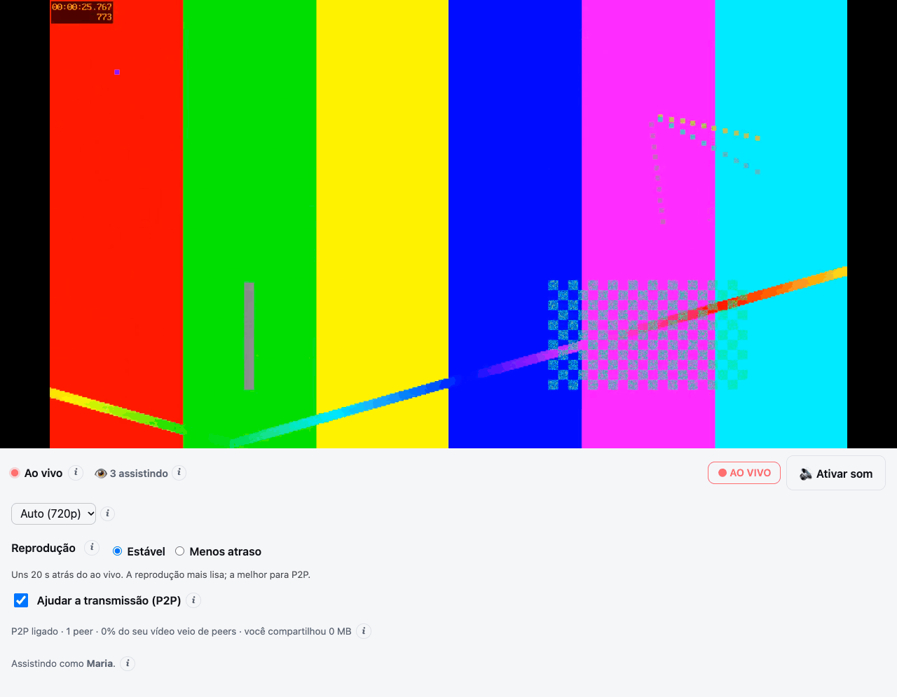
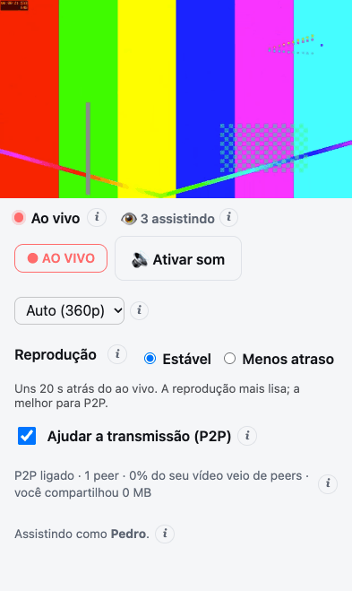

# SwarmCast: como fazer a live

O SwarmCast deixa quem é sub assistir à sua live por um link secreto, direto do seu computador. Quem assiste só precisa de um navegador.

Antes de começar: o túnel gratuito não tem garantia de funcionamento e pode falhar com públicos grandes.

## 1. Instalar e abrir o SwarmCast

Existem dois jeitos. Use o que o desenvolvedor te passou.

**A. Zip de instalação (enviado pelo desenvolvedor)**

1. Baixe o zip do seu computador:
   - Windows: `SwarmCast-vX.Y.Z-windows-x64-installer.zip`
   - Mac com chip Apple (M1, M2, M3, M4): `SwarmCast-vX.Y.Z-macos-arm64-installer.zip`
   - Mac com chip Intel: `SwarmCast-vX.Y.Z-macos-x64-installer.zip`
   - Linux: `SwarmCast-vX.Y.Z-linux-x64-installer.zip`
2. Extraia o zip. Não rode nada de dentro do zip.
   - Windows: clique com o botão direito no zip → **Extrair tudo…** → **Extrair**.
   - macOS: dê dois cliques no zip.
   - Linux: botão direito → **Extrair aqui**.
3. Abra a pasta extraída e rode o script:
   - **Windows:** dê dois cliques em `start-windows.cmd`. Na primeira vez, o Windows pode mostrar "O Windows protegeu o computador": clique em **Mais informações → Executar assim mesmo**. Se perguntar "Deseja executar este arquivo?", clique em **Executar**.
   - **macOS:** dê dois cliques em `start-macos.command`. Na primeira vez, o macOS bloqueia. Clique com o botão direito (ou Control + clique) no arquivo → **Abrir** → **Abrir**. No macOS 15 ou mais novo: clique em **OK** no aviso, abra **Ajustes do Sistema → Privacidade e Segurança**, role até o fim, clique em **Abrir Mesmo Assim** e confirme.
   - **Linux:** abra um terminal na pasta e rode `./start-linux.sh`.

**B. Comando de uma linha (só quando o desenvolvedor avisar que está disponível)**

- Windows (PowerShell): `irm https://github.com/Lucas-Angelo/swarmcast/releases/latest/download/start-windows.ps1 | iex`
- macOS (Terminal): `curl -fsSL https://github.com/Lucas-Angelo/swarmcast/releases/latest/download/start-macos.sh | bash`
- Linux (terminal): `curl -fsSL https://github.com/Lucas-Angelo/swarmcast/releases/latest/download/start-linux.sh | bash`

**O que a janela faz**

1. Confere o seu computador: memória, processador, disco, velocidade da internet e OBS. ✓ quer dizer tudo certo, ⚠ funciona mas não é o ideal, ✗ está abaixo do mínimo.
2. Se algo estiver abaixo do mínimo, ela mostra um aviso ⚠ e continua mesmo assim. Ela nunca faz perguntas.
3. No Linux, se faltarem ferramentas básicas, ela explica o motivo e pede sua senha (`sudo`) para instalá-las. Nada mais precisa de permissão de administrador.
4. Instala ou atualiza o SwarmCast e confere se os arquivos estão íntegros (SHA-256). Também baixa o conversor de vídeo gratuito (ffmpeg), que deixa quem assiste escolher qualidades menores.
   Se algo der errado ela tenta de novo sozinha; se mesmo assim falhar, ela diz o que fazer e espera você apertar Enter para fechar.
5. O painel do SwarmCast abre no navegador.

Deixe essa janela aberta enquanto faz a live. Fechar a janela desliga o SwarmCast.

Na primeira vez, o painel abre um tutorial passo a passo (com imagens do OBS) que cobre os passos 2 a 6 abaixo; para ver de novo, clique em **Refazer o tutorial de configuração** no fim do painel.

## 2. Configurar o OBS (só uma vez)

Você pode transmitir ao mesmo tempo em outra plataforma (Twitch, YouTube, Kick, TikTok Live, Facebook…) ou só no SwarmCast. O que você já usa continua como está.

- **Outra plataforma e SwarmCast ao mesmo tempo (Twitch, YouTube, Kick…):** o OBS sozinho só manda para um lugar. Um plugin gratuito adiciona uma segunda saída, e a outra plataforma continua configurada como sempre. Passo a passo (feito uma vez só):
  1. Feche o OBS. Baixe e instale o plugin **Multiple RTMP outputs** (página oficial no fórum do OBS: [obsproject.com/forum/resources/multiple-rtmp-outputs-plugin.964](https://obsproject.com/forum/resources/multiple-rtmp-outputs-plugin.964/), ou os "Releases" de [github.com/sorayuki/obs-multi-rtmp](https://github.com/sorayuki/obs-multi-rtmp/releases)). No Windows é um instalador `.exe`; no Mac, um `.pkg`.
  2. Abra o OBS. Vai aparecer um painel novo chamado **Multiple output** (Múltiplas saídas). Se não aparecer, vá no menu **Painéis** (Docks) e marque **Multiple output**.
     
  3. Nesse painel, clique em **Add new target** (Adicionar novo destino) e preencha:
     - **Nome:** `SwarmCast` (qualquer nome serve);
     - **Servidor RTMP:** `rtmp://127.0.0.1:1935/live` (botão **Copiar** ao lado de "Servidor" no painel do SwarmCast);
     - **Chave:** a **chave de transmissão** do painel do SwarmCast (botão **Copiar** ao lado de "Chave de transmissão"; não mostre ela na live);
     - **Vídeo/encoder:** escolha a opção de **usar o mesmo encoder da transmissão principal** (assim o PC não codifica o vídeo duas vezes). O nome exato pode mudar um pouco conforme a versão do plugin.
     - Salve.
     
  4. **Não mexa** em Configurações → Transmissão: ali continua a sua outra plataforma.
  5. Na hora da live: no painel do SwarmCast clique em **Ligar o SwarmCast**; no OBS clique em **Iniciar transmissão** (vai para a outra plataforma, como sempre) e, no painel **Multiple output**, clique em **Start** (Iniciar) ao lado de "SwarmCast". Se o plugin tiver a opção de iniciar junto com o OBS ("sync start"), pode marcar para não precisar desse clique.
     
  6. Confira no painel do SwarmCast: deve aparecer **OBS: enviando**. Para parar, clique em **Stop** no painel do plugin (ou pare a transmissão do OBS, se usar "sync start").
- **Só SwarmCast:** vá em Configurações → Transmissão → Serviço "Personalizado..." e coloque o mesmo servidor e a mesma chave.
  
- **Nos dois casos:** vá em Configurações → Saída → Modo de saída "Avançado" → Transmissão → **Intervalo de quadro-chave = 2 s**.
  

## 3. Em toda live

1. Abra o SwarmCast do mesmo jeito do passo 1 (dois cliques no script). O painel abre.
2. No painel, clique em **Ligar o SwarmCast**.
3. Comece a transmitir no OBS. Com o plugin, inicie também o destino SwarmCast (botão **Start**), se ele não começar junto com a live.
   
4. O link aparece em **Link da live para seus inscritos**. Cada live tem um link novo.
   
5. Clique em **Copiar link** e envie só para quem é sub, por exemplo num canal do Discord exclusivo para subs.
   

## 4. Durante a live

O painel mostra:

- **Espectadores e ajuda P2P:** quem está assistindo (apelido e aparelho) e quem está ajudando por P2P.
- **Sua internet** e **Seu upload agora:** quanto do seu upload o SwarmCast está usando, e o teste de velocidade.
  
- **Avisos** no topo, por exemplo quando há espectadores demais para o seu upload ou quando o OBS parou de enviar vídeo.
  

Se algo der errado:

1. **O link vazou:** clique em **Gerar novo link** e envie o novo. Quem já está assistindo continua, a não ser que você também clique em **Desconectar todo mundo**.
2. **Tirar uma pessoa:** clique em **Expulsar**. Se ela puder voltar por outro aparelho, gere também um link novo.
3. **A pessoa pode continuar assistindo, mas sem compartilhar:** clique em **Tirar do P2P**.
4. **Avisos de "Espectadores demais":** peça para os espectadores deixarem "Ajudar a transmissão (P2P)" ligado. Se o teste de velocidade mostrar folga, aumente **Upload máximo para espectadores** no painel.
   
5. **Aviso de "Possível ataque":** o cartão **Proteção** reage sozinho (uma verificação rápida do navegador para quem entra e limites de entrada mais rígidos; no modo direto, ele volta para o modo seguro). Se o aviso disser que há um link NOVO, envie. Clique em **Encerrar alerta** quando acabar ou se for alarme falso. **Máximo de espectadores ao mesmo tempo** e **Sessões por navegador** (abaixo do upload) limitam entradas falsas em massa.
   

## 5. Se a live travar muito para todo mundo

1. Tente **Usar o modo direto…** e leia o aviso antes.
2. No modo direto, os espectadores se conectam direto no seu computador, então **eles conseguem ver o seu IP de internet**. Isso revela sua região aproximada e permite ataques que derrubam sua internet. Use só com pessoas de confiança e só quando o túnel continuar falhando.
   No Windows, na primeira vez que você liga o modo direto o Windows pode perguntar se quer permitir o SwarmCast nas redes: clique em **Permitir** (redes privadas); senão os espectadores não conseguem conectar.
3. Você recebe um link novo para enviar. Para sair do modo direto, clique em **Voltar ao modo seguro**.
4. Depois, para tentar trocar de IP, desligue o modem da tomada por alguns minutos. Não é garantido. O painel avisa se o seu IP mudou.

## 6. Ao terminar

1. Pare a transmissão no OBS.
2. Clique em **Desligar tudo** e espere aparecer "Desligado: nada no seu computador está acessível". Fechar a janela do SwarmCast também desliga tudo.

Se o OBS ficar 10 minutos sem enviar vídeo, o SwarmCast desliga tudo sozinho.

## 7. Atualizar

- **Zip de instalação:** quando receber um zip novo, extraia e rode o script dele do mesmo jeito do passo 1. Suas configurações e a chave de transmissão continuam. Pode apagar a pasta antiga.
- **Comando de uma linha:** rode o mesmo comando de novo.

Se a atualização falhar, a versão anterior continua funcionando.

## 8. Problemas comuns

- **Windows "O Windows protegeu o computador":** clique em **Mais informações → Executar assim mesmo**.
- **macOS "não pode ser aberto" ou "A Apple não pôde verificar…":** veja o passo 1 (botão direito → **Abrir**, ou **Abrir Mesmo Assim** em Privacidade e Segurança).
- **"Could not download SwarmCast" ou "HTTP 404":** você rodou o script fora da pasta extraída (ou de dentro do zip). Extraia o zip e rode o script na pasta extraída.
- **O OBS não conecta:** confira se o SwarmCast está ligado (painel ou ícone na bandeja), se o servidor é `rtmp://127.0.0.1:1935/live` e se a chave é a copiada do painel.
- **"Port … is busy":** outro SwarmCast, ou outro programa, está usando a porta 1935, 8080 ou 8081. Feche-o (ícone na bandeja → **Fechar o SwarmCast**) e rode o script de novo.
- **Espectadores veem "Link inválido":** estão com um link antigo. Envie o atual, que está no painel.
  
- **Sem ícone na bandeja no Linux GNOME:** instale a extensão "AppIndicator and KStatusNotifierItem Support" ou use só o painel no navegador.

## 9. Desinstalar

1. Abra a pasta extraída do zip de instalação e rode o desinstalador:
   - **Windows:** dê dois cliques em `uninstall-windows.cmd`. Se aparecer "O Windows protegeu o computador", clique em **Mais informações → Executar assim mesmo**.
   - **macOS:** dê dois cliques em `uninstall-macos.command`. Na primeira vez, botão direito no arquivo → **Abrir** (como no passo 1).
   - **Linux:** abra um terminal na pasta e rode `./uninstall-linux.sh`.
2. Ele não pergunta nada. Desliga o SwarmCast se estiver aberto, fecha uma porta do roteador que o modo direto possa ter deixado aberta e apaga todos os arquivos do SwarmCast: o programa, as configurações, a chave de transmissão e os logs. A janela mostra o resultado; no Windows, aperte uma tecla para fechar.
3. Quer reinstalar depois com a mesma chave de transmissão? Rode com `--keep-settings` (por exemplo, num terminal na pasta: `uninstall-windows.cmd --keep-settings`).
4. O OBS não é alterado. Se quiser, remova você mesmo o destino do SwarmCast (painel Multiple output) ou o servidor personalizado no OBS. Depois pode apagar a pasta extraída.

Se você instalou com o comando de uma linha, baixe o desinstalador do seu computador na mesma página de releases e rode do mesmo jeito.
