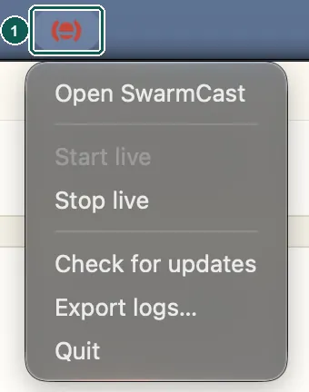

SwarmCast can open by itself when you sign in to your computer, so it is ready when you want to go live. This is **off by default**.

## Turn it on or off

1. Open SwarmCast.
2. In the **Desktop app** card, tick (or untick) **Start with the computer**.

When it is on, SwarmCast opens **without a window**: only its icon appears in the tray (next to the clock on Windows and Linux) or in the menu bar (at the top of the screen on a Mac). Click the icon, then **Open SwarmCast**, to see the panel.

The menu also has **Start live** / **Stop live**, **Check for updates**, **Export logs…** and **Quit**.

## Good to know

- It uses the normal startup list of your system (on Windows: Settings → Apps → Startup; on a Mac: System Settings → General → Login Items; on Linux: the autostart folder). You can also turn it off there.
- If you moved or reinstalled SwarmCast, the card may say **It opens an older copy of SwarmCast**. Click **Fix it**.
- Linux AppImage: keep the file in the same place, because the setting remembers where it is.
- Uninstalling SwarmCast removes it from the startup list.

This setting exists only in the desktop app, not in the [script install](/swarmcast/advanced/script-install/).
