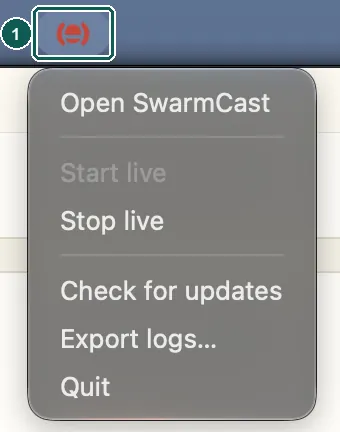

Uninstalling never changes OBS. If you want, remove the SwarmCast target (Multiple output panel), the Vertical streaming settings (Aitum Vertical) or the custom server from OBS yourself.

## Windows

1. Quit SwarmCast (tray icon → **Quit**).
2. Open **Settings** → **Apps** → **Installed apps**, find **SwarmCast**, click **…** → **Uninstall**.
3. The uninstaller keeps your settings and stream key, unless you tick **Delete the application data**.

## macOS

1. Quit SwarmCast (menu bar icon → **Quit**).

   

2. If **Start with the computer** is on, turn it off first in the panel ([Start with the computer](/swarmcast/app/autostart/)).
3. Open **Applications** and drag **SwarmCast** to the Trash.
4. Your settings stay in `~/Library/Application Support/SwarmCast`.

## Linux

- **.deb:** in a terminal, `sudo apt remove swarm-cast`.
- **AppImage:** turn off **Start with the computer** in the panel, quit SwarmCast and delete the `.AppImage` file.

Your settings stay in `~/.local/share/swarmcast`.
