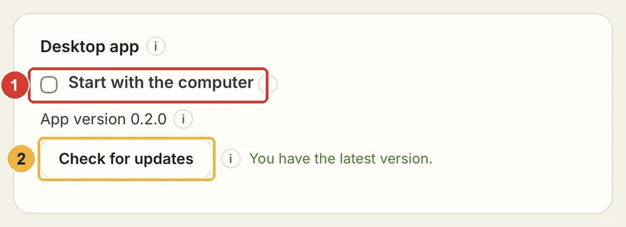
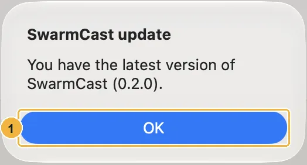

SwarmCast looks for a new **stable** version shortly after it opens and then every 6 hours (and for beta versions too, if you turned them on: see [Beta versions](#beta-versions)). Nothing is installed without your OK.

## When there is a new version

A message says **"SwarmCast X is available (you have Y)"** with what's new, and the panel shows the same as a banner.

1. Click **Update now** (or **Later**).
2. SwarmCast downloads the update, checks its digital signature, installs it and **opens again by itself**. It takes about a minute.

Your settings, your stream key and your viewers' access are kept.

:::caution[Updating stops the live]
If you are live, updating ends the live for everyone. SwarmCast warns you first, and **Later** is the default. Update when the live is over.
:::

## Check now

Click **Check for updates** in the panel's **Desktop app** card, or in the tray menu. When nothing is new, SwarmCast says so:

## Beta versions

A beta is an early version of the next update: new features before everyone else, but it **can have bugs**. Betas are optional and off by default.

- **Turn them on:** in the panel's **Desktop app** card, tick **Get beta versions**. SwarmCast looks right away and offers the newest version, beta or stable. Your settings are kept.
- **Turn them off** at any time with the same switch. SwarmCast never installs an older version over a newer one, so you **stay on the beta** until the next stable version is newer, which then comes as a normal update.
- A version like **0.3.0-beta.1** has a **Beta** badge next to it. If you installed a beta yourself, it follows the betas by itself until you turn the switch off.
- **Tell us what you find** in [Discussions → Beta feedback](https://github.com/Lucas-Angelo/swarmcast/discussions/categories/beta-feedback), or report a bug and pick **Beta** as the update channel.

Beta releases are on the [releases page](https://github.com/Lucas-Angelo/swarmcast/releases), marked **Pre-release**. The download button on this site always gives the stable version.

## If an update fails

The version you have keeps working. SwarmCast retries the download a few times by itself. If it still fails, check your internet connection and click **Try again** later.

## Linux

- **AppImage:** updates itself like on Windows and macOS.
- **.deb:** if the app cannot install the update by itself, it opens the download page. Download the new `.deb` and install it the same way as the first time ([Install on Linux](/swarmcast/install/linux/)). Your settings are kept.

## Script install

If you installed with a script, run the same script (or the one from a new installer zip) again. It updates SwarmCast and keeps your settings. See [Advanced: install with a script](/swarmcast/advanced/script-install/).

## How SwarmCast checks (privacy)

To check, the app downloads a small public file (`latest.json`) from the SwarmCast releases on GitHub; with beta versions on, also `updates/beta.json` from this website. It sends nothing about you or your live. GitHub counts how many times that file was downloaded, which is how this site can estimate how many apps are in use. More in [Privacy and usage numbers](/swarmcast/about/privacy/).
