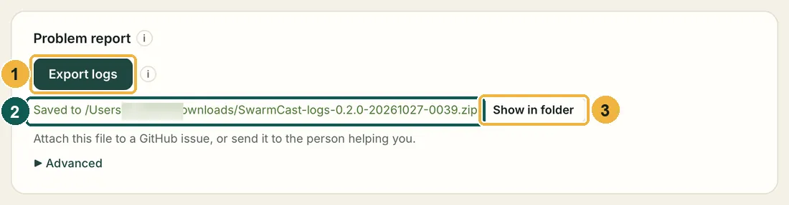

## Installing and opening

### Windows: "Windows protected your PC"

Click **More info**, then **Run anyway**. See [Install on Windows](/swarmcast/install/windows/).

### macOS: "Apple could not verify SwarmCast" or "cannot be opened"

Open **System Settings** → **Privacy & Security**, scroll down and click **Open Anyway**. See [Install on macOS](/swarmcast/install/macos/).

### "SwarmCast is already open in another window or in a terminal"

Another SwarmCast is running, for example one you started with a script. Close it (in a terminal: **Ctrl+C**; or its tray icon → **Quit**), then click **Try again**.

### "Another program is using the ports SwarmCast needs"

Another streaming app, or a second SwarmCast, uses port 1935 (the one OBS sends to) or the panel port. Close it, then click **Try again**. Restarting the computer also helps.

### "SwarmCast could not start"

Click **Try again**. If it keeps failing, click **Open logs folder** and send the newest files when you ask for help (see [Send your logs](#send-your-logs)).

## OBS

### OBS cannot connect

- Check that SwarmCast is open and the top of the panel says **Waiting for OBS to start streaming…** or **Live**. If it says **Off**, click **Turn on SwarmCast**.
- The server must be exactly `rtmp://127.0.0.1:1935/live`.
- The key must be the one from the panel. Use the **Copy** buttons instead of typing.
- With the Multiple output plugin, click **Start** next to SwarmCast. With Aitum Vertical, click the antenna button in the Vertical panel.

### "The keyframe interval looks wrong"

In OBS: **Settings** → **Output** → **Output Mode: Advanced** → **Streaming** → **Keyframe Interval: 2 s**. See [Set up OBS](/swarmcast/start/obs/).

## The link and the viewers

### Viewers see "Link not valid"

They have an old link. Every live gets a new link, and **Generate new link** replaces it. Send the current link from the panel.

### Viewers see "This stream is full"

You reached **Max viewers at once** (120 unless you changed it). Raise it in the panel if your upload allows it, but the free tunnel (Secure mode) holds about 120 viewers: beyond that, use Direct mode or your own domain.

### The video starts without sound

Browsers start videos muted. Viewers click **Unmute** once.

### It stutters for one viewer

Their internet is probably slow. Their player moves to a smaller quality by itself (**Auto**). They can also choose **Stable** playback, which keeps more video ready.

### It stutters for everyone

1. Look at the warnings at the top of the panel. **"Too many viewers for your upload"**: ask viewers to keep **Help the stream (P2P)** on, or lower the OBS bitrate.
2. Check that your upload is not used by something else (cloud backup, downloads, another stream with a high bitrate).
3. If the free tunnel keeps failing, [Direct mode](/swarmcast/live/direct-mode/) is a last resort. Read its warning first.

### "Possible attack"

The Protection card reacts by itself. If the warning says there is a NEW link, send it. When it is over, click **End alert**. See [Security and protection](/swarmcast/live/protection/).

## Other

### Only the original quality is offered

Your computer may not have a video chip that can convert, or the video converter (ffmpeg) is not installed. See [Qualities](/swarmcast/live/quality/).

### No tray icon on Linux (GNOME)

Install the "AppIndicator and KStatusNotifierItem Support" extension, or use the SwarmCast window.

### Linux: "AppImages require FUSE to run"

See [Install on Linux](/swarmcast/install/linux/).

## Frequent questions

### Is SwarmCast free?

Yes. It is free and open source (MIT license). There is no account, no subscription and no ads.

### Does it replace Twitch, YouTube or Kick?

No. It is for a **members-only** live next to your public one, or on its own. You can stream to both at the same time ([Set up OBS](/swarmcast/start/obs/)).

### How many people can watch?

It depends on your internet **upload** and on how many viewers help through P2P. The panel shows an estimate. Minimum: 10 Mbps upload, 4 GB of memory and 2 processor cores. Recommended: 50 Mbps upload or more, 8 GB and 4 cores.

### Can I go live from my phone?

No. SwarmCast runs on the computer where OBS runs (Windows, macOS or Linux). Viewers can watch on phones.

### Does SwarmCast collect data about me or my viewers?

No. SwarmCast has no telemetry and no analytics. See [Privacy and usage numbers](/swarmcast/about/privacy/).

### Can I use Streamlabs or another app instead of OBS Studio?

SwarmCast is tested with OBS Studio. Any app that can send to a custom RTMP server with a stream key and 2-second keyframes should work, but the guides show OBS.

## Send your logs

When something goes wrong, the logs show what happened. SwarmCast puts them in one file for you:

1. In the panel, scroll down to the **Problem report** card and click **Export logs**. In the desktop app you can also use the tray icon (on a Mac, the menu bar icon) → **Export logs…**.
2. SwarmCast saves a ZIP file named like `SwarmCast-logs-0.2.0-20261026-1430.zip` in your **Downloads** folder and shows where it is. Click **Show in folder** to find it.
3. Attach the ZIP to an issue on [GitHub](https://github.com/Lucas-Angelo/swarmcast/issues), or send it to the person helping you. Say what you did and what you expected.

**What is inside:** the logs of the last 14 days (SwarmCast, the desktop app, the video receiver, the tunnel and the video converter), a short summary of your computer and of SwarmCast's settings, your PC check, and the **Activity** card.

**What is never inside:** your stream key, the live link, the panel login, passwords or keys. The file is **anonymised**: viewers' IP addresses and nicknames are replaced by labels like `ip-3f9a1c2b` and `viewer-8d02e4aa`. Nothing is sent by itself: you choose who gets the file. Under **Advanced** there is an option to keep the full IP addresses; turn it on only if the developer asks for it.

If the panel does not open at all, send the newest files from the logs folder instead:

| System | Logs folder |
|---|---|
| Windows | `%LOCALAPPDATA%\SwarmCast\logs` (paste it into the File Explorer address bar) |
| macOS | `~/Library/Application Support/SwarmCast/logs` (Finder → **Go** → **Go to Folder…**) |
| Linux | `~/.local/share/swarmcast/logs` |

SwarmCast deletes log files older than 14 days by itself (you can change it from 3 to 90 days under **Problem report** → **Advanced**).

## Asking for help

1. [Export your logs](#send-your-logs), or in the panel's **Activity** card, click **Copy all**. Secrets (stream key, link) are already hidden.
2. Open an issue on [GitHub](https://github.com/Lucas-Angelo/swarmcast/issues), attach the ZIP or paste the text, and say your system (Windows, macOS or Linux) and what you did.
