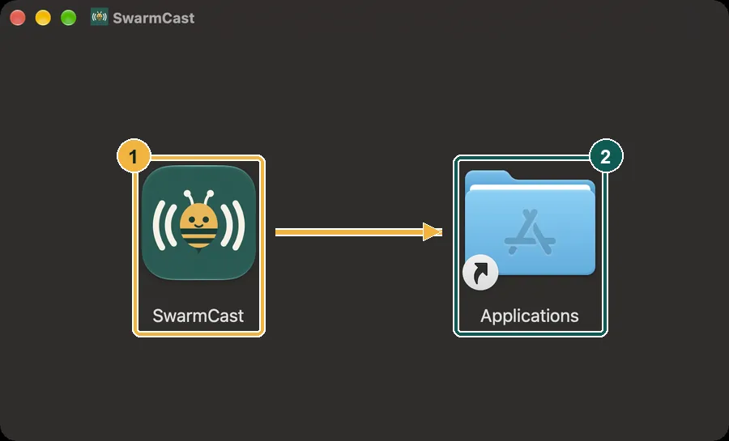
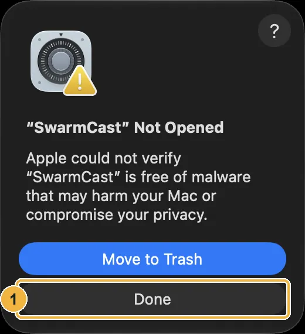
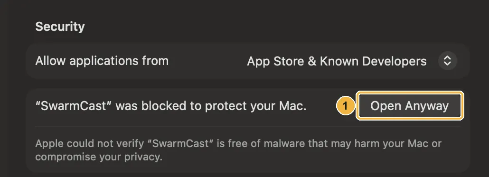
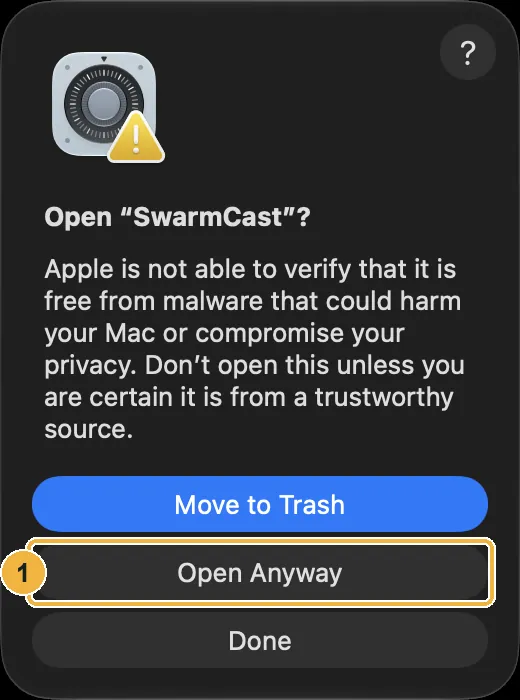

SwarmCast needs macOS 13.5 (Ventura) or newer. In the pictures, a **yellow** box means click, a **red** box means type or choose, and a **green** box means check.

## 1. Download the right file

Apple menu → **About This Mac**:

- **Chip: Apple M1, M2, M3, M4…** → the **Apple chip** file (ends in `aarch64.dmg`).
- **Processor: Intel…** → the **Intel chip** file (ends in `x64.dmg`).

Get it from the [download page](/swarmcast/download/#macos).

## 2. Drag SwarmCast to Applications

1. Double-click the `.dmg` in **Downloads**. A window opens.
2. Drag the **SwarmCast** icon onto **Applications**. Then eject **SwarmCast** in Finder's sidebar.

## 3. The first open: "Open Anyway"

SwarmCast is free and open source, so it has no paid Apple registration. macOS asks you to allow it once.

1. Open **Applications** and double-click **SwarmCast**. macOS says **"SwarmCast" Not Opened**. Click **Done** (not **Move to Trash**).

2. Apple menu → **System Settings** → **Privacy & Security**. Scroll down to **Security** and click **Open Anyway**.

3. Click **Open Anyway** again and confirm with your password or Touch ID.

From now on SwarmCast opens normally, and its icon sits in the menu bar at the top of the screen.

:::tip[Is that safe?]
The warning only means SwarmCast is not registered with Apple. Its source code is public, and every update the app installs is checked with a digital signature first.
:::

## 4. First run

The window shows **Starting SwarmCast…**, then a short tutorial. Continue with [First run and the tutorial](/swarmcast/start/first-run/).

If macOS asks whether SwarmCast may accept incoming network connections (only in [Direct mode](/swarmcast/live/direct-mode/)), click **Allow**. In the normal Secure mode, viewers never connect to your Mac.

## Something went wrong?

- **"SwarmCast is damaged and can't be opened":** delete the app and the `.dmg`, download again and repeat. If it still says so, open **Terminal**, paste `xattr -dr com.apple.quarantine /Applications/SwarmCast.app`, press Enter, and open SwarmCast again.
- **No "Open Anyway" button:** it shows for about an hour after you tried to open the app. Double-click SwarmCast again, then go back to **Privacy & Security**.
- More answers: [Troubleshooting](/swarmcast/help/troubleshooting/).
