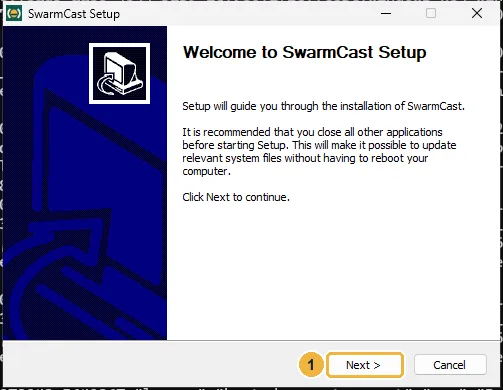
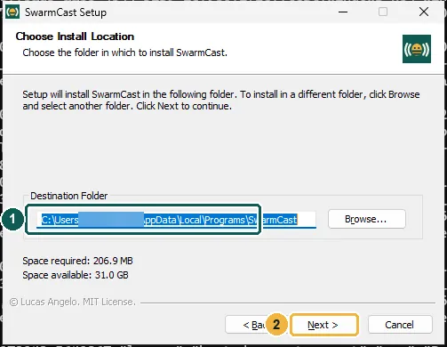
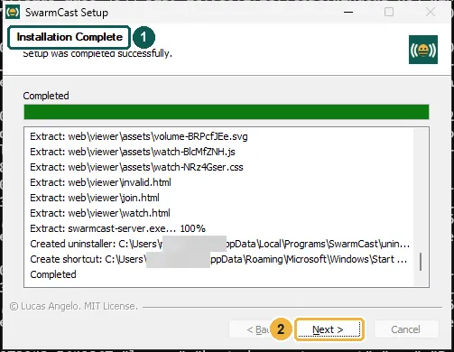
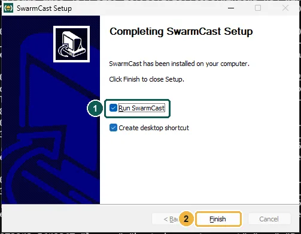
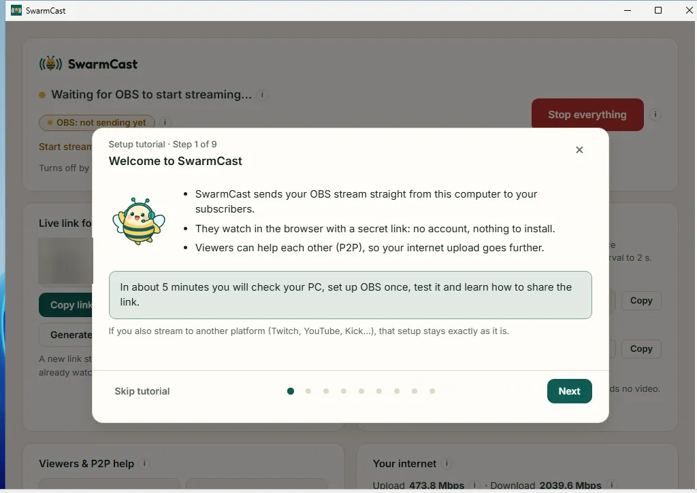

SwarmCast installs for your Windows user only. It needs no administrator rights and does not change OBS. In the pictures, a **yellow** box means click and a **green** box means check.

## 1. Download

Get the file that ends in **`x64-setup.exe`** (for example `SwarmCast_0.2.0_x64-setup.exe`) from the [download page](/swarmcast/download/#windows).

## 2. Run the installer

Open your **Downloads** folder and double-click the file.

The first time, Windows may show a blue window, **"Windows protected your PC"**. It shows for every new app that has no paid code-signing certificate; it does not mean something is wrong:

1. Click **More info**.
2. Click **Run anyway**.

If Windows asks **"Do you want to run this file?"**, click **Run**.

:::tip[Why the warning?]
SwarmCast is free and open source, so it has no paid certificate. Its source code is public, and every update the app installs is checked with a digital signature first.
:::

## 3. Click through the setup

The installer follows your Windows language (English or Portuguese).

1. **Welcome:** click **Next**.

2. **Choose Install Location:** keep the folder and click **Next**. Installing takes a few seconds.

3. **Installation Complete:** click **Next**.

4. Leave **Run SwarmCast** ticked and click **Finish**.

## 4. SwarmCast opens

SwarmCast opens in its own window, with a shortcut on the desktop and in the Start menu, and an icon next to the clock (the tray; click the small arrow **^** if you don't see it). The first time, the setup tutorial opens: continue with [First run and the tutorial](/swarmcast/start/first-run/).

:::note
The first time you turn on Direct mode (emergencies only, see [Direct mode](/swarmcast/live/direct-mode/)), Windows may ask whether SwarmCast may use networks. Click **Allow** (Private networks).
:::

## Something went wrong?

- **The download disappeared, or the browser says it is "not commonly downloaded":** in Edge open the downloads list (**Ctrl+J**), click **…** next to the file, then **Keep** → **Show more** → **Keep anyway**.
- **Installing again while SwarmCast is open:** the installer closes SwarmCast first, which ends a live that is on. Install when you are not live.
- More answers: [Troubleshooting](/swarmcast/help/troubleshooting/).
