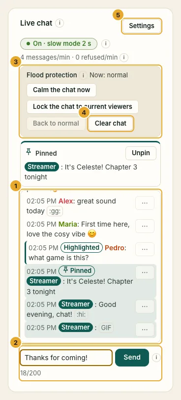
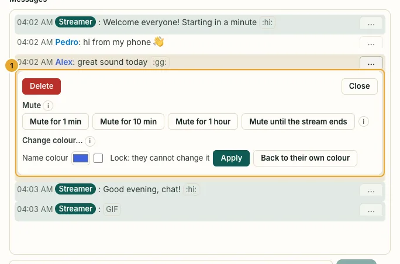
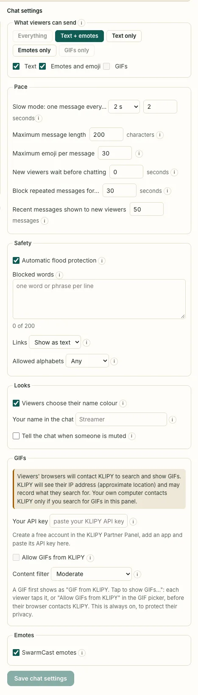
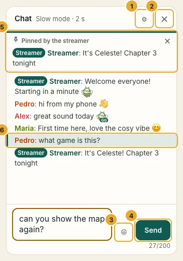
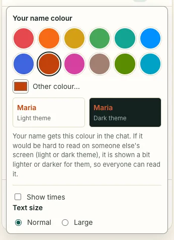

Your live has a chat. Viewers write under the video, you read and answer in the panel's **Chat** card, and everyone sees the messages within a second. It is **on by default**: nothing to set up.

:::note[Nicknames are public in the live]
Everyone watching sees the nicknames in the chat. The join page says so before people type theirs.
:::

## What viewers can send

- **Text:** one line, up to 200 characters by default. Links show as plain text: they can never be clicked and never show a preview.
- **Emoji and emotes:** the usual emoji from the phone or the picker, plus the bee emotes that come with SwarmCast (`:gg:`, `:love:`, `:wow:`…).
- **GIFs:** only if you turn them on with your own free key. See [Get a GIF key](/swarmcast/live/gif-key/).

Your own messages, sent from the box **Send as …** at the bottom of the Chat card, carry a **Streamer** badge. Nobody else can get that badge, whatever nickname they pick, and nobody can join with a name like "Streamer", "Admin" or "Moderator", or with a look-alike of the name of someone already watching.

## Keep the chat friendly

Each message in the Chat card has an **Actions** menu:

- **Delete:** removes that message for everyone.
- **Mute:** for 1 min, 10 min, 1 hour, or **until the stream ends**. The person keeps watching but cannot write. **Unmute** lets them write again right away. Leaving and coming back does not undo a mute.
- **Change colour…:** sets the colour of their name for everyone. Tick **Lock** so they cannot change it back.

You can also mute someone from the **Viewers** card.

:::note[Mute until the stream ends]
There are no accounts, so on your next live SwarmCast cannot recognise this person. If they come back and misbehave, mute or kick them again; a new link keeps out anyone you did not send it to ([Kick and new link](/swarmcast/live/kick-and-new-link/)).
:::

**Clear chat** removes every message for everyone (viewers see "The streamer cleared the chat").

## Flood protection

When the chat gets too busy for your audience, or someone floods it, SwarmCast protects it **by itself** (**Automatic flood protection**, on by default):

- **Calm:** everyone waits longer between messages (automatic slow mode).
- **Lock:** in a real flood, only people who were already watching can write. Newcomers can read.

It goes back to normal by itself when things calm down. The card shows what is happening and why. You can also do it yourself under **Flood protection**: **Calm the chat now**, **Lock the chat to current viewers** and **Back to normal**.

:::tip
The chat never slows the video down. Chat has its own small share of your upload, and if your computer gets busy, the chat slows down first so the video stays smooth.
:::

## Chat settings

Open **Chat settings** in the Chat card, change what you want and click **Save chat settings**. Everyone watching gets the change within a second.

- **What viewers can send:** **Everything**, **Text + emotes**, **Text only**, **Emotes only** or **GIFs only**, or tick any mix. **Text only** means letters only: no emoji and no emotes. **Emotes only** means emoji and emotes, no letters.
- **Slow mode: one message every…** each viewer waits this long between messages. 2 seconds by default; **Off** keeps only a short burst limit.
- **Maximum message length:** from 20 to 500 characters (an emoji counts as one). 200 by default.
- **Maximum emoji per message:** stops walls of emoji that are hard to read and heavy for old phones.
- **New viewers wait before chatting:** seconds someone who just joined must wait before writing. Useful when people join only to spam.
- **Block repeated messages for…:** the same viewer cannot send the same message again within this time.
- **Recent messages shown to new viewers:** how many of the last messages someone sees when they join.
- **Links:** **Show as text** (default) or **Block** messages that contain one.
- **Blocked words:** one per line. Messages with one are refused, also when written with look-alike letters, accents or spaces.
- **Allowed alphabets:** **Any**, or **Latin only** for a local audience.
- **Viewers choose their name colour**, **Your name in the chat** and **Tell the chat when someone is muted**.
- **SwarmCast emotes:** turns the bee emotes on or off.

To turn the chat off for everyone, use the switch at the top of the Chat card. Viewers then do not see the chat at all.

## What viewers see

- The chat next to the video on a computer, under it on a phone.
- **Hide chat** hides it on that device (remembered); **Show chat** brings it back.
- **Chat settings** for their own name colour, times and text size. SwarmCast keeps every colour readable on light and dark screens.

  

- "sending…" until the message is in, and a short reason in their language when it is refused (slow mode, muted, too long, a blocked word…).

## Privacy

- Messages live **only in memory** while you are live. **Stop everything** wipes them; nothing is ever saved to disk, and logs never contain what people wrote.
- The chat goes through the same private tunnel as the video: nobody's IP address is shown, yours or the viewers'.
- Links are never clickable and pictures from links are never shown, so nobody can use the chat to learn other viewers' IP addresses.

:::note[Coming in 0.4.1]
A chat overlay for OBS and your own custom emotes.
:::
