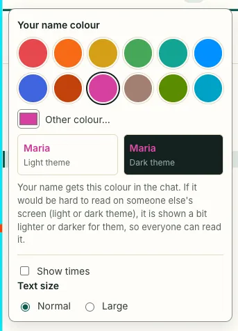

Your live has a chat. Viewers write under the video, you read and answer in the panel's **Live chat**, and everyone sees the messages within a second. It is **on by default**: nothing to set up.

While you are live, the **Live chat** is right on the panel's main screen, no scrolling needed: in a column on the right (under the status when the window is narrow), and it stays in view while you scroll through the rest of the panel. When you are not live, or the chat is off, it is not shown.

:::note[Nicknames are public in the live]
Everyone watching sees the nicknames in the chat. The join page says so before people type theirs.
:::

## What viewers can send

- **Text:** one line, up to 200 characters by default. Links show as plain text: they can never be clicked and never show a preview.
- **Emoji and emotes:** the usual emoji from the phone or the picker, plus the bee emotes that come with SwarmCast (`:gg:`, `:love:`, `:wow:`…).
- **GIFs:** only if you turn them on with your own free key. See [Get a GIF key](/swarmcast/live/gif-key/).

Your own messages, sent from the box **Send as …** at the bottom of the Live chat, carry a **Streamer** badge. Nobody else can get that badge, whatever nickname they pick, and nobody can join with a name like "Streamer", "Admin" or "Moderator", or with a look-alike of the name of someone already watching.

## Keep the chat friendly

Each message in the Live chat has an **Actions** menu (the **⋯** button):

- **Reply:** answers that message from your box (see [Replies and mentions](#replies-and-mentions)).
- **Delete:** removes that message for everyone.
- **Highlight:** makes the message stand out for everyone (see [Highlight and pin](#highlight-and-pin)). **Remove highlight** takes it off.
- **Pin to top:** keeps the message at the top of everyone's chat, **until I unpin it** or for 5 min, 15 min or 1 hour. **Unpin** takes it down.
- **Mute:** for 1 min, 10 min, 1 hour, or **until the stream ends**. The person keeps watching but cannot write. **Unmute** lets them write again right away. Leaving and coming back does not undo a mute.
- **Change colour…:** sets the colour of their name for everyone. Tick **Lock** so they cannot change it back.

You can also mute someone from the **Viewers** card.

:::note[Mute until the stream ends]
There are no accounts, so on your next live SwarmCast cannot recognise this person. If they come back and misbehave, mute or kick them again; a new link keeps out anyone you did not send it to ([Kick and new link](/swarmcast/live/kick-and-new-link/)).
:::

**Clear chat** removes every message for everyone (viewers see "The streamer cleared the chat").

## Highlight and pin

- **Highlight** a good question or an important message: everyone sees it with a coloured bar, also people who join later and see it among the recent messages. Up to 20 messages can be highlighted at a time; highlighting one more takes the mark off the oldest.
- **Pin to top** one message (yours or a viewer's), for example the rules, a link you want everyone to read or the answer to the question everyone asks. It stays above the messages for everyone, also for people who join later. Only one message is pinned at a time: pinning another one replaces it. Choose **Until I unpin it**, or 5 min, 15 min or 1 hour to have it come down by itself.
- The pinned message also shows at the top of your Live chat, with **Unpin** (and, for a timed pin, when it comes down).
- **Deleting** the pinned message or **Clear chat** unpins it. Muting or kicking the person who wrote it does not. **Stop everything** removes it with the rest of the chat.

Only you can highlight or pin. A viewer who types "📌 Pinned" in a message only writes text in their own row, under their own name: the real pinned message has its own place, above the chat, labelled "Pinned by the streamer".

## Replies and mentions

- **Reply** to a message: everyone sees your answer with a short quote of the message above it, so the chat knows what you are answering, also people who join later. Viewers reply with the **Reply** button that shows when they point at a message (or tap it on a phone); you reply from the **⋯** menu. While you write, "Replying to …" shows above the box: **✕** or Escape cancels.
- **Mention** someone with **@**: type **@** and pick a name from the list (or keep typing to narrow it). The list only has people who already wrote in the chat, never everyone watching. The person you mention sees your message marked for them; nobody else does, and there is no sound or notification. A message that mentions you is marked in your Live chat with **Mentions you**.
- **Deleting** a message also removes its quote from the replies: they say "Original message deleted". After **Clear chat** there is nothing left to reply to.
- A reply is a message like any other: slow mode, blocked words, what viewers can send and mute all apply. In **Emotes only**, a mention (it is text) is refused.

So nobody can harass one person with mentions, SwarmCast counts how often someone mentions people, and how often one person gets mentioned. Past that, the message still shows, just without the mark. Look-alike names (a Cyrillic "А" instead of "A", say) never mention anybody. Viewers who do not want the mark can turn off **Highlight messages that mention me** in their chat settings.

## Flood protection

When the chat gets too busy for your audience, or someone floods it, SwarmCast protects it **by itself** (**Automatic flood protection**, on by default):

- **Calm:** everyone waits longer between messages (automatic slow mode).
- **Lock:** in a real flood, only people who were already watching can write. Newcomers can read.

It goes back to normal by itself when things calm down. The Live chat shows what is happening and why. You can also do it yourself under **Flood protection**: **Calm the chat now**, **Lock the chat to current viewers** and **Back to normal**.

:::tip
The chat never slows the video down. Chat has its own small share of your upload, and if your computer gets busy, the chat slows down first so the video stays smooth.
:::

## Chat settings

Click **Settings** in the Live chat, or scroll down to the **Chat** card, change what you want and click **Save chat settings**. Everyone watching gets the change within a second.

- **What viewers can send:** **Everything**, **Text + emotes**, **Text only**, **Emotes only** or **GIFs only**, or tick any mix. **Text only** means letters only: no emoji and no emotes. **Emotes only** means emoji and emotes, no letters.
- **Slow mode: one message every…** each viewer waits this long between messages. 2 seconds by default; **Off** keeps only a short burst limit.
- **Maximum message length:** from 20 to 500 characters (an emoji counts as one). 200 by default.
- **Maximum emoji per message:** stops walls of emoji that are hard to read and heavy for old phones.
- **New viewers wait before chatting:** seconds someone who just joined must wait before writing. Useful when people join only to spam.
- **Block repeated messages for…:** the same viewer cannot send the same message again within this time.
- **Recent messages shown to new viewers:** how many of the last messages someone sees when they join.
- **Links:** **Show as text** (default) or **Block** messages that contain one.
- **Blocked words:** one per line. Messages with one are refused, also when written with look-alike letters, accents or spaces.
- **Allowed alphabets:** **Any**, or **Latin only** for a local audience.
- **Viewers choose their name colour**, **Your name in the chat** and **Tell the chat when someone is muted**.
- **SwarmCast emotes:** turns the bee emotes on or off.

To turn the chat off for everyone, use the switch at the top of the Chat card (1). Viewers then do not see the chat at all, and the Live chat leaves the panel until you turn it back on.

## What viewers see

- The chat next to the video on a computer, under it on a phone.
- The **pinned message** above the messages, labelled "Pinned by the streamer" (5). A long one opens with **Show more**; **✕** hides it on that device until you pin another one. While the chat is hidden, **Show chat** says **Pinned** when you pin something.
- **Highlighted messages** with a coloured bar (6), readable in light and dark themes.
- **Replies** with a short quote of the message they answer; a click on the quote jumps to it while it is still in the chat. A message that **mentions them** has a honey-coloured bar and their name marked (7); while the chat is hidden, **Show chat** counts those mentions.
- **Reply** on each message (pointing at it, tapping it on a phone, or with the arrow keys from the chat) and **@** in the message box to mention someone who wrote.
- **Hide chat** hides it on that device (remembered); **Show chat** brings it back.
- **Chat settings** for their own name colour, times, **Highlight messages that mention me** and text size. SwarmCast keeps every colour readable on light and dark screens.

  

- "sending…" until the message is in, and a short reason in their language when it is refused (slow mode, muted, too long, a blocked word…).

## Privacy

- Messages live **only in memory** while you are live. **Stop everything** wipes them; nothing is ever saved to disk, and logs never contain what people wrote.
- The chat goes through the same private tunnel as the video: nobody's IP address is shown, yours or the viewers'.
- Links are never clickable and pictures from links are never shown, so nobody can use the chat to learn other viewers' IP addresses.

:::note[Coming in 0.4.1]
A chat overlay for OBS and your own custom emotes.
:::
