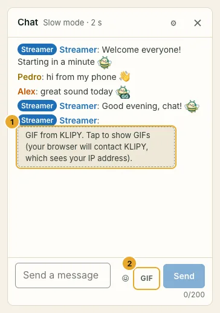

GIFs in the chat are **off by default**. To turn them on you need your own free key from **KLIPY**, the GIF service SwarmCast uses. SwarmCast has no shared key: each streamer uses their own.

:::caution[What turning GIFs on means]
Viewers' browsers contact KLIPY to search and show GIFs. KLIPY sees their IP address (approximate location) and may record what they search for. Nothing goes through your computer. Your own computer contacts KLIPY only if you search for GIFs in the panel yourself.
:::

## 1. Create the key

1. Open the KLIPY Partner Panel, <https://partner.klipy.com/>, and create a free account.
2. Go to **API Keys** and create your platform (your app, for example "My stream").
3. Copy the **API key** it shows.

A new key starts in **testing mode**, limited to 100 requests per hour. Your viewers' searches all count against your key, so once GIFs work, ask for **production access** in the same Partner Panel (it is free) to remove the limit.

:::note
The KLIPY site may look different from these steps; look for "API Keys" in its Partner Panel. The key is not a secret: viewers' browsers use it to search GIFs, which is how KLIPY works.
:::

## 2. Turn GIFs on in the panel

1. In the **Chat** card, open **Chat settings**.
2. Tick **Allow GIFs from KLIPY** and paste the key in **Your API key**.
3. Pick a **Content filter**: **Strict (everyone)**, **Moderate** (default) or **Relaxed (teens and up)**. KLIPY's Partner Panel can also block search words.
4. Keep **Viewers must allow GIFs first** on (recommended).
5. Make sure **GIFs** is ticked in **What viewers can send**, then click **Save chat settings**.

## What viewers see

- A GIF in the chat first shows as a placeholder: "GIF from KLIPY. Tap to show GIFs (your browser will contact KLIPY, which sees your IP address)." The viewer taps it (or **Allow GIFs from KLIPY** in the GIF picker) once before their browser contacts KLIPY; the choice is remembered in that browser and can be undone in their **Chat settings** (**Show GIFs**).

  

- Viewers who never agree never contact KLIPY: the page then talks only to your live, as without GIFs.
- One GIF per viewer every 30 seconds.
- While the chat is protected against a flood, or your computer is busy, GIFs pause by themselves.

In the panel, GIFs viewers send show as a "GIF" label and are not loaded, so your computer does not contact KLIPY for them.

## Turn GIFs off

Untick **Allow GIFs from KLIPY** (or **GIFs** in **What viewers can send**) and save. From then on, the viewer page contacts no outside service for GIFs. More about the chat in [Chat](/swarmcast/live/chat/).
