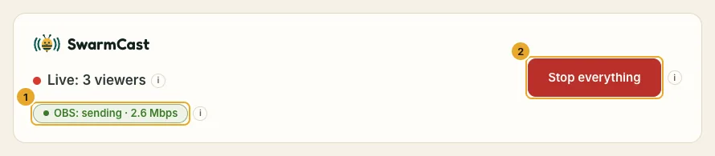
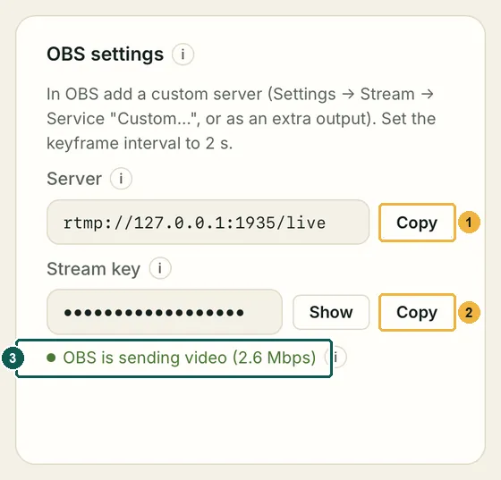
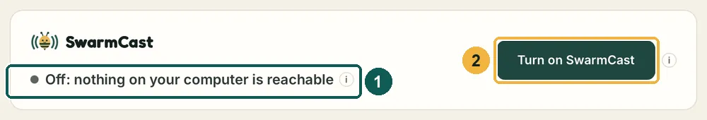
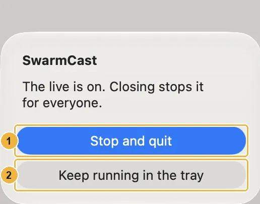

## Every live

### 1. Open SwarmCast

It turns on by itself and shows **Waiting for OBS to start streaming…**. If the top of the panel says **Off**, click **Turn on SwarmCast**.

### 2. Start streaming in OBS

Click **Start Streaming** as always. With the Multiple output plugin, SwarmCast starts with it if you ticked "Sync start"; otherwise also click **Start** next to SwarmCast. Setup: [Set up OBS](/swarmcast/start/obs/).

### 3. Wait for "OBS: sending"

The top of the panel turns to **Live** and shows **OBS: sending**.

### 4. Copy the link and send it

Click **Copy link** and send it only to your members, for example in a subscribers-only Discord channel. Every live gets a new link.

Your members open the link, type a nickname and watch in the browser. See [For viewers](/swarmcast/viewers/).

:::caution[Keep the link among members]
Anyone who has the link can watch. If it leaks, click **Generate new link** and send the new one. See [Kick a viewer and make a new link](/swarmcast/live/kick-and-new-link/).
:::

## The OBS settings card

The two things OBS needs, each with a **Copy** button. The key stays hidden: **never show it on stream or in a screenshot**. A green **OBS is sending video** means OBS is connected.

## During the live

- **Viewers & P2P help:** how many watch and how many help through P2P.
- **Your upload now:** how much of your upload SwarmCast uses. It never goes above **Max upload for viewers**.
- **Warnings** at the top, for example **"Too many viewers for your upload"**: ask viewers to turn on **Help the stream (P2P)**, which is off by default ([Help the stream](/swarmcast/live/p2p/)).

## When you finish

1. Stop streaming in OBS.
2. In the panel click **Stop everything** and wait for this:

If OBS sends no video for 10 minutes, SwarmCast turns everything off by itself (**Turn off after … minutes without video** in the panel).

## Closing the window

If you close the window while you are live, SwarmCast asks: **Stop and quit** ends the live; **Keep running in the tray** hides the window and the live goes on.

The icon sits in the menu bar (Mac) or next to the clock (Windows, Linux; click the small arrow **^** if you don't see it). Its menu has **Open SwarmCast**, **Start live** / **Stop live**, **Check for updates**, **Export logs…** and **Quit**.
