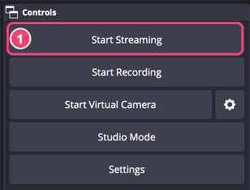
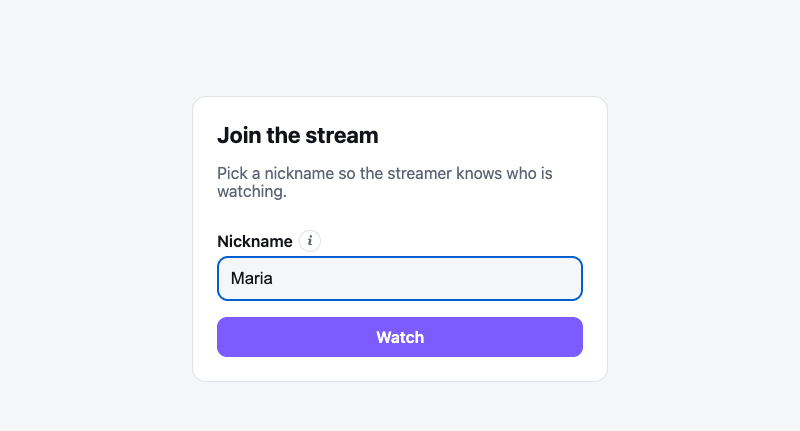
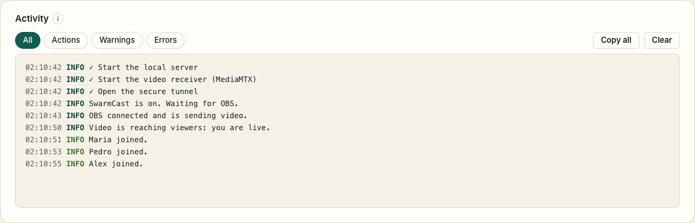

## Every live

1. **Open SwarmCast.** It turns on by itself and shows **Waiting for OBS to start streaming…**. If the top of the panel says **Off**, click **Turn on SwarmCast**.
2. **Start streaming in OBS.** With the Multiple output plugin, also click **Start** next to SwarmCast (not needed if you ticked "Sync start").

   

3. **Wait for "OBS: sending"** at the top of the panel. The link appears in the card **Live link for your subscribers**. Every live gets a new link.

   

4. **Click Copy link** and send it only to your members, for example in a subscribers-only Discord channel or a private group.

That's it. Your members open the link, pick a nickname and watch in the browser. See [For viewers](/swarmcast/viewers/) for what they see.

:::caution[Keep the link among members]
Anyone who has the link can watch. If it leaks, click **Generate new link** and send the new one. See [Kick a viewer and make a new link](/swarmcast/live/kick-and-new-link/).
:::

## During the live

The panel shows what matters:

- **Viewers & P2P help:** who is watching (nickname and device) and how many help through P2P.
- **Your upload now:** how much of your internet upload SwarmCast uses. It never goes above **Max upload for viewers**.
- **Warnings** at the top, for example when there are too many viewers for your upload or when OBS stopped sending video.

**"Too many viewers for your upload":** ask viewers to keep **Help the stream (P2P)** on (see [Help the stream](/swarmcast/live/p2p/)). If your speed test shows room, raise **Max upload for viewers** in the panel.

## When you finish

1. Stop streaming in OBS (and the SwarmCast target in the Multiple output panel, if it does not stop by itself).
2. In the panel click **Stop everything** and wait for **"Off: nothing on your computer is reachable"**.

Quitting SwarmCast also turns everything off. If you close the window while you are live, SwarmCast asks: **Stop and quit**, or **Keep running in the tray**.

If OBS sends no video for 10 minutes, SwarmCast turns everything off by itself, so your computer is never left reachable. You can change the time in the panel (**Turn off after … minutes without video**).
