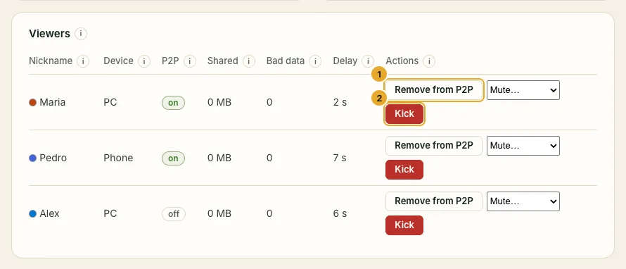
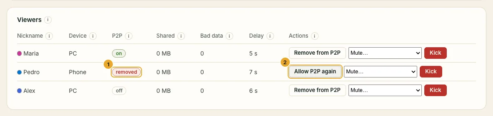
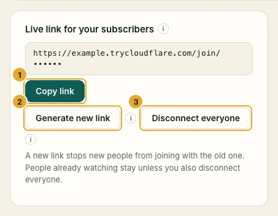

Everyone watching appears in the panel's **Viewers** card, with the nickname they typed and their device (PC or Phone).

## Remove one person: Kick

Click **Kick** next to the person. They are disconnected right away and that browser cannot come back until the live ends. They could still come back from **another device** if they kept the link: also make a new link (below).

## Stop someone from sharing video: Remove from P2P

Click **Remove from P2P**. The person keeps watching, straight from your computer, but no longer shares video with others. **Allow P2P again** undoes it. SwarmCast also does this by itself to a viewer whom other viewers report for broken video.

## The link leaked: Generate new link

1. Click **Generate new link**, then **Copy link** and send the new link to your members.
2. The old link stops working at once for anyone **new**. People already watching stay, unless you also click **Disconnect everyone**: then everybody needs the new link.
3. People already watching lose their **Share** button: whoever got the leaked link cannot pass the new one on. Only people who join with the new link can share it.

Anyone who opens an old link sees this:

:::tip
Every live gets a new link automatically. A link you shared yesterday does not work today.
:::

## Limits against fake viewers

- **Max viewers at once:** when the live is full, new people see "This stream is full". Nobody already watching is dropped. It starts at 120, about what the free tunnel holds.
- **Sessions per browser:** how many tabs one browser may keep open (the oldest is replaced).
- **Viewers can share the link** (on by default): viewers get a **Share** button that sends your current link to a friend. Turn it off if only you should hand out the link; the button then disappears for everyone at once.

Click **Save** after a change. More in [Security and protection](/swarmcast/live/protection/).
