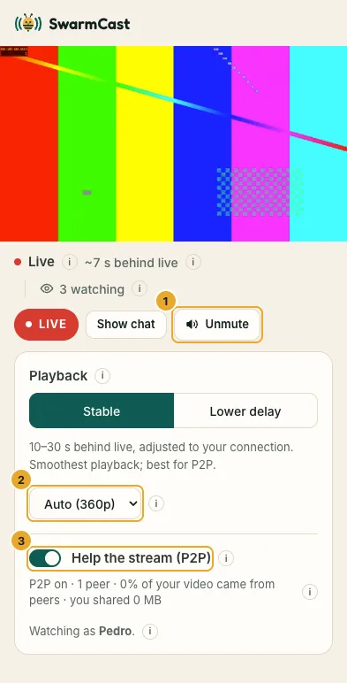
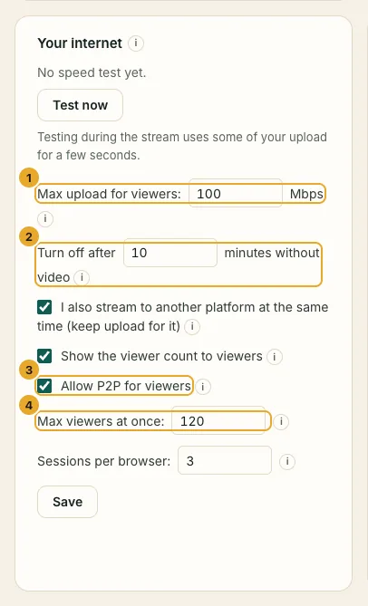

**Help the stream (P2P)** is a switch on the viewer page. It is **off by default**: each viewer decides whether to turn it on. Viewers who have it on pass pieces of the video to each other, so your computer sends less and the live runs smoother for everyone. P2P means "peer to peer": from one viewer to another.

## What it shows, honestly

To pass video to each other, two viewers' browsers connect directly. **Viewers who have P2P on can see each other's IP address** (the internet address of their connection).

- An IP address reveals only an **approximate location** (usually the city or region) and the **internet provider**.
- It does **not** reveal a name, a home address, or anything on the device.
- Online games and video calls work the same way.
- **Your own IP stays hidden** in the normal Secure mode: viewers get your video through an encrypted tunnel, never straight from your computer.
- **Watching from your own internet connection** (you on your phone, or someone at your place on the same Wi-Fi): there, a viewer's IP *is* your IP, so SwarmCast turns P2P off for them by itself. They keep watching normally and see "P2P is off on the streamer's own connection, to keep their IP private".

## Nobody can send altered video

Every piece of video has a fingerprint signed by your SwarmCast. Each viewer's browser checks every piece it gets from another viewer before playing it. A wrong piece is thrown away and fetched again from you, and the viewer who sent it is disconnected and reported. After three reports, SwarmCast removes that viewer from P2P by itself.

## Turning it off

- **Viewers:** it is off until they tick **Help the stream (P2P)**; unticking it stops sharing. Either way they keep watching normally, and the choice is remembered. The small **ⓘ** next to the switch explains the same thing.
- **You:** click **Remove from P2P** next to someone in the viewers list. They keep watching but stop sharing.
- **Everyone at once:** untick **Allow P2P for viewers** in the **Your internet** card and click **Save**. Everybody then watches straight from you, so your upload has to carry them all.

Some browsers or networks cannot use P2P (some company or school networks, for example). Those viewers see "P2P is not available on this device" and watch normally.

## Why it matters for you

Without P2P, every viewer downloads the whole video from your computer, and your internet upload decides how many people can watch. With P2P, viewers share part of that work. The panel shows how many viewers help and roughly how many viewers your upload can serve.

If you see **"Too many viewers for your upload"**, ask your viewers to turn P2P on (it is off by default).
