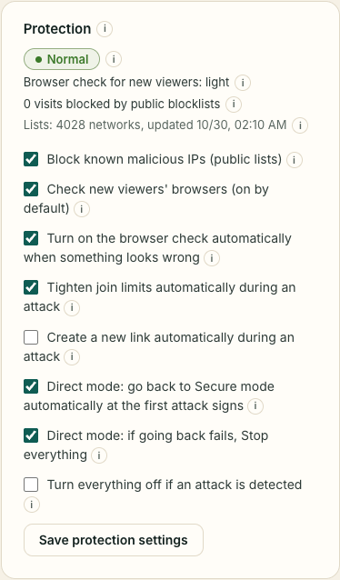

SwarmCast is built so that your computer is never open to the internet in the normal **Secure mode**.

## What protects you all the time

- **Your IP stays hidden.** Viewers reach your live through an encrypted tunnel (Cloudflare). Nothing on your computer accepts connections from the internet.
- **The panel is only yours.** It opens only on your own computer. Nobody else can reach it, even with the live link.
- **A new secret link every live.** It is long and random, so nobody can guess it. The old one stops working.
- **Your stream key stays on your computer.** It is never sent anywhere and never written in the logs.
- **Checked video.** Every piece viewers pass to each other is checked against a signed fingerprint (see [Help the stream](/swarmcast/live/p2p/)).
- **Everything off at the end.** **Stop everything** disconnects viewers, closes the tunnel, deletes the temporary video and then checks that nothing is still running or reachable.

## The Protection card

SwarmCast watches the traffic of your live and compares it with what your audience normally produces. The card shows the state: **Normal**, **Unusual activity** or **Under attack**, and why.

What it does by itself (you can change each one):

- **Browser check (captcha without puzzles):** new viewers' browsers solve a small automatic puzzle, about a second on a phone, while they type their nickname. It makes fake mass joins slow and costly. It turns on by itself when something looks wrong. You can also make it **always on**.
- **Stricter join limits during an attack:** fewer join attempts per internet address, one session per browser, and the viewer limit held near the current audience. Nobody already watching is dropped.
- **Public blocklists:** SwarmCast refuses visitors from networks on free public lists of known malicious networks (Spamhaus DROP and FireHOL level1). The lists are downloaded once a day, with no account. Normal home and mobile connections are almost never on them, and you can turn the lists off in the card.
- **New link during an attack** (off by default): the old link stops working, and you must send the new one.
- **Turn everything off if an attack is detected** (off by default): rarely needed, because the tunnel absorbs large floods.

When it is over (or it was a false alarm), click **End alert**: the limits go back to your settings right away.

## What SwarmCast cannot do

Being honest about the limits helps you decide:

- **Anyone with the link can watch,** and a member can forward it. Make a new link if it leaks.
- **Nothing stops screen recording.** There is no copy protection.
- **Viewers with P2P on see each other's IP** (approximate location only). See [Help the stream](/swarmcast/live/p2p/).
- **Cloudflare is in the path.** The free tunnel is run by Cloudflare, which can see traffic information. It has no uptime guarantee and can struggle with very big audiences.
- **Direct mode shows your IP** to everyone with the link. Use it only in emergencies: [Direct mode](/swarmcast/live/direct-mode/).
- **Attack detection is a best effort.** A very slow or very spread-out attack can stay below the alarms.

Technical details for the curious: [threat model](https://github.com/Lucas-Angelo/swarmcast/blob/main/docs/THREAT_MODEL.md) (English).
