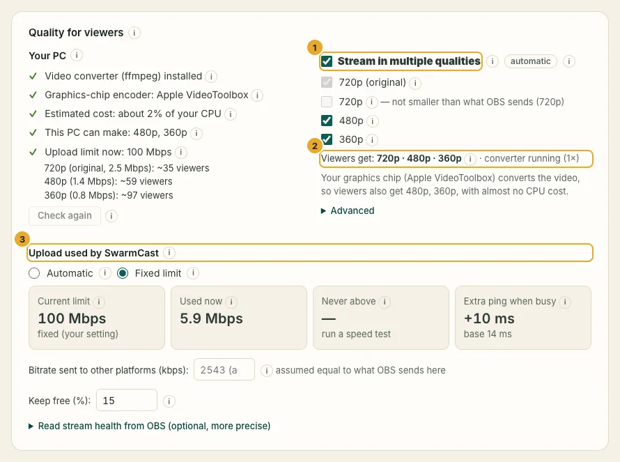

Your viewers always get your **original quality** (what OBS sends, for example 1080p). When your computer can do it safely, SwarmCast also makes **smaller copies** (720p, 480p and 360p), so viewers on weak Wi-Fi or mobile data keep watching without pauses.

## It is automatic

- SwarmCast checks your computer when it starts. With a **graphics chip** that can convert video (NVIDIA, AMD, Intel, Apple), it offers 720p, 480p and 360p, with almost no processor cost.
- Without one, it runs a short test on the processor and offers **one** small quality only if there is room to spare.
- The viewer's player picks the best quality their internet can play without pausing (**Auto**), and changes it when needed. Viewers can also pick a quality by hand.

## OBS always comes first

The converter runs at low priority. If it falls behind or your processor is almost fully busy for 10 seconds, SwarmCast turns off the most expensive quality, then the next one, until only your original quality is left. The panel and the Activity console tell you when that happens. Your stream on OBS is never affected.

## Smaller qualities save your upload

A viewer at 480p costs about a quarter of your upload compared with 1080p. When many people watch, the players move down by themselves, and your upload goes further. Viewers who help through [P2P](/swarmcast/live/p2p/) cost you even less.

## How far behind live viewers are

Each viewer's player picks its own delay behind live and keeps adjusting it to that viewer's connection. With **Stable** (the default) it starts at about 20 seconds:

- **Steady internet** (video arrives much faster than it plays, no pauses): the delay slowly drifts down to about **10–12 seconds**. The player plays a tiny bit faster (at most 5 %) for a while to get there, so nobody notices a jump.
- **Shaky internet** (mobile data that keeps changing, pauses): the delay grows towards **30 seconds**, so the player keeps more video ready. After a pause it moves back at once, inside that same pause, so there is no second one later.
- Viewers who get video from other viewers over P2P stay at 12 seconds or more, which leaves time for the sharing.

With **Lower delay** it moves between 6 and 10 seconds. Viewers see their delay next to the status (for example "~14 s behind live"), and the panel's viewers table shows each viewer's delay in the **Delay** column. It never goes past what your server keeps of the stream, so nobody falls off it.

## Change it yourself

In the **Quality for viewers** card you can:

- turn **Stream in multiple qualities** off or on;
- choose which qualities to offer;
- under **Advanced**, force one encoder.

Your choice is remembered and always wins over the automatic one.

## "The video converter (ffmpeg) is not installed"

The smaller qualities need ffmpeg, a free video converter. SwarmCast downloads it from its publisher the first time it opens and checks its fingerprint before use. If that failed (no internet at the time), click **Install the video converter** in the quality card. Without it, everything works with your original quality.
