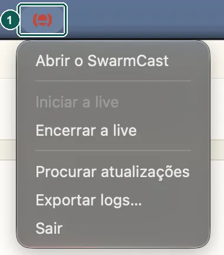

Desinstalar nunca mexe no OBS. Se quiser, apague você mesmo o destino do SwarmCast (painel Multiplas saídas), as configurações de transmissão do Vertical (Aitum Vertical) ou o servidor personalizado no OBS.

## Windows

1. Feche o SwarmCast (ícone da bandeja → **Sair**).
2. Abra **Configurações** → **Aplicativos** → **Aplicativos instalados**, encontre o **SwarmCast**, clique em **…** → **Desinstalar**.
3. O desinstalador mantém as suas configurações e a chave de transmissão, a não ser que você marque **Remover dados do programa**.

## macOS

1. Feche o SwarmCast (ícone na barra de menus → **Sair**).

   

2. Se **Iniciar com o computador** estiver ligado, desligue antes no painel ([Iniciar com o computador](/swarmcast/pt-br/app/autostart/)).
3. Abra **Aplicativos** e arraste o **SwarmCast** para o Lixo.
4. As suas configurações continuam em `~/Library/Application Support/SwarmCast`. Para apagar também, veja [Apagar tudo](#apagar-tudo) abaixo.

## Linux

- **.deb:** no terminal, `sudo apt remove swarm-cast`.
- **AppImage:** desligue **Iniciar com o computador** no painel, feche o SwarmCast e apague o arquivo `.AppImage`.

As suas configurações continuam em `~/.local/share/swarmcast`. Para apagar também, veja [Apagar tudo](#apagar-tudo) abaixo.

## Apagar tudo

As suas configurações, a chave de transmissão, os logs e o conversor de vídeo ficam numa pasta só do SwarmCast. Apague essa pasta só se você nunca mais quiser usar a mesma chave de transmissão.

1. Se você usa o modo direto, clique antes em **Voltar ao modo seguro** no painel: o SwarmCast fecha a porta do roteador que ele abriu.
2. Desinstale o app como mostrado acima para o seu sistema.
3. Apague a pasta do SwarmCast:
   - **Windows:** marque **Remover dados do programa** no desinstalador. Já desinstalou? Aperte **Windows + R**, digite `%LOCALAPPDATA%`, aperte Enter e apague a pasta **SwarmCast**.
   - **macOS:** no Finder, clique em **Ir** → **Ir para a Pasta…**, digite `~/Library/Application Support`, aperte Enter e mova a pasta **SwarmCast** para o Lixo.
   - **Linux:** no terminal, `rm -rf ~/.local/share/swarmcast`.
