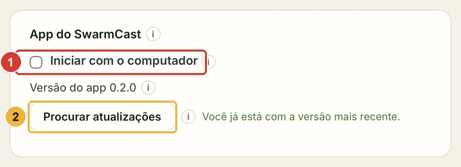
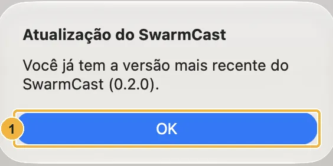

O SwarmCast procura uma versão **estável** nova logo depois de abrir e depois a cada 6 horas (e versões beta também, se você ligou: veja [Versões beta](#versões-beta)). Nada é instalado sem o seu OK.

## Quando tem versão nova

Aparece uma mensagem **"O SwarmCast X está disponível (você tem a versão Y)"** com as novidades, e o painel mostra o mesmo numa faixa.

1. Clique em **Atualizar agora** (ou **Depois**).
2. O SwarmCast baixa a atualização, confere a assinatura digital, instala e **abre de novo sozinho**. Leva mais ou menos um minuto.

As suas configurações, a chave de transmissão e o acesso dos espectadores continuam iguais.

:::caution[Atualizar encerra a live]
Se você estiver ao vivo, atualizar encerra a live para todo mundo. O SwarmCast avisa antes, e **Depois** já vem selecionado. Atualize quando a live acabar.
:::

## Procurar agora

Clique em **Procurar atualizações** no cartão **App do SwarmCast** do painel ou no menu do ícone da bandeja. Quando não tem nada novo, o SwarmCast avisa:

## Versões beta

Uma beta é uma versão antecipada da próxima atualização: novidades antes de todo mundo, mas ela **pode ter defeitos**. As betas são opcionais e vêm desligadas.

- **Para ligar:** no cartão **App do SwarmCast** do painel, marque **Receber versões beta**. O SwarmCast procura na hora e oferece a versão mais nova, beta ou estável. As suas configurações continuam.
- **Para desligar**, use a mesma chave quando quiser. O SwarmCast nunca instala uma versão mais antiga por cima de uma mais nova, então você **fica na beta** até sair uma versão estável mais nova, que chega como uma atualização normal.
- Uma versão como **0.3.0-beta.1** aparece com o selo **Beta** ao lado. Se você mesmo instalou uma beta, ela segue as betas sozinha até você desligar a chave.
- **Conte o que você encontrou** em [Discussions → Beta feedback](https://github.com/Lucas-Angelo/swarmcast/discussions/categories/beta-feedback), ou abra um relato de problema e escolha **Beta** como canal de atualização.

As betas ficam na [página de versões](https://github.com/Lucas-Angelo/swarmcast/releases), marcadas como **Pre-release**. O botão de download deste site sempre dá a versão estável.

## Se a atualização falhar

A versão que você tem continua funcionando. O SwarmCast tenta baixar de novo algumas vezes sozinho. Se ainda assim falhar, confira a sua internet e clique em **Tentar de novo** mais tarde.

## Linux

- **AppImage:** se atualiza sozinho, como no Windows e no macOS.
- **.deb:** se o app não conseguir instalar a atualização sozinho, ele abre a página de download. Baixe o `.deb` novo e instale do mesmo jeito da primeira vez ([Instalar no Linux](/swarmcast/pt-br/install/linux/)). As configurações continuam.

## Instalação por script

Se você instalou com script, rode o mesmo script de novo (ou o de um zip de instalação novo). Ele atualiza o SwarmCast e mantém as suas configurações. Veja [Avançado: instalar com script](/swarmcast/pt-br/advanced/script-install/).

## Como o SwarmCast procura (privacidade)

Para procurar, o app baixa um arquivinho público (`latest.json`) das versões do SwarmCast no GitHub; com as versões beta ligadas, também `updates/beta.json` deste site. Ele não manda nada sobre você nem sobre a sua live. O GitHub conta quantas vezes esse arquivo foi baixado, e é assim que este site consegue estimar quantos apps estão em uso. Mais em [Privacidade e números de uso](/swarmcast/pt-br/about/privacy/).
