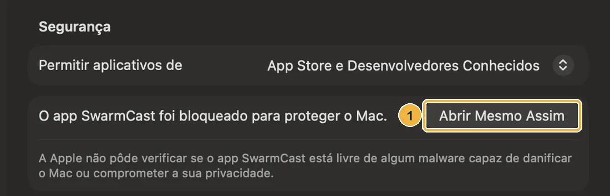

O SwarmCast precisa do macOS 13.5 (Ventura) ou mais novo. Nas imagens, a caixa **amarela** quer dizer clique, a **vermelha** digite ou escolha, e a **verde** confira.

## 1. Baixe o arquivo certo

Menu Apple → **Sobre Este Mac**:

- **Chip: Apple M1, M2, M3, M4…** → o arquivo para **chip Apple** (termina em `aarch64.dmg`).
- **Processador: Intel…** → o arquivo para **chip Intel** (termina em `x64.dmg`).

Baixe na [página de download](/swarmcast/pt-br/download/#macos).

## 2. Arraste o SwarmCast para Aplicativos

1. Dê dois cliques no `.dmg` em **Downloads**. Abre uma janela com o ícone do **SwarmCast** e a pasta **Applications** (Aplicativos).
2. Arraste o ícone do **SwarmCast** para cima da pasta. Depois ejete o **SwarmCast** na barra lateral do Finder.

## 3. A primeira abertura: "Abrir Mesmo Assim"

O SwarmCast é gratuito e de código aberto, então não tem o registro pago da Apple. O macOS pede para você liberar uma vez.

1. Abra **Aplicativos** e dê dois cliques no **SwarmCast**. O macOS mostra **O Item "SwarmCast" Não Foi Aberto** ("A Apple não pôde verificar…"). Clique em **OK** (não em **Mover para o Lixo**).

2. Menu Apple → **Ajustes do Sistema** → **Privacidade e Segurança**. Role até **Segurança** e clique em **Abrir Mesmo Assim**.
3. Aparece a pergunta **Abrir "SwarmCast"?**. Clique em **Abrir Mesmo Assim** de novo e confirme com a sua senha ou o Touch ID.

Daqui em diante o SwarmCast abre normalmente, e o ícone dele fica na barra de menus, no alto da tela.

:::tip[É seguro?]
O aviso só quer dizer que o SwarmCast não é registrado na Apple. O código-fonte é público, e toda atualização que o app instala é conferida antes com uma assinatura digital.
:::

## 4. Primeira vez

A janela mostra **Abrindo o SwarmCast…** e depois um tutorial curto. Continue em [Primeira vez e tutorial](/swarmcast/pt-br/start/first-run/).

Se o macOS perguntar se o SwarmCast pode aceitar conexões de rede (só no [modo direto](/swarmcast/pt-br/live/direct-mode/)), clique em **Permitir**. No modo seguro, que é o normal, ninguém se conecta ao seu Mac.

## Deu algo errado?

- **"O SwarmCast está danificado e não pode ser aberto":** apague o app e o `.dmg`, baixe de novo e repita. Se continuar, abra o **Terminal**, cole `xattr -dr com.apple.quarantine /Applications/SwarmCast.app`, aperte Enter e abra o SwarmCast de novo.
- **Não aparece "Abrir Mesmo Assim":** o botão fica lá por mais ou menos uma hora depois que você tentou abrir o app. Dê dois cliques no SwarmCast de novo e volte em **Privacidade e Segurança**.
- Mais respostas: [Problemas e dúvidas](/swarmcast/pt-br/help/troubleshooting/).
