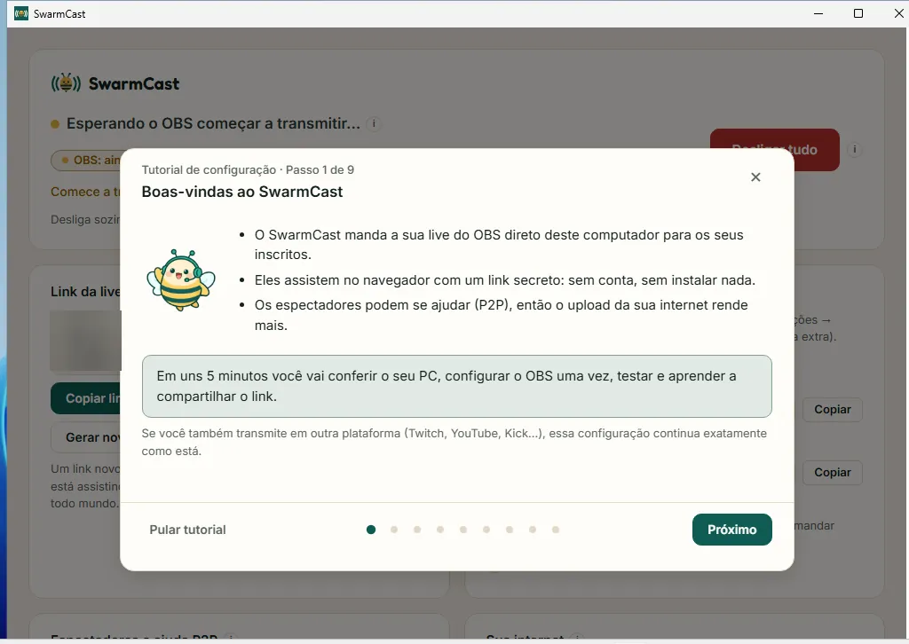

O SwarmCast é instalado só para o seu usuário do Windows. Ele não pede permissão de administrador e não mexe no OBS.

## 1. Baixar

Baixe o arquivo que termina em **`x64-setup.exe`** (por exemplo, `SwarmCast_0.2.1_x64-setup.exe`) na [página de download](/swarmcast/pt-br/download/#windows).

## 2. Rodar o instalador

Abra a pasta **Downloads** e dê dois cliques no arquivo.

Na primeira vez, o Windows pode mostrar uma tela azul, **"O Windows protegeu o computador"**. Ela aparece para todo app novo sem um certificado de assinatura pago; não quer dizer que tem algo errado:

1. Clique em **Mais informações**.
2. Clique em **Executar assim mesmo**.

Se o Windows perguntar **"Deseja executar este arquivo?"**, clique em **Executar**.

:::tip[Por que aparece esse aviso?]
O SwarmCast é gratuito e de código aberto, por isso não tem o certificado pago. O código é público, e toda atualização que o app instala é conferida antes por uma assinatura digital.
:::

## 3. Avance pelo instalador

O instalador segue o idioma do Windows (português ou inglês). Em português, as telas são:

1. **Bem-vindo ao Instalador do SwarmCast:** clique em **Próximo >**.
2. **Escolha o Local da Instalação:** deixe a pasta como está (dentro de `AppData\Local\Programs\SwarmCast` do seu usuário) e clique em **Próximo >**. A instalação leva poucos segundos.
3. **Instalação Completa:** clique em **Próximo >**.
4. **Completando a instalação do SwarmCast:** deixe marcado **Executar o SwarmCast** (e, se quiser, **Criar atalho na área de trabalho**) e clique em **Concluir**.

## 4. O SwarmCast abre

O SwarmCast abre na própria janela, com um atalho na área de trabalho e no menu Iniciar, e um ícone perto do relógio (a bandeja; clique na setinha **^** se não encontrar). Na primeira vez, o tutorial de configuração abre: continue em [Primeira vez e tutorial](/swarmcast/pt-br/start/first-run/).

:::note
Na primeira vez que você ligar o modo direto (só para emergências, veja [Modo direto](/swarmcast/pt-br/live/direct-mode/)), o Windows pode perguntar se o SwarmCast pode usar as redes. Clique em **Permitir** (redes privadas).
:::

## Deu algum problema?

- **O download sumiu, ou o navegador diz que o arquivo "não é baixado com frequência":** no Edge, abra a lista de downloads (**Ctrl+J**), clique em **…** ao lado do arquivo e depois em **Manter** → **Mostrar mais** → **Manter mesmo assim**.
- **Instalar de novo com o SwarmCast aberto:** o instalador fecha o SwarmCast antes, o que encerra uma live que estiver no ar. Instale quando não estiver ao vivo.
- Mais respostas: [Problemas e dúvidas](/swarmcast/pt-br/help/troubleshooting/).
