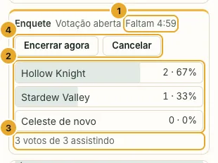
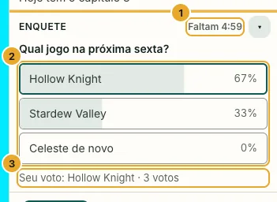
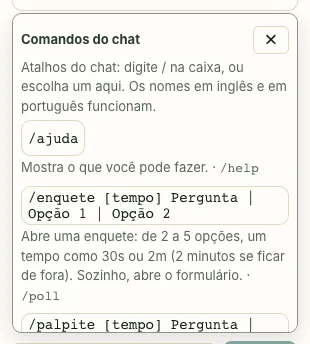
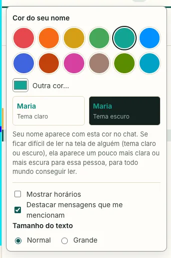

A sua live tem chat. Quem assiste escreve embaixo do vídeo, você lê e responde no **Chat ao vivo** do painel, e todo mundo vê as mensagens em menos de um segundo. Ele vem **ligado por padrão**: não precisa configurar nada.

Durante a live, o **Chat ao vivo** fica na tela principal do painel, sem precisar rolar: numa coluna à direita (embaixo do status quando a janela é estreita), e continua à vista enquanto você rola o resto do painel. Fora da live, ou com o chat desligado, ele não aparece.

:::note[Os apelidos são públicos na live]
Todo mundo que está assistindo vê os apelidos no chat. A página de entrada avisa isso antes de a pessoa digitar o dela.
:::

## O que dá para mandar

- **Texto:** uma linha, até 200 caracteres por padrão. Links aparecem como texto simples: nunca dá para clicar e nunca geram prévia.
- **Emojis e emotes:** os emojis de sempre, do celular ou do seletor, mais os emotes de abelha que vêm com o SwarmCast (`:gg:`, `:love:`, `:wow:`…).
- **GIFs:** só se você ligar, com a sua própria chave grátis. Veja [Como conseguir uma chave de GIFs](/swarmcast/pt-br/live/gif-key/).

As suas mensagens, enviadas pela caixa **Enviar como …** no fim do Chat ao vivo, levam o selo **Transmissão**. Ninguém mais consegue esse selo, seja qual for o apelido, e ninguém entra com um nome como "Transmissão", "Admin" ou "Moderador", com o seu nome no chat, nem com um nome parecido com algum desses ou com o de alguém que já está assistindo. Escolha o seu nome no chat no tutorial de configuração ou em **Configurações do chat** → **Aparência**. Se alguém que já está assistindo tiver um nome parecido com o que você escolher, a pessoa continua com ele até entrar de novo.

## Mantenha o chat tranquilo

Cada mensagem no Chat ao vivo tem um menu **Ações** (o botão **⋯**):

- **Responder:** responde àquela mensagem pela sua caixa (veja [Respostas e menções](#respostas-e-menções)).
- **Apagar:** some com a mensagem para todo mundo.
- **Destacar:** faz a mensagem se destacar para todo mundo (veja [Destacar e fixar](#destacar-e-fixar)). **Tirar destaque** volta ao normal.
- **Fixar no topo:** deixa a mensagem no topo do chat de todo mundo, **até eu desafixar** ou por 5 min, 15 min ou 1 hora. **Desafixar** tira do topo.
- **Silenciar:** por 1 min, 10 min, 1 hora ou **até o fim da live**. A pessoa continua assistindo, mas não consegue escrever. **Tirar silêncio** libera na hora. Sair e entrar de novo não desfaz o silêncio.
- **Mudar cor…:** muda a cor do nome da pessoa para todo mundo. Marque **Travar** para ela não conseguir trocar.

Também dá para silenciar alguém pelo cartão **Espectadores**.

:::note[Silenciar até o fim da live]
Não existem contas, então na sua próxima live o SwarmCast não reconhece essa pessoa. Se ela voltar e aprontar, silencie ou expulse de novo; um link novo deixa de fora quem você não convidou ([Expulsar e trocar o link](/swarmcast/pt-br/live/kick-and-new-link/)).
:::

**Limpar chat** apaga todas as mensagens para todo mundo (quem assiste vê "Quem transmite limpou o chat").

## Destacar e fixar

- **Destaque** uma boa pergunta ou uma mensagem importante: todo mundo vê com uma barra colorida, inclusive quem entra depois e vê entre as mensagens recentes. Dá para destacar até 20 mensagens de cada vez; destacar mais uma tira a marca da mais antiga.
- **Fixe no topo** uma mensagem (sua ou de um espectador), por exemplo as regras, um link que você quer que todo mundo leia ou a resposta da pergunta que todo mundo faz. Ela fica acima das mensagens para todo mundo, inclusive para quem entra depois. Só uma mensagem fica fixada de cada vez: fixar outra substitui a anterior. Escolha **Até eu desafixar**, ou 5 min, 15 min ou 1 hora para ela sair sozinha.
- A mensagem fixada também aparece no topo do seu Chat ao vivo, com **Desafixar** (e, numa fixação com tempo, a hora em que ela sai).
- **Apagar** a mensagem fixada ou **Limpar chat** desafixa. Silenciar ou expulsar quem escreveu não. **Parar tudo** tira junto com o resto do chat.

Só você destaca e fixa. Um espectador que escreve "📌 Fixada" numa mensagem só escreve texto na própria linha, com o próprio nome: a mensagem fixada de verdade tem um lugar só dela, acima do chat, com o aviso "Fixada por quem transmite".

## Respostas e menções

- **Responda** a uma mensagem: todo mundo vê a sua resposta com um trecho curto da mensagem acima dela, para o chat saber o que você está respondendo, inclusive quem entra depois. Quem assiste responde pelo botão **Responder** que aparece ao apontar para uma mensagem (ou tocar nela no celular); você responde pelo menu **⋯**. Enquanto você escreve, "Respondendo a …" aparece acima da caixa: **✕** ou Esc cancela.
- **Mencione** alguém com **@**: digite **@** e escolha um nome da lista (ou continue digitando para filtrar). A lista só tem quem já escreveu no chat, nunca todo mundo que está assistindo. A pessoa mencionada vê a sua mensagem marcada para ela; ninguém mais vê, e não há som nem notificação. Uma mensagem que menciona você aparece marcada no seu Chat ao vivo com **Menciona você**.
- **Apagar** uma mensagem também tira o trecho dela das respostas: elas passam a dizer "Mensagem original apagada". Depois de **Limpar chat** não sobra nada para responder.
- Uma resposta é uma mensagem como outra qualquer: modo lento, palavras bloqueadas, o que dá para mandar e silenciar valem igual. Em **Só emotes**, uma menção (é texto) é recusada.

Para ninguém conseguir perseguir uma pessoa com menções, o SwarmCast conta quantas vezes alguém menciona os outros e quantas vezes uma pessoa é mencionada. Passando disso, a mensagem aparece do mesmo jeito, só sem a marca. Nomes parecidos (um "А" cirílico no lugar do "A", por exemplo) nunca mencionam ninguém. Quem não quiser a marca pode desligar **Destacar mensagens que me mencionam** nas configurações do chat.

## Enquetes e palpites

Faça uma pergunta para todo mundo que está assistindo. Clique em **Enquete** embaixo da sua caixa de mensagem no Chat ao vivo:

1. Escolha **Enquete** (as pessoas votam e veem o resultado) ou **Palpite** (as pessoas chutam, e você diz a resposta certa quando os palpites terminam).
2. Escreva a pergunta e de 2 a 5 respostas (**+ Adicionar opção**), e escolha quanto tempo as pessoas têm para votar: de 30 segundos a 10 minutos.
3. Clique em **Começar**.

- Quem assiste vê a enquete acima das mensagens do chat e toca numa resposta. **O resultado aparece ao vivo** enquanto as pessoas votam, para todo mundo.
- Quando o tempo acaba, ou quando você clica em **Encerrar agora**, a enquete mostra o resultado por um minuto e depois sai (**Remover** tira na hora). **Cancelar** remove sem resultado.
- Um **palpite** para de receber chutes no fim (**Encerrar palpites**). Depois clique em **Resposta certa** ao lado da certa: todo mundo vê a resposta, com quantas pessoas acertaram, e cada pessoa vê se acertou. Só aparecem números, nunca nomes.
- **Uma de cada vez.** Abra a próxima quando a anterior terminar.

Como os votos contam:

- **Um voto por navegador, definitivo e anônimo.** Outras abas ou janelas do mesmo navegador não votam de novo, e não dá para mudar o voto. Ninguém, nem você, vê quem votou em quê.
- **No máximo 10 votos por conexão de internet.** Uma casa inteira ou um escritório ainda votam, mas quem abre um monte de janelas anônimas não consegue encher a enquete. A enquete mostra quantos votos não contaram por isso.
- **Só quem já está assistindo** (ligado por padrão nos palpites, uma marcação no formulário): quem chega depois que começou não vota, então uma visita nova feita só para votar de novo não conta. Também liga sozinho enquanto a **Proteção contra flood** está ligada.
- Quem está **silenciado** não vota. Expulsar alguém tira o voto da pessoa. **Limpar chat** não mexe na enquete; **Desligar tudo** remove.

Não tem pontos nem prêmios: a enquete é só um jeito divertido de perguntar ao chat.

## Reações sobre o vídeo

Quem assiste toca na abelhinha ao lado da caixa de mensagem e escolhe uma de oito reações (Amei, Hype, Engraçado, Uau, GG, Fogo, Triste, Oi). Ela sobe flutuando sobre o vídeo por um instante, para todo mundo que está assistindo, também em tela cheia. Elas vêm **ligadas**.

- São só figurinhas dos emotes de abelha: ninguém consegue escrever nada com elas.
- Quase não usam a sua internet: o SwarmCast soma os toques de todo mundo e manda uma vez por segundo, e um momento agitado nunca põe mais do que algumas na tela.
- Pessoas **silenciadas** não reagem. As reações pausam sozinhas enquanto o chat está **travado para quem já está aqui** e quando o seu computador está ocupado, e param junto com o chat.
- O **Chat ao vivo** mostra uma contagem pequena embaixo dos números: "Reações no último minuto: Fogo 12 · Amei 3".
- Para desligar para todo mundo, desmarque **Reações no vídeo** nas configurações do chat e clique em **Salvar configurações do chat**.
- Cada espectador pode escondê-las na própria tela (**Mostrar reações no vídeo** nas configurações do chat). Quem pediu ao aparelho para reduzir o movimento vê um contador pequeno no canto do vídeo em vez das abelhinhas flutuando.

## Atalhos: digite / na caixa

A caixa do Chat ao vivo também aceita comandos curtos. Digite **/** e aparece uma lista dos que combinam, com o jeito de escrever cada um; o **?** ao lado de **Enviar** mostra todos. Os nomes em português e em inglês funcionam, com ou sem acento. Os botões continuam: o comando é só um jeito mais rápido.

| Comando | O que faz |
|---|---|
| `/enquete 2m Pizza ou hambúrguer? \| Pizza \| Hambúrguer` | Abre uma enquete: um tempo opcional primeiro (`30s`, `2m`), depois a pergunta e de 2 a 5 respostas separadas por **\|**. `/enquete` sozinho abre o formulário |
| `/palpite Quem ganha? \| Azul \| Verde` | O mesmo para um palpite |
| `/encerrar`, `/resposta 2`, `/cancelar` | Encerra a votação, dá a resposta certa de um palpite (o número dela), remove a enquete |
| `/fixar Bem-vindos!` | Manda a mensagem e fixa. `/fixar` sozinho fixa a mensagem que você está respondendo. `/desafixar` tira |
| `/lento 10`, `/lento desligar` | Modo lento: segundos entre duas mensagens da mesma pessoa |
| `/silenciar Ana 10`, `/silenciar Ana live`, `/dessilenciar Ana` | Silencia alguém que está assistindo (10 minutos se você não disser o tempo; **live**: até o fim da transmissão). Duas pessoas com nomes parecidos: inclua a etiqueta que a lista mostra, como `Ana#K3QF` |
| `/proteger lento`, `/proteger bloqueio`, `/proteger desligado` | Proteção contra flood na mão |
| `/limpar` | Limpa o chat, depois de perguntar |
| `/ajuda` | A lista de comandos |

A resposta aparece embaixo da caixa ("Enquete aberta.", ou o que corrigir). Uma linha que não começa com o nome de um comando vai como mensagem normal; para mandar uma mensagem que começa com "/", digite duas vezes: `//assim`.

Quem assiste também pode digitar **/ajuda**: aparece uma lista curta do que dá para fazer no chat, só na tela da pessoa. Nada que ela digite como comando chega ao chat, então ninguém consegue fingir que abriu uma enquete.

## Proteção contra flood

Quando o chat fica movimentado demais para o tamanho da sua audiência, ou alguém inunda o chat, o SwarmCast protege **sozinho** (**Proteção automática contra flood**, ligada por padrão):

- **Acalmar:** todo mundo espera mais entre uma mensagem e outra (modo lento automático).
- **Travar:** num flood de verdade, só quem já estava assistindo consegue escrever. Quem chega só lê.

Tudo volta ao normal sozinho quando acalma. O Chat ao vivo mostra o que está acontecendo e por quê. Você também pode fazer isso na mão em **Proteção contra flood**: **Acalmar o chat agora**, **Travar o chat para quem já está aqui** e **Voltar ao normal**.

:::tip
O chat nunca deixa o vídeo mais lento. Ele tem uma parte pequena e separada do seu upload, e se o computador ficar ocupado, o chat desacelera primeiro para o vídeo continuar liso.
:::

## Configurações do chat

Clique em **Configurações** no Chat ao vivo, ou desça até o cartão **Chat**, mude o que quiser e clique em **Salvar configurações do chat**. Todo mundo que está assistindo recebe a mudança em até um segundo.

- **O que dá para mandar:** **Tudo**, **Texto + emotes**, **Só texto**, **Só emotes** ou **Só GIFs**, ou marque qualquer combinação. **Só texto** quer dizer só letras: sem emojis e sem emotes. **Só emotes** quer dizer emojis e emotes, sem letras.
- **Modo lento: uma mensagem a cada…** cada pessoa espera esse tempo entre mensagens. 2 segundos por padrão; **Desligado** deixa só um limite curto de rajada.
- **Tamanho máximo da mensagem:** de 20 a 500 caracteres (um emoji conta como um). 200 por padrão.
- **Máximo de emojis por mensagem:** evita paredões de emojis, difíceis de ler e pesados para celulares antigos.
- **Quem acabou de entrar espera antes de falar:** segundos que alguém recém-chegado espera antes de escrever. Útil quando entram só para mandar spam.
- **Bloquear mensagens repetidas por…:** a mesma pessoa não manda a mesma mensagem de novo dentro desse tempo.
- **Mensagens recentes para quem entra:** quantas das últimas mensagens a pessoa vê ao entrar.
- **Links:** **Mostrar como texto** (o padrão) ou **Bloquear** mensagens que tenham um.
- **Palavras bloqueadas:** uma por linha. Mensagens com uma delas são recusadas, mesmo escritas com letras parecidas, acentos ou espaços.
- **Alfabetos permitidos:** **Qualquer**, ou **Só latino** para um público local.
- **Espectadores escolhem a cor do nome**, **Seu nome no chat**, **Avisar no chat quando alguém for silenciado** e **Reações no vídeo**.
- **Emotes do SwarmCast:** liga ou desliga os emotes de abelha.

Para desligar o chat para todo mundo, use a chave no topo do cartão Chat (1). Aí quem assiste nem vê o chat, e o Chat ao vivo sai do painel até você ligar de novo.

## O que quem assiste vê

- O chat ao lado do vídeo no computador, embaixo dele no celular.
- A **mensagem fixada** acima das mensagens, com o aviso "Fixada por quem transmite" (5). Uma longa abre com **Mostrar mais**; o **✕** esconde naquele aparelho até você fixar outra. Com o chat oculto, **Mostrar chat** avisa **Fixada** quando você fixa algo.
- **Mensagens destacadas** com uma barra colorida (6), legíveis no tema claro e no escuro.
- **Respostas** com um trecho curto da mensagem respondida; um clique no trecho leva até ela enquanto ainda está no chat. Uma mensagem que **menciona a pessoa** tem uma barra cor de mel e o nome dela marcado (7); com o chat oculto, **Mostrar chat** conta essas menções.
- **Responder** em cada mensagem (apontando para ela, tocando nela no celular ou com as setas a partir do chat) e **@** na caixa de mensagem para mencionar alguém que escreveu.
- **Enquetes e palpites** acima das mensagens, com o resultado ao vivo e o próprio voto. No celular a enquete começa recolhida numa linha, para o chat não perder espaço: um toque abre. Com o chat oculto, **Mostrar chat** diz **Enquete**.
- **Reações**: a abelhinha ao lado da caixa de mensagem manda uma, e as de todo mundo flutuam sobre o vídeo.
- **Ocultar chat** esconde o chat naquele aparelho (fica lembrado); **Mostrar chat** traz de volta.
- **Configurações do chat** para a cor do próprio nome, horários, **Destacar mensagens que me mencionam**, **Mostrar reações no vídeo** e tamanho do texto. O SwarmCast deixa toda cor legível em tela clara e escura.

  

- "enviando…" até a mensagem entrar, e um motivo curto no idioma da pessoa quando ela é recusada (modo lento, silenciado, longa demais, palavra bloqueada…).

## Privacidade

- As mensagens ficam **só na memória** enquanto você está ao vivo. **Desligar tudo** apaga tudo; nada é salvo no disco, e os logs nunca guardam o que as pessoas escreveram.
- O chat passa pelo mesmo túnel privado do vídeo: o IP de ninguém aparece, nem o seu nem o de quem assiste.
- Links nunca são clicáveis e imagens de links nunca aparecem, então ninguém usa o chat para descobrir o IP de quem assiste.

:::note[Chegando na 0.4.1]
Um overlay do chat para o OBS e os seus próprios emotes.
:::
