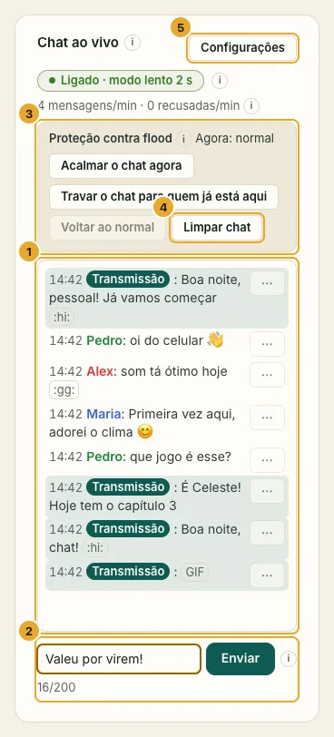
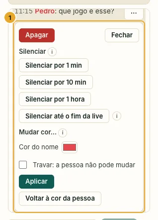
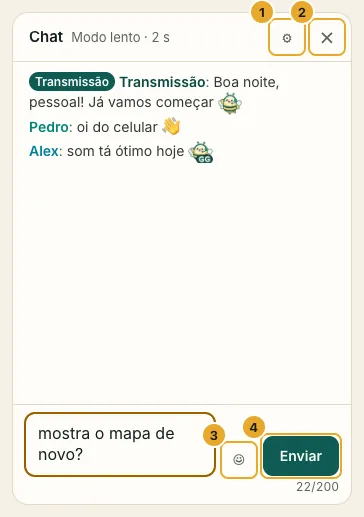
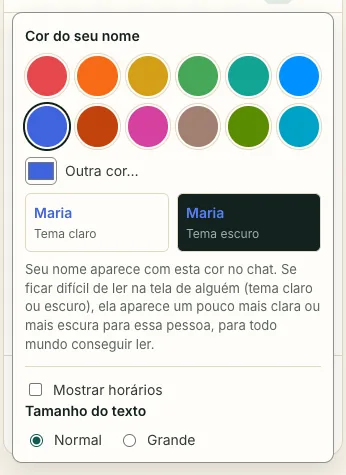

A sua live tem chat. Quem assiste escreve embaixo do vídeo, você lê e responde no cartão **Chat** do painel, e todo mundo vê as mensagens em menos de um segundo. Ele vem **ligado por padrão**: não precisa configurar nada.

:::note[Os apelidos são públicos na live]
Todo mundo que está assistindo vê os apelidos no chat. A página de entrada avisa isso antes de a pessoa digitar o dela.
:::

## O que dá para mandar

- **Texto:** uma linha, até 200 caracteres por padrão. Links aparecem como texto simples: nunca dá para clicar e nunca geram prévia.
- **Emojis e emotes:** os emojis de sempre, do celular ou do seletor, mais os emotes de abelha que vêm com o SwarmCast (`:gg:`, `:love:`, `:wow:`…).
- **GIFs:** só se você ligar, com a sua própria chave grátis. Veja [Como conseguir uma chave de GIFs](/swarmcast/pt-br/live/gif-key/).

As suas mensagens, enviadas pela caixa **Enviar como …** no fim do cartão Chat, levam o selo **Transmissão**. Ninguém mais consegue esse selo, seja qual for o apelido, e ninguém entra com um nome como "Transmissão", "Admin" ou "Moderador", nem com um nome parecido com o de alguém que já está assistindo.

## Mantenha o chat tranquilo

Cada mensagem no cartão Chat tem um menu **Ações**:

- **Apagar:** some com a mensagem para todo mundo.
- **Silenciar:** por 1 min, 10 min, 1 hora ou **até o fim da live**. A pessoa continua assistindo, mas não consegue escrever. **Tirar silêncio** libera na hora. Sair e entrar de novo não desfaz o silêncio.
- **Mudar cor…:** muda a cor do nome da pessoa para todo mundo. Marque **Travar** para ela não conseguir trocar.

Também dá para silenciar alguém pelo cartão **Espectadores**.

:::note[Silenciar até o fim da live]
Não existem contas, então na sua próxima live o SwarmCast não reconhece essa pessoa. Se ela voltar e aprontar, silencie ou expulse de novo; um link novo deixa de fora quem você não convidou ([Expulsar e trocar o link](/swarmcast/pt-br/live/kick-and-new-link/)).
:::

**Limpar chat** apaga todas as mensagens para todo mundo (quem assiste vê "Quem transmite limpou o chat").

## Proteção contra flood

Quando o chat fica movimentado demais para o tamanho da sua audiência, ou alguém inunda o chat, o SwarmCast protege **sozinho** (**Proteção automática contra flood**, ligada por padrão):

- **Acalmar:** todo mundo espera mais entre uma mensagem e outra (modo lento automático).
- **Travar:** num flood de verdade, só quem já estava assistindo consegue escrever. Quem chega só lê.

Tudo volta ao normal sozinho quando acalma. O cartão mostra o que está acontecendo e por quê. Você também pode fazer isso na mão em **Proteção contra flood**: **Acalmar o chat agora**, **Travar o chat para quem já está aqui** e **Voltar ao normal**.

:::tip
O chat nunca deixa o vídeo mais lento. Ele tem uma parte pequena e separada do seu upload, e se o computador ficar ocupado, o chat desacelera primeiro para o vídeo continuar liso.
:::

## Configurações do chat

Abra **Configurações do chat** no cartão Chat, mude o que quiser e clique em **Salvar configurações do chat**. Todo mundo que está assistindo recebe a mudança em até um segundo.

- **O que dá para mandar:** **Tudo**, **Texto + emotes**, **Só texto**, **Só emotes** ou **Só GIFs**, ou marque qualquer combinação. **Só texto** quer dizer só letras: sem emojis e sem emotes. **Só emotes** quer dizer emojis e emotes, sem letras.
- **Modo lento: uma mensagem a cada…** cada pessoa espera esse tempo entre mensagens. 2 segundos por padrão; **Desligado** deixa só um limite curto de rajada.
- **Tamanho máximo da mensagem:** de 20 a 500 caracteres (um emoji conta como um). 200 por padrão.
- **Máximo de emojis por mensagem:** evita paredões de emojis, difíceis de ler e pesados para celulares antigos.
- **Quem acabou de entrar espera antes de falar:** segundos que alguém recém-chegado espera antes de escrever. Útil quando entram só para mandar spam.
- **Bloquear mensagens repetidas por…:** a mesma pessoa não manda a mesma mensagem de novo dentro desse tempo.
- **Mensagens recentes para quem entra:** quantas das últimas mensagens a pessoa vê ao entrar.
- **Links:** **Mostrar como texto** (o padrão) ou **Bloquear** mensagens que tenham um.
- **Palavras bloqueadas:** uma por linha. Mensagens com uma delas são recusadas, mesmo escritas com letras parecidas, acentos ou espaços.
- **Alfabetos permitidos:** **Qualquer**, ou **Só latino** para um público local.
- **Espectadores escolhem a cor do nome**, **Seu nome no chat** e **Avisar no chat quando alguém for silenciado**.
- **Emotes do SwarmCast:** liga ou desliga os emotes de abelha.

Para desligar o chat para todo mundo, use a chave no topo do cartão Chat. Aí quem assiste nem vê o chat.

## O que quem assiste vê

- O chat ao lado do vídeo no computador, embaixo dele no celular.
- **Ocultar chat** esconde o chat naquele aparelho (fica lembrado); **Mostrar chat** traz de volta.
- **Configurações do chat** para a cor do próprio nome, horários e tamanho do texto. O SwarmCast deixa toda cor legível em tela clara e escura.

  

- "enviando…" até a mensagem entrar, e um motivo curto no idioma da pessoa quando ela é recusada (modo lento, silenciado, longa demais, palavra bloqueada…).

## Privacidade

- As mensagens ficam **só na memória** enquanto você está ao vivo. **Desligar tudo** apaga tudo; nada é salvo no disco, e os logs nunca guardam o que as pessoas escreveram.
- O chat passa pelo mesmo túnel privado do vídeo: o IP de ninguém aparece, nem o seu nem o de quem assiste.
- Links nunca são clicáveis e imagens de links nunca aparecem, então ninguém usa o chat para descobrir o IP de quem assiste.

:::note[Chegando na 0.4.1]
Um overlay do chat para o OBS e os seus próprios emotes.
:::
