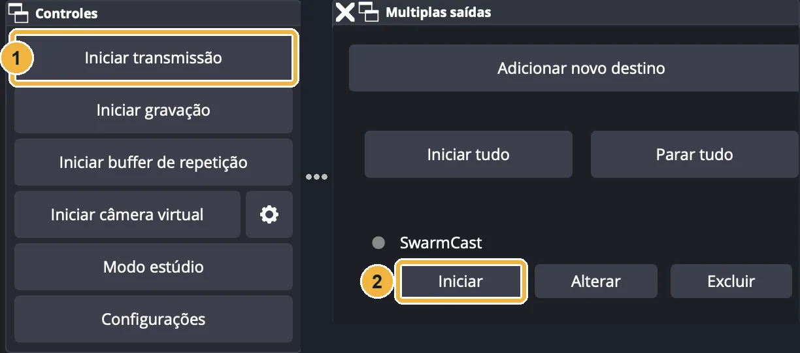
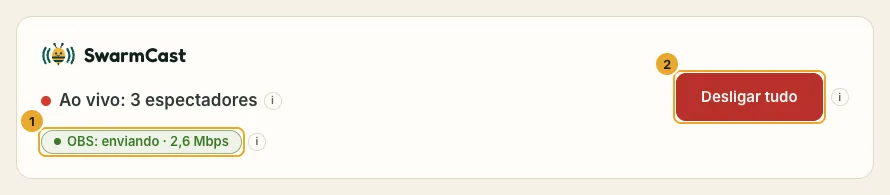
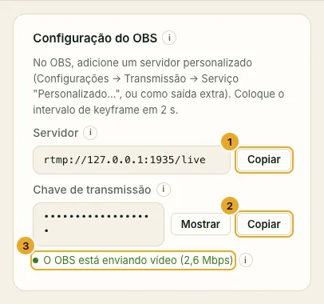
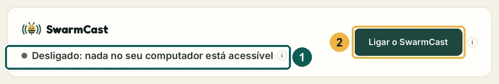
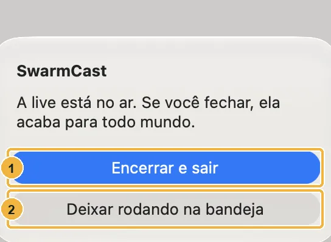
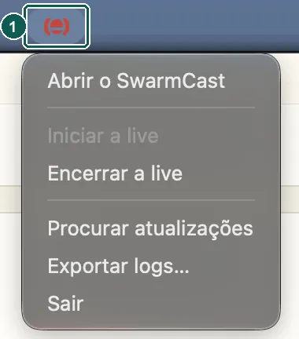

## Em toda live

### 1. Abra o SwarmCast

Ele liga sozinho e mostra **Esperando o OBS começar a transmitir…**. Se o topo do painel disser **Desligado**, clique em **Ligar o SwarmCast**.

### 2. Comece a transmitir no OBS

Clique em **Iniciar transmissão**, como sempre. Com o plugin Multiplas saídas, o SwarmCast começa junto se você marcou "Sincronizar início"; se não, clique também em **Iniciar** ao lado do SwarmCast. Configuração: [Configurar o OBS](/swarmcast/pt-br/start/obs/).

### 3. Espere aparecer "OBS: enviando"

O topo do painel muda para **Ao vivo** e mostra **OBS: enviando**.

### 4. Copie o link e mande

Clique em **Copiar link** e mande só para os seus membros, por exemplo num canal do Discord só para subs. Cada live ganha um link novo.

Os membros abrem o link, digitam um apelido e assistem no navegador. Veja [Para quem assiste](/swarmcast/pt-br/viewers/).

:::caution[O link é só para os membros]
Quem tiver o link consegue assistir. Se ele vazar, clique em **Gerar novo link** e mande o novo. Veja [Expulsar alguém e trocar o link](/swarmcast/pt-br/live/kick-and-new-link/).
:::

## O cartão Configuração do OBS

As duas coisas que o OBS precisa, cada uma com um botão **Copiar**. A chave fica escondida: **nunca mostre a chave na live nem num print**. **O OBS está enviando vídeo** em verde quer dizer que o OBS está conectado.

## Durante a live

- **Espectadores e ajuda P2P:** quantos assistem e quantos ajudam por P2P.
- **Seu upload agora:** quanto do seu upload o SwarmCast está usando. Nunca passa do **Upload máximo para espectadores**.
- **Avisos** no topo, por exemplo **"Espectadores demais para o seu upload"**: peça para o pessoal ligar **Ajudar a transmissão (P2P)**, que vem desligado por padrão ([Ajudar a transmissão](/swarmcast/pt-br/live/p2p/)).

## Quando terminar

1. Pare a transmissão no OBS.
2. No painel, clique em **Desligar tudo** e espere aparecer isto:

Se o OBS ficar 10 minutos sem mandar vídeo, o SwarmCast desliga tudo sozinho (**Desligar após … minutos sem vídeo**, no painel).

## Fechar a janela

Se você fechar a janela com a live no ar, o SwarmCast pergunta: **Encerrar e sair** acaba a live; **Deixar rodando na bandeja** esconde a janela e a live continua.

O ícone fica na barra de menus (Mac) ou perto do relógio (Windows e Linux; clique na setinha **^** se não aparecer). O menu dele tem **Abrir o SwarmCast**, **Iniciar a live** / **Encerrar a live**, **Procurar atualizações**, **Exportar logs…** e **Sair**.
