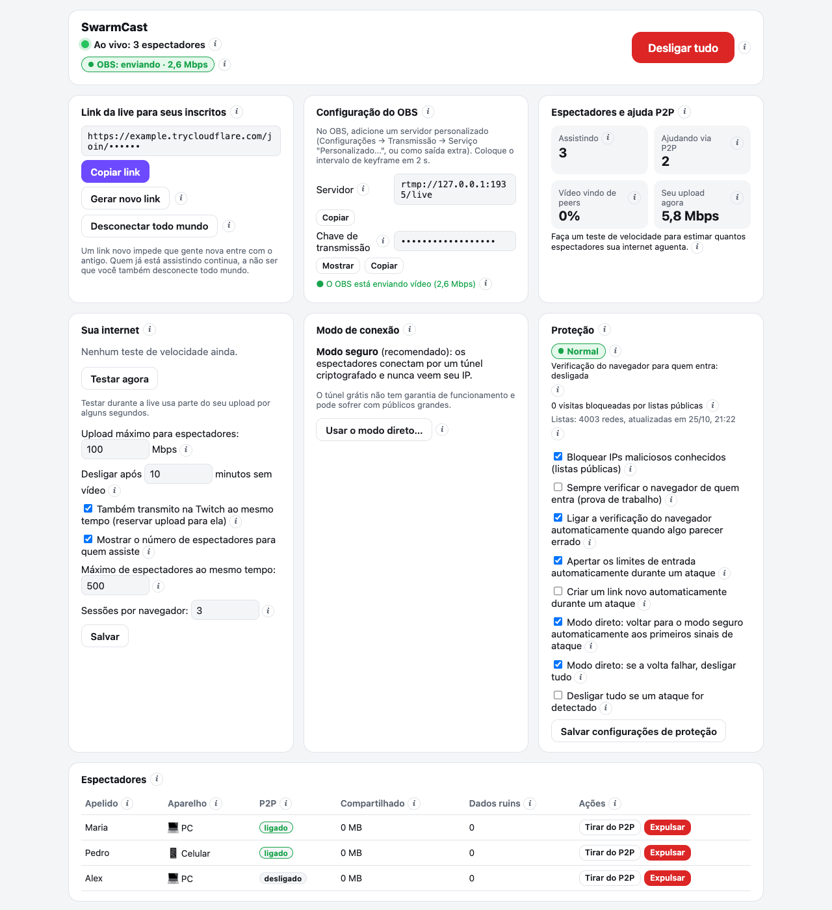
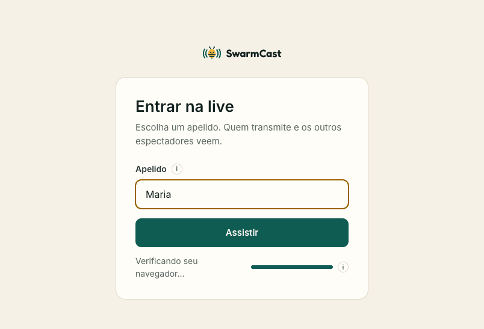
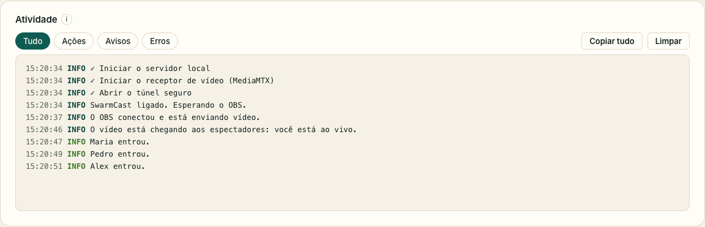

## Em toda live

1. **Abra o SwarmCast.** Ele liga sozinho e mostra **Esperando o OBS começar a transmitir…**. Se o topo do painel disser **Desligado**, clique em **Ligar o SwarmCast**.
2. **Comece a transmitir no OBS.** Com o plugin Multiplas saídas (Multiple output), clique também em **Iniciar** ao lado do SwarmCast (não precisa se marcou "Sincronizar início com o OBS"). Com o Aitum Vertical, clique também no botão verde de antena do painel Vertical.

   

3. **Espere aparecer "OBS: enviando"** no topo do painel. O link aparece no cartão **Link da live para seus inscritos**. Cada live tem um link novo.

   

4. **Clique em Copiar link** e mande só para quem é membro, por exemplo num canal do Discord só para subs ou num grupo fechado.

Pronto. Os seus membros abrem o link, escolhem um apelido e assistem no navegador. Veja em [Para quem assiste](/swarmcast/pt-br/viewers/) o que eles enxergam.

:::caution[O link é só para os membros]
Quem tiver o link consegue assistir. Se ele vazar, clique em **Gerar novo link** e mande o novo. Veja [Expulsar alguém e trocar o link](/swarmcast/pt-br/live/kick-and-new-link/).
:::

## Durante a live

O painel mostra o que importa:

- **Espectadores e ajuda P2P:** quem está assistindo (apelido e aparelho) e quantos estão ajudando por P2P.
- **Seu upload agora:** quanto da sua internet de upload o SwarmCast está usando. Nunca passa do **Upload máximo para espectadores**.
- **Avisos** no topo, por exemplo quando há espectadores demais para o seu upload ou quando o OBS parou de mandar vídeo.

**"Espectadores demais para o seu upload":** peça para o pessoal deixar **Ajudar a transmissão (P2P)** ligado (veja [Ajudar a transmissão](/swarmcast/pt-br/live/p2p/)). Se o teste de velocidade mostrar folga, aumente o **Upload máximo para espectadores** no painel.

## Quando terminar

1. Pare a transmissão no OBS (e o destino do SwarmCast no painel Multiplas saídas, ou o botão de antena do painel Vertical, se ele não parar sozinho).
2. No painel, clique em **Desligar tudo** e espere aparecer **"Desligado: nada no seu computador está acessível"**.

Fechar o SwarmCast também desliga tudo. Se você fechar a janela com a live no ar, o SwarmCast pergunta: **Encerrar e sair** ou **Deixar rodando na bandeja**.

Se o OBS ficar 10 minutos sem mandar vídeo, o SwarmCast desliga tudo sozinho, para o seu computador nunca ficar acessível à toa. Dá para mudar esse tempo no painel (**Desligar após … minutos sem vídeo**).
