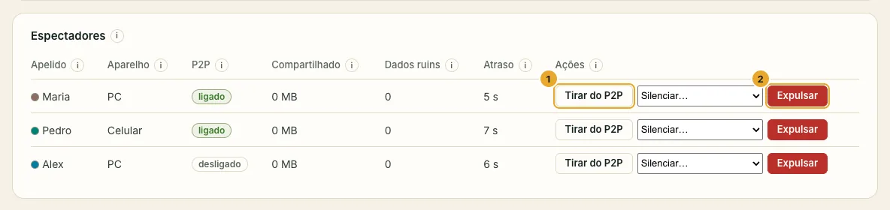
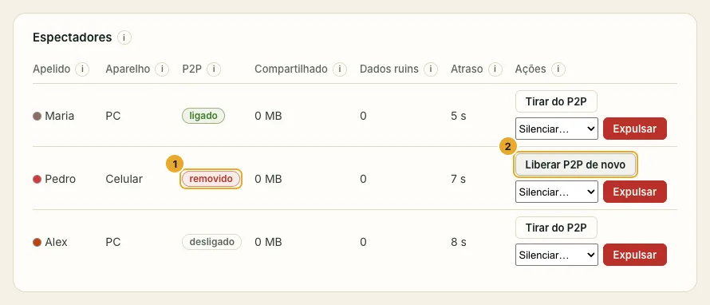
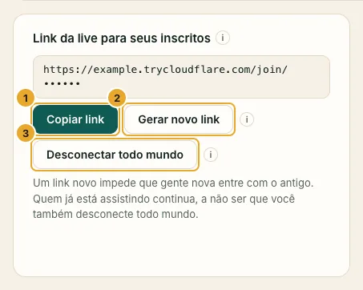
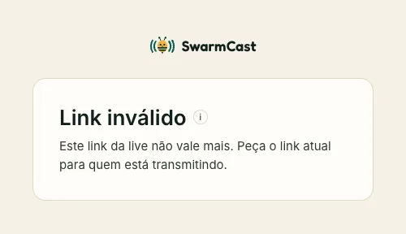

Todo mundo que está assistindo aparece no cartão **Espectadores** do painel, com o apelido que digitou e o aparelho (PC ou Celular).

## Tirar uma pessoa: Expulsar

Clique em **Expulsar** ao lado da pessoa. Ela cai na hora e aquele navegador não volta até a live acabar. Ela ainda pode voltar por **outro aparelho** se guardou o link: troque o link também (abaixo).

## Impedir alguém de compartilhar vídeo: Tirar do P2P

Clique em **Tirar do P2P**. A pessoa continua assistindo, direto do seu computador, mas não compartilha mais vídeo com os outros. **Liberar P2P de novo** desfaz. O SwarmCast também faz isso sozinho com quem os outros espectadores denunciam por mandar vídeo quebrado.

## O link vazou: Gerar novo link

1. Clique em **Gerar novo link**, depois em **Copiar link**, e mande o link novo para os seus membros.
2. O link antigo para de funcionar na hora para quem é **novo**. Quem já está assistindo continua, a não ser que você também clique em **Desconectar todo mundo**: aí todo mundo precisa do link novo.
3. Quem já está assistindo perde o botão **Compartilhar**: quem recebeu o link vazado não consegue repassar o novo. Só quem entra com o link novo pode compartilhar.

Quem abre um link antigo vê isto:

:::tip
Toda live ganha um link novo sozinha. Um link que você mandou ontem não funciona hoje.
:::

## Limites contra espectadores falsos

- **Máximo de espectadores ao mesmo tempo:** quando a live lota, quem chega vê "A live está lotada agora". Ninguém que já está assistindo cai. Começa em 120, mais ou menos o que o túnel grátis aguenta.
- **Sessões por navegador:** quantas abas um mesmo navegador pode deixar abertas (a mais antiga é trocada).
- **Quem assiste pode compartilhar o link** (ligado por padrão): quem assiste ganha um botão **Compartilhar** que envia o seu link atual para um amigo. Desligue se só você deve passar o link adiante; o botão some na hora para todo mundo.

Clique em **Salvar** depois de mudar. Mais em [Segurança e proteção](/swarmcast/pt-br/live/protection/).
