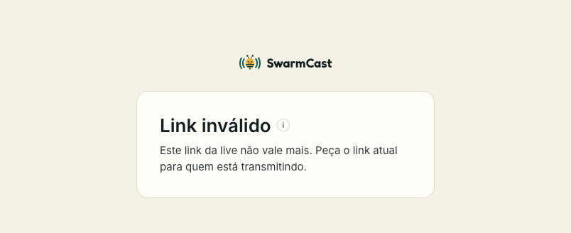

Cada pessoa aparece na lista de **Espectadores** do painel com o apelido que digitou e o aparelho (💻 PC ou 📱 Celular).

## Tirar uma pessoa: Expulsar

Clique em **Expulsar** ao lado da pessoa. Ela é desconectada na hora e aquele navegador não consegue voltar até a live acabar.

Ela ainda pode voltar por **outro aparelho** se tiver guardado o link. Para fechar essa porta também, gere um link novo (veja abaixo).

## Impedir alguém de compartilhar vídeo: Tirar do P2P

Clique em **Tirar do P2P**. A pessoa continua assistindo, direto do seu computador, mas para de passar vídeo para os outros. **Liberar P2P de novo** desfaz.

O SwarmCast também faz isso sozinho com quem for denunciado por outros espectadores por mandar vídeo com defeito.

## O link vazou: Gerar novo link

1. Clique em **Gerar novo link** no cartão do link da live.
2. Mande o link novo para os seus membros.

O link antigo para de funcionar na hora para quem tentar **entrar**. Quem já está assistindo continua, a não ser que você também clique em **Desconectar todo mundo**. Aí todo mundo vai precisar do link novo.

Quem tentar entrar com um link antigo vê **Link inválido**:

:::tip
Toda live ganha um link novo automaticamente. O link que você mandou ontem não funciona hoje.
:::

## Limites contra espectadores falsos

Duas opções abaixo da configuração de upload impedem que alguém encha a sua live de entradas falsas:

- **Máximo de espectadores ao mesmo tempo:** quando a live lota, quem chega vê que ela está lotada. Ninguém que já está assistindo cai. Começa em 120, mais ou menos o que o túnel grátis aguenta.
- **Sessões por navegador:** quantas abas um mesmo navegador pode deixar abertas (a mais antiga é substituída).

Mais em [Segurança e proteção](/swarmcast/pt-br/live/protection/).
