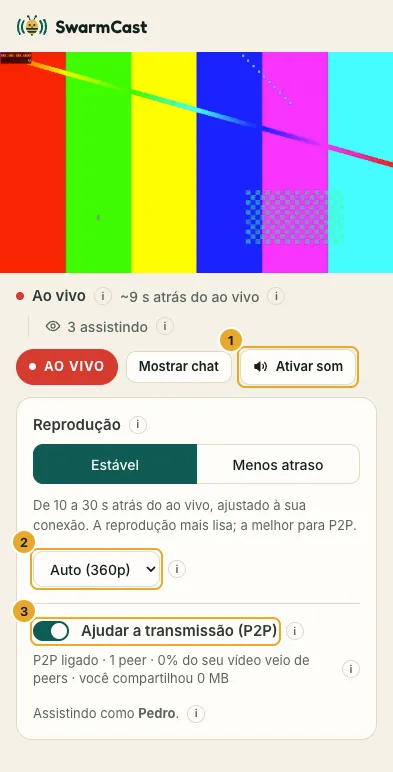
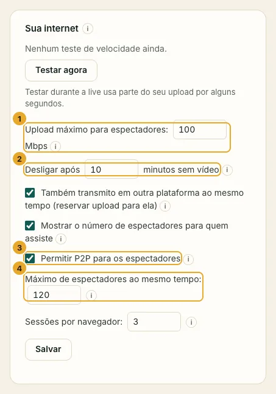

**Ajudar a transmissão (P2P)** é uma opção na página de quem assiste. Ela vem **desligada** por padrão: cada espectador decide se quer ligar. Quem deixa ligada passa pedaços do vídeo para os outros espectadores, então o seu computador manda menos e a live fica mais lisa para todo mundo. P2P quer dizer "peer to peer": de um espectador para outro.

## O que isso mostra, sem rodeios

Para passar vídeo entre si, os navegadores de dois espectadores se conectam direto. **Quem está com o P2P ligado consegue ver o IP dos outros que também estão** (o endereço de internet da conexão).

- Um IP só mostra uma **localização aproximada** (normalmente a cidade ou a região) e a **operadora de internet**.
- Ele **não** mostra nome, endereço de casa nem nada do aparelho.
- Jogos online e chamadas de vídeo funcionam do mesmo jeito.
- **O seu IP continua escondido** no modo seguro, que é o normal: o vídeo chega aos espectadores por um túnel criptografado, nunca direto do seu computador.
- **Quem assiste na sua própria conexão de internet** (você pelo celular, ou alguém aí da sua casa no mesmo Wi-Fi): ali o IP de quem assiste *é* o seu IP, então o SwarmCast desliga o P2P para essa pessoa sozinho. Ela continua assistindo normalmente e vê "O P2P fica desligado na própria conexão de quem transmite, para manter o IP dessa pessoa privado".

## Ninguém consegue mandar vídeo adulterado

Cada pedaço de vídeo tem uma impressão digital assinada pelo seu SwarmCast. O navegador de cada espectador confere cada pedaço que recebe de outro espectador antes de tocar. Um pedaço errado é jogado fora e baixado de novo de você, e quem mandou é desconectado e denunciado. Com três denúncias, o SwarmCast tira essa pessoa do P2P sozinho.

## Como desligar

- **Quem assiste:** fica desligado até a pessoa marcar **Ajudar a transmissão (P2P)**; desmarcar para de compartilhar. Nos dois casos ela continua assistindo normalmente, e a escolha fica salva. O **ⓘ** ao lado da opção explica a mesma coisa.
- **Você:** clica em **Tirar do P2P** ao lado da pessoa na lista de espectadores. Ela continua assistindo, mas para de compartilhar.
- **Todo mundo de uma vez:** desmarque **Permitir P2P para os espectadores** no cartão **Sua internet** e clique em **Salvar**. Aí todo mundo assiste direto de você, e o seu upload precisa dar conta de todos.

Alguns navegadores ou redes não conseguem usar P2P (algumas redes de empresa ou de escola, por exemplo). Essas pessoas veem "P2P não está disponível neste aparelho" e assistem normalmente.

## Por que isso importa para você

Sem P2P, cada espectador baixa o vídeo inteiro do seu computador, e o seu upload decide quantas pessoas conseguem assistir. Com P2P, os espectadores dividem parte desse trabalho. O painel mostra quantos estão ajudando e mais ou menos quantas pessoas o seu upload aguenta.

Se aparecer **"Espectadores demais para o seu upload"**, peça para o pessoal ligar o P2P (vem desligado por padrão).
