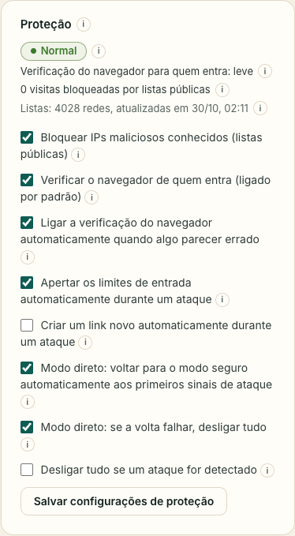

O SwarmCast foi feito para o seu computador nunca ficar aberto para a internet no **modo seguro**, que é o normal.

## O que protege você o tempo todo

- **O seu IP fica escondido.** Os espectadores chegam na sua live por um túnel criptografado (Cloudflare). Nada no seu computador aceita conexões vindas da internet.
- **O painel é só seu.** Ele só abre no seu próprio computador. Ninguém mais chega nele, nem quem tem o link da live.
- **Um link secreto novo a cada live.** Ele é comprido e aleatório, ninguém consegue adivinhar. O antigo para de funcionar.
- **A sua chave de transmissão não sai do seu computador.** Ela nunca é enviada para lugar nenhum e nunca aparece nos logs.
- **Vídeo conferido.** Cada pedaço que os espectadores passam entre si é conferido com uma impressão digital assinada (veja [Ajudar a transmissão](/swarmcast/pt-br/live/p2p/)).
- **Tudo desligado no fim.** **Desligar tudo** desconecta os espectadores, fecha o túnel, apaga o vídeo temporário e depois confere se nada ficou rodando ou acessível.

## O cartão Proteção

O SwarmCast acompanha o tráfego da sua live e compara com o que o seu público costuma gerar. O cartão mostra o estado: **Normal**, **Atividade incomum** ou **Sob ataque**, e o motivo.

O que ele faz sozinho (dá para mudar cada item):

- **Verificação do navegador (um captcha sem quebra-cabeça):** o navegador de quem entra resolve um pequeno desafio automático, mais ou menos um segundo no celular, enquanto a pessoa digita o apelido. Isso deixa as entradas falsas em massa lentas e caras. Liga sozinha quando algo parece errado. Você também pode deixar **sempre ligada**.
- **Limites de entrada mais rígidos durante um ataque:** menos tentativas de entrada por endereço de internet, uma sessão por navegador e o limite de espectadores segurado perto do público atual. Ninguém que já está assistindo cai.
- **Listas públicas de bloqueio:** o SwarmCast recusa visitas de redes que estão em listas públicas e gratuitas de redes maliciosas conhecidas (Spamhaus DROP e FireHOL level1). As listas são baixadas uma vez por dia, sem conta nenhuma. Conexões normais de casa e de celular quase nunca estão nelas, e você pode desligar as listas no cartão.
- **Link novo durante um ataque** (desligado por padrão): o link antigo para de funcionar e você precisa mandar o novo.
- **Desligar tudo se um ataque for detectado** (desligado por padrão): quase nunca é preciso, porque o túnel aguenta grandes enxurradas de tráfego.

Quando passar (ou se foi alarme falso), clique em **Encerrar alerta**: os limites voltam na hora para as suas configurações.

## O que o SwarmCast não consegue fazer

Ser honesto sobre os limites ajuda você a decidir:

- **Quem tem o link consegue assistir,** e um membro pode repassar o link. Troque o link se ele vazar.
- **Nada impede alguém de gravar a tela.** Não existe proteção contra cópia.
- **Quem está com P2P ligado vê o IP dos outros** (só a localização aproximada). Veja [Ajudar a transmissão](/swarmcast/pt-br/live/p2p/).
- **A Cloudflare está no caminho.** O túnel gratuito é da Cloudflare, que consegue ver informações do tráfego. Ele não tem garantia de funcionamento e pode sofrer com públicos muito grandes.
- **O modo direto mostra o seu IP** para todo mundo que tem o link. Use só em emergência: [Modo direto](/swarmcast/pt-br/live/direct-mode/).
- **A detecção de ataques faz o melhor possível.** Um ataque muito lento ou muito espalhado pode passar abaixo dos alarmes.

Detalhes técnicos para quem tem curiosidade: [modelo de ameaças](https://github.com/Lucas-Angelo/swarmcast/blob/main/docs/THREAT_MODEL.md) (em inglês).
