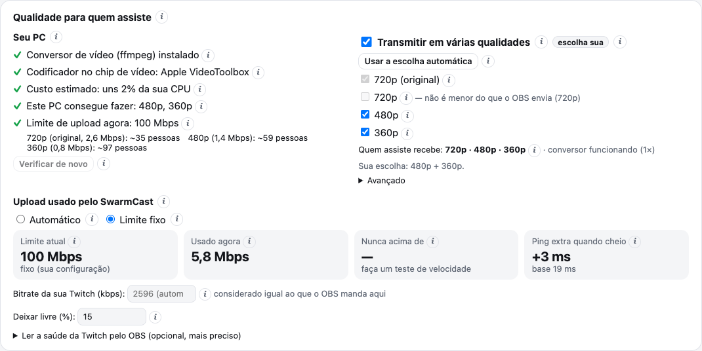

Quem assiste sempre recebe a sua **qualidade original** (o que o OBS manda, por exemplo 1080p). Quando o seu computador consegue fazer isso com folga, o SwarmCast também cria **cópias menores** (720p, 480p e 360p), para quem está num Wi-Fi fraco ou nos dados móveis continuar assistindo sem travar.

## É automático

- O SwarmCast testa o seu computador quando abre. Com um **chip de vídeo** que converte vídeo (NVIDIA, AMD, Intel, Apple), ele oferece 720p, 480p e 360p, quase sem gastar processador.
- Sem esse chip, ele faz um teste rápido no processador e só oferece **uma** qualidade menor se sobrar folga.
- O player de quem assiste escolhe a melhor qualidade que a internet dele aguenta sem travar (**Auto**) e troca quando precisa. Quem assiste também pode escolher uma qualidade na mão.

## O OBS sempre vem primeiro

O conversor roda com prioridade baixa. Se ele ficar para trás, ou se o processador ficar quase todo ocupado por 10 segundos, o SwarmCast desliga a qualidade mais pesada, depois a próxima, até sobrar só a original. O painel e o console de Atividade avisam quando isso acontece. A sua transmissão no OBS nunca é afetada.

## Qualidades menores economizam o seu upload

Um espectador em 480p gasta mais ou menos um quarto do upload de um em 1080p. Quando tem muita gente assistindo, os players descem de qualidade sozinhos e o seu upload rende mais. Quem ajuda pelo [P2P](/swarmcast/pt-br/live/p2p/) gasta menos ainda.

## Mudar você mesmo

No cartão **Qualidade para quem assiste** você pode:

- ligar ou desligar **Transmitir em várias qualidades**;
- escolher quais qualidades oferecer;
- em **Avançado**, forçar um encoder.

A sua escolha fica salva e sempre vale mais que a automática.

## "O conversor de vídeo (ffmpeg) não está instalado"

As qualidades menores precisam do ffmpeg, um conversor de vídeo gratuito. O SwarmCast baixa ele de quem publica na primeira vez que abre e confere a impressão digital (SHA-256) do arquivo antes de usar. Se isso falhou (sem internet na hora, por exemplo), clique em **Instalar o conversor de vídeo** no cartão de qualidade. Sem ele, tudo funciona na qualidade original.
