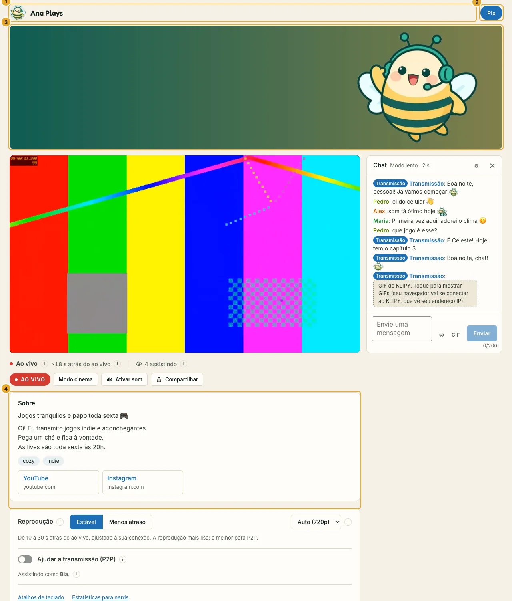
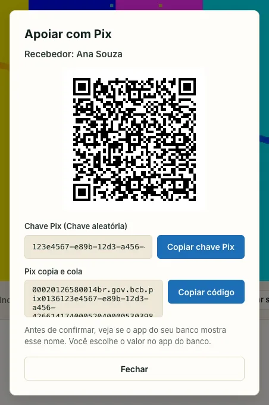
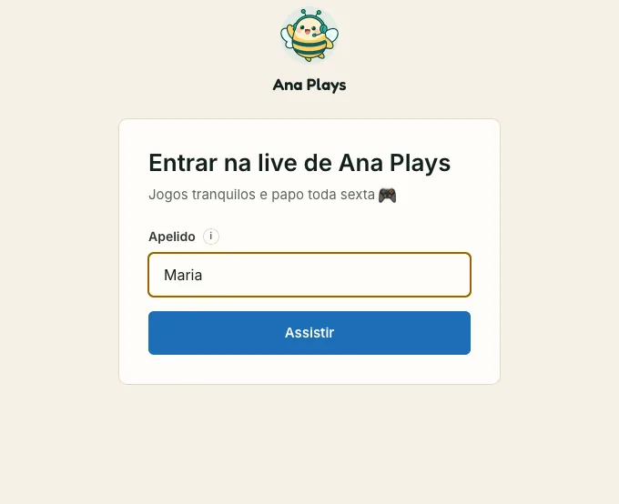

O cartão **Sua página** do painel muda o que quem assiste vê: seu nome, foto, uma bio curta, seus links e suas cores, na página de entrada e em volta do vídeo. Só quem tem o link da sua live vê; qualquer outra pessoa que achar o endereço vê a página comum de "Link inválido".

Mude o que quiser, confira a **Prévia** (página da live, página de entrada e fim da live; computador ou celular; claro ou escuro) e clique em **Salvar**. As páginas abertas de quem assiste se atualizam em poucos segundos. A chave no topo do cartão desliga a sua página sem perder nada; **Voltar ao padrão do SwarmCast** apaga tudo.

## Nome e foto

- **Nome do canal:** até 40 caracteres. A página de entrada diz "Entrar na live de *seu nome*", e ele aparece no topo da página da live e na aba do navegador.
- **Foto ou logo:** uma imagem quadrada ao lado do seu nome, que também vira o iconezinho da aba do navegador.
- **Banner:** uma imagem larga (4 por 1) em cima do vídeo. Ela carrega depois que o vídeo começa, então nunca atrasa a live.

Clique em **Escolher uma imagem…**, arraste e dê zoom para escolher a parte que aparece e clique em **Usar esta imagem**. PNG, JPEG e WebP funcionam; SVG não, e uma imagem animada fica só com o primeiro quadro.

:::tip[Suas fotos continuam privadas]
Localização, câmera e outros dados escondidos da foto são removidos antes de salvar. Quem assiste recebe só a imagem.
:::

## Sobre você

- **Descrição em uma linha:** uma frase curta embaixo do seu nome, como "Jogos tranquilos e papo toda sexta". Até 100 caracteres.
- **Sobre você:** algumas linhas sobre você e a sua live, numa caixa "Sobre" embaixo do vídeo. Até 1.000 caracteres e 12 linhas. Links digitados aqui não são clicáveis: use **Links**.
- **Tags:** até 8 palavras curtas sobre a sua live (jogos, música, papo…).

## Links e apoio

- **Links:** até 6, cada um com um nome e um endereço: seu YouTube, Instagram, uma página de gorjetas ou um e-mail. Só endereços `https://` e e-mail são aceitos, e quem assiste vê para onde cada link vai. Endereços da sua rede de casa, com senha dentro ou que apontam para a própria live são recusados.
- **Botão de apoio:** um botão em destaque no topo da sua página e na tela de fim da live, com o texto **Apoiar**, **Gorjeta**, **Doar** ou **Pix** (sempre no idioma de cada pessoa). Ele pode:
  - abrir a sua página de gorjetas (**Link para uma página de gorjetas**: Ko-fi, LivePix, PayPal…); ou
  - mostrar o seu **Pix**: quem assiste pode copiar a chave, copiar o código "Pix copia e cola" ou ler o QR code com o app do banco.

No Pix, escolha o tipo de chave (a **chave aleatória** é a melhor escolha: não mostra nenhum número pessoal), digite seu nome como o banco mostra e a sua cidade. Uma chave CPF, CNPJ ou de celular pede uma confirmação a mais, porque todo mundo que está assistindo vai ver o número.

:::caution[O Pix mostra quem você é]
Quem te manda um Pix vê o seu nome completo e parte do seu CPF. Se você quer ficar anônimo, use uma página de gorjetas.
:::

## Cores

Escolha **Floresta**, **Mel**, **No Ar**, **Oceano**, **Argila** ou **Grafite**, ou **Personalizada…** para a sua própria cor. Ela vai nos botões, links e destaques. Cada pessoa continua com o seu modo claro ou escuro, e o SwarmCast ajusta a sua cor para ficar fácil de ler nos dois (o cartão avisa quando ajustou). **Cantos** define o quanto botões e caixas são arredondados: **Redondos**, **Suaves** ou **Retos**.

## Quando a live é compartilhada ou acaba

- **Mostrar um cartão de prévia quando o link for compartilhado:** vem desligado. Ligado, WhatsApp, Telegram, Discord e apps parecidos mostram seu nome, a descrição em uma linha e a **Imagem do cartão de prévia** junto do link, para todo mundo naquela conversa. Desligado, aparece um convite neutro de live. Depois de **Gerar novo link**, a prévia do link antigo também para de funcionar.
- **Mensagem quando a live acabar:** aparece na tela de fim, por exemplo "Valeu! Volto sexta às 20h".
- **Mostrar "no SwarmCast" no rodapé da sua página:** desmarque para esconder essa linha.

:::note
A sua página sai do seu próprio computador, pelo mesmo link da live que o vídeo: nada é enviado para outro serviço. Não dá para usar um domínio seu no link.
:::
