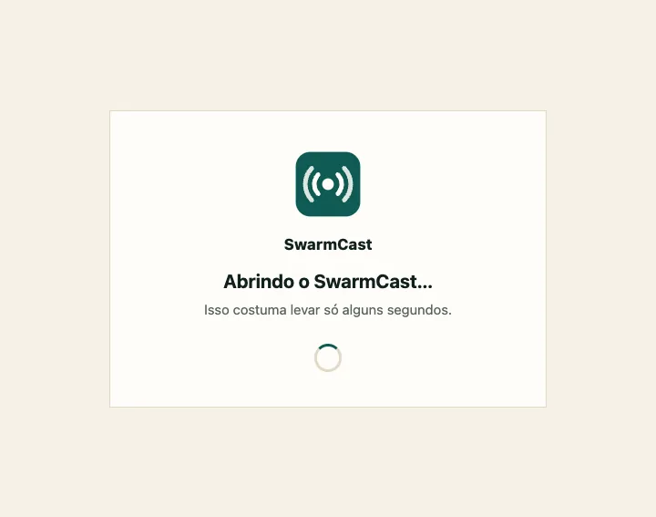
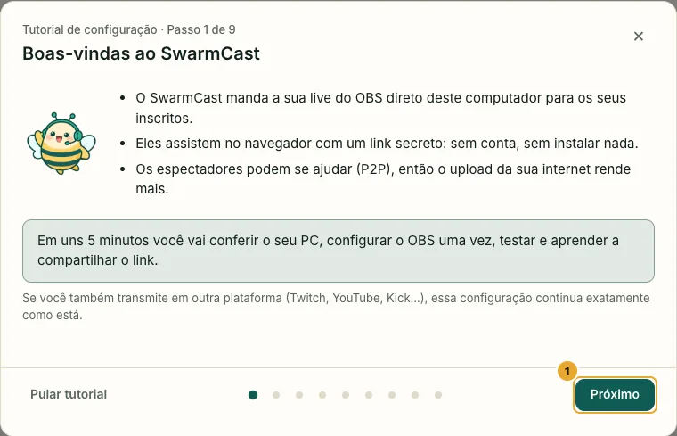
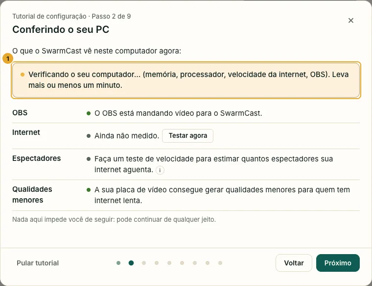
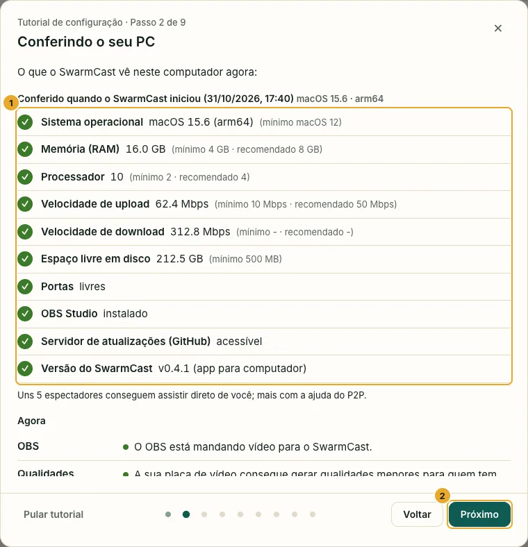
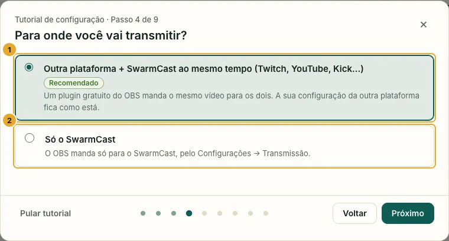
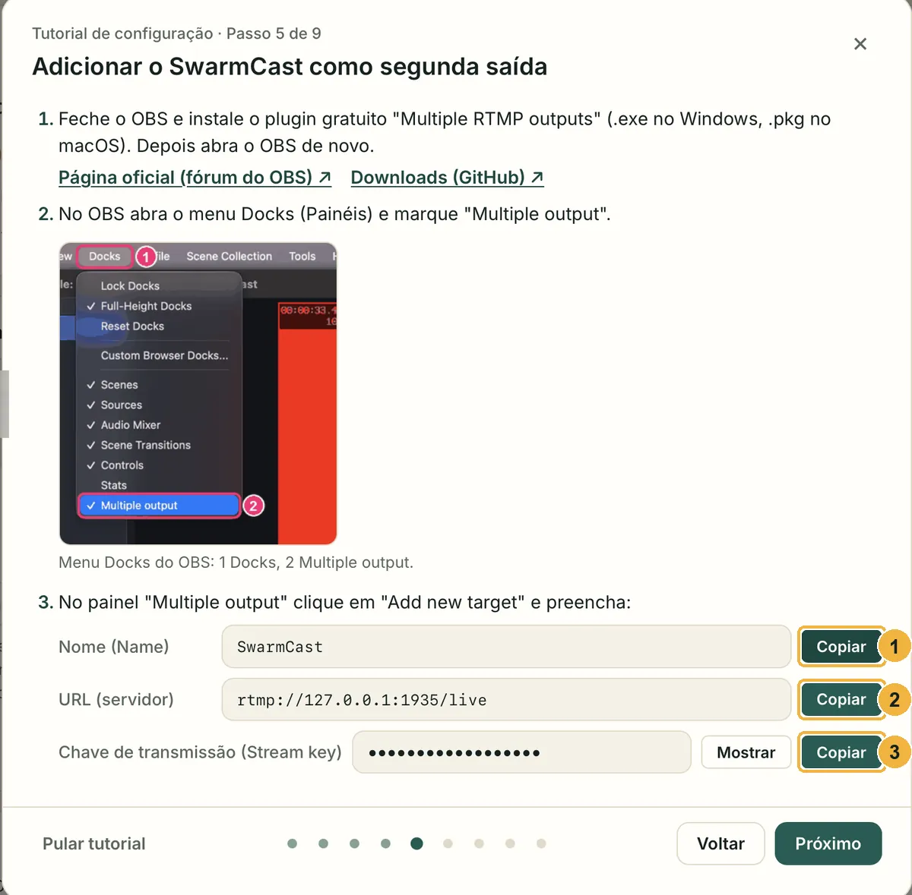
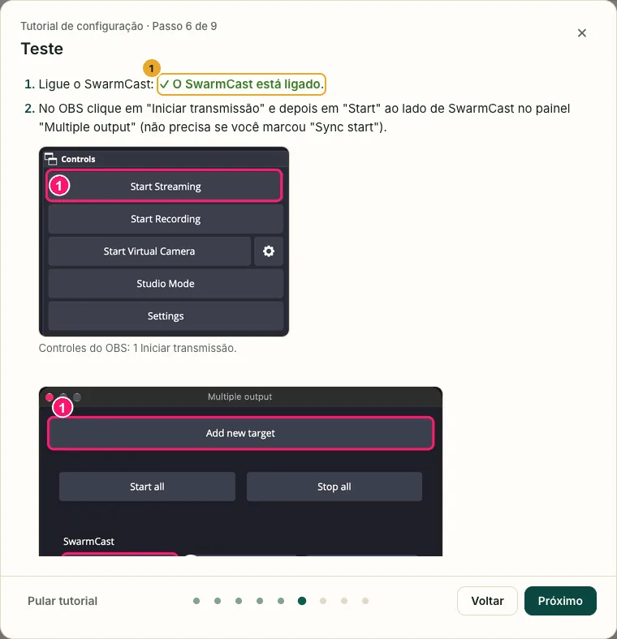
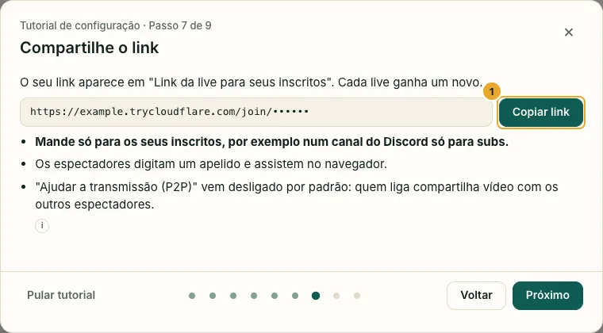
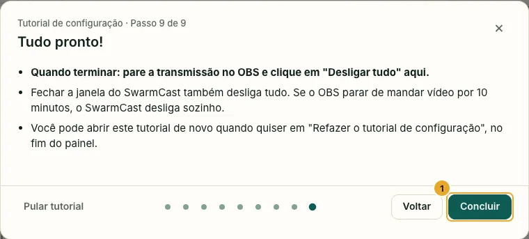
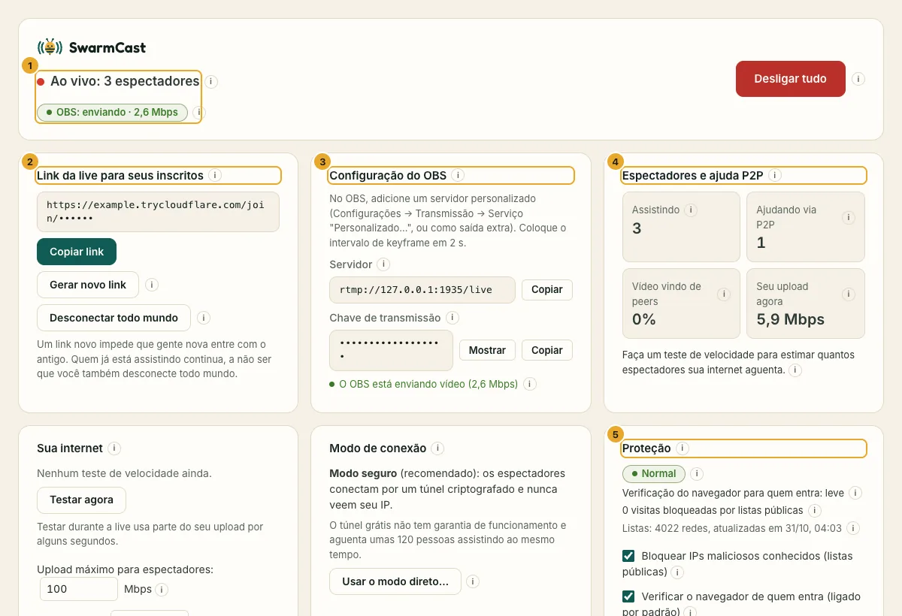

Quando você abre o SwarmCast, aparece o **painel**, a tela onde você controla a sua live. Ele roda só no seu computador: ninguém mais consegue abrir.

## 1. O SwarmCast abre

A janela mostra **Abrindo o SwarmCast…** por alguns segundos, e depois o tutorial de configuração abre sozinho.

## 2. O tutorial de configuração

Leva uns 5 minutos. Clique em **Próximo** para seguir e em **Voltar** para voltar. **Pular tutorial** fecha (dá para abrir de novo depois).

## 3. Conferindo o seu PC

Na primeira vez, o SwarmCast confere o seu computador. Ele mostra **Verificando o seu computador…** por mais ou menos um minuto.

Verde quer dizer tudo certo; amarelo, funciona mas não é o ideal. Nada disso impede você de continuar. Ao mesmo tempo, o SwarmCast baixa o conversor de vídeo gratuito (ffmpeg) para as qualidades menores.

## 4. O OBS, uma vez só

Escolha se você também transmite na Twitch, no YouTube ou na Kick, ou só no SwarmCast. Os próximos passos mostram as configurações do OBS para essa escolha.

Use os botões **Copiar** e cole no OBS. O passo a passo completo, com imagens do OBS: [Configurar o OBS](/swarmcast/pt-br/start/obs/).

## 5. Teste e mande o link

Comece a transmitir no OBS. O tutorial mostra quando o vídeo chega.

Cada live ganha um link secreto novo. Mande só para os seus membros.

Clique em **Concluir**. Para ver o tutorial de novo, clique em **Refazer o tutorial de configuração**, no fim do painel.

## O painel

1. **No alto:** se você está ao vivo, se o OBS está enviando e o botão **Desligar tudo**.
2. **Link da live para seus inscritos:** o link para mandar. Veja [Fazer a live](/swarmcast/pt-br/live/go-live/).
3. **Configuração do OBS:** o servidor e a chave de transmissão para o OBS.
4. **Espectadores e ajuda P2P:** quantos assistem e quantos ajudam. Veja [Ajudar a transmissão (P2P)](/swarmcast/pt-br/live/p2p/).
5. **Proteção:** veja [Segurança e proteção](/swarmcast/pt-br/live/protection/).

Mais abaixo: **Qualidade para quem assiste**, **App do SwarmCast** (iniciar com o computador, atualizações), **Espectadores** (expulsar alguém), **Atividade** e **Relatório de problema** (mandar os logs). Quase todo botão tem um **ⓘ** pequeno: passe o mouse ou toque nele para ver a explicação.

## Onde o SwarmCast guarda as suas configurações

As configurações, a chave de transmissão e os logs ficam numa pasta do SwarmCast na sua conta de usuário. Atualizar o SwarmCast nunca apaga essa pasta.

- Windows: `%LOCALAPPDATA%\SwarmCast`
- macOS: `~/Library/Application Support/SwarmCast`
- Linux: `~/.local/share/swarmcast`

Próximo passo: [Configurar o OBS](/swarmcast/pt-br/start/obs/).
