Você faz isso **uma vez só**. O SwarmCast funciona com o [OBS Studio](https://obsproject.com/) (gratuito). A sua configuração da Twitch, do YouTube ou da Kick continua igual.

## Qual eu preciso?

- **A mesma imagem na Twitch e no SwarmCast** (os membros veem exatamente o que a Twitch vê): [A. A mesma cena em todo lugar](/swarmcast/pt-br/start/obs/#a-a-mesma-cena-em-todo-lugar), com o plugin gratuito **Multiple output** (Multiplas saídas). É o mais fácil, e o PC codifica o vídeo uma vez só.
- **Outra coisa para os membros** (por exemplo, um filme numa janela do navegador, enquanto a Twitch vê a sua tela de sempre): [B. Outra cena para o SwarmCast](/swarmcast/pt-br/start/obs/#b-outra-cena-para-o-swarmcast), com o plugin gratuito **Aitum Vertical**. O PC codifica dois vídeos, então precisa de mais potência.
- **Só no SwarmCast, sem outra plataforma**: [Só no SwarmCast](/swarmcast/pt-br/start/obs/#só-no-swarmcast).

Nas imagens, caixa **amarela** é clicar, caixa **vermelha** é digitar ou escolher e caixa **verde** é conferir. Os números são os mesmos dos passos embaixo de cada imagem.

## Antes de começar

- **OBS Studio 30 ou mais novo.** As imagens mostram o OBS 33 em português, num Mac; no Windows os menus têm os mesmos nomes.
- **SwarmCast aberto.** No painel dele, o cartão **Configuração do OBS** tem as duas coisas que você cola no OBS, cada uma com um botão **Copiar**:
  - **Servidor:** `rtmp://127.0.0.1:1935/live`
  - **Chave de transmissão:** um código secreto comprido. **Nunca mostre ela na live nem em print.** Quem tiver a sua chave consegue mandar vídeo para o seu SwarmCast. As chaves das imagens são de mentira.
- **Feche o OBS** antes de instalar um plugin.

## A. A mesma cena em todo lugar

Sozinho, o OBS só manda para um lugar. O plugin **Multiple output** ([obs-multi-rtmp](https://github.com/sorayuki/obs-multi-rtmp), do sorayuki, código aberto) cria uma segunda saída que reaproveita o vídeo da sua live principal.

### 1. Instale o plugin

Baixe pelos [releases no GitHub](https://github.com/sorayuki/obs-multi-rtmp/releases) do plugin: pegue a versão mais nova que **não** está marcada como "Pre-release".

- **Windows:** o arquivo que termina em `windows-x64-Installer.exe`. Abra e vá clicando em avançar.
- **Mac:** o arquivo que termina em `macos-universal.pkg`. Abra e vá clicando em continuar. Se o macOS disser que não consegue verificar o arquivo, abra **Ajustes do Sistema → Privacidade e Segurança** e clique em **Abrir Mesmo Assim**.

### 2. Abra o painel Multiplas saídas

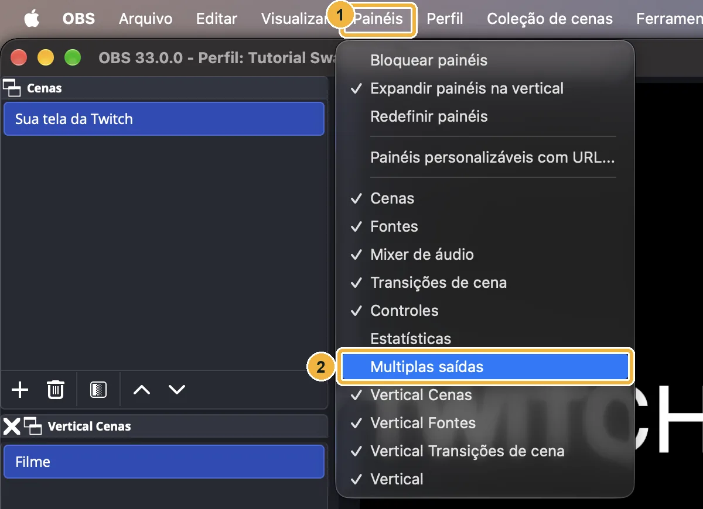

1. Abra o menu **Painéis**.
2. Clique em **Multiplas saídas** (é assim mesmo, sem acento, que o plugin escreve). O painel pode abrir como uma janelinha solta: se quiser, arraste ele para a lateral da janela do OBS.

### 3. Adicione o SwarmCast como destino

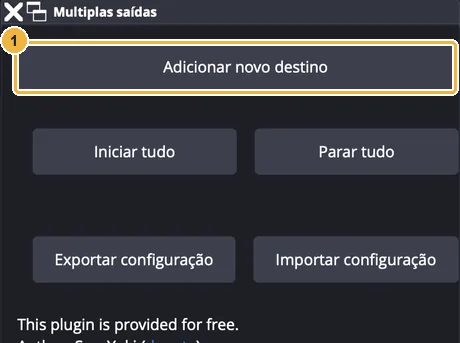

1. Clique em **Adicionar novo destino**.

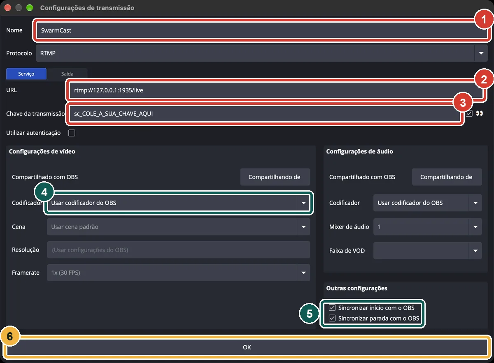

1. **Nome:** `SwarmCast`.
2. **URL:** cole o servidor, `rtmp://127.0.0.1:1935/live`.
3. **Chave da transmissão:** cole a chave do painel do SwarmCast.
4. **Codificador:** deixe **Usar codificador do OBS**. Assim o SwarmCast recebe o mesmo vídeo da Twitch, codificado uma vez só.
5. Marque **Sincronizar início com o OBS** e **Sincronizar parada com o OBS**, para o SwarmCast começar e parar junto com a live da Twitch.
6. Clique em **OK**.

### 4. Intervalo de keyframes de 2 segundos

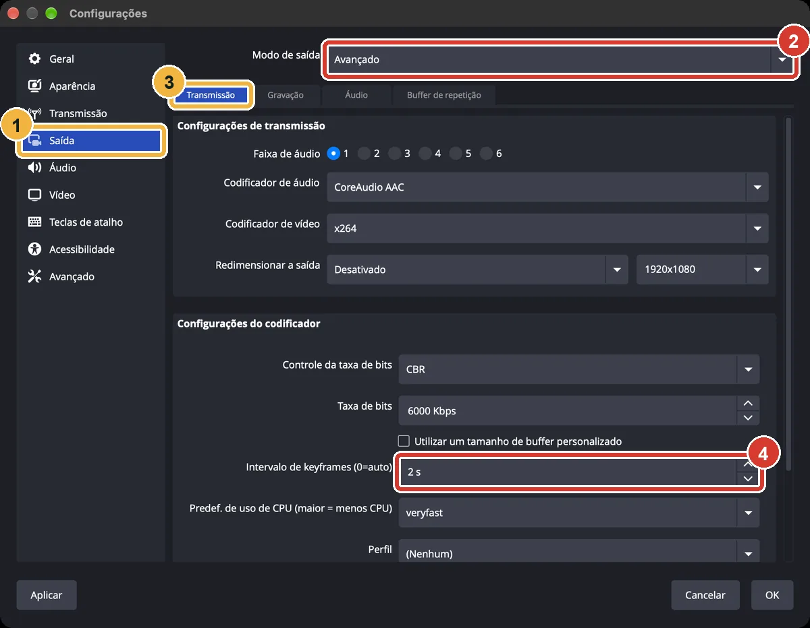

1. No OBS, abra **Configurações** → **Saída**.
2. **Modo de saída:** escolha **Avançado**.
3. Fique na aba **Transmissão**.
4. **Intervalo de keyframes:** coloque **2 s** e clique em **OK**.

Quem assiste recebe o vídeo em pedaços que começam em cada keyframe (quadro-chave); com 2 s fica com menos atraso e menos travadas. A Twitch, o YouTube e a Kick também recomendam 2 s.

### 5. Vá ao ar

1. Clique em **Iniciar transmissão**, como sempre. Essa é a live da Twitch.
2. Com **Sincronizar início** marcado, o SwarmCast começa sozinho. Sem isso, clique em **Iniciar** ao lado do SwarmCast.

Configurações → Transmissão continua sendo a da Twitch (ou da outra plataforma). Agora [confira se funcionou](/swarmcast/pt-br/start/obs/#conferir-se-funcionou).

## B. Outra cena para o SwarmCast

A Twitch continua com a sua tela de sempre. Uma segunda tela, com uma cena só dela (aqui, um filme numa janela do navegador), vai para o SwarmCast. O plugin é o **Aitum Vertical** ([aitum.tv](https://aitum.tv/), grátis). Apesar do nome, essa segunda tela fica deitada, 1920x1080, igual uma live normal.

### 1. Instale o Aitum Vertical

Baixe pelo [aitum.tv](https://aitum.tv/) ou pelos [releases no GitHub](https://github.com/Aitum/obs-vertical-canvas/releases) e instale com o OBS fechado. Abra o OBS: aparecem os painéis **Vertical**, **Vertical Cenas** e **Vertical Fontes**. Se não aparecerem, marque eles no menu **Painéis**.

### 2. Segunda tela deitada (1920x1080)

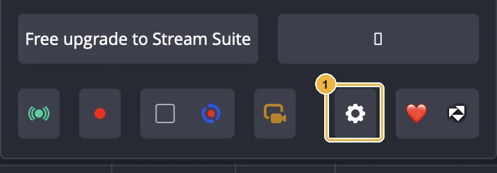

1. No painel **Vertical**, clique na engrenagem.

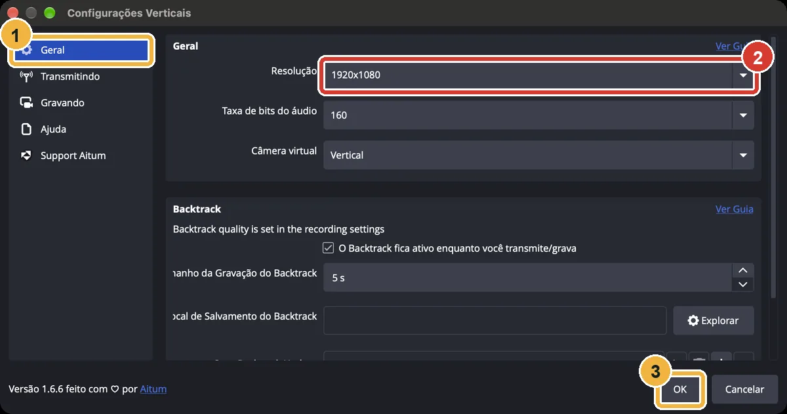

1. **Geral**.
2. **Resolução:** digite `1920x1080` (com a letra x).
3. Clique em **OK**.

### 3. Uma cena "Filme"

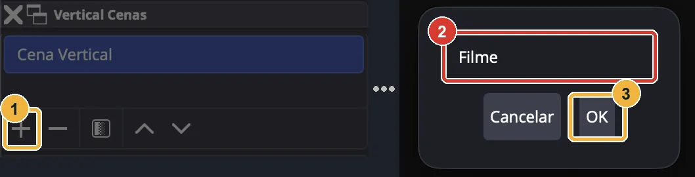

1. Em **Vertical Cenas**, clique em **+**.
2. Digite `Filme`.
3. Clique em **OK**.

### 4. Adicione a janela do navegador

Deixe o filme tocando no navegador antes.

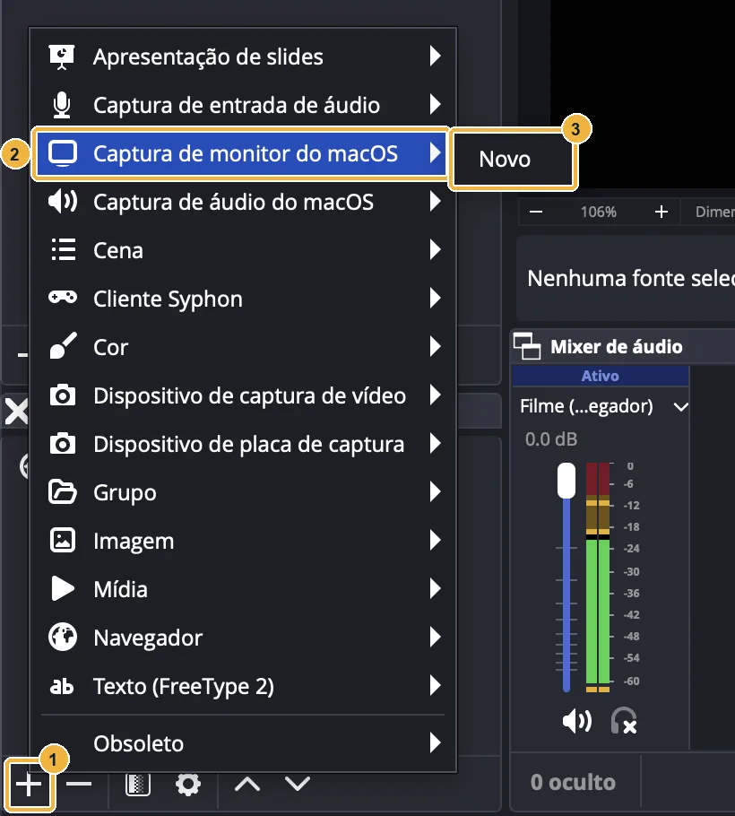

1. Em **Vertical Fontes**, clique em **+**.
2. No Mac: **Captura de monitor do macOS**. No Windows: **Captura de janela**.
3. **Novo** e depois **OK**.

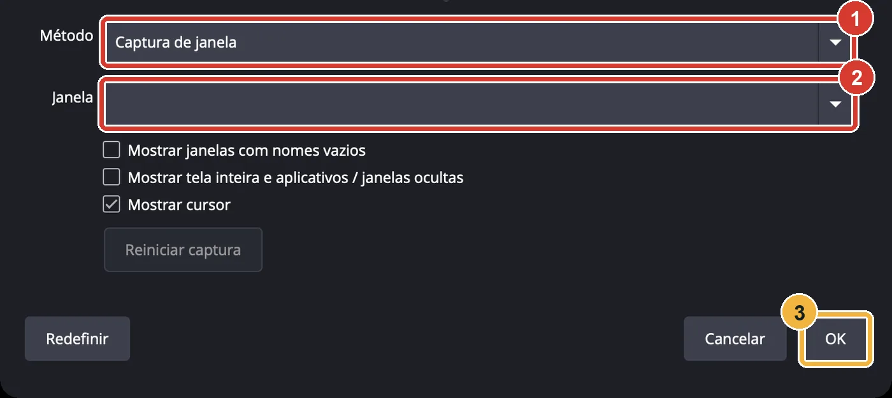

1. **Método:** **Captura de janela** (só no Mac).
2. **Janela:** a do navegador com o filme.
3. Clique em **OK**.

:::note[O som do filme]
**Windows:** nessa mesma janela da Captura de janela, marque **Capturar áudio (BETA)**.

**Mac:** essa opção não existe. Adicione também **+** → **Captura de áudio do macOS** → método **Captura de aplicativo** → o seu navegador.
:::

:::note[Imagem preta no Mac?]
Libere o OBS em **Ajustes do Sistema → Privacidade e Segurança → Gravação de Tela e Áudio do Sistema** e reabra o OBS. O OBS do Mac usado nestas imagens não tinha essa permissão, então as imagens mostram uma fonte **Navegador** tocando uma página de teste local. Filme em arquivo no PC? Use **+** → **Mídia**.
:::

### 5. Ocupe a tela toda

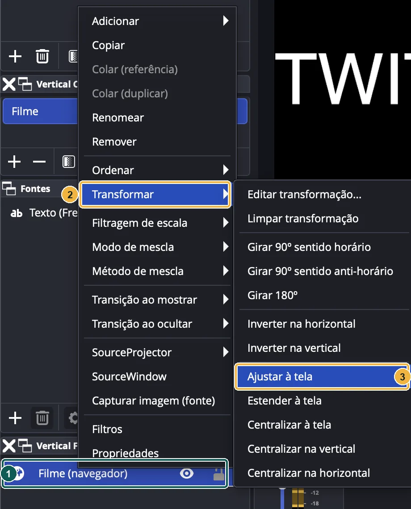

1. Clique com o botão direito na fonte.
2. **Transformar**.
3. **Ajustar à tela**. Deixe o navegador em tela cheia (F11; no Mac ⌃⌘F) para a barra de endereço não aparecer.

### 6. Mande a segunda tela para o SwarmCast

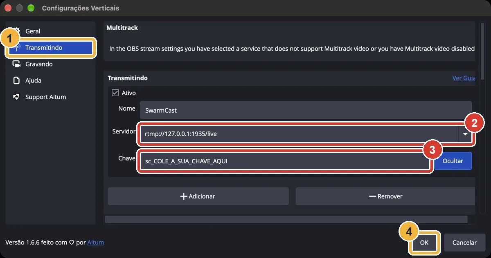

1. Engrenagem do Vertical → **Transmitindo**.
2. **Servidor:** `rtmp://127.0.0.1:1935/live`
3. **Chave:** cole a chave do painel do SwarmCast.
4. Clique em **OK**.

### 7. Som: o filme só no SwarmCast

O OBS mistura o som em até seis faixas. A Twitch recebe a faixa 1 e o SwarmCast, a faixa 2.

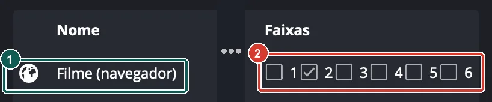

1. Abra **Editar** → **Propriedades de áudio avançadas** e ache o filme.
2. Deixe marcada só a faixa **2**. Microfone e jogo: só a faixa **1** (marque a 2 também se quiser falar com os membros).

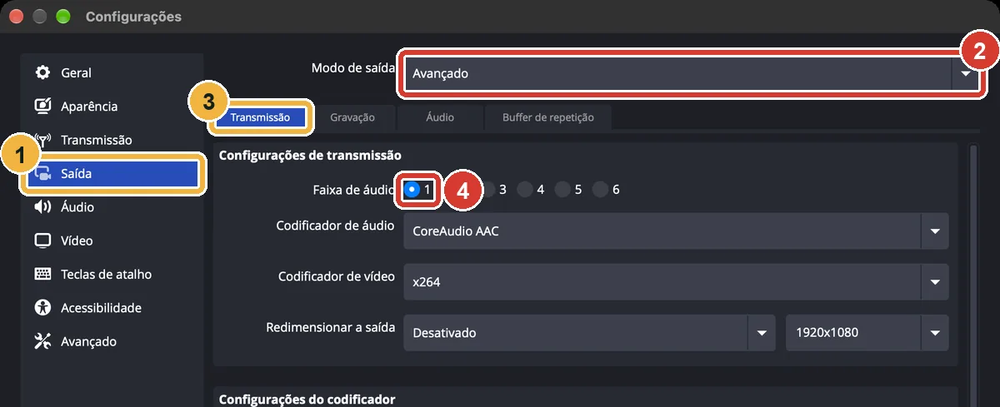

1. **Configurações** → **Saída**.
2. **Modo de saída:** **Avançado**.
3. Aba **Transmissão**.
4. **Faixa de áudio:** **1** (a da Twitch). Clique em **OK**.

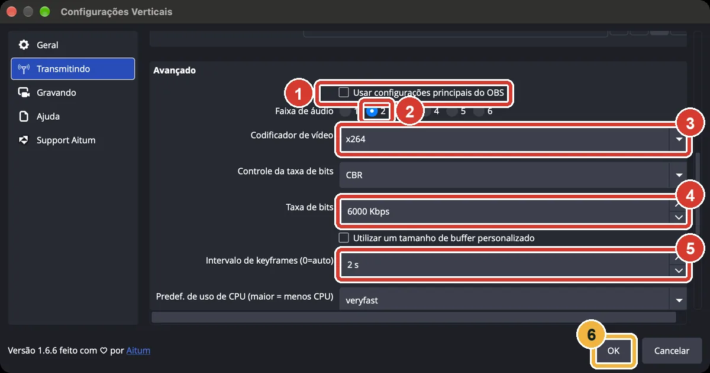

Engrenagem do Vertical → **Transmitindo**, role até **Avançado**:

1. Desmarque **Usar configurações principais do OBS**.
2. **Faixa de áudio:** **2**.
3. **Codificador de vídeo:** **x264**, ou **NVIDIA NVENC H.264** se você tiver placa de vídeo NVIDIA.
4. **Taxa de bits:** **6000** Kbps.
5. **Intervalo de keyframes:** **2 s**.
6. Clique em **OK**.

Se antes você usava o plugin Multiplas saídas para mandar ao SwarmCast, abra **Painéis → Multiplas saídas** e apague esse destino, para o OBS não mandar duas vezes.

### 8. Vá ao ar: dois botões

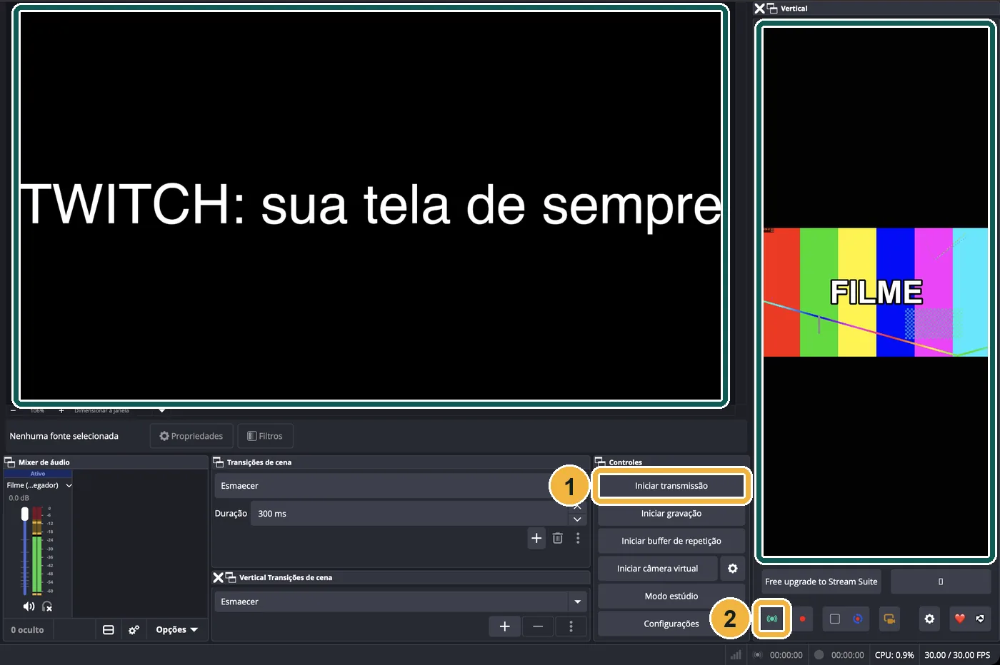

1. Twitch: **Iniciar transmissão**, como sempre.
2. SwarmCast: o botão verde de antena no painel **Vertical**.

Um botão não liga o outro. A prévia grande à esquerda é a Twitch; a estreita à direita é o SwarmCast (o painel é estreito, mas a live sai deitada).

## Só no SwarmCast

Sem outra plataforma? Use a saída normal do OBS.

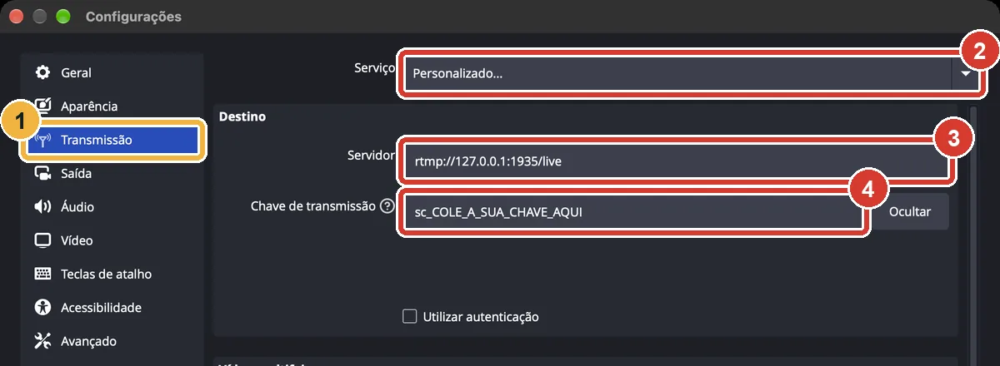

1. **Configurações** → **Transmissão**.
2. **Serviço:** **Personalizado...**.
3. **Servidor:** `rtmp://127.0.0.1:1935/live`
4. **Chave de transmissão:** cole a chave e clique em **OK**.

Ajuste também o [intervalo de keyframes para 2 s](/swarmcast/pt-br/start/obs/#4-intervalo-de-keyframes-de-2-segundos). Para voltar a transmitir em outra plataforma depois, escolha ela em **Configurações → Transmissão**.

## Conferir se funcionou

Comece a transmitir. Em poucos segundos o topo do painel do SwarmCast mostra **OBS: enviando**. Se continuar **OBS: ainda sem sinal**, veja os problemas comuns logo abaixo.

## Problemas comuns

- **OBS: ainda sem sinal.** O SwarmCast está aberto? O servidor está exatamente `rtmp://127.0.0.1:1935/live`? Copie a chave de novo no painel e cole. A saída do SwarmCast começou (**Iniciar** em Multiplas saídas, ou a antena no Vertical)?
- **"Não é possível reutilizar o codificador quando ele não está em transmissão ou gravação".** O Multiplas saídas reaproveita o vídeo da live principal: clique antes em **Iniciar transmissão**, ou marque **Sincronizar início com o OBS**.
- **"Erro: falha ao conectar ao servidor".** O SwarmCast está fechado ou a URL está errada.
- **Imagem preta no Mac.** Dê ao OBS a permissão de gravação de tela (veja o passo B4).
- **Os membros não ouvem nada** (jeito B). O filme tem que estar na faixa 2 e a transmissão do Vertical na faixa 2. No Windows, marque **Capturar áudio (BETA)**; no Mac, adicione uma **Captura de áudio do macOS**.
- **O som do filme vai para a Twitch** (jeito B). Desmarque a faixa 1 do filme em **Propriedades de áudio avançadas**.
- **O OBS fica lento ou perde quadros** (o jeito B codifica dois vídeos). Use um codificador da placa de vídeo (NVIDIA NVENC, AMD, Intel QuickSync ou Apple VT) e deixe a taxa de bits em 6000 ou menos.
- Mais ajuda: [Problemas e dúvidas](/swarmcast/pt-br/help/troubleshooting/#o-obs-não-conecta).

## O seu upload

Quando você também transmite na Twitch (ou em outra plataforma), marque **Também transmito em outra plataforma ao mesmo tempo** nas configurações do painel do SwarmCast. Assim o SwarmCast reserva o upload de uma live para a outra plataforma quando calcula quantas pessoas você consegue atender.

:::caution[Direitos autorais]
Só transmita o que você tem direito de exibir. Filme comercial, mesmo só para membros, pode violar direitos autorais.
:::

Imagens: OBS 33.0, Multiplas saídas 0.7.4.5 e Aitum Vertical 1.6.6, em português, num Mac. Próximo passo: [Fazer a live e mandar o link](/swarmcast/pt-br/live/go-live/).
