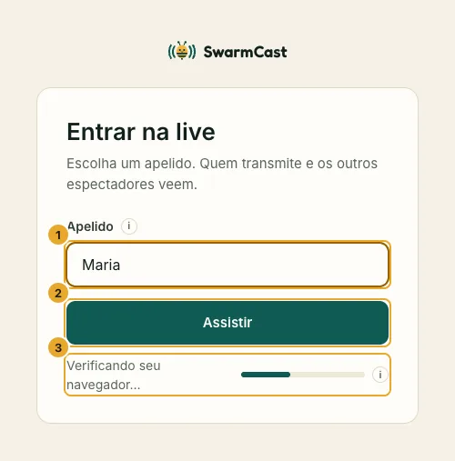
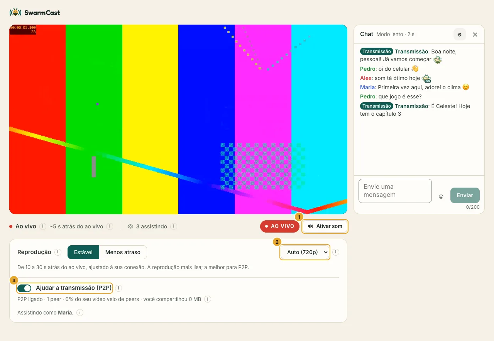

Alguém mandou um link do SwarmCast para você? Dá para assistir no navegador. **Sem app, sem conta, sem instalar nada.**

## Assistir

1. Abra o link num navegador atualizado: Chrome, Edge ou Firefox no computador, Chrome no Android ou Safari no iPhone e no iPad (iOS 17.1 ou mais novo).
2. Digite um **apelido** e clique em **Assistir**. Só quem faz a live vê o seu apelido; os outros espectadores não veem.

   

3. A live começa **sem som**, porque os navegadores bloqueiam o som até você clicar. Clique em **Ativar som**.

## Os controles

- **● AO VIVO / Ir para o ao vivo:** você fica uns 20 segundos atrás de quem transmite, o que é normal. Se ficou mais para trás, clique em **Ir para o ao vivo**.
- **Qualidade:** **Auto** escolhe a melhor qualidade que a sua internet aguenta sem travar. Você também pode escolher uma.
- **Reprodução: Estável ou Menos atraso.** **Estável** (o padrão) deixa mais vídeo guardado, então uma oscilação rápida da internet não trava a live. **Menos atraso** fica mais perto do ao vivo (uns 8 segundos), bom para conversar no chat, mas trava com mais facilidade.
- **Ajudar a transmissão (P2P):** vem desligada por padrão; você pode ligar (veja abaixo).

No celular, os mesmos controles ficam embaixo do vídeo:

## Ajudar a transmissão (P2P)

Ela fica desligada até você ligar. Com essa opção ligada, o seu navegador passa pedaços do vídeo para outros espectadores, a live fica mais lisa para todo mundo e a internet de quem transmite rende mais.

Bom saber: **outros espectadores que também estão com ela ligada conseguem ver o seu IP.** Isso só mostra a sua localização aproximada (cidade) e a sua operadora de internet. Não mostra o seu nome, o seu endereço nem nada do seu aparelho. Jogos online e chamadas de vídeo funcionam do mesmo jeito.

Você pode desligar quando quiser e continuar assistindo normalmente. A sua escolha fica salva. Ninguém consegue mandar vídeo adulterado para você: cada pedaço é conferido antes de tocar.

## Deu algum problema?

- **"Link inválido":** o link é antigo. Quem transmite ganha um link novo a cada live e pode trocar o link a qualquer momento. Peça o link atual.
- **A live está lotada:** quem transmite limitou quantas pessoas podem assistir ao mesmo tempo. Tente de novo daqui a pouco.
- **"A live acabou":** a live terminou. Valeu por assistir!
- **"Você foi removido":** quem transmite tirou você desta live.
- **Fica travando:** escolha uma qualidade menor ou a reprodução **Estável**.
- **"Navegador não suportado":** atualize o navegador ou abra o link no Chrome, Edge, Firefox ou Safari.

## A sua privacidade

A página da live não tem anúncios, rastreadores nem estatísticas. Ela só se conecta à live de quem transmite e, no P2P, aos outros espectadores e a um servidor da Cloudflare que ajuda os navegadores a se encontrarem (STUN).
