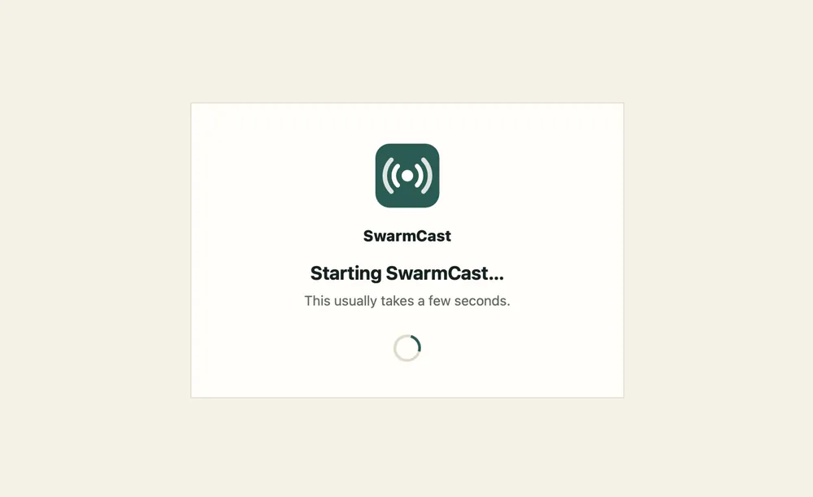
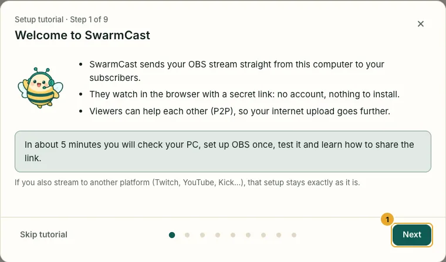
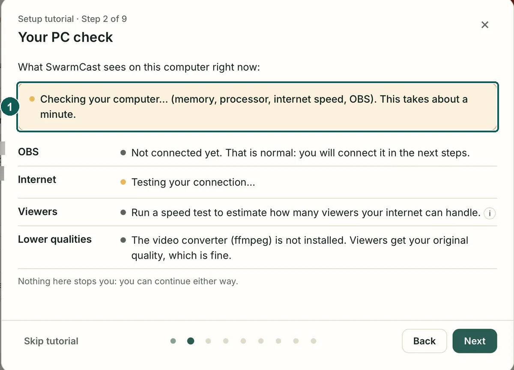
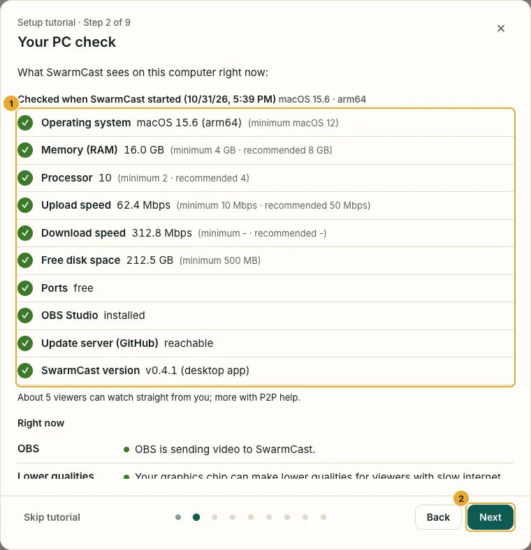
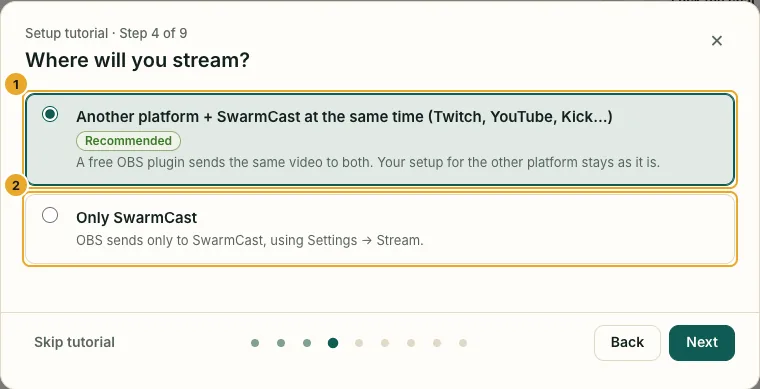
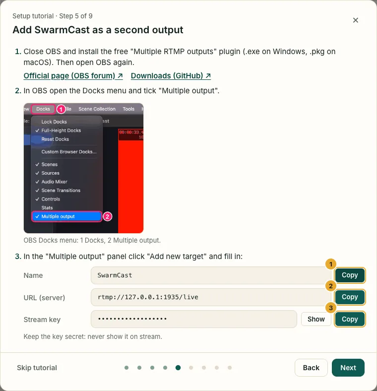
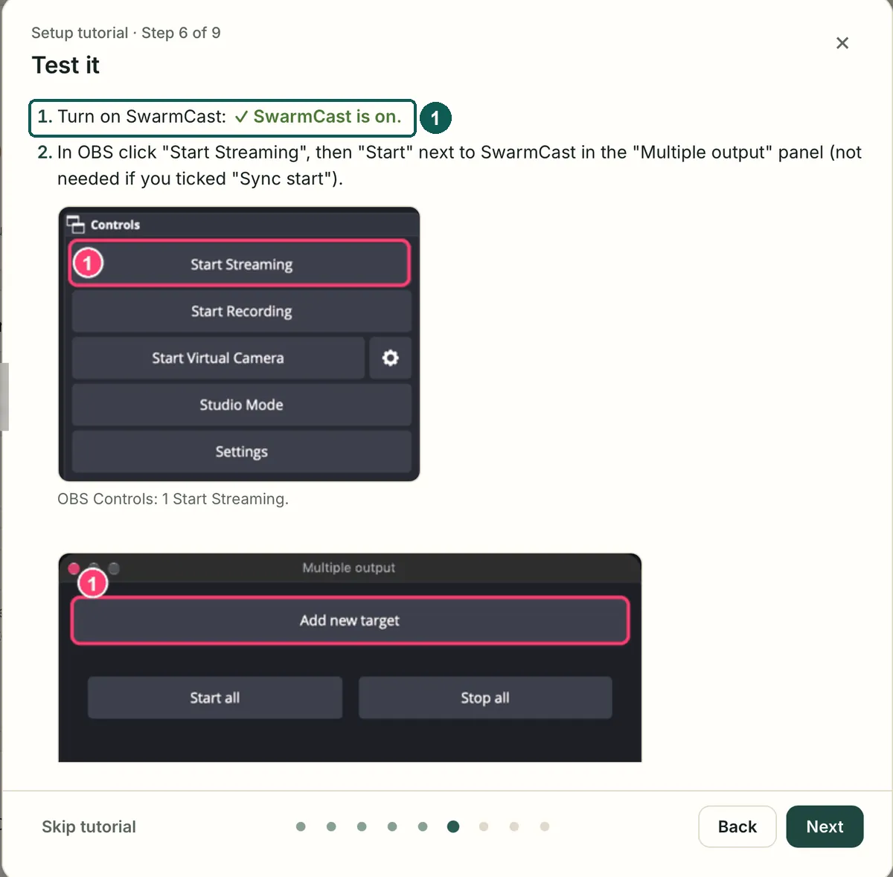
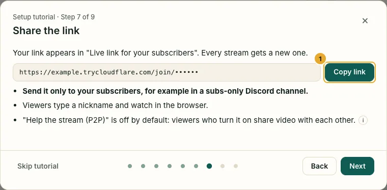
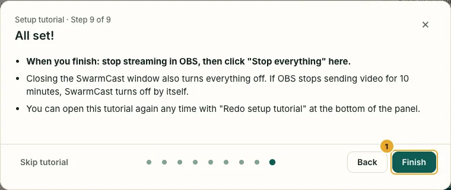
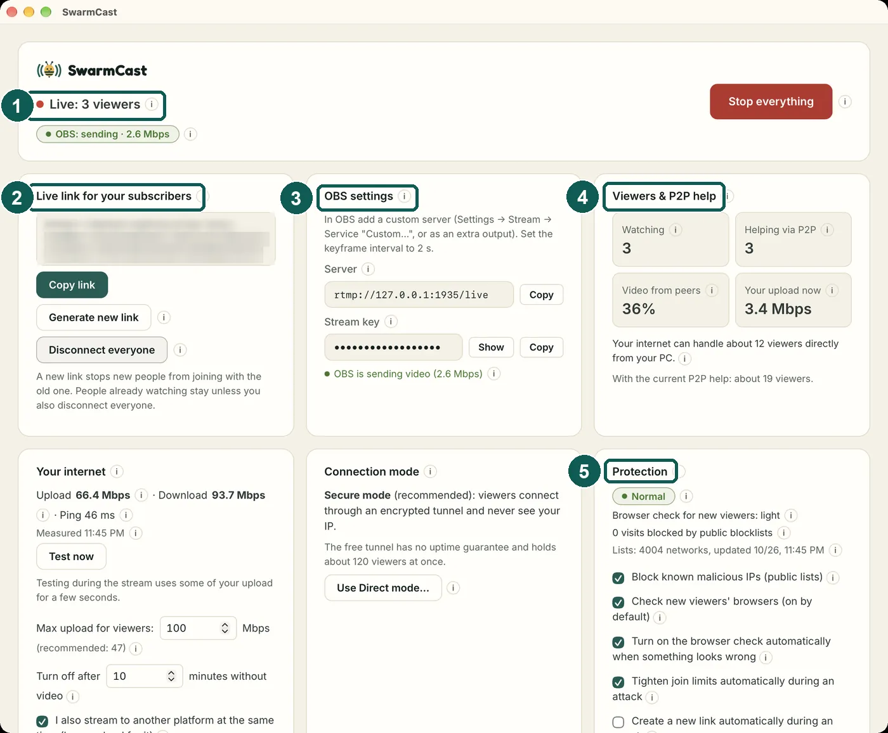

When you open SwarmCast you see the **panel**, the screen where you control your live. It runs only on your computer: nobody else can open it.

## 1. SwarmCast starts

The window shows **Starting SwarmCast…** for a few seconds, then the setup tutorial opens by itself.

## 2. The setup tutorial

About 5 minutes. Click **Next** to go on, **Back** to go back. **Skip tutorial** closes it (you can open it again later).

## 3. Your PC check

The first time, SwarmCast checks your computer. It shows **Checking your computer…** for about a minute.

A green tick means fine, a yellow one means it works but is not ideal. Nothing here stops you. At the same time SwarmCast downloads the free video converter (ffmpeg) for the smaller qualities.

## 4. OBS, once

Choose whether you also stream to Twitch, YouTube or Kick, or only to SwarmCast. The next steps show the OBS settings for that choice.

Use the **Copy** buttons and paste into OBS. The full walkthrough with OBS pictures: [Set up OBS](/swarmcast/start/obs/).

## 5. Test it and share the link

Start streaming in OBS. The tutorial shows when the video arrives.

Every live gets a new secret link. Send it only to your members.

Click **Finish**. To see the tutorial again, click **Redo setup tutorial** at the bottom of the panel.

## The panel

1. **At the top:** whether you are live, whether OBS is sending, and **Stop everything**.
2. **Live link for your subscribers:** the link to share. See [Go live](/swarmcast/live/go-live/).
3. **OBS settings:** the server and the stream key for OBS.
4. **Viewers & P2P help:** how many watch and how many help. See [Help the stream (P2P)](/swarmcast/live/p2p/).
5. **Live chat:** while you are live, the chat is right here, on the right (under the status in a narrow window): read, answer and moderate without scrolling. See [Chat](/swarmcast/live/chat/).

Further down: **Your internet**, **Connection mode**, **Protection** (see [Security and protection](/swarmcast/live/protection/)), **Quality for viewers**, **Desktop app** (start with the computer, updates), **Viewers** (kick someone), **Chat** (turn the chat on or off, chat settings), **Activity** and **Problem report** (send your logs). Most buttons have a small **ⓘ**: hover or tap it for an explanation.

## Where SwarmCast keeps your settings

Your settings, your stream key and the logs live in a SwarmCast folder in your user account. Updating SwarmCast never deletes it.

- Windows: `%LOCALAPPDATA%\SwarmCast`
- macOS: `~/Library/Application Support/SwarmCast`
- Linux: `~/.local/share/swarmcast`

Next: [Set up OBS](/swarmcast/start/obs/).
