You do this **only once**. SwarmCast works with [OBS Studio](https://obsproject.com/) (free). Your setup for Twitch, YouTube or Kick stays as it is.

## Which one do I need?

- **The same picture on Twitch and on SwarmCast** (your members see exactly what Twitch sees): [A. Same scene everywhere](/swarmcast/start/obs/#a-same-scene-everywhere), with the free **Multiple output** plugin. Easiest, and your PC encodes the video only once.
- **Something else for your members** (for example a movie in a browser window, while Twitch sees your usual scene): [B. A different scene for SwarmCast](/swarmcast/start/obs/#b-a-different-scene-for-swarmcast), with the free **Aitum Vertical** plugin. Your PC encodes two videos, so it needs more power.
- **Only SwarmCast, no other platform**: [Only SwarmCast](/swarmcast/start/obs/#only-swarmcast).

In the pictures, a **yellow** box means click, a **red** box means type or choose, and a **green** box means check. The numbers match the steps under each picture.

## Before you start

- **OBS Studio 30 or newer.** The pictures show OBS 33 on a Mac; on Windows the menus have the same names.
- **SwarmCast open.** In its panel, the **OBS settings** card has the two things you paste into OBS, each with a **Copy** button:
  - **Server:** `rtmp://127.0.0.1:1935/live`
  - **Stream key:** a long secret code. **Never show it on stream or in a screenshot.** Anyone with your key could send video to your SwarmCast. The keys in the pictures are fake.
- **Close OBS** before you install a plugin.

## A. Same scene everywhere

OBS on its own sends to one place only. The **Multiple output** plugin ([obs-multi-rtmp](https://github.com/sorayuki/obs-multi-rtmp), by sorayuki, open source) adds a second output that reuses your main stream's video.

### 1. Install the plugin

Download it from the plugin's [GitHub releases](https://github.com/sorayuki/obs-multi-rtmp/releases): take the newest release that is **not** marked "Pre-release".

- **Windows:** the file that ends in `windows-x64-Installer.exe`. Run it and click through.
- **Mac:** the file that ends in `macos-universal.pkg`. Open it and click through. If macOS says it cannot check the file, open **System Settings → Privacy & Security** and click **Open Anyway**.

### 2. Open the Multiple output panel

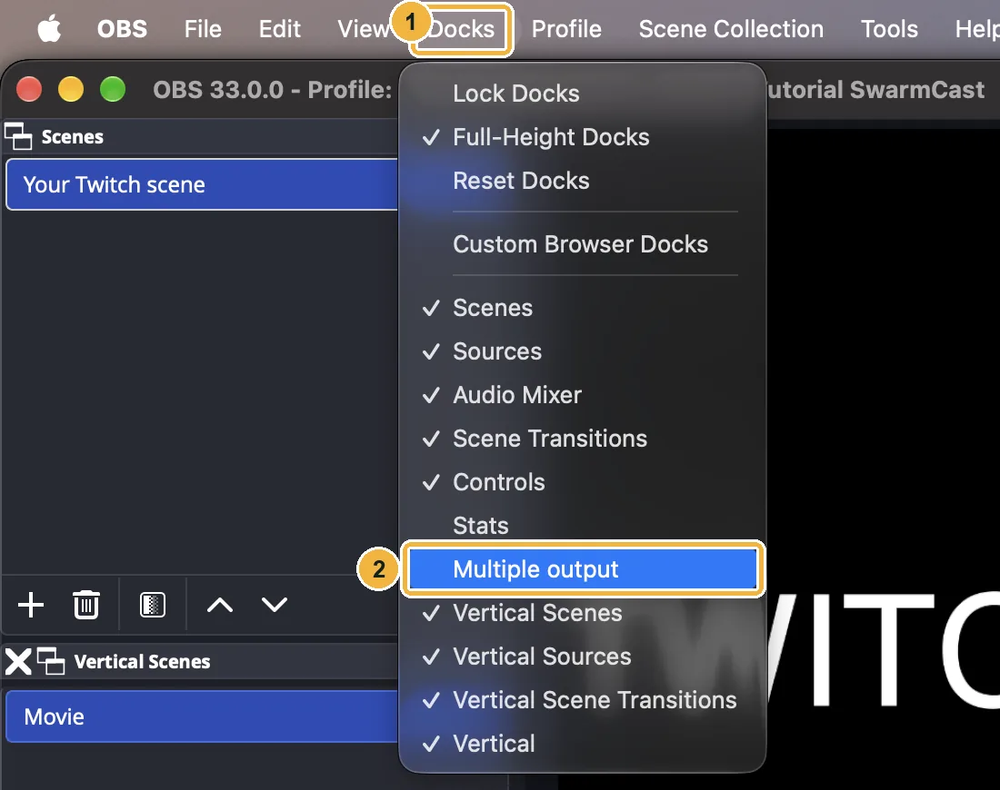

1. Open the **Docks** menu.
2. Click **Multiple output**. The panel may open as a small floating window: drag it onto the side of the OBS window if you like.

### 3. Add SwarmCast as a target

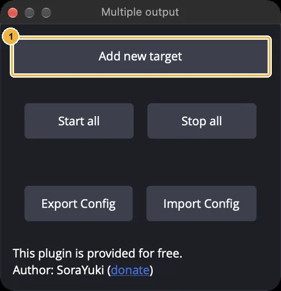

1. Click **Add new target**.

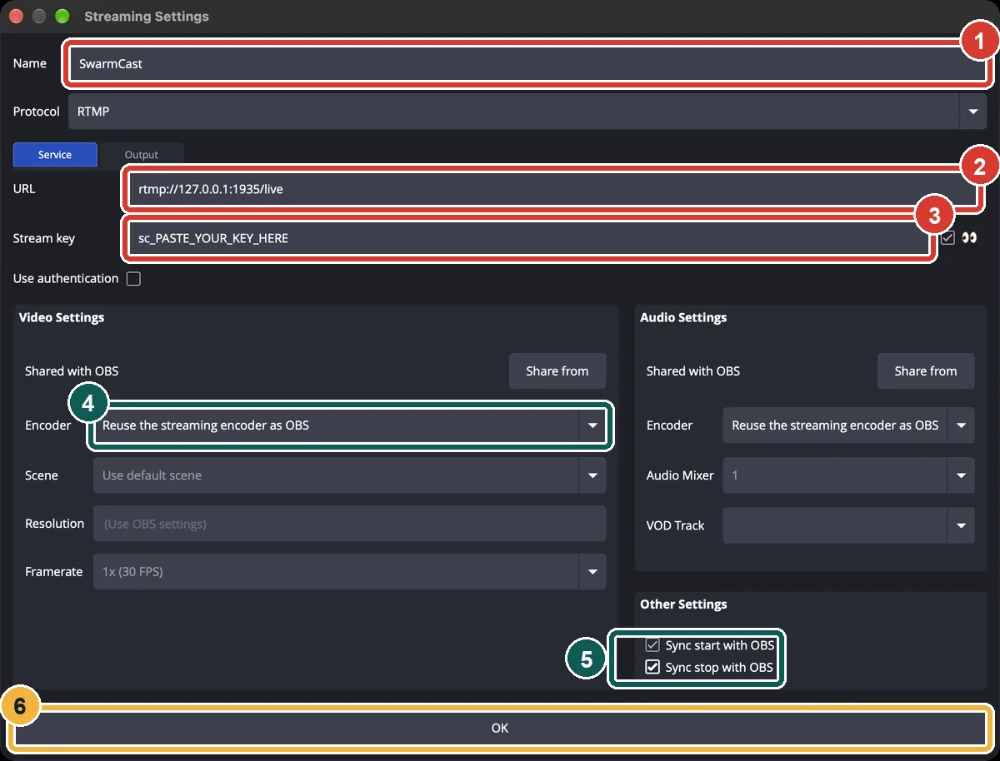

1. **Name:** `SwarmCast`.
2. **URL:** paste the server, `rtmp://127.0.0.1:1935/live`.
3. **Stream key:** paste the key from the SwarmCast panel.
4. **Encoder:** leave **Reuse the streaming encoder as OBS**. SwarmCast then gets the same video as Twitch, encoded only once.
5. Tick **Sync start with OBS** and **Sync stop with OBS**, so SwarmCast starts and stops with your Twitch stream.
6. Click **OK**.

### 4. Keyframe interval of 2 seconds

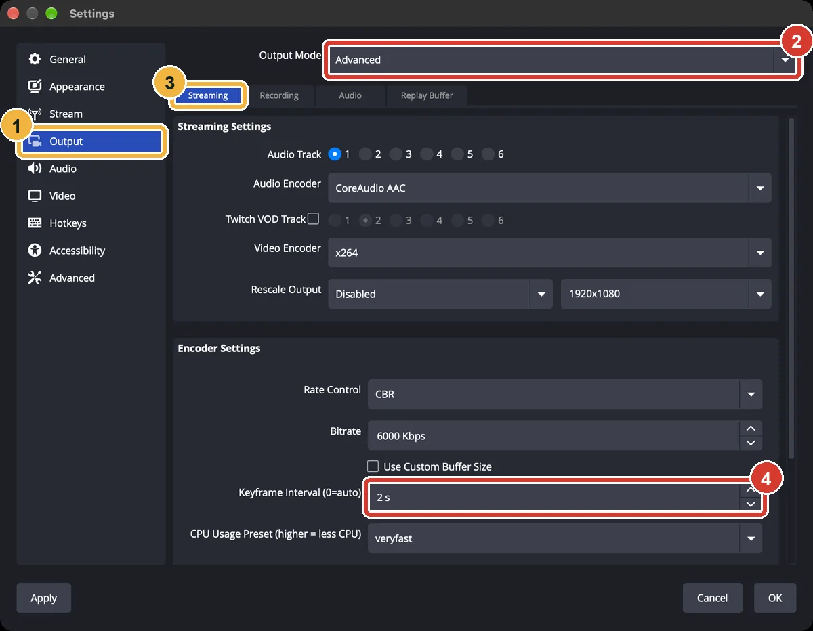

1. In OBS open **Settings** → **Output**.
2. **Output Mode:** choose **Advanced**.
3. Stay on the **Streaming** tab.
4. **Keyframe Interval:** type **2 s**, then click **OK**.

Viewers get the video in pieces that start at each keyframe, so 2 s means less delay and fewer pauses. Twitch, YouTube and Kick recommend 2 s too.

### 5. Go live

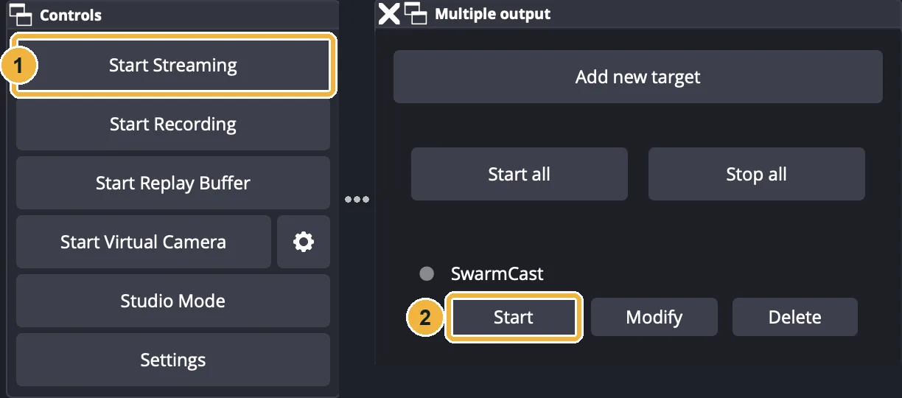

1. Click **Start Streaming**, as always. This is your Twitch stream.
2. With **Sync start** ticked, SwarmCast starts by itself. Without it, click **Start** next to SwarmCast.

Settings → Stream stays your Twitch (or other platform) setup. Now [check that it works](/swarmcast/start/obs/#check-that-it-works).

## B. A different scene for SwarmCast

Twitch keeps your usual scene. A second canvas with its own scene (here, a movie in a browser window) goes to SwarmCast. The plugin is **Aitum Vertical** ([aitum.tv](https://aitum.tv/), free). Despite the name, this second canvas is landscape, 1920x1080, like a normal stream.

### 1. Install Aitum Vertical

Download it from [aitum.tv](https://aitum.tv/) or its [GitHub releases](https://github.com/Aitum/obs-vertical-canvas/releases) and install it with OBS closed. Open OBS: the **Vertical**, **Vertical Scenes** and **Vertical Sources** panels appear. If they don't, tick them in the **Docks** menu.

### 2. A landscape canvas (1920x1080)

1. In the **Vertical** panel, click the gear.

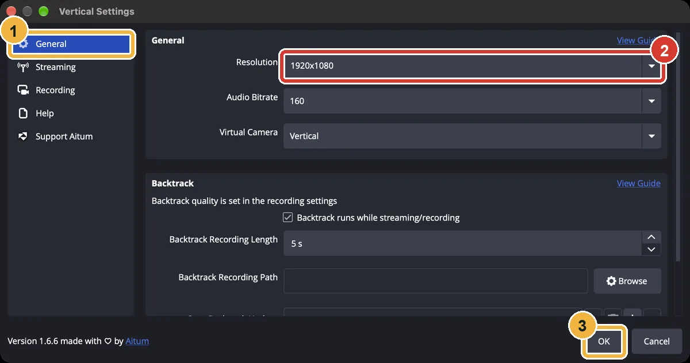

1. **General**.
2. **Resolution:** type `1920x1080` (with the letter x).
3. Click **OK**.

### 3. A "Movie" scene

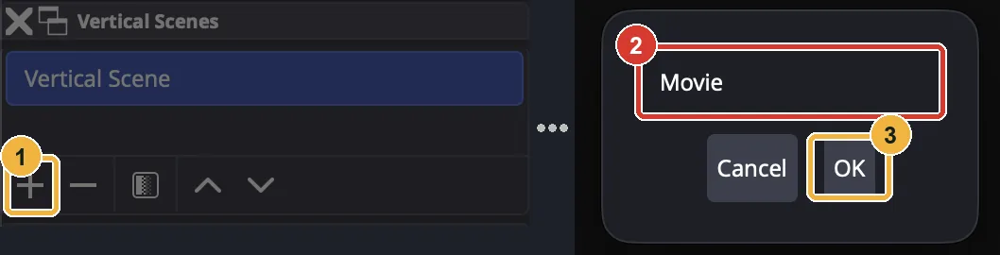

1. Under **Vertical Scenes**, click **+**.
2. Type `Movie`.
3. Click **OK**.

### 4. Add the browser window

Start the movie in your browser first.

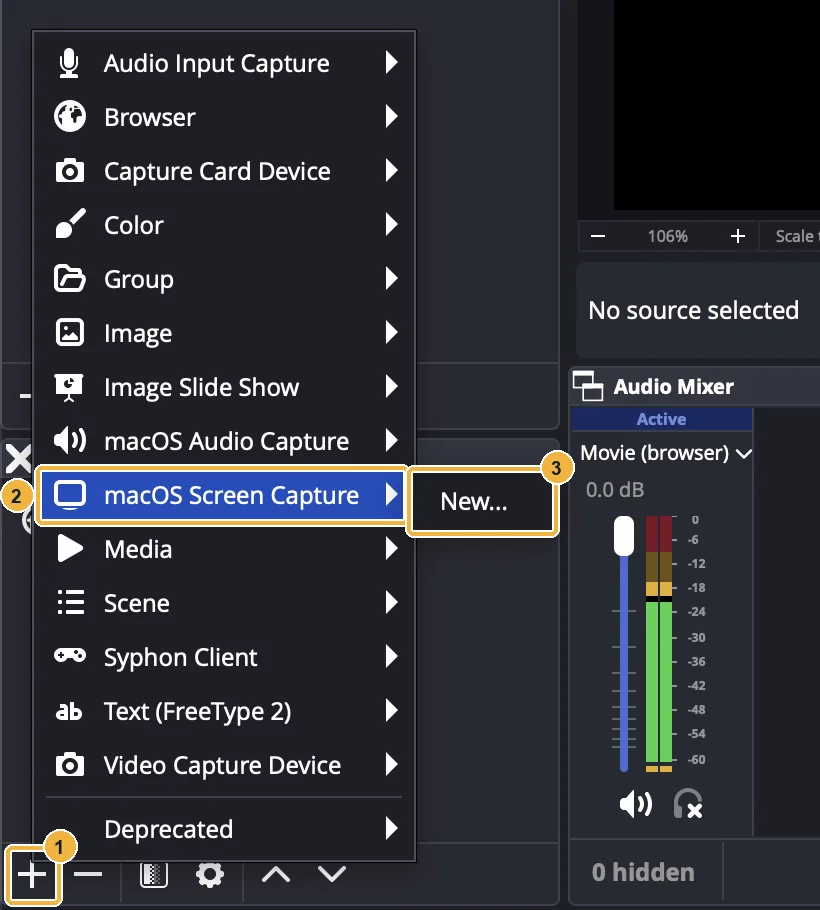

1. Under **Vertical Sources**, click **+**.
2. On a Mac: **macOS Screen Capture**. On Windows: **Window Capture**.
3. **New...**, then **OK**.

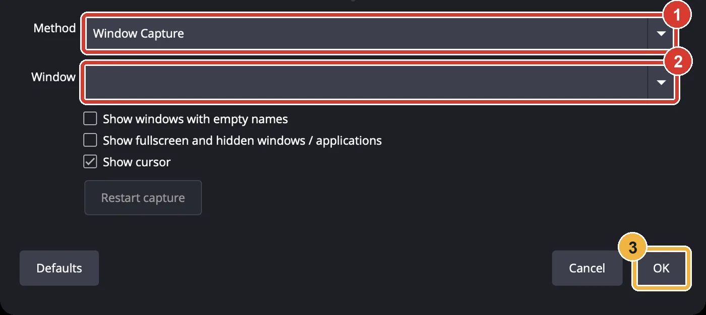

1. **Method:** **Window Capture** (only on a Mac).
2. **Window:** the browser window with the movie.
3. Click **OK**.

:::note[The movie's sound]
**Windows:** in the same Window Capture window, tick **Capture Audio (BETA)**.

**Mac:** that option does not exist. Also add **+** → **macOS Audio Capture** → method **Application Audio Capture** → your browser.
:::

:::note[Black picture on a Mac?]
Allow OBS in **System Settings → Privacy & Security → Screen & System Audio Recording**, then restart OBS. The OBS on the Mac used for these pictures did not have that permission, so the pictures show a **Browser** source playing a local test page instead. A movie file on your PC? Use **+** → **Media** instead.
:::

### 5. Fill the screen

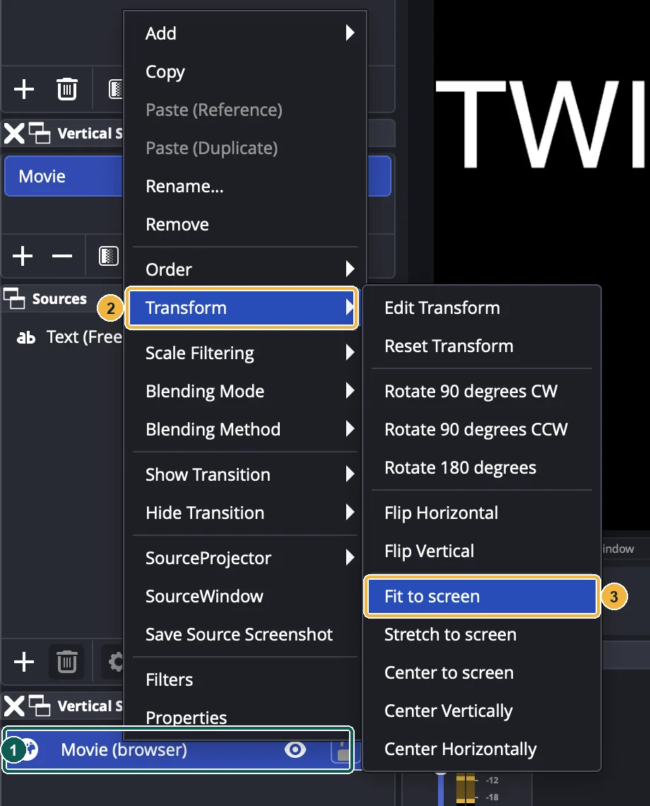

1. Right-click the source.
2. **Transform**.
3. **Fit to screen**. Put the browser in full screen (F11; on a Mac ⌃⌘F) so the address bar does not show.

### 6. Send the second canvas to SwarmCast

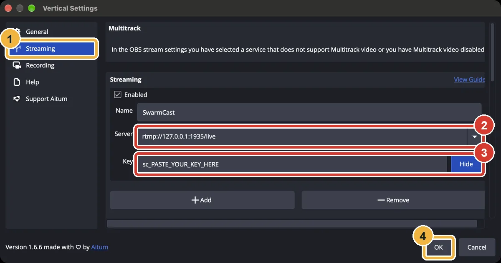

1. Vertical gear → **Streaming**.
2. **Server:** `rtmp://127.0.0.1:1935/live`
3. **Key:** paste the key from the SwarmCast panel.
4. Click **OK**.

### 7. Sound: the movie only on SwarmCast

OBS mixes sound into up to six tracks. Twitch gets track 1, SwarmCast gets track 2.

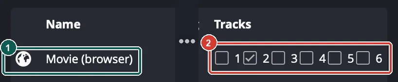

1. Open **Edit** → **Advanced Audio Properties** and find the movie.
2. Tick only track **2**. Your microphone and game: only track **1** (tick 2 too if you want to talk to your members).

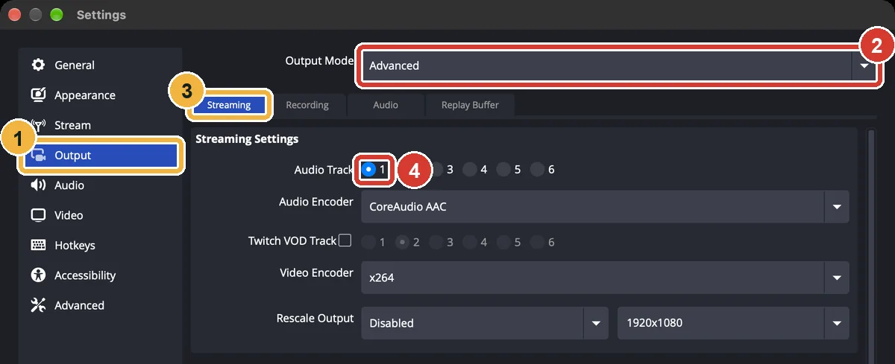

1. **Settings** → **Output**.
2. **Output Mode:** **Advanced**.
3. **Streaming** tab.
4. **Audio Track:** **1** (Twitch). Click **OK**.

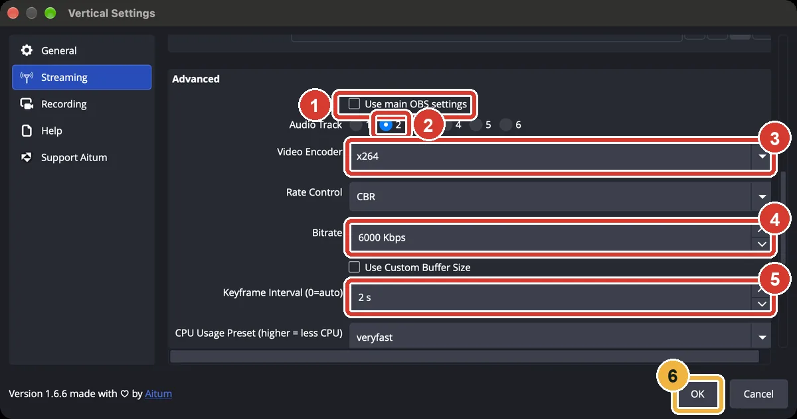

Vertical gear → **Streaming**, scroll down to **Advanced**:

1. Untick **Use main OBS settings**.
2. **Audio Track:** **2**.
3. **Video Encoder:** **x264**, or **NVIDIA NVENC H.264** if you have an NVIDIA graphics card.
4. **Bitrate:** **6000** Kbps.
5. **Keyframe Interval:** **2 s**.
6. Click **OK**.

If you used the Multiple output plugin for SwarmCast before, open **Docks → Multiple output** and delete that target, so OBS does not send twice.

### 8. Go live: two buttons

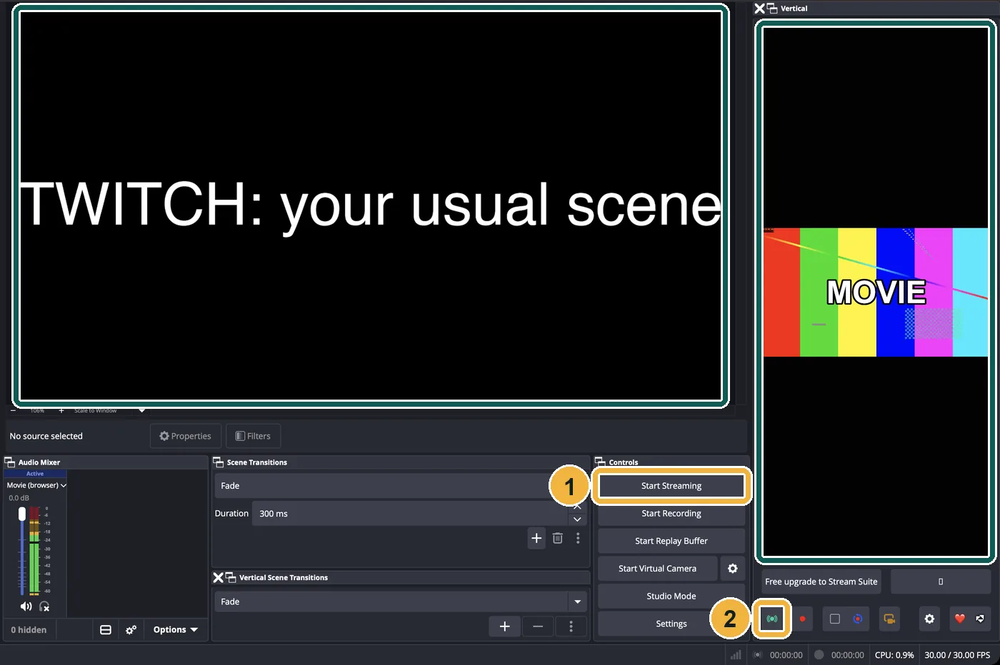

1. Twitch: **Start Streaming**, as always.
2. SwarmCast: the green antenna button in the **Vertical** panel.

One button does not start the other. The big preview on the left is Twitch; the narrow one on the right is SwarmCast (the panel is narrow, but the stream is landscape).

## Only SwarmCast

No other platform? Use the normal OBS output.

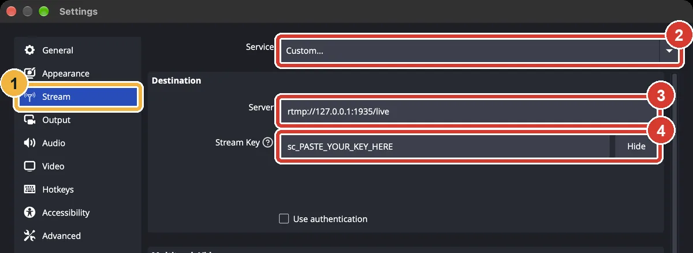

1. **Settings** → **Stream**.
2. **Service:** **Custom...**.
3. **Server:** `rtmp://127.0.0.1:1935/live`
4. **Stream Key:** paste the key and click **OK**.

Also set the [keyframe interval to 2 s](/swarmcast/start/obs/#4-keyframe-interval-of-2-seconds). To stream to another platform again later, pick it in **Settings → Stream**.

## Check that it works

Start streaming. After a few seconds the top of the SwarmCast panel shows **OBS: sending**. If it still says **OBS: not sending yet**, see the common problems below.

## Common problems

- **OBS: not sending yet.** Is SwarmCast open? Is the server exactly `rtmp://127.0.0.1:1935/live`? Copy the key again from the panel and paste it. Did the SwarmCast output start (**Start** in Multiple output, or the antenna in Vertical)?
- **"Cannot reuse encoder when it's not in streaming or recording".** Multiple output reuses your main stream's video: click **Start Streaming** first, or tick **Sync start with OBS**.
- **"Error: failed to connect to server".** SwarmCast is closed or the URL is wrong.
- **Black picture on a Mac.** Give OBS the screen recording permission (see step B4).
- **Members hear nothing** (method B). The movie must be on track 2 and the Vertical stream on track 2. On Windows tick **Capture Audio (BETA)**; on a Mac add a **macOS Audio Capture**.
- **The movie is heard on Twitch** (method B). Untick track 1 on the movie in **Advanced Audio Properties**.
- **OBS is slow or drops frames** (method B encodes two videos). Use a graphics card encoder (NVIDIA NVENC, AMD, Intel QuickSync or Apple VT) and keep the bitrate at 6000 or lower.
- More help: [Troubleshooting](/swarmcast/help/troubleshooting/#obs-cannot-connect).

## Your upload

When you also stream to Twitch (or another platform), tick **I also stream to another platform at the same time** in the SwarmCast panel settings. SwarmCast then keeps one stream's worth of upload for your other platform when it estimates how many viewers you can serve.

:::caution[Copyright]
Only stream what you have the right to show. A commercial movie, even for members only, can break copyright.
:::

Pictures: OBS 33.0, Multiple output 0.7.4.5 and Aitum Vertical 1.6.6, in English, on a Mac. Next: [Go live and share the link](/swarmcast/live/go-live/).
