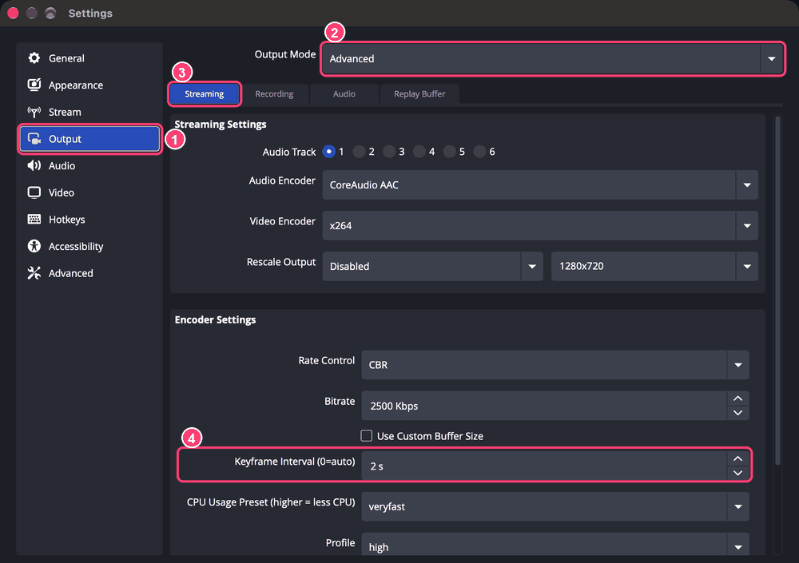
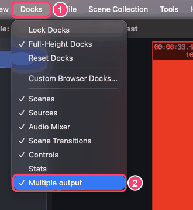
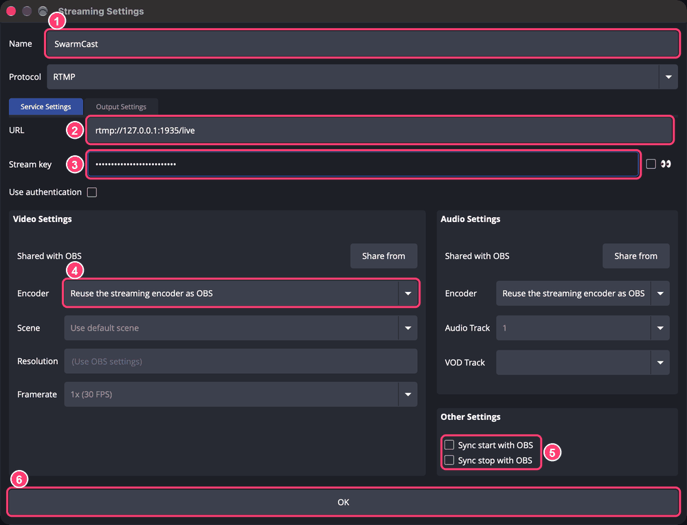
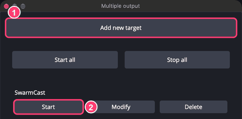
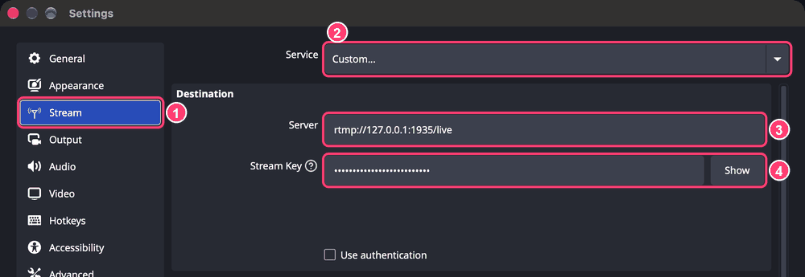

You do this **only once**. SwarmCast works with [OBS Studio](https://obsproject.com/) (free). What you already use for other platforms stays as it is.

You need two things from the SwarmCast panel, card **OBS settings**. Each one has a **Copy** button:

- **Server:** `rtmp://127.0.0.1:1935/live`
- **Stream key:** a long secret code. **Never show it on stream.** Anyone with your key could send video to your SwarmCast.

## Step 1 (always): keyframe interval of 2 seconds

1. In OBS open **Settings** → **Output**.
2. **Output Mode:** choose **Advanced**.
3. Stay on the **Streaming** tab.
4. **Keyframe Interval:** type **2 s**, then click **OK**.

Why: viewers get the video in pieces that start at each keyframe. Twitch, YouTube and Kick also recommend 2 s. The "Simple" mode makes pieces of about 8 seconds: more delay and more pauses.

## Step 2: choose how you stream

### A. Another platform and SwarmCast at the same time (recommended)

OBS on its own sends to one place only. The free **Multiple RTMP outputs** plugin (obs-multi-rtmp) adds a second output. Your setup for Twitch, YouTube or Kick stays as it is.

1. Close OBS. Download and install the plugin from its [official page on the OBS forum](https://obsproject.com/forum/resources/multiple-rtmp-outputs-plugin.964/) or its [GitHub releases](https://github.com/sorayuki/obs-multi-rtmp/releases). On Windows it is an `.exe` installer, on a Mac a `.pkg`.
2. Open OBS. A new panel called **Multiple output** appears. If you don't see it, open the **Docks** menu and tick **Multiple output**.

   

3. In that panel click **Add new target** and fill in:
   - **Name:** `SwarmCast` (any name works).
   - **URL (server):** the server from the SwarmCast panel.
   - **Stream key:** the key from the SwarmCast panel.
   - **Encoder:** choose to **reuse the streaming encoder** (it shares the encoder with your main stream, so your PC does not encode the video twice). The exact words can vary a little between plugin versions.
   - Optional: tick **Sync start** and **Sync stop** so it starts and stops together with your main stream.
   - Click **OK**.

   

4. **Don't change** Settings → Stream: that is still your other platform.

When you go live, click **Start Streaming** in OBS as usual and, in the **Multiple output** panel, **Start** next to SwarmCast (not needed with "Sync start").

### B. Only SwarmCast

1. In OBS open **Settings** → **Stream**.
2. **Service:** choose **Custom...**.
3. **Server:** paste the server from the SwarmCast panel.
4. **Stream Key:** paste the key, then click **OK**.

To stream to another platform again later, pick it in **Settings → Stream**.

## Check that it works

Start streaming in OBS. After a few seconds the top of the SwarmCast panel shows **OBS: sending**. If not, see [Troubleshooting](/swarmcast/help/troubleshooting/#obs-cannot-connect).

:::tip[Graphics card encoder]
In OBS, **Settings → Output → Video Encoder**, prefer a graphics card encoder (NVIDIA NVENC, AMD, Intel QuickSync or Apple VT) over x264. It leaves the processor free for your game and for SwarmCast.
:::

Next: [Go live and share the link](/swarmcast/live/go-live/).
