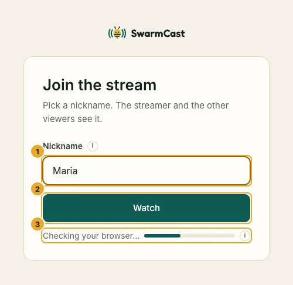
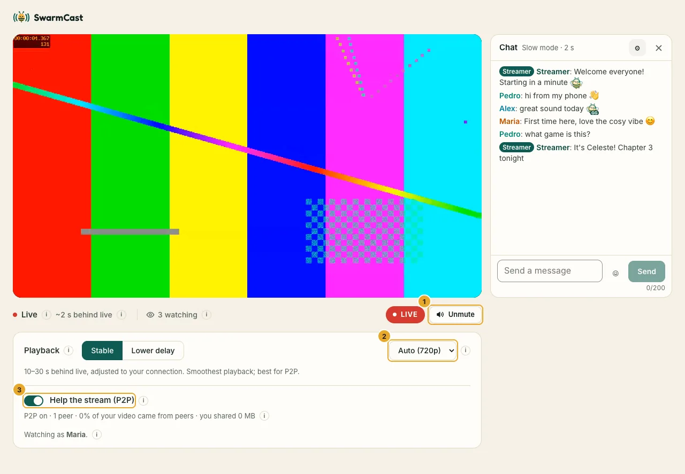
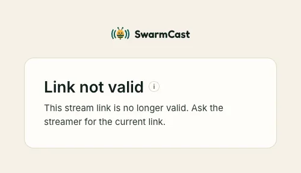

A streamer sent you a SwarmCast link? You can watch in your browser. **No app, no account, nothing to install.**

## Watch

1. Open the link in a current browser: Chrome, Edge or Firefox on a computer, Chrome on Android, or Safari on iPhone and iPad (iOS 17.1 or newer).
2. Type a **nickname** and click **Watch**. Everyone in the live sees it in the chat: 2 to 24 letters (from one alphabet), numbers, spaces, `-`, `_` or `.`, no emoji.

   

3. The live starts **muted**, because browsers block sound until you click. Click **Unmute**.

## The controls

- **● LIVE / Go live:** you are 10 to 30 seconds behind the streamer, which is normal. Next to it, "~14 s behind live" shows your delay: it adjusts itself to your connection (closer to live on steady internet, further back when it wobbles, so the video does not pause). If you fell behind, click **Go live**.
- **Quality:** **Auto** picks the best quality your internet can play without pausing. You can pick one yourself.
- **Audio only (saves data):** the last choice in the quality menu. You hear the live without the picture, and it uses much less data: about 85% less than 360p (roughly 50 to 70 MB per hour). Good on mobile data, or when you only want to listen. The video area shows the streamer's picture and name, or "Audio only". Pick a quality (or **Auto**) to see the picture again. Your browser remembers the choice for next time.
- **Playback: Stable or Lower delay.** **Stable** (default) keeps more video ready, so short internet hiccups do not pause it. **Lower delay** is closer to live (6 to 10 seconds), good for chatting, but pauses more easily.
- **Help the stream (P2P):** off by default; you can turn it on (see below).

On a phone the same controls sit under the video:

## The chat

Under the video (next to it on a computer) is the live's chat. Type a message and press Enter. Everyone in the live sees your nickname and your messages; the streamer's messages have a **Streamer** badge.

- **Hide chat** hides it on this device (your choice is remembered); **Show chat** brings it back.
- **Chat settings** lets you pick your name colour, show the times and make the text larger. Your colour is always shown readable for everyone.
- If a message is refused, a short note says why (slow mode, muted, too long…). The streamer can delete messages and mute people.
- **GIFs**, if the streamer turned them on, come from KLIPY, an outside service. A GIF first shows as "GIF from KLIPY. Tap to show GIFs…": your browser contacts KLIPY only after you tap it (or **Allow GIFs from KLIPY** in the GIF picker); KLIPY then sees your IP address. You can undo it in **Chat settings** (**Show GIFs**). Without that tap, nothing is loaded from outside.

## Help the stream (P2P)

It is off until you turn it on. With this switch on, your browser passes pieces of the video to other viewers, so the live runs smoother for everyone and the streamer's internet goes further.

Please know: **other viewers who also have it on can see your IP address.** That only shows your approximate location (city) and internet provider. It does not show your name, your home address or anything on your device. Online games and video calls work the same way.

You can turn it off at any time and keep watching normally. Your choice is remembered. Nobody can send you altered video: every piece is checked before it plays.

## Something is wrong?

- **"Link not valid":** the link is old. Streamers get a new link every live, and can replace it at any time. Ask the streamer for the current one.
- **"This stream is full":** the streamer limited how many people can watch at once. Try again later.
- **"The stream has ended":** the live is over. Thanks for watching!
- **"You were removed":** the streamer removed you from this live.
- **It keeps pausing:** choose a smaller quality, or **Stable** playback. On a very slow connection, **Audio only** keeps the sound going.
- **No "Audio only" in the menu:** the streamer's stream does not have its sound separate from the picture, so it cannot be played alone.
- **"Browser not supported":** update your browser, or open the link in Chrome, Edge, Firefox or Safari.

## Your privacy

The live page has no ads, no trackers and no analytics. It connects only to the streamer's live and, for P2P, to other viewers and to a Cloudflare server that helps browsers find each other (STUN). GIFs in the chat come from KLIPY only after you agree. Chat messages are never saved: they are gone when the live ends.
