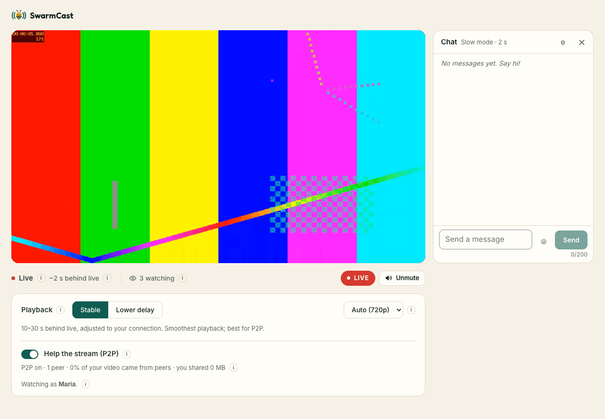
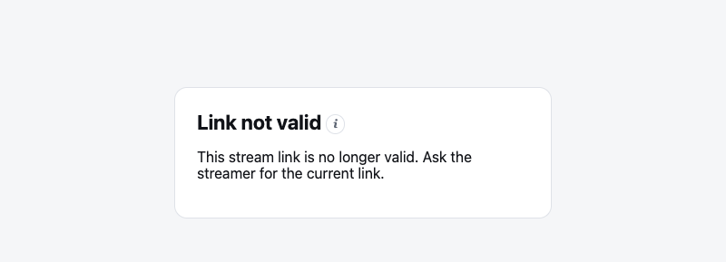

A streamer sent you a SwarmCast link? You can watch in your browser. **No app, no account, nothing to install.**

## Watch

1. Open the link in a current browser: Chrome, Edge or Firefox on a computer, Chrome on Android, or Safari on iPhone and iPad (iOS 17.1 or newer).
2. Type a **nickname** and click **Watch**. Only the streamer sees your nickname, not the other viewers.

   

3. The live starts **muted**, because browsers block sound until you click. Click **Unmute**.

## The controls

- **● LIVE / Go live:** you are about 20 seconds behind the streamer, which is normal. If you fell behind, click **Go live**.
- **Quality:** **Auto** picks the best quality your internet can play without pausing. You can pick one yourself.
- **Playback: Stable or Lower delay.** **Stable** (default) keeps more video ready, so short internet hiccups do not pause it. **Lower delay** is closer to live (about 8 seconds), good for chatting, but pauses more easily.
- **Help the stream (P2P):** on by default (see below).

## Help the stream (P2P)

With this switch on, your browser passes pieces of the video to other viewers, so the live runs smoother for everyone and the streamer's internet goes further.

Please know: **other viewers who also have it on can see your IP address.** That only shows your approximate location (city) and internet provider. It does not show your name, your home address or anything on your device. Online games and video calls work the same way.

You can turn it off at any time and keep watching normally. Your choice is remembered. Nobody can send you altered video: every piece is checked before it plays.

## Something is wrong?

- **"Link not valid":** the link is old. Streamers get a new link every live, and can replace it at any time. Ask the streamer for the current one.
- **"This stream is full":** the streamer limited how many people can watch at once. Try again later.
- **"The stream has ended":** the live is over. Thanks for watching!
- **"You were removed":** the streamer removed you from this live.
- **It keeps pausing:** choose a smaller quality, or **Stable** playback.
- **"Browser not supported":** update your browser, or open the link in Chrome, Edge, Firefox or Safari.

## Your privacy

The live page has no ads, no trackers and no analytics. It connects only to the streamer's live and, for P2P, to other viewers and to a Cloudflare server that helps browsers find each other (STUN).
