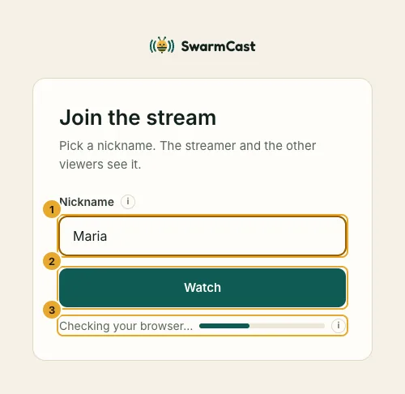
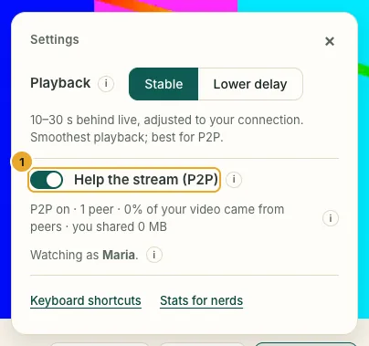
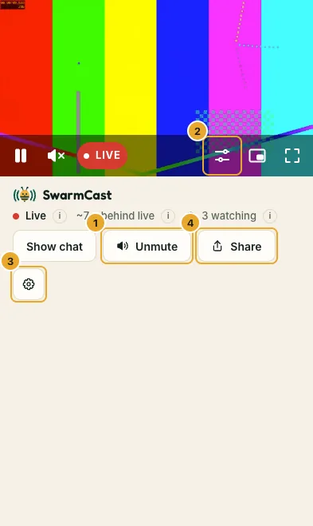
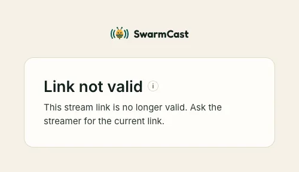

A streamer sent you a SwarmCast link? You can watch in your browser. **No app, no account, nothing to install.**

## Watch

1. Open the link in a current browser: Chrome, Edge or Firefox on a computer, Chrome on Android, or Safari on iPhone and iPad (iOS 17.1 or newer).
2. Type a **nickname** and click **Watch**. Everyone in the live sees it in the chat: 2 to 24 letters (from one alphabet), numbers, spaces, `-`, `_` or `.`, no emoji.

   

3. The live starts **muted**, because browsers block sound until you click. Click **Unmute**.

## The controls

A bar along the bottom of the video has the player's buttons. It looks the same in every browser, and it fades out while the live plays: move the mouse over the video, tap the video, or press Tab to bring it back. (If you asked your device for **reduced motion**, it stays.) From left to right:

- **Play / Pause** (a big **Play** button also shows in the middle while the video is paused), and **Mute / Unmute** with the **volume** slider. Phones have no slider: use the volume buttons of the phone.
- **● LIVE / Go live:** you are 10 to 30 seconds behind the streamer, which is normal. Next to it, "~14 s behind live" shows your delay: it adjusts itself to your connection (closer to live on steady internet, further back when it wobbles, so the video does not pause). If you fell behind, click **Go live**.
- **Quality** (on the right of the bar): **Auto** picks the best quality your internet can play without pausing. You can pick one yourself.
- **Audio only (saves data):** the last choice in the quality menu. You hear the live without the picture, and it uses much less data: about 85% less than 360p (roughly 50 to 70 MB per hour). Good on mobile data, or when you only want to listen. The video area shows the streamer's picture and name, or "Audio only". Pick a quality (or **Auto**) to see the picture again. Your browser remembers the choice for next time.
- **Settings** (the gear under the video): Playback, Help the stream (P2P), your nickname, Keyboard shortcuts and Stats for nerds. Esc, a click outside or × closes it.

  

- **Playback: Stable or Lower delay** (in **Settings**). **Stable** (default) keeps more video ready, so short internet hiccups do not pause it. **Lower delay** is closer to live (6 to 10 seconds), good for chatting, but pauses more easily.
- **Help the stream (P2P)** (in **Settings**): off by default; you can turn it on (see below).
- **Share:** sends the link of this live to a friend. On a phone it opens your share menu (WhatsApp, Messages…); on a computer it copies the link and says **Link copied**, so you can paste it in a message. Your friend opens the link and picks a nickname, like you did. The button is there only if the streamer allows it, and it goes away when the streamer makes a new link.

- **Picture-in-picture** (only where your browser has it, such as Chrome, Edge and Safari): the video in a small window that stays on top while you use other apps or tabs.
- **Theater mode** (on a computer): the video takes the whole height of the window too, with black around it and the chat still next to it; the streamer's name and the rest are a scroll away. Click it again to go back; your browser remembers the choice.
- **Full screen:** the video fills the screen, with the same bar (and how far behind live you are) on top of it. Press it again, or Esc, to go back. On computers, Android, iPad and iPhones with a recent iOS, the page's bar stays in full screen. **On an iPhone with an older iOS** the browser only lets the video itself go full screen: the iPhone's own player opens, with its own buttons instead of SwarmCast's (no Go live or quality there). Close that player and the page's buttons are back.

The quality menu, Go live and Unmute work with the keyboard and screen readers too: every button has a name, and the menu opens with Enter and moves with the arrow keys.

While the live plays, your phone or computer **keeps the screen on**, so it does not dim or lock in the middle of the stream (pause and it can sleep again). With the sound on, your phone's **lock screen** and notifications show the streamer's name and picture with a play / pause button.

On a phone the video is at the top with the bar over its bottom, the other controls under it, and the chat fills the rest of the screen:

### Keyboard shortcuts

On a computer you can control the live from the keyboard:

| Key | What it does |
| --- | --- |
| Space or K | Play or pause |
| M | Sound on or off |
| F | Full screen, with the controls (Esc leaves it) |
| T | Theater mode |
| G | Go live |
| I | Picture-in-picture (the video in a small window), where your browser has it |
| C | Go to the chat box |
| S | Stats for nerds |
| ? | The list of shortcuts |

They do nothing while you type, so writing in the chat is safe. **Keyboard shortcuts**, in **Settings** under the video, shows the list and a switch to turn them off (for example if you use voice control); your browser remembers it.

### Stats for nerds

Curious about what the player is doing? **Stats for nerds**, in **Settings** under the video, opens a small panel on top of the video: the resolution and quality, the internet speed the player measures, how many seconds of video are loaded ahead, how far behind live you are, dropped frames, how much video came from other viewers (P2P) and what you sent them, and your connection type when the browser tells it. The numbers update every second. Press Esc or × to close it; **Copy** copies the lines, for example to send them to the streamer when something goes wrong. It never shows your address or anyone else's.

## The chat

Next to the video on a computer (a column as tall as the window) and under it on a phone is the live's chat. Type a message and press Enter. Everyone in the live sees your nickname and your messages; the streamer's messages have a **Streamer** badge.

- **Reply** to a message with the button that shows when you point at it (tap it on a phone; from the keyboard, the arrow keys go through the messages): your answer shows a short quote of it. Type **@** to mention someone who wrote in the chat; a message that mentions you is marked for you only, without any sound (you can turn the mark off in **Chat settings**).
- **Polls and predictions** from the streamer show above the chat messages: tap an answer to vote. Your vote is final and anonymous (one per browser), and the results show live. On a phone the poll starts folded to one line: tap it to open it. Type **/help** in the chat box for a short list of what you can do.
- **Chat on the video**: in full screen, the chat button in the video's bar (or **Chat on the video in full screen** in **Settings**) shows the latest messages over the bottom left of the video for a few seconds each, above the controls. The small chat button there opens the message box, so you can write and react without leaving full screen. It is off until you turn it on, and your browser remembers the choice. On an iPhone with an older iOS, the full-screen button then fills the browser window with the video instead of opening the iPhone's own player (which cannot show the chat).
- **Reactions**: tap the bee next to the message box and pick one (Love, Fire, GG…): it floats over the video for everyone for a moment. Everyone's reactions float by too; **Show reactions on the video** in **Chat settings** hides them on your screen (remembered). If your device is set to reduce motion, a small counter in the corner of the video counts them instead.
- **Hide chat** hides it on this device (your choice is remembered); **Show chat** brings it back.
- **Chat settings** lets you pick your name colour, show the times and make the text larger. Your colour is always shown readable for everyone.
- If a message is refused, a short note says why (slow mode, muted, too long…). The streamer can delete messages and mute people.
- **GIFs**, if the streamer turned them on, come from KLIPY, an outside service. A GIF first shows as "GIF from KLIPY. Tap to show GIFs…": your browser contacts KLIPY only after you tap it (or **Allow GIFs from KLIPY** in the GIF picker); KLIPY then sees your IP address. You can undo it in **Chat settings** (**Show GIFs**). Without that tap, nothing is loaded from outside.

## Help the stream (P2P)

It is off until you turn it on. With this switch on, your browser passes pieces of the video to other viewers, so the live runs smoother for everyone and the streamer's internet goes further.

Please know: **other viewers who also have it on can see your IP address.** That only shows your approximate location (city) and internet provider. It does not show your name, your home address or anything on your device. Online games and video calls work the same way.

You can turn it off at any time and keep watching normally. Your choice is remembered. Nobody can send you altered video: every piece is checked before it plays.

## Something is wrong?

- **"Link not valid":** the link is old. Streamers get a new link every live, and can replace it at any time. Ask the streamer for the current one.
- **"This stream is full":** the streamer limited how many people can watch at once. Try again later.
- **"The stream has ended":** the live is over. Thanks for watching!
- **"You were removed":** the streamer removed you from this live.
- **It keeps pausing:** choose a smaller quality, or **Stable** playback. On a very slow connection, **Audio only** keeps the sound going.
- **No "Audio only" in the menu:** the streamer's stream does not have its sound separate from the picture, so it cannot be played alone.
- **"Browser not supported":** update your browser, or open the link in Chrome, Edge, Firefox or Safari.

## Your privacy

The live page has no ads, no trackers and no analytics. It connects only to the streamer's live and, for P2P, to other viewers and to a Cloudflare server that helps browsers find each other (STUN). GIFs in the chat come from KLIPY only after you agree. Chat messages are never saved: they are gone when the live ends.
